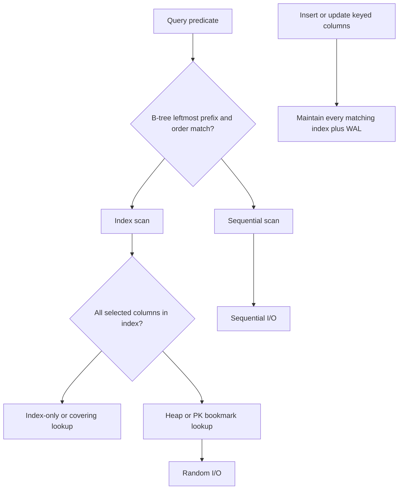

An index is a derived structure that answers a lookup without scanning the heap. The common one is a B-tree (B+ tree in most engines): sorted keys, log-height, good for equality and ranges. A query that matches the tree's order uses the index. A query that does not will scan, or will use a different index, or will use the index as a random pile of row pointers that is slower than a sequential heap scan. Indexing is matching a tree to a predicate, not sprinkling `CREATE INDEX` on every column.

Write amplification is the tax. Every insert, update of a keyed column, and delete must maintain each index that includes the row. Five secondary indexes are five extra trees to update, plus WAL for those pages, plus fragmentation and vacuum or optimize later. Read-heavy OLTP loves covering indexes. Write-heavy ingestion hates them. An index that is never used in `EXPLAIN` is pure write tax.

The clustered index versus heap decision changes everything in MySQL InnoDB. The primary key is the table: rows live in primary-key order. A secondary index stores the secondary key plus the primary key as the pointer. A fat primary key is copied into every secondary index. PostgreSQL stores rows in a heap and indexes point at tuple locations (with MVCC complications and index-only scans when visibility maps allow). Copying advice from InnoDB to PostgreSQL or the reverse is how you get a schema that is fast in one engine and painful in the other.

You cannot index your way out of a query that must read most of the table. Selectivity matters. An index on `status` with three values and an even distribution will not help `WHERE status = 'active'` if 90% of rows are active. The planner will scan. That is not a bug. It is the planner refusing a random I/O storm.

## Concept

### B-tree and the query it serves

A B-tree index keeps keys in sorted order with a high fanout so depth stays small. Equality (`WHERE id =`) is a descent to a leaf. A range (`WHERE created_at > ... ORDER BY created_at`) can walk the leaf linked list (B+ tree). A leading-column match on a composite index `(a, b, c)` supports `a`, `a,b`, and `a,b,c` predicates. It does not support `b` alone, unless you have a skip-scan implementation and the planner thinks it is worth it. PostgreSQL and MySQL generally need the leftmost prefix.

Order by and group by can use the same order as the index and skip a sort. A mismatch (`ORDER BY created_at DESC` on an `ASC` index) may still work if the engine can scan backward. A mismatch on a different column will sort in memory or on disk.

Covering indexes (include columns, or extra columns in the index) let the engine answer from the index without visiting the heap. PostgreSQL index-only scans need the visibility map to say the heap page is all-visible. InnoDB covering secondary indexes avoid the primary-key lookup. If `SELECT` asks for a column not in the index, you pay the bookmark lookup. That lookup is random I/O. A thousand lookups can lose to a sequential scan.

Hash indexes exist (PostgreSQL hash, Memory engine, some adaptive structures). They answer equality, not ranges. In InnoDB you almost always mean B-tree. In PostgreSQL, btree is the default and the one you should know first. GIN and GiST are for arrays, JSON, and full text; they are indexes, they have write cost, they are not B-trees, and they need their own `EXPLAIN` literacy.

### Clustered primary keys (InnoDB) versus heap (PostgreSQL)

InnoDB: the table is a B-tree on the primary key. Inserts in primary-key order (monotonic ids) append to the right edge. Inserts with random UUIDs as primary keys scatter, split pages, and bloat. Secondary indexes do not store a row pointer; they store the PK. A UUID PK of 16 bytes (or a 36-byte string) inflates every secondary index. Integer surrogate keys stay popular for this reason, with a unique index on the natural UUID if you must expose one.

PostgreSQL: heap plus indexes. The primary key is a unique index, not the table layout. `CLUSTER` can rewrite the heap in index order once; it does not keep it clustered. HOT updates can avoid index maintenance when indexed columns do not change. Index-only scans and BRIN (block range) indexes are PostgreSQL-specific tools. BRIN wins on columns that correlate with physical order, such as a monotonically increasing `created_at` on an append-mostly table.

Choosing a primary key is an indexing decision in InnoDB and a uniqueness decision in PostgreSQL. State the engine before you copy a schema from a blog.

### Write amplification, bloat, and maintenance

Each index is a tree of pages. A write that touches an indexed column dirties index pages, writes WAL, and may split a page. Bulk loads are faster with indexes dropped and rebuilt, if you can take the window. Online index builds (`CREATE INDEX CONCURRENTLY` in PostgreSQL, `ALGORITHM=INPLACE` in MySQL) exist because the naive build locks more than you want.

Bloat: deleted keys leave space; MVCC leaves versions. PostgreSQL `VACUUM` and `autovacuum` reclaim. MySQL InnoDB purge and optimize reclaim. An index on a high-churn column (status flags that flip, session tables) can be larger and slower than a scan of a smaller heap. Partial indexes (`WHERE` clause on the index in PostgreSQL) exclude the rows you will never query, which cuts write tax and size.

Unused indexes still cost writes. `pg_stat_user_indexes` and MySQL `sys.schema_unused_indexes` (or performance_schema) exist so you can drop them. Dropping an index that a nightly job needs will surprise you on Monday; check `EXPLAIN` of the known query set, not only OLTP.

### What the planner actually does

`EXPLAIN (ANALYZE, BUFFERS)` is the instrument. You care about whether an index was used, how many rows were estimated versus actual, and whether a sort or a heap fetch dominated. A sequential scan is not always a failure. A nested loop with a bad estimate is. Statistics (ANALYZE, histograms) drive estimates. Stale stats after a bulk load cause bad plans.

Composite index column order is the query, not a guess. `(tenant_id, created_at)` serves a tenant's time range. `(created_at, tenant_id)` serves a global time range and is weak for one tenant unless created_at is extremely selective. Equality columns before range columns is the usual rule when both appear.

## Trade-offs

| Approach | When it wins | Cost / risk |
| -------- | ------------ | ----------- |
| B-tree on PK / equality / range | Point lookups and ordered ranges the tree can walk | Random UUID PKs in InnoDB; leftmost-prefix misses; write amplification |
| Covering / include index | Hot read path that would otherwise heap-fetch | Wider leaves, more write cost; wasted if `SELECT` list grows |
| Partial, hash, GIN/GiST, BRIN | Sparse predicates, equality-only, JSON/text, append-only time columns | Engine-specific; easy to create and never use; maintenance jobs |

Add an index for a query you can show in `EXPLAIN`, with a selectivity story, and with a write-rate you can afford. Do not add one for a column because it appears in a `WHERE` once in a report that runs on a replica. Revisit indexes when the query changes; an index is part of the application's ABI to the planner.

## Diagram

## Failure modes

### Index does not match the predicate

**Detection.** `EXPLAIN` shows sequential scan on a large table. The index exists on `(b, a)` and the query filters `WHERE a =`. Or a function wraps the column (`WHERE DATE(created_at) =`) and the index is on `created_at`. Or the leading column is missing from the `WHERE`. Row estimates may still look plausible; the plan will not use the tree.

**Mitigation.** Rewrite the predicate to match the index (`created_at >= day AND created_at < day+1`). Change the index order to the query you actually run. Add an expression index if you must wrap the column. Confirm with `EXPLAIN ANALYZE` after, not with "we added an index" in the PR description.

### Write amplification and insert stalls

**Detection.** Insert and update latency rise as secondary indexes grow. WAL volume tracks index count. Page splits show up as latency spikes on random PK inserts (UUID in InnoDB). Bulk import with all indexes live is many times slower than import-then-build.

**Mitigation.** Drop unused indexes. Use an integer clustered PK in InnoDB if the table is insert-heavy. Load in PK order. Defer non-essential indexes until after bulk load. Partial indexes for sparse predicates. Stop indexing every JSON field "for later."

### Bookmark lookup storm

**Detection.** The plan is an index scan plus a heap fetch or PK lookup per row, returning tens of thousands of rows. Disk is busy with random reads. A sequential scan would have been cheaper. The index was non-covering and the query was not selective enough.

**Mitigation.** Make the index covering for that query, or add a filter that is actually selective, or accept a sequential scan. Limit the result set. Pagination with a keyset on the indexed column beats `OFFSET` that still walks the tree.

### Stale statistics and plan flip

**Detection.** A query that was fast last week times out after a data growth or a bulk delete. `EXPLAIN` estimates 100 rows and finds 10 million. Autovacuum or ANALYZE has not run. A nested loop explodes.

**Mitigation.** `ANALYZE` after large loads. Watch for plan flips in logs (auto_explain, performance_schema). Pin a plan only as a last resort (pg_hint_plan, optimizer hints); fixing stats and indexes is the durable path. Retry the incident query with `EXPLAIN ANALYZE` on production-sized data, not on an empty staging database.

## Real-world example

MySQL InnoDB's clustered primary key is the indexing shape GitHub, Shopify, and many other large MySQL estates live with. The table is the primary-key B-tree. Secondary indexes store the secondary key plus the primary key. That design makes PK lookups a single tree descent, and it makes a wide or random primary key a tax on every other index. GitHub's public engineering writing on MySQL, and Shopify's on running MySQL at commerce scale, repeatedly come back to query plans, covering indexes, and the cost of adding an index to a hot write table — not to a generic "indexes are good" slogan.

The operational pattern is: identify the query with `EXPLAIN`, add the shortest index that matches the leftmost prefix and covering needs, watch replication lag and write latency when it builds, then watch `performance_schema` for unused indexes after the next application change. An index that saved a storefront read path can still be too expensive on the inventory write path; those tables get different indexes because the workload is different.

PostgreSQL shops (GitLab.com is a well-documented large Postgres estate) live the heap-and-index version: bloat, autovacuum, `CREATE INDEX CONCURRENTLY`, index-only scans, and partial indexes. The same `EXPLAIN ANALYZE` discipline applies. The same write-amplification math applies. The primary key is not the table, so UUID primary keys do not scatter the heap the way they scatter an InnoDB clustered index, but they still widen every unique index that includes them.

The engine-specific lesson is the one to steal. If you use InnoDB, treat PK choice as a physical layout choice and keep secondary indexes narrow. If you use PostgreSQL, treat indexes as extra trees on a heap, use partial and include indexes where they pay, and keep vacuum healthy. If you use both, do not copy the schema blindly.

## What to remember

- A B-tree helps the queries that match its order and leftmost prefix; other predicates will scan or will use a different index.
- Every index is write amplification: WAL, page splits, and slower inserts; drop unused ones.
- InnoDB clusters on the primary key; PostgreSQL does not; PK choice is a storage decision in one and not the other.
- Confirm with `EXPLAIN ANALYZE` on realistic data; an index that does not change the plan is a tax you just added.
