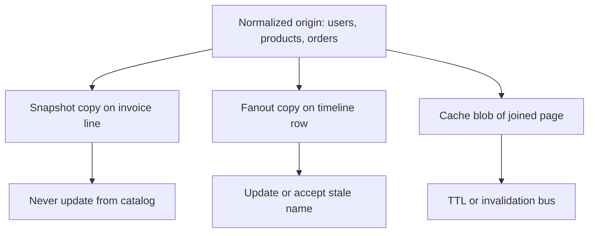

Normalization stores each fact once. Denormalization copies a fact into the shape you read. The first removes update anomalies: change a customer's address in one row, not in every order that printed it. The second buys read speed and simple queries: the order row already has the city, so checkout does not join. Drift is the price. If you copy, you will eventually disagree, unless a process you operate keeps the copies aligned.

This is not a purity contest. Third normal form is a good default for OLTP systems of record. Star schemas are denormalized on purpose for analytics. Caches, materialized views, and "store the display name on the tweet" are denormalization by another name. The mistake is denormalizing the system of record because a page load did a join, without naming the copy, the update path, and the drift SLO.

Update anomalies are the reason normal form exists. If the same email lives on ten tables, a change will miss one. If a product name is only on `products`, every reader joins or looks up. If a product name is copied onto `invoice_lines` at purchase time, that copy is a historical fact, not a cache of the current name — and you should label it that way, or someone will "fix" old invoices when the catalog changes.

Read speed is the reason denormalization exists. Joins at request time cost CPU, round trips, and planner risk. Prejoining into a row, a document, or a Redis blob costs memory, write fanout, and invalidation. Pick the cost that matches the QPS and the correctness requirement. A user profile that changes twice a year can be copied into a million timeline entries only if you have a plan for those million updates, or if you accept the old name until TTL.

## Concept

### What normalization is doing

First normal form: atomic attributes, no repeating groups as unqueriable blobs if you need to query them. Second: non-key attributes depend on the whole key. Third: no transitive dependency (city should not live on the order because city depends on customer, unless you meant to snapshot it). BCNF and higher exist for more exotic dependency cycles. In practice, "facts in one place, keys to point at them" gets you most of the value.

The win is write simplicity and integrity. A unique constraint can enforce one email per user. A foreign key can prevent an order from pointing at a missing customer. An update is one row. Reporting can still join, on a replica, with indexes, at a latency the dashboard accepts.

The loss is read complexity. A product page that needs product, vendor, inventory, and prices is several indexed lookups or a join. Under modest QPS that is fine. Under extreme QPS with a join the planner gets wrong, people denormalize or cache.

Normalize the system of record until you have a measured reason not to. Do not start with a single wide table because MongoDB once said documents map to APIs. A document that embeds a user in every order is denormalized. You can do that in PostgreSQL with JSON too. The engine did not save you from drift.

### What denormalization is doing

You copy attributes into the table, document, or cache that is read together. Invoice line has product_name as of sale. Feed item has author_display_name. Analytics `fact_orders` has denormalized dimension columns or you use a star schema with dimension tables that are themselves slowly changing copies.

Three honest kinds of copy:

Snapshot: the value as of an event (price on the invoice). Never update when the catalog changes. This is not drift; this is history. Name the column `product_name_at_purchase`.

Cache: the value as of last refresh. Update on a bus, a TTL, or a nightly job. Drift is bounded. This is a cache, even if it lives in MySQL.

Aggregate: counts, sums, rollups maintained on write or by a worker. Drift is a reconciliation problem. The origin of truth is the event log or the line items.

Fanout-on-write is denormalization at social-network scale: when you tweet, write pointers into follower timelines so read is a key lookup. Fanout-on-read is the normalized join: when you open the feed, query people you follow. Twitter's home timeline has long been described as a write-time fanout for many users, with exceptions for celebrity accounts whose follower count makes write fanout impossible. That exception is the denormalization cost showing up as an architecture branch.

### Drift, dual writes, and derived stores

If two places can change, they will disagree. The durable pattern is one origin plus derived copies. CDC, an outbox, or a materialized view refreshes the copy. Dual-writing both tables in the request path without a transaction is how you get a successful HTTP 200 and a missing copy.

Materialized views in PostgreSQL are denormalization the database knows about. Concurrent refresh is still a window. Incremental view maintenance is still a system. Redis JSON of the same row is a materialized view you built by hand, with worse tooling.

Schema-on-read documents hide denormalization inside nested objects. Updating an embedded vendor name in every product document is the update anomaly with extra JSON. Referencing a vendor id is normalization inside a document store. The same design discussion applies; the syntax changed.

### When the snapshot is the product

Accounting, invoices, contracts, and game replays want the past, not the live catalog. Copying a price onto a line item is correct. Joining to today's `products.price` is a bug. Normalization zeal that "fixes" this by always joining is how historical invoices change. Denormalization zeal that copies live profile data into every invoice is how a legal name change rewrites tax documents. Label snapshot columns as snapshots. Do not run the same "update all copies" job on them that you run on a cache.

## Trade-offs

| Approach | When it wins | Cost / risk |
| -------- | ------------ | ----------- |
| Normalized OLTP (3NF-ish) | System of record; constraints; facts change in one place | Joins at read time; more round trips; planner risk on complex pages |
| Snapshot denormalization | Historical facts (invoices, contracts); value must never track origin | Storage; cannot "fix" history by updating the catalog |
| Cached / fanout denormalization | High QPS read of a stable join; feed and timeline shapes | Drift; write fanout; invalidation; celebrity exceptions |

Default to normalized origin. Snapshot at the business event that must freeze. Cache or fanout only with a named refresh path and an SLO for drift. If you cannot name the job that updates the copy, you do not have denormalization. You have a future incident.

## Diagram

## Failure modes

### Update anomaly on an unlabeled copy

**Detection.** A user changes email or address. Some screens show the new value, some show the old. Tables or documents that were supposed to be "the same fact" were both writable. No job converges them. Support compares two admin tools and files a data bug.

**Mitigation.** Make one table origin. Convert the others to snapshots (stop updating) or to derived caches (update from origin only). Add a constraint or a linter that application code does not `UPDATE` the copy's copied columns. Reconcile with a query that finds disagreement and treat disagreement as a defect until it is zero.

### Write fanout that cannot finish

**Detection.** A write that should copy to N rows or N timeline keys times out, queues explode, or celebrity accounts take a different path that was never load-tested. Partial fanout: some followers see the post, others do not. Retry duplicates the copies.

**Mitigation.** Bound fanout, queue it, make it idempotent. For extreme N, fanout-on-read or hybrid (Twitter-style celebrity exception). Do not do N updates in the user-facing request. Measure fanout lag as an SLO. If lag exceeds the SLO, you needed a different read model, not a bigger transaction.

### Join removed, query still slow, data now wrong

**Detection.** A denormalized column was added "for performance," the join is gone, `EXPLAIN` is happier, and a week later the column is stale because the write path was not updated in every client. Or only the happy path writes both, and the admin tool writes one.

**Mitigation.** Single writer module for the fact. Tests that update origin and assert the copy moved, or assert the snapshot did not move if it is history. Feature flags for backfill. Do not denormalize in a migration that only `UPDATE`s existing rows once; the application must keep the invariant.

### Analytics star schema treated as OLTP

**Detection.** Dashboards lock OLTP tables, or someone writes an order into a fact table from the app without dimensions matching. ETL is skipped "temporarily." Numbers disagree with the billing database.

**Mitigation.** Keep the warehouse derived. ETL/CDC from origin. Slowly changing dimensions are an analytics design, not a second checkout path. OLTP stays normalized enough to charge the right card.

## Real-world example

Twitter's home timeline is a public case of denormalization as fanout. A tweet is stored as a canonical object. Delivering a home timeline by joining "everyone you follow" at read time, at Twitter's follower-graph scale, was the expensive path for many users. The design that engineering posts have described for years is fanout-on-write: on tweet, insert the tweet id into per-follower timeline structures so that reading home is a lookup of a precomputed list. That list is denormalized. It can drift (deletes, blocks, protected accounts, failed fanout). The system then has to repair, filter at read, or both.

The celebrity exception is the other half of the lesson. Accounts with enormous follower counts cannot pay write fanout to every follower in the time the product allows. Those tweets are pulled at read time (fanout-on-read) and merged. Normalization and denormalization coexist in one product because the cost crossed a threshold. Copying "we denormalize the feed" without the celebrity branch copies only the blog title.

Invoice and commerce systems show the snapshot half. Shopify-style commerce keeps products and prices as live catalog data, and copies price, title, and tax-relevant fields onto the order at checkout. Recalculating an old order from today's catalog would be a financial defect. That copy is not a cache. A cache of the storefront product page, by contrast, should follow the catalog, with TTL or invalidation, and may be wrong for seconds. Mixing those two kinds of copy in one `product_title` column on a table that is both invoice and cache is how you get accountants and cache engineers in the same incident.

Normalize the catalog. Snapshot the sale. Fanout or cache the feed and the storefront with an explicit refresh. If a column cannot be classified as origin, snapshot, or cache, do not add it.

## What to remember

- Normalization stores each fact once and removes update anomalies; it is the default for a system of record.
- Denormalization copies facts to speed reads and accepts drift, write fanout, or frozen history.
- Label every copy as snapshot, cache, or aggregate; unlabeled copies become two sources of truth.
- Fanout-on-write has a celebrity limit; when N is too large, merge at read time instead of pretending the copy always completed.
