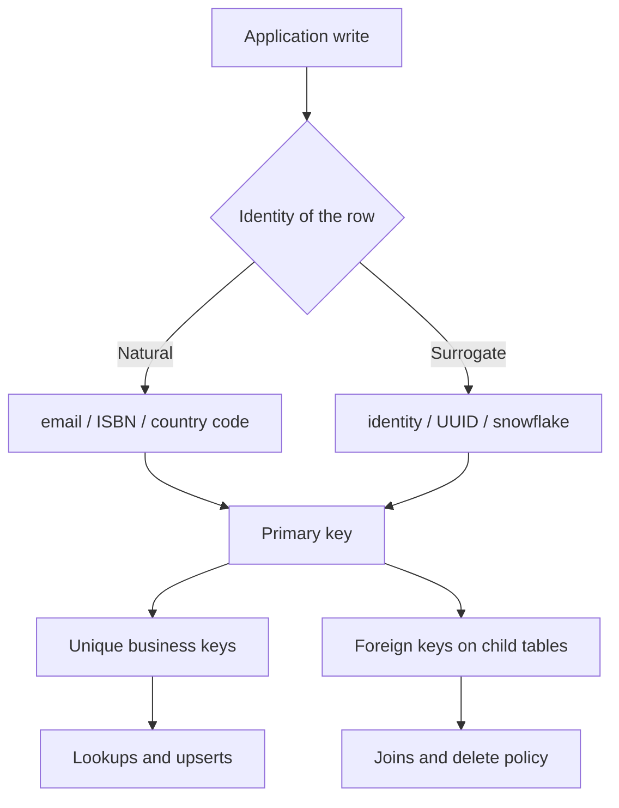

A schema is a bet about identity. Every table answers "what is one of these" before it answers which columns to store. Get the key wrong and every join, cache entry, URL, and child table copies the mistake. Get it right and the rest of the design has a stable handle.

A key is a column or a set of columns whose values distinguish rows. The primary key is the identity the engine uses. Unique constraints add other identities that must not collide. Foreign keys are promises that a value in this table exists as a key in that table. The engine enforces those promises. The query planner uses them. Your APIs will leak them.

Engineers reach for an auto-increment integer because the tutorial did. That is often the right surrogate. It is not always the right identity. Natural keys — email, ISBN, country code — describe the world. Surrogate keys — serial, UUID, a snowflake id — describe the row. Mixing those two jobs is the usual source of painful migrations.

The decision on a design review is small and strict: pick the identity, decide whether the world may change it, then wire uniqueness and foreign keys so the database, not the application, holds the line.

## Concept

A row without a declared identity is a bag of columns. Two sessions can insert what you think is "the same" customer. Reports double-count. Caches disagree. A primary key is the engine's statement that this combination of columns is the row.

### Primary, unique, and foreign

`PRIMARY KEY` means unique and not null. PostgreSQL and InnoDB both cluster or organize access around it in ways that matter for locality, but the logical contract is the same: one row, one primary key value, forever for that row. Do not update a primary key if you can avoid it. Every foreign key, every URL, every message payload that copied it now points at a ghost.

`UNIQUE` is a second identity. An email that must be unique across users is a unique constraint, not a primary key, if you still want a surrogate id that never changes when the person changes their email. Unique constraints in PostgreSQL allow multiple NULLs, because NULL is not equal to NULL. If "missing" must also be unique, use a partial unique index or a sentinel. MySQL's unique treatment of NULL is the same idea with engine-specific corners. Write the constraint. Do not hope the application checks.

A foreign key says this column's values must exist in the referenced table's key. `ON DELETE RESTRICT` (or `NO ACTION`) refuses to delete a parent that still has children. `ON DELETE CASCADE` deletes the children. `ON DELETE SET NULL` clears the pointer. Cascades are convenient and dangerous: a delete of a "root" account can wipe orders, invoices, and audit rows you thought were independent. Prefer restrict, and delete in an explicit application order, until you can name the cascade as a business rule.

Composite keys are legal. `(org_id, slug)` as a unique constraint is how you get per-tenant uniqueness. A composite primary key is honest when the identity really is the pair. Child tables then copy both columns as a composite foreign key. That is correct and noisy. Many teams still put a surrogate on the child and unique-constrain the pair, so other tables can hang off one column.

### Natural versus surrogate

A natural key is a value the business already uses: ISO country code, a well-run product SKU, an ISBN if you trust the catalog. It is a good primary key only when three things stay true. It is unique in your population. It will not change. It is not a secret. Country codes are close. Email addresses fail the second test. National identifiers fail the third, and often the first.

A surrogate key is assigned by the system: `INTEGER GENERATED BY DEFAULT AS IDENTITY`, `BIGSERIAL`, UUID, a snowflake. It has no meaning outside the database except as a handle. The business attributes sit beside it with their own unique constraints. When marketing renames the SKU, the id does not move, the unique index on `sku` updates, and every order line that stored `product_id` still joins.

Integer identities are short, sequential, and easy to type. They leak volume: `/orders/1842` tells a scraper there are at least that many orders. They create hot tails on the right edge of a B-tree under a heavy insert load. They need a central allocator, which is the sequence in PostgreSQL and `AUTO_INCREMENT` in InnoDB.

UUIDs, especially v4, are easy to generate in the application before insert, which helps disconnected clients and multi-master writes. They are 16 bytes. Random v4 values scatter inserts across the index and destroy locality. Time-ordered UUIDs (v7) and snowflake ids keep roughly sequential inserts without a single sequence node. Use those when you need client-side generation and you still care about B-tree cache behavior.

Do not store a UUID as text if the engine has a 16-byte type. Do not use a natural key as the public URL if it can change; put the surrogate in the path and keep the natural key as a unique, redirectable slug.

### What the schema actually protects

Nullability, check constraints, and foreign keys are the rest of the identity story. A `status` column with no check constraint will grow a fourth spelling by Thursday. A `user_id` column with no foreign key will accept ids that never existed, and your joins will drop those rows silently. An application validation is a hint. A constraint is a guarantee that survives a one-off SQL console.

Polymorphic associations (`owner_type`, `owner_id` with no foreign key) give up referential integrity for flexibility. If you need them, add a real foreign key per owner type in separate tables, or accept that the database will not help you. JSON columns that contain ids the application treats as keys are the same hole with worse tooling.

Name the grain of the table. `users` is one human account. `user_emails` is one email belonging to a user, with a unique on the address and a foreign key to `users`. Stuffing three emails into an array on `users` makes "is this address taken?" a scan and makes a foreign key from `email_verifications` impossible. Arrays and JSON are fine for attributes. They are a poor place to hide identities other tables must reference.

## Trade-offs

| Approach | When it wins | Cost / risk |
| -------- | ------------ | ----------- |
| Natural primary key | Stable, public, compact codes the business already uses | Changes, collisions, and secrets leak into every child table |
| Integer surrogate | Single-writer OLTP, short ids, simple joins | Sequential hot spots, enumerable ids, a sequence as a dependency |
| UUID or snowflake surrogate | Client-generated ids, many writers, harder-to-guess handles | Wider indexes; random UUIDs scatter inserts |
| Unique natural key plus surrogate PK | The common production shape: stable id, changeable business key | Two indexes to maintain; you must remember which one URLs use |

The default I want in a new OLTP service is a surrogate primary key, unique constraints on every business identity, and foreign keys on every reference. Reach for a natural primary key only when you would bet money the value is immutable. Reach for client-generated UUIDs when the insert cannot wait for a round trip to a sequence, and then prefer a time-ordered variant so the index does not fragment on day one.

## Diagram

## Failure modes

### Updating a primary key that other tables copied

**Detection.** A rename or merge job updates `users.id` or a natural primary key. Child rows, outbox payloads, and CDN URLs still hold the old value. Joins return nothing. Support finds "missing" orders that exist under the previous id.

**Mitigation.** Treat primary keys as immutable. Put the changeable name in a unique slug or email column. If you must merge two rows, introduce a replacement id, rewrite children in a controlled job, and keep a redirect table from old id to new id until every consumer has moved. Never `UPDATE` the primary key in place as a product feature.

### Missing unique constraints on business identities

**Detection.** Two rows share an email, an external account id, or a `(tenant_id, slug)`. The UI shows whichever row the query hit first. An upsert races and inserts a duplicate. A unique index added later fails because the duplicates already exist.

**Mitigation.** Declare the unique constraint in the first migration that creates the table. For tenant-scoped names, unique on `(tenant_id, slug)`, not on `slug` alone. Backfill and deduplicate before adding the constraint to a live table. Application checks are a courtesy; the index is the lock.

### Foreign keys omitted "for speed"

**Detection.** Orphan `order.user_id` values. Analytics counts that do not match `users`. Deletes from the parent table succeed and leave children behind. A later attempt to add the foreign key fails validation.

**Mitigation.** Add the foreign key. Measure the insert cost; it is almost always cheaper than orphan repair. Choose `ON DELETE` explicitly. If a bulk loader cannot afford per-row checks, load into a staging table, validate, then insert into the keyed table in one transaction. Do not leave the production table unconstrained as a permanent shortcut.

### Enumerable or sensitive keys in public URLs

**Detection.** `/invoices/1` through `/invoices/N` are reachable by incrementing. A sequential user id appears in a shareable link. A national identifier was used as the primary key and now sits in logs, browser history, and foreign systems.

**Mitigation.** Public identifiers can be surrogates that are not a dense integer sequence, or they can be unguessable tokens mapped to the internal id. Keep secrets and natural identifiers out of primary keys. Authorization still has to run on every fetch; an unguessable id is not an access-control mechanism, only a reduction in casual enumeration.

## Real-world example

GitHub's public API exposes both a numeric `id` and a human name for the same object. A repository has an integer `id` that stays put across renames and transfers, and a `full_name` of the form `owner/repo` that does not. A user has an integer `id` and a `login` that the person can change. Issue numbers are unique per repository, not globally; the identity of an issue is the pair (repository, number), while the API also offers a global integer `id`.

That split is the schema lesson. The integer is a surrogate. The login and the repository name are natural keys with unique constraints and a rename path. GitHub redirects old repository URLs after a rename so inbound links survive. Integrations that stored `octocat/Hello-World` as if it were a primary key break on rename unless they follow the redirect or, better, persist the numeric `id`. Integrations that stored only the integer still need a lookup when they want to print a URL, which is why the API returns both.

GraphQL's global node ids are another surrogate layer on top: an opaque id that identifies the object type and the row across the product. The physical tables still have ordinary primary keys. The product decided which identity is stable, which identity is for humans, and which identity is allowed to change, and it documented the redirects. That is schema design leaking all the way to the URL bar, which is where your keys will end up whether you planned for it or not.

## What to remember

- A primary key identifies the row and should not change. Unique constraints identify business facts that might.
- Prefer a surrogate primary key plus unique natural keys. Use a natural primary key only when the value is truly immutable.
- Foreign keys are the integrity the application will not consistently enforce. Write them, and pick `ON DELETE` on purpose.
- Public URLs inherit your key choice. Do not put secrets or dense sequential ids where a browser or a scraper can iterate them.
