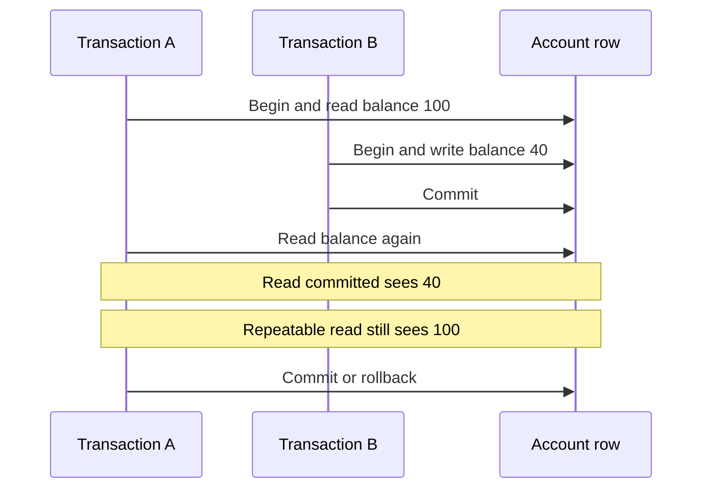

A transaction is a boundary around a set of reads and writes that the database will commit together or not at all. Isolation is the part of that boundary that answers a harder question: what is this session allowed to see of other sessions' work while it is still open? Atomicity keeps a transfer from crediting without debiting. Isolation keeps two transfers from reading a world that never existed.

The SQL standard names four isolation levels: read uncommitted, read committed, repeatable read, and serializable. They are defined by the anomalies they permit, not by a particular locking implementation. Engines differ in how they deliver those levels. PostgreSQL's default is read committed. InnoDB's default is repeatable read. Those two sentences already explain a class of "it worked in staging" bugs.

Three read anomalies show up in design reviews. A dirty read sees another transaction's not-yet-committed write. A non-repeatable read sees a committed change to a row you already read; a second `SELECT` of the same row returns a different value. A phantom read sees a committed insert (or delete) that matches a predicate you already queried; the set of rows changed, not just the columns of a row you held.

If you only remember one operational fact, remember this: the default is not serializable, and "we used a transaction" does not mean two overlapping requests produced a result equivalent to running them one after the other.

## Concept

Begin a transaction, do the work, commit or roll back. Between begin and commit, isolation policy decides which versions of rows you observe and which writes you conflict with. The engine may use locks, multi-version concurrency control (MVCC), or both. PostgreSQL's ordinary levels are MVCC: readers do not block writers, writers do not block readers, and each snapshot is a consistent cut of committed state. InnoDB mixes MVCC with next-key locks at repeatable read.

### The four levels and the three anomalies

Read uncommitted allows dirty reads. You can see a write that later rolls back. Almost no OLTP application wants this. PostgreSQL accepts the name and runs it as read committed anyway; it will not return dirty data. MySQL InnoDB can return dirty data at this level. If a vendor default or a session parameter ever sets it, treat that as an incident, not a performance tip.

Read committed, PostgreSQL's default, gives you a fresh snapshot per statement. Each statement sees only committed data as of its start. It does not dirty-read. It does allow non-repeatable reads and phantoms across statements in the same transaction: you read a balance, someone commits a debit, you read the balance again and it moved. For many web requests that are one statement or that do not re-read, this is enough. For a read-modify-write in application memory, it is not.

Repeatable read, InnoDB's default, keeps the same snapshot for the whole transaction in PostgreSQL. You will not see committed updates to rows you already qualified. PostgreSQL's repeatable read is snapshot isolation. It still allows write skew: two transactions read overlapping state, each writes a disjoint row, both commit, and the combined result violates a constraint that neither transaction saw as broken. InnoDB's repeatable read uses next-key locks to block many phantoms on the locked index range. It is stronger than PostgreSQL's repeatable read on some phantom cases and still not a full serializable guarantee for every constraint you can write in SQL.

Serializable is the promise that the committed history is equivalent to some serial order of those transactions. PostgreSQL implements this with serializable snapshot isolation (SSI): it runs transactions on snapshots and aborts those it cannot prove serializable, with SQLSTATE `40001`. InnoDB serializable turns consistent reads into locking reads. Throughput falls as contention rises. You retry serialization failures. You do not "try/catch and ignore" them.

### What a transaction does not cover

A transaction is one database session's work on one database. It does not include the HTTP response, the cache write, the queue publish, or a second database. If you commit the order and then fail to publish the outbox row because you did the publish after commit in application code, you have an atomicity hole no isolation level will close. Put the outbox insert in the same transaction as the order. Cache invalidation after commit. Remote calls after commit.

Autocommit is a transaction per statement. A read of the row and a later update are two transactions at read committed, which is how lost updates sneak in without any "forgotten BEGIN". Wrap the read-modify-write, or better, put the predicate in the `UPDATE ... WHERE` so the engine does the check.

Long transactions hold snapshots (PostgreSQL) or locks (InnoDB, and also PostgreSQL for row locks you took). Vacuum cannot reclaim row versions still visible to an old snapshot. Lock waits pile up. Keep the transaction short. Do not hold it open across a network call to a payment processor.

### Choosing a level in application code

Start from the engine default. Raise isolation for the transaction that needs it, not for the whole process. A report that must see a stable cut of many tables can `SET TRANSACTION ISOLATION LEVEL REPEATABLE READ` (or snapshot, where the engine has that name) and accept a slightly older picture. A constraint that spans two rows — "at least one manager per department", "two doctors cannot take the last on-call slot" — needs serializable, or an explicit lock, or a denormalized counter with a check. Isolation is one tool. Predicate `UPDATE`s and `SELECT ... FOR UPDATE` are others.

Frameworks that open a transaction per request (some Rails and Django configurations) hold a snapshot or locks for the whole handler. That is convenient until the handler calls Redis, S3, and a billing API before commit. Split the database work, or move the remote calls out.

## Trade-offs

| Approach | When it wins | Cost / risk |
| -------- | ------------ | ----------- |
| Read committed | Typical request/response OLTP, one-shot writes, PostgreSQL default | Lost updates and write skew if you read, decide in memory, write back |
| Repeatable read / snapshot | Stable reads across statements, InnoDB default, reports inside one txn | Write skew remains on PostgreSQL; InnoDB next-key locks add wait and deadlock |
| Serializable | Multi-row invariants without a hand-designed lock order | Abort rate under contention; every caller must retry `40001` |
| Read uncommitted | Essentially never for OLTP | Dirty reads on engines that honor it; PostgreSQL silently upgrades |

The right default for a new PostgreSQL service is read committed plus explicit stronger transactions where invariants need them. Copying InnoDB habits onto PostgreSQL without noticing the default change is a common porting bug: you will see more non-repeatable reads than you did on MySQL, and you will not get InnoDB's gap locks for free. Copying PostgreSQL habits onto InnoDB, you will hold next-key locks you never asked for and deadlock on range writes.

## Diagram

## Failure modes

### Lost update under read committed

**Detection.** Two sessions read `quantity = 1`. Both sell. Both write `quantity = 0` or both write `quantity = 0` from a computed value and a unit disappears or a unit is sold twice. The audit log shows two commits, no error. Counters drift from the event table.

**Mitigation.** Do not compute the next value only in application memory. `UPDATE items SET quantity = quantity - 1 WHERE id = $id AND quantity >= 1` and check the row count. Or `SELECT ... FOR UPDATE` inside the transaction. Or raise to a level and a retry policy that makes the second commit fail. Isolation without a write-time predicate is how this bug survives code review.

### Write skew treated as "serializable enough"

**Detection.** Two on-call doctors both see that the other is still assigned, both go off call, the table now has zero. Each transaction's writes were disjoint, so repeatable read and snapshot isolation committed both. The invariant lived in the application's head.

**Mitigation.** Serializable with retries, or a constraint the engine can see (a materialized counter with a check, an exclusion constraint, a lock on the parent row). If you stay at snapshot isolation, add an explicit lock on a row that represents the invariant. Document that repeatable read is not serializable.

### Serialization failures ignored

**Detection.** PostgreSQL logs `could not serialize access` or SQLSTATE `40001`. The API returns 500. The client retries the whole HTTP request and sometimes doubles a side effect. Or the client does not retry and the user sees a spurious error for a conflict that would succeed on the next attempt.

**Mitigation.** Catch serialization and deadlock errors as retryable. Retry the transaction from the beginning with jitter and a budget. Do not retry after an external side effect unless that effect is idempotent. Turn the error into a 409 or a queued retry, not an unhandled 500.

### Long transactions and stalled vacuum

**Detection.** PostgreSQL wraparound warnings, table bloat, `idle in transaction` sessions in `pg_stat_activity`. InnoDB history list length grows. Unrelated queries slow down. A forgotten admin console or a background job opened a transaction and then waited on a downstream HTTP call.

**Mitigation.** `idle_in_transaction_session_timeout`. Statement timeouts. Connection poolers that recycle. Application rules: no remote I/O inside a transaction. Find the oldest backend xmin and page the owner. Isolation snapshots are not free to hold.

## Real-world example

PostgreSQL is the system whose isolation behavior you should memorize if you run it, because the names in `SET TRANSACTION` do not mean the textbook locking hierarchy. The default is `READ COMMITTED`. `READ UNCOMMITTED` is accepted and treated as `READ COMMITTED`; you will not get dirty reads by asking for them. `REPEATABLE READ` and `SERIALIZABLE` both use snapshots; the difference is that serializable adds SSI checks and aborts transactions that would produce a cycle. Dan Ports and Kevin Grittner's SSI work is what ships in PostgreSQL, and the documented advice is to retry on serialization failure.

InnoDB takes the other default. Sessions run at repeatable read unless you change it. Consistent reads inside a transaction use a snapshot; locking reads (`SELECT ... FOR UPDATE`) take record and next-key locks that block inserts into the gap. Teams that move a Rails or Django app from MySQL to PostgreSQL keep the same `BEGIN`/`COMMIT` and lose those gap locks. Teams that move the other way suddenly deadlock on ranges they used to snapshot.

GitLab, Heroku Postgres, and a large fraction of Rails applications run on PostgreSQL with read committed unless a given transaction asks for more. The production pattern that works is boring: short transactions, predicate updates for counters, `FOR UPDATE` for hot rows, serializable for the rare multi-row invariant, and a retry helper that understands `40001`. The production pattern that fails is a request-wide transaction at default isolation that reads a row, calls Stripe, then writes the row back.

## What to remember

- Isolation is defined by anomalies: dirty, non-repeatable, and phantom reads. The engine default is not serializable.
- PostgreSQL defaults to read committed and treats read uncommitted as read committed. InnoDB defaults to repeatable read.
- Read-modify-write in application memory loses updates at read committed. Put the rule in the `UPDATE` predicate or take a row lock.
- Serializable (PostgreSQL SSI) aborts; retry is part of the protocol. A transaction does not cover caches, queues, or other databases.
