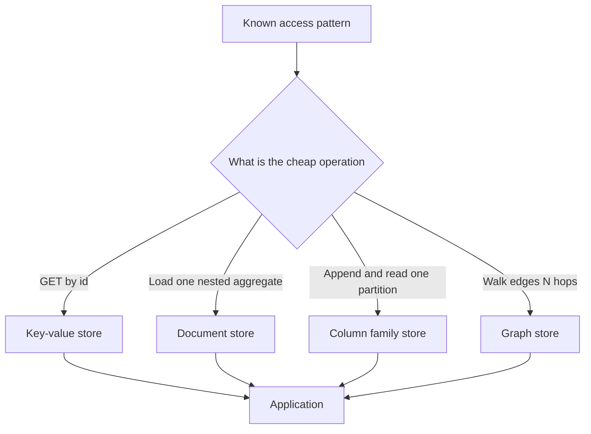

The store you pick is a bet about access patterns, not a bet about fashion. A key-value engine is a map with a persistence story. A document store is a map whose values are nested records you query by field. A column family store is a map of maps tuned for wide, sparse rows and sequential writes. A graph store is a set of nodes and edges you traverse without joining tables by hand. All four can persist bytes. They do not answer the same questions at the same cost.

Relational engines remain the default when you have ad-hoc queries, multi-row transactions, and a schema other teams must share. The non-relational models win when the query is known in advance and the relational shape fights you: a session blob by user id, a product JSON that changes weekly, a write-heavy time series, a social walk of friends-of-friends. Access pattern decides the model. The vendor logo does not.

Engineers often copy a document into MongoDB because the payload was already JSON, then spend a year reinventing joins, unique constraints, and migrations. The inverse mistake is forcing a graph walk through SQL with recursive common table expressions until the planner gives up. Name the lookup, the write, and the transaction boundary first. The store class follows.

This essay is the map I want on a whiteboard when someone says "NoSQL" as if that were one product.

## Concept

Think of each model as the operation it makes cheap, and the operation it makes expensive.

### Key-value

The API is `GET(key)`, `PUT(key, value)`, `DELETE(key)`, sometimes `GET_RANGE` if keys are ordered. Redis, Memcached, DynamoDB's simplest table, and the storage layer under many higher systems are this shape. Values are opaque to the engine. Secondary lookup means a second key you maintain, a secondary index the product bolted on, or a scan you cannot afford.

This wins for sessions, feature flags, rate-limit counters, cache entries, and shopping carts addressed by `user_id`. It wins when the application already knows the key. It loses when you need "all users in Germany who bought X last week" unless you designed a key that answers that, or you exported the data to a store that can.

Durability and structure vary. Redis can persist, but many teams use it as a cache and are surprised when a restart drops data they treated as source of truth. DynamoDB asks you to choose a partition key and optional sort key; that pair is the only cheap access path unless you add a global secondary index, which is another key-value view with its own capacity.

### Document

A document is a JSON or BSON object with a primary key and nested fields. MongoDB, Couchbase, and Amazon DocumentDB treat fields as queryable. You can index `customer.address.city`. You can retrieve a whole aggregate in one read: an order with its line items nested, instead of an orders table plus a lines table.

The win is locality of an aggregate you always load together, and schema flexibility when attributes differ per document. The cost is that relations between aggregates become application joins or denormalized copies. Unique constraints exist in some products and are weaker or absent in others. Multi-document transactions arrived late in MongoDB and have limits; do not assume they are the same as InnoDB.

A document that grows without bound (an array of every event ever) will hit size caps and rewrite costs. A document per event with no index for the query you need is a key-value store you pretended was relational. Design the document around the read, cap array sizes, and keep a relational system for the parts that need joins and constraints.

### Column family

Cassandra, ScyllaDB, and HBase store rows identified by a partition key, with a dynamic set of columns (or clustering columns plus cells) inside the partition. Writes append. Reads of one partition are sequential and cheap. Reads that scatter across partitions are expensive. There is no cheap `JOIN`. Transactions, when they exist, are limited: lightweight transactions in Cassandra are compare-and-set on a partition, not multi-partition ACID.

This wins for high write rate, multi-datacenter replication, and queries you can prefix with the partition key: "all events for this device today", "all inbox items for this user". It loses for ad-hoc analytics, secondary lookups you did not model as a second table, and any workflow that needs to update two partitions atomically.

The data model is the query. You often write the same fact into several tables, one per access path. That is denormalization as a first-class practice. If you are not willing to maintain those copies, do not pick this family.

### Graph

Nodes and relationships are first-class. Neo4j, Amazon Neptune, and similar engines store edges you can walk: `MATCH (p:Person)-[:FRIEND]->(f)-[:FRIEND]->(fof)`. Variable-length paths, shortest path, and pattern match are the point. Labels and properties give you some filtering. The engine is built so that traversing an edge does not mean scanning a join index for every hop if the adjacency is local.

This wins when the product question is the walk: fraud rings, recommendations, network inventory, authorization graphs. It loses as a general application database. Aggregations over all nodes, bulk analytics, and simple CRUD with rare hops are cheaper in a relational or document store. Hybrid designs keep the system of record relational and project a graph for the walks, or the reverse, and then you own the sync.

## Trade-offs

| Approach | When it wins | Cost / risk |
| -------- | ------------ | ----------- |
| Key-value | Lookup by known id, caches, sessions, simple items | No query flexibility; secondary access is your problem |
| Document | Whole-aggregate reads, uneven attributes, JSON in / JSON out | Cross-aggregate joins, unbounded arrays, weaker constraints |
| Column family | High write rate, partition-scoped queries, multi-DC | Query-first modeling, multi-partition transactions, operational complexity |
| Graph | Multi-hop relationships are the product | Poor general-purpose store; sync with a system of record |

Pick the model that matches the dominant query. A product catalog with unpredictable filters still wants a relational engine or a search index, not a column family. A social graph with rare SQL-shaped reports can live in a graph store plus an export. Many production systems run two stores and accept the copy: DynamoDB or Cassandra for the hot path, a warehouse for the rest.

## Diagram

## Failure modes

### Store chosen from the payload shape

**Detection.** The request body was JSON, so the table is a document collection. Six months later every feature needs a join, a unique email, and a multi-document transaction. The team is writing application-level referential integrity and nightly repair jobs.

**Mitigation.** Choose from the query and the constraint, not from the wire format. JSON in a `jsonb` column in PostgreSQL is a valid middle path when most of the row is relational and a tail of attributes is flexible. Move to a document store when the aggregate boundary is stable and the join load is truly gone.

### Partition or shard key that the query does not start with

**Detection.** Cassandra or DynamoDB queries with `ALLOW FILTERING`, full-table scans, or fan-out to every partition. Latency tracks cluster size. On-call pages correlate with "we added a query for customer email" on a table keyed by device id.

**Mitigation.** Add an access table or a global secondary index whose key matches the new query. If the new query is ad-hoc, export to a search cluster or a warehouse. Do not pretend a column-family table is a SQL database with worse syntax.

### Graph used as the system of record for tabular data

**Detection.** Node properties accumulate invoice lines and payment states. Bulk updates time out. Analysts cannot query without a proprietary language. Backup and schema migration tools look like afterthoughts.

**Mitigation.** Keep money, inventory, and identity in a relational store with real transactions. Project edges into the graph for walks, or call the graph for recommendations and write decisions back. The graph is a query engine for relationships, not a replacement for accounting.

### Cache treated as a key-value source of truth

**Detection.** Redis restarts, sessions vanish, or a failover promotes an empty replica. Counters reset. The application has no rebuild path because the only copy lived in memory.

**Mitigation.** Name the durability contract. If the data must survive process death, use a store whose persistence you test with a crash drill, or write through to a durable engine and use Redis as a cache. Key-value is a model. Persistence is a separate checkbox.

## Real-world example

Amazon DynamoDB is a production key-value store with a partition key, an optional sort key, and optional secondary indexes. AWS publishes it as the service many of their own teams use for session state, metadata, and high-scale item lookup. The programming model is explicit: you must know the key, or you must pay for an index that is another keyed view. There is no planner that will save a query you did not design for. Capacity is per table and per index. A hot partition key (one customer id that receives a disproportionate write rate) throttles that partition while the rest of the table sits idle.

That shape is the lesson for all four families. DynamoDB does not replace a graph walk; Amazon offers Neptune for that, and it does not replace ad-hoc SQL; Amazon offers relational engines for that. Netflix's public engineering writing on Apache Cassandra makes the same point from the column-family side: they chose Cassandra where the query is partition-scoped and the write rate is high, and they model tables per query rather than a single normalized schema.

A competent architecture names two or three access patterns per bounded context and assigns a store class to each. Shopping cart by `user_id` is key-value. Product page with nested variants is a document or a relational aggregate. Friend-of-friend is a graph or a precomputed list. "All four in one cluster because the vendor says unified" is how you pay column-family operational cost for a workload that wanted foreign keys.

## What to remember

- Access pattern decides the model. Key-value, document, column family, and graph make different operations cheap.
- Secondary queries, joins, and multi-row transactions are either first-class or they are your application. Ask which before you pick.
- Column-family and key-value tables are designed per query. A new lookup usually means a new index or a new table.
- Persistence, transactions, and query flexibility are separate axes. Redis-as-cache is not DynamoDB-as-record, and neither is Neo4j.
