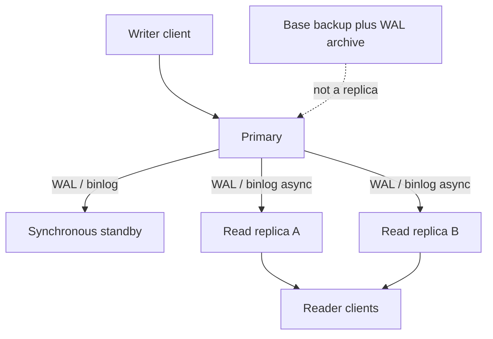

Replication copies database changes from one server to another so a second machine can serve reads, take over after a failure, or sit in another region. It is a log of committed work shipped and applied. It is not a backup. A replica that follows the primary will happily apply a `DROP TABLE` and a ransomware encrypt. Restore points, retention, and offline copies are a different system.

The first design choice is timing. Synchronous replication waits until at least one replica has the bytes (or has acknowledged them) before the primary reports commit to the client. Asynchronous replication reports commit when the primary has durable local state and sends the log later. Sync buys a tighter failure story at the cost of commit latency and availability if the replica or the network stalls. Async buys speed and geographic distance at the cost of lag and data loss on failover.

Most production estates mix both. A local standby can be synchronous so a crash of the primary does not lose committed transactions. Cross-region copies are asynchronous because a round trip to another continent on every commit is rarely the product goal. Read replicas are almost always asynchronous, which means a client that writes and immediately reads from a replica can see the old world.

If you operate a relational database in 2026 and have not named whether each replica is sync or async, you do not yet have a replication design. You have a hope.

## Concept

The primary, also called the leader or source, accepts writes. It records them in a log: PostgreSQL's write-ahead log (WAL), MySQL's binary log, MongoDB's oplog. Replicas connect, pull or receive that log, and apply it. How they apply it, and how far they are allowed to fall behind, is the rest of the mechanism.

### Physical versus logical

Physical replication ships the disk-level log. PostgreSQL streaming replication is this: replicas are the same major version, the same system identifiers, byte-oriented WAL. It is efficient and faithful. It cannot filter tables. It cannot easily replicate to a different engine version or a different schema shape. The replica is a clone, not a subscriber.

Logical replication decodes the log into row changes (or SQL) and applies them on a replica that can have extra indexes, a subset of tables, or a different major version. PostgreSQL logical replication, MySQL row-based replication consumed by tools, and change-data-capture pipelines are this family. You gain flexibility and you gain apply lag, conflict cases, and a catalog of publication/subscription objects to operate.

Statement-based replication, historically common in MySQL, sends the SQL text. It breaks on non-deterministic functions, on `NOW()`, on statements that touched different rows because data had already drifted. Row-based replication sends before/after images. Prefer row-based or physical WAL. Treat statement-based as a legacy mode you audit, not a default.

### Synchronous versus asynchronous

In PostgreSQL, `synchronous_commit` and `synchronous_standby_names` decide whether commit waits for a named standby to flush WAL. `on` and `remote_apply` mean different points on the path: flushed to replica disk versus applied to replica queries. In MySQL, `rpl_semi_sync` waits for at least one replica to acknowledge the event. Fully synchronous cluster modes (some Galera, some group replication configurations, consensus-based engines) wait for a quorum.

Async is the common read-replica setting. Measure replica lag: WAL insert versus replay in PostgreSQL (`pg_stat_replication`), seconds behind source in MySQL. Lag is not a single number; a replica can be current on receive and behind on apply if replay is CPU-bound or blocked on a query. A reporting replica that runs a sequential scan can stall apply in engines where replay shares the query workload, then jump forward when the query ends. Chart receive lag and apply lag separately.

Catch-up after a replica restart is another lag source. The replica must fetch the WAL it missed, from the primary's local retention or from an archive. If the primary has already recycled those segments and no archive exists, the replica cannot catch up and must be rebuilt from a new base backup. WAL retention on the primary is therefore part of the replica design, not an internals curiosity.

Failover is not automatic just because a replica exists. Someone, or a consensus agent, must stop writes to the old primary, choose a replica, promote it, and point clients. If the old primary is still alive and still accepting writes, you have two histories. That split-brain is a data corruption event, not an availability win.

### Replication is not a backup

Backups have a point-in-time, a retention policy, and a restore test. Replicas have a live connection to the primary's present. Accidental deletes replicate. Schema migrations replicate. A compromised primary replicates. You still need snapshots or base backups plus WAL archives for point-in-time recovery, stored in a failure domain that is not the database cluster. Use replicas for availability and read scale. Use backups for "last Tuesday before the bad migration."

Read-your-writes after an async replica is a product bug unless you route those reads to the primary, wait for catch-up, or accept session stickiness. Caching the replica's answer makes it worse.

## Trade-offs

| Approach | When it wins | Cost / risk |
| -------- | ------------ | ----------- |
| Asynchronous replicas | Read scale, cross-region copies, low commit latency | Lag, lost last writes on failover, stale reads |
| Synchronous standby | Zero or near-zero data loss on primary crash | Commit waits on the replica path; availability tied to that path |
| Physical streaming | Same-version HA clone, efficient catch-up | No filtering; replica is not a flexible subscriber |
| Logical replication | Version upgrades, table subset, extra indexes | Apply lag, identity conflicts, more moving parts |

A local sync standby plus async read replicas is the shape many managed services sell. It is a good default for a single-region OLTP system that can afford a second box. It is a poor substitute for a backup, and it is a poor substitute for multi-primary writes. If you need writes in two regions, you have left this essay and entered conflict resolution.

## Diagram

## Failure modes

### Failover that loses acknowledged writes

**Detection.** The primary dies. A replica is promoted. Clients retry and cannot find rows they received a commit for. Lag metrics on the promoted replica were not zero. Support tickets cluster around the failover window.

**Mitigation.** Use a synchronous standby for the durability class that cannot lose commits, and only promote a replica that was that standby or that has replayed through the last sync point. Application retries must be idempotent because you will still retry. If you stay async, state the RPO in writing: you may lose N seconds of commits, and product owners have to accept that.

### Stale reads after a write

**Detection.** A user updates a profile, refreshes, and sees the old bio. Load balancers send `GET` to replicas and `POST` to the primary. Lag spikes during batch jobs or vacuum. The bug reproduces only under load.

**Mitigation.** Route read-your-writes to the primary, or use a session token that waits until the replica has applied a given log sequence number. Cap what you put on replicas: reports, search indexing, and reads that may be stale. Alert on lag, not only on replica liveness.

### Split brain after a network partition

**Detection.** Two servers both accept writes. Unique keys collide when you try to reconcile. Rows exist on A and not B. Fencing was missing: the old primary was never told to stop.

**Mitigation.** A single writer, always. Promotion goes through a consensus or a lock (Patroni with etcd or ZooKeeper, Orchestrator with a source-of-truth, a cloud failover API). STONITH or at least `pg_ctl promote` only on one side and shutdown of the old primary. Never "just start the other node" during an incident.

### Replica used as the only copy of backups

**Detection.** A bad `DELETE` or encryption event hits the primary and every replica. There is no snapshot older than the event. Retention was "we have two replicas."

**Mitigation.** Separate backup storage, delayed replicas if you want a short undo window, and tested restores. A delayed replica is still not a backup: it will eventually apply the drop. WAL archive plus a base backup in object storage is the backup.

## Real-world example

Amazon RDS for PostgreSQL and MySQL publishes the split clearly. Multi-AZ standby is a synchronous replica in another availability zone, used for failover, not for serving application reads in the classic Multi-AZ deployment. Read replicas are asynchronous copies you can query, including in other regions. Automated backups and point-in-time restore are a third mechanism: snapshots plus transaction logs in Amazon's backup storage, independent of whether any replica is alive.

That product map is the architecture. GitHub, GitLab, and every team running PostgreSQL streaming replication on their own VMs are implementing the same three boxes: a primary, replicas for reads or HA, and a WAL archive that is not the replica. PostgreSQL's `pg_stat_replication` shows `sent_lsn`, `replay_lsn`, and `sync_state`. If `sync_state` is `async` for every client, failover can lose data. If you have no `archive_command` or managed equivalent, you have no PITR.

MySQL's binary log plus replicas is the same idea with different names. GTID makes failover less guessy. Replica lag is still `Seconds_Behind_Source`, and it still lies when the replica is not single-threaded in apply. Semi-sync reduces loss on crash. It does not replace `mysqldump` or Percona XtraBackup sitting in a bucket the database instances cannot delete.

## What to remember

- Replication copies the live log. It is not a backup, and a drop will replicate.
- Synchronous commit waits on a replica; asynchronous commit creates lag and a non-zero RPO on failover.
- Physical replication clones the instance. Logical replication can filter and cross versions, at the cost of apply complexity.
- Failover needs fencing of the old primary. Two writers is split brain, not high availability.
