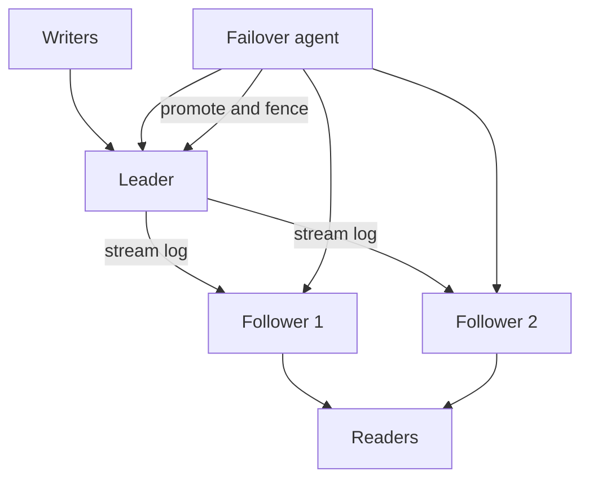

Leader-follower replication, also called primary-replica or source-replica, is the topology most relational databases actually run. One node accepts writes. Every other node applies the leader's log and serves reads, or stands by for failover. There is a single serial history of commits. That is the feature. It is also the limit: write throughput is the leader's throughput, and a mistaken second leader is a split brain.

Clients send `INSERT`, `UPDATE`, and `DELETE` to the leader. Followers pull WAL or binlog and replay. A follower that is caught up can answer `SELECT`. A follower that is behind answers with yesterday's row. Failover is the act of choosing one follower, promoting it to leader, and making sure the old leader never writes again. If two nodes both believe they are leader, unique keys fork, counters fork, and you spend the next week merging by hand.

This topology is simpler than multi-leader or leaderless quorum stores. Learn it before those. Most "we need a cluster" conversations are satisfied by one writer, n readers, and a fencing story you have rehearsed.

The rest of this essay is that rehearsal: where writes go, what lag means, how promotion works, and how two leaders happen.

## Concept

The leader is the only node whose data page is allowed to change because of a client write. Followers are restorers of the leader's log. They are not peers in the write path.

### Writes, reads, and lag

A write path looks like this. The client connects to the leader (directly, or through a proxy that knows the current leader). The leader writes the WAL, commits locally, optionally waits for a synchronous follower, and returns. Asynchronous followers receive the record later. PostgreSQL streaming replication, MySQL source-replica, Redis replication, and MongoDB replica sets (with a primary) are all this shape.

Reads may go to the leader for freshness or to followers for capacity. Replica lag is the delay between leader commit and follower apply. It grows when the follower is slower than the write rate, when a long query blocks apply, when the network blips, or when the follower is restarting and catching up. An application that writes the leader and reads a follower without a causal token will see missing rows. That is not eventual consistency as a philosophy. It is a race you can measure with log sequence numbers.

Synchronous followers sit on the commit path. If the only sync follower dies, the leader either blocks commits or you degrade to async, depending on configuration. That is the availability cost of wanting zero data loss. Asynchronous followers do not block commits. They can be arbitrarily behind. Promoting a follower that is 30 seconds behind drops 30 seconds of acknowledged writes unless the application can replay them.

### Failover

Failover has four steps, and skipping any of them is how you get a worse outage.

First, detect that the leader is gone. Health checks, missed heartbeats, or a cloud API. False detection during a network blip is as dangerous as slow detection.

Second, choose a follower. Prefer the one with the highest applied log position, among those allowed by policy (same region, not a delayed replica). In PostgreSQL, compare received/replay LSN. In MySQL, compare GTID sets.

Third, promote it. PostgreSQL `pg_ctl promote` or the managed equivalent. MySQL `STOP REPLICA` plus `SET read_only = 0` (and GTID position). Redis `REPLICAOF NO ONE`. The new leader must refuse to become a follower of the old leader later without a rewind or a rebuild.

Fourth, fence the old leader. If it returns from a freeze, it must not accept writes. Patroni, Orchestrator, Redis Sentinel, MongoDB replica sets, and RDS Multi-AZ all exist to automate this. Manual failover without fencing is how split brain starts: the "dead" node was partitioned, not dead.

Client routing must move. DNS TTLs, a proxy (ProxySQL, PgBouncer with a pause, HAProxy), or a driver that queries the topology. Connections to the old leader must die. Connection pools will otherwise keep writing into a node that is now a zombie.

### Split brain

Two leaders means two serial histories. Both will accept an insert with the same natural key if you only had uniqueness on each node. When you try to reattach one as a follower, the logs diverge and the replica cannot rewind without discarding data. Recovery is: pick a surviving history, rebuild the other node from backup or from the winner, and replay application-level events if you have them. There is no clean merge for arbitrary SQL.

Prevention is mechanical. One writer. Consensus or a lock service decides who. The old leader shuts down or is STONITH'd. `read_only = on` on every follower, enforced. A replica that is promoted is the only one with `read_only = off`.

## Trade-offs

| Approach | When it wins | Cost / risk |
| -------- | ------------ | ----------- |
| Single leader, async followers | Simple HA and read scale | Lag, data loss on promote, stale reads |
| Single leader, sync follower | Stronger durability on leader crash | Commit latency; commits stall if the sync path dies |
| Manual failover | Small estates, humans in the loop | Slow, error-prone fencing |
| Automated failover | Minutes-to-seconds recovery | False failover during partitions if quorum is wrong |

Leader-follower is the right default for a single-region OLTP database. It is the wrong tool for writing in two continents without a conflict story. If the product needs a writer next to every user, you are leaving this topology. If the product needs a second machine so a disk death is not a company event, stay here and invest in fencing.

## Diagram

## Failure modes

### Promotion of a lagging follower

**Detection.** After failover, rows that the API had committed are missing. The promoted node's replay LSN or GTID set is behind the last client-visible commit. Monitoring showed lag that nobody treated as a promotion blocker.

**Mitigation.** Automate promotion only from a synchronous replica, or from a replica whose apply position meets a threshold. On async-only topologies, accept RPO and make writes idempotent so clients can retry onto the new leader. Record the last known LSN in the application when you cannot afford loss, and refuse promotion that cannot meet it.

### Split brain after a partition

**Detection.** Two nodes both have `read_only = off`. Application metrics show writes to both. Unique violations appear when a replica is later attached. Data exists on A that B never saw.

**Mitigation.** Quorum-based failover (Patroni with DCS, MongoDB replica set majority, cloud multi-AZ). Fence the old leader: kill the process, revoke the disk, drop the route. Never run two failovers from two operators on two terminals. After any failover, verify there is exactly one writable node before you reopen traffic.

### Replica lag mistaken for "eventual consistency"

**Detection.** Users see old data after their own writes. Followers' apply CPU is pegged. A report replica is hours behind and still in the default read pool. The team talks about eventual consistency instead of a stuck replay.

**Mitigation.** Separate HA replicas from reporting replicas. Alert on lag with a SLO. Route read-your-writes to the leader. Fix the apply bottleneck (heavy queries on the follower blocking replay in some engines, insufficient IOPS, a single-threaded applier). Lag is an incident when it exceeds the number you told product.

### Clients stuck on the old leader

**Detection.** After promotion, a fraction of writes still hit the old host because of DNS cache, a hard-coded host, or a pool that never recycled. The old host may be read-only now (errors) or still writable (split brain).

**Mitigation.** Topology-aware proxies and short-lived connections. Pause PgBouncer, switch the host, resume. Force-close connections at the old node. Health checks that test writability, not only TCP. Configuration management that cannot leave a forgotten app server pointing at a hostname you demoted.

## Real-world example

GitLab's documented PostgreSQL high availability uses Patroni to manage a leader and followers. Patroni stores the leader lock in a distributed configuration store (etcd, Consul, or ZooKeeper). Only the node that holds the lock is allowed to be writable. On leader death, Patroni runs a leader race, promotes a replica, and the old node, if it returns, notices it lost the lock and does not reopen for writes. GitLab also puts PgBouncer in front so client connections can be drained and reattached when the leader moves.

That is leader-follower with an explicit fence. GitHub's MySQL fleet used Orchestrator to discover replication topology and to run recoveries with a similar idea: there is one source of truth for which node is the writer, and replicas are re-parented around it. Redis Sentinel does the same job for Redis: monitor, elect, `REPLICAOF NO ONE` on the winner, and reconfigure the others.

Managed RDS Multi-AZ is the same topology sold as a button. The standby is not a read replica. Failover is Amazon fencing the old primary and moving the endpoint. Read replicas are extra async followers you opt into. If you build this yourself and skip the lock service, you have rebuilt the topology without the part that prevents two leaders.

## What to remember

- Writes go to one leader. Followers replay the log and may serve reads.
- Lag is the gap between leader commit and follower apply. Promoting across that gap loses data.
- Failover is detect, choose, promote, and fence. Skip the fence and you get split brain.
- Two leaders are a corruption event. Quorum, a lock, or the cloud's fencing API must pick exactly one writer.
