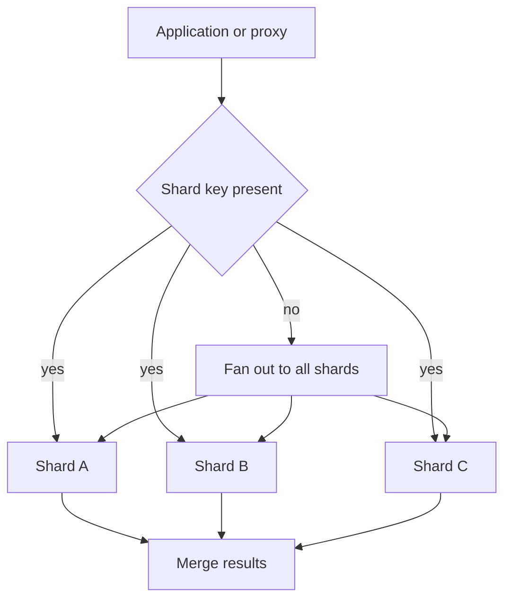

Sharding is horizontal partitioning: you split the rows of a logical table across several databases or clusters so no single instance holds the whole working set. Shard 1 holds users 0–N, shard 2 holds the next range, or a hash of `user_id` maps to one of sixteen instances. Each shard is a normal database with its own memory, disk, connections, and replication. The application, or a proxy, decides which shard a request hits.

You shard when one primary can no longer store the data, serve the write rate, or hold the working set in cache, and vertical scaling (a bigger box) has stopped being honest. Replication does not solve this. Replicas copy the same data; they add read capacity and failover, not write capacity or storage headroom. Sharding is the step after "we already have a leader and followers and the leader is the bottleneck."

The cost shows up on day two. Cross-shard joins become application joins. Cross-shard transactions stop being a single `BEGIN`/`COMMIT`. Unique constraints are per shard unless you add a global index. Resharding — moving rows because a shard filled up — is a project. Teams that shard for fashion, with a table that still fits on one PostgreSQL primary, buy that complexity for no capacity.

The question on a design review is not "should we shard." It is "which key makes almost every request hit one shard, and what do we do when a request cannot."

## Concept

A shard key is the column whose value selects the shard. Everything about the architecture hangs off that choice. This essay covers the split itself: how rows are placed, how queries find them, and why transactions shrink. Choosing the key well is the next topic in this series.

### Placement: range, hash, directory

Range sharding puts contiguous key values on one shard: user ids 1–1_000_000 on shard A. Range scans for a key interval hit one shard. New users with monotonic ids all land on the newest shard, which becomes a hotspot. Rebalancing means splitting a range.

Hash sharding computes `hash(key) mod N` (or a consistent hash) and places the row on that bucket. Load spreads if the key has enough distinct values. Range queries over the original key become scatter-gather to all shards. Adding a shard changes the modulus unless you use consistent hashing or a lookup table, so you plan resharding from the start.

Directory sharding stores `key -> shard` in a lookup service. You can move a single tenant by updating the directory. You now operate a directory that is on the path of every request. Vitess Vindex and many tenant-routing layers are this idea with extra machinery.

Physical layout varies. Some teams run one PostgreSQL instance per shard on its own VM. Some run many schemas on one instance (a "pod") and move pods between machines. Some use a proxy (Vitess, Citus, MongoDB mongos, a custom router) so the application speaks one SQL endpoint. The proxy does not remove the rules. It hides them until a query has no shard key in the `WHERE` clause, at which point it fans out or refuses.

### What stays easy, what gets hard

A request that includes the shard key is a request to one database. It keeps transactions, joins, and foreign keys inside that database. That is the goal: pick a key so the common transaction is local.

A request that does not include the shard key is a scatter-gather: send the query to every shard, merge in the application or proxy. Latency becomes the slowest shard. Partial failure becomes a new class: nine shards answered, one timed out, is the list complete? Global unique email becomes a lookup table or an application check with a race. `COUNT(*)` of all orders is a job, not a query.

Cross-shard transactions need a coordinator: two-phase commit, sagas, or "we simply do not do that." Two-phase commit across shards is slow and failure-prone; most application teams refuse it. Sagas compensate instead of locking. The honest design is: do not shard through the middle of a transaction. Keep an order and its lines on the same shard. Keep a shop's inventory with that shop.

Secondary indexes are local unless you build a global index, which is itself a sharded table or an external search cluster. Pagination across shards needs a merge of cursors. `SERIAL` primary keys collide across shards; use a global id allocator (snowflake, UUID, or range of sequences per shard).

### When not to shard

If the working set fits, and the leader's CPU and IOPS have headroom, do not shard. Partition inside one instance (PostgreSQL declarative partitioning) if you need to drop old ranges or constrain scans. Partitioning is not sharding: one engine, one transaction, one backup. It is cheaper. Shard when you need multiple engines.

## Trade-offs

| Approach | When it wins | Cost / risk |
| -------- | ------------ | ----------- |
| Single primary plus replicas | Data and writes still fit | Ceiling on write rate and size |
| Range shards | Range queries on the key, easy splits | Hot tail if keys are monotonic |
| Hash shards | Even load for high-cardinality keys | Scatter-gather for any non-keyed query; resharding |
| Directory / proxy | Tenant moves, heterogeneous shard sizes | Directory is a dependency; unkeyed queries still hurt |

Sharding buys independent failure domains and independent capacity. A bad shard still takes down the tenants on it. You have not eliminated downtime; you have narrowed the blast radius, if the key aligns with a tenant or a user. If the key is a random hash of every row, a down shard affects a random slice of every customer, which is often worse politically than one large tenant going down.

## Diagram

## Failure modes

### Cross-shard transaction assumed to be one commit

**Detection.** An order lands on shard A, payment on shard B. One commit succeeds, the other fails. Support finds paid orders with no rows, or rows with no payment. The code used two connections and no saga.

**Mitigation.** Collocate the rows that must commit together by choosing a shard key they share. If they cannot share a key, use an explicit saga or an outbox, and accept intermediate states. Do not wrap two shard connections in a pretend local transaction.

### Unkeyed query in the hot path

**Detection.** A listing endpoint or a unique-email check hits every shard. Tail latency tracks the worst shard. Load on idle shards spikes when one feature ships. The proxy log shows scatter queries.

**Mitigation.** Require the shard key on every OLTP path. Add a lookup table or a global secondary store for the rare lookup by another attribute (email -> user_id, then user_id -> shard). Ban `SELECT` without the key in code review for request handlers. Leave scatter to offline jobs.

### Uneven shards and a hotspot

**Detection.** One shard's CPU, disk, or connection count is at the limit; others are idle. A celebrity tenant, a monotonic range, or a popular hash bucket owns too many rows or too many writes.

**Mitigation.** Split the hot range, move the hot tenant via the directory, or change the key (the next essay). Isolate elephants onto dedicated shards. Hash keys with low cardinality cannot be saved by adding hardware; they need a different key.

### Resharding without a dual-write plan

**Detection.** A migration copies rows to a new shard while the application still writes the old one. Rows diverge. Unique keys conflict. The cutover weekend becomes a week.

**Mitigation.** Expand/contract: write both places or write through a proxy that understands the new mapping, backfill, verify counts and checksums, then read from the new location, then drop the old. Treat resharding as a migration with a rollback, not as a file copy.

## Real-world example

Vitess is the sharding system YouTube built for MySQL and later open-sourced. The application talks to a Vitess gateway as if it were one MySQL. Behind the gateway, keyspaces are split into shards, each a MySQL cluster with its own primary and replicas. A Vindex maps a column to a shard. Queries that include that column go to one shard. Queries that do not may scatter or be rejected depending on configuration. Transactions are expected to stay on one shard.

Slack migrated large MySQL fleets onto Vitess and has described the same constraints in public engineering talks: the shard key has to match how the product loads data, and cross-shard work is the expensive exception. Shopify's "pod" architecture is a tenant-shaped variant: many shops in a pod, many pods, and a shop's data stays together so a shop-scoped request is one database. The unit of shard is the shop, not a random hash of every row.

Those systems did not shard because sharding is interesting. They sharded because one MySQL primary stopped being a credible place to put all rows and all writes. They invested in routing, in forbidding unkeyed OLTP queries, and in operational tools to split shards. The application still thinks in transactions. Those transactions are shard-local, by construction.

## What to remember

- Sharding splits rows across databases. It adds write and storage capacity; replication does not.
- Keep transactions and joins inside one shard. Cross-shard queries and commits are where the design gets hard.
- Unkeyed OLTP queries become scatter-gather. Require the shard key on the hot path.
- Resharding is a data migration. Plan dual write, verify, then cut over.
