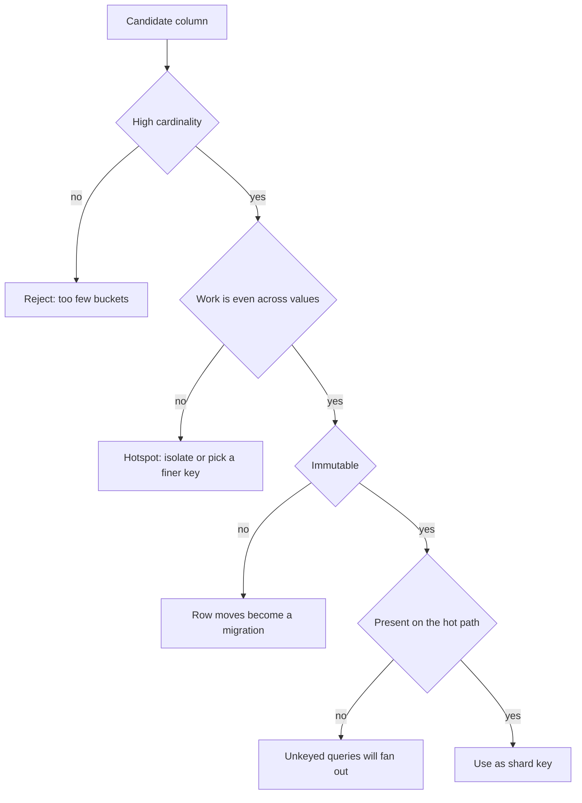

A shard key is the attribute whose value decides which database holds the row. Every later decision — which queries are fast, which transactions are local, which tenant can move — is downstream of that choice. Pick a key with enough distinct values, a write pattern that does not hammer one shard, and a value that will not change. Change the key later and you rewrite the fleet.

Cardinality is the first filter. A key with ten values cannot spread load across sixteen shards. Country code, boolean flags, and status enums fail immediately. A key with millions of values can spread, if those values are equally busy. A million users where two of them produce half the writes is a hotspot, not a success.

Hotspots are the second filter. Monotonic keys (time, `SERIAL` ids) range-shard onto the newest partition. A celebrity tenant hash-shards onto one bucket that still receives a disproportionate rate. The key must spread *work*, not only row count.

Immutability is the third. If `email` is the shard key and the user changes email, the row has to move shards, every child row has to move, and in-flight requests still hit the old shard. Prefer a surrogate that never changes: `user_id`, `shop_id`, `device_id`. Put the changeable attributes beside it.

If you cannot name the key in one sentence that matches how the product loads data, you are not ready to shard.

## Concept

The shard key is both a routing function and a collocation promise. Routing: given this value, I know which instance to open. Collocation: rows that share this value live together, so I can join and transact among them.

### Cardinality and skew

High cardinality means many distinct values. User id, order id, device id usually qualify. Low cardinality means you will have fewer occupied shards than you think. Skew means the distribution of *traffic* is not the distribution of values. Power-law tenants — one shop that is a thousand times busier than the median — break hash spreading. You isolate those tenants on dedicated shards (directory exception) or you pick a finer key (`shop_id` plus a random suffix on the hottest entities), which then splits the tenant's transactions.

Measure the candidate key. Histogram of distinct values. Histogram of writes per value. Histogram of data size per value. A key that looks even in a unit test will not look even in production if you never plotted it.

Hash of a high-cardinality key is the default spreading function. Range of a high-cardinality key is right when you need range scans (time series by `device_id` plus time as a clustering column inside the shard, not time as the shard key). Time as the *shard* key is a classic failure: today lands on one shard, yesterday's shard is cold.

### Collocation versus spreading

The product transaction tells you what must sit together. An order and its line items should share a key (`order_id` or `customer_id`, depending on whether you transact per order or per customer). A shop and its products, inventory, and staff should share `shop_id`. If you shard orders by `order_id` and customers by `customer_id`, placing an order is a cross-shard write unless you duplicate data.

That is the tension. A key that collocates a whole tenant (`shop_id`) gives you transactions and also gives you a tenant-sized hotspot. A key that spreads hotter (`order_id`) balances load and breaks "all of this customer's orders in one query" unless you add a second access path.

Pick the grain of the unit of work. Marketplace platforms often shard by seller or by shop because almost every request is in that context. Consumer social products often shard by user id because the home feed and the profile are per user, and they accept that a global search is another system.

### Immutability and compound keys

Once a row is written to a shard, moving it is a migration. Use an immutable surrogate. If you must shard by a value that can change, you are signing up for a move protocol: dual write, directory update, read repair.

Compound keys appear in two roles. The shard key might be `(tenant_id)` while the primary key is `(tenant_id, id)`. Or the shard key might itself be compound: `(customer_id, order_id)` hashed, which is usually a mistake unless you always have both in hand. MongoDB's shard key can be compound; if the leading field is low cardinality you recreate hot chunks. DynamoDB's partition key is the shard key; the sort key is not. Mixing those two roles in conversation is how teams "shard on timestamp" by accident.

Whatever you pick, put it on every row that must live with the parent. Child tables carry `shop_id` even if they also have `product_id`. The router should not have to join to find the shard.

### What you cannot shard on

Do not shard on a value the hot path does not have. If every request has `shop_id` and only some have `user_id`, `shop_id` is the candidate. Do not shard on a random UUID if you then need to list by tenant without a secondary index. Do not shard on a field you plan to null out. Do not shard on something you compute from user input you do not trust to be stable.

## Trade-offs

| Approach | When it wins | Cost / risk |
| -------- | ------------ | ----------- |
| High-cardinality hash of a surrogate | Even load, immutable routing | Range queries scatter; resharding needs consistent hashing or a map |
| Tenant or user id | Collocated transactions, simple routing | Celebrity / whale hotspots |
| Range of a monotonic key | Easy splits, time-ordered data | Write hotspot on the latest range |
| Compound or directory exceptions | Isolate whales, support moves | Operational complexity; more ways to miss the key |

The key you want is immutable, present on every hot-path request, high cardinality, and low skew. You will not get all four. Rank them for your product. A B2B SaaS with a few huge customers should bias toward tenant collocation plus dedicated shards for whales. A consumer app with millions of similar users should bias toward hashed user id and an external search cluster for the unkeyed queries.

## Diagram

## Failure modes

### Low-cardinality key

**Detection.** Sixteen shards provisioned, three contain almost all rows. CPU charts match. The key was `region`, `plan_type`, or a status. New shards stay empty.

**Mitigation.** Stop. Pick a key with a distinct value per routing unit (user, shop, device). Region can be a placement hint for which cluster a tenant lives in, not the shard key inside the cluster.

### Monotonic or time-based hotspot

**Detection.** The shard that owns the current day or the latest id range saturates. Older shards idle. Insert latency climbs only on that instance. Range sharding on `created_at` or `SERIAL`.

**Mitigation.** Hash an immutable id instead, and keep time as a sort or partition *inside* the shard if you need to drop old data. If you need time-range queries across all entities, that is an analytics path, not the OLTP shard key.

### Mutable key and silent misses

**Detection.** User changes email, username, or org slug that you sharded on. Reads go to the new shard, rows remain on the old one. Writes split. Unique constraints do not see each other.

**Mitigation.** Shard on a surrogate. Treat the mutable field as a unique attribute with a lookup (`slug -> shop_id`) in a small global table or cache. If a move is required, run it as a planned reshard of that key, with dual read until cutover.

### Key not on child rows

**Detection.** The router can place `orders` by `customer_id` but `order_lines` only has `order_id`. A second hop is needed, or lines land on a default shard. Transactions spanning order and lines go cross-shard.

**Mitigation.** Denormalize the shard key onto every child table at insert time. Foreign keys stay inside the shard. The line insert includes `customer_id` (or `shop_id`) even though it is logically redundant.

## Real-world example

Instagram's early engineering posts on sharding PostgreSQL described a fleet split by user id. Photos, friendships, and other user-owned rows carried that id so a request for a user's data hit one shard. They generated ids that encoded a shard identifier, so the id itself could be routed without a directory lookup. That design only works if the product's dominant unit of work is the user. A query "all photos worldwide from this hour" is not that unit; it belongs in a search or analytics system.

Amazon DynamoDB makes the same rule a hard API: the partition key is the shard key. AWS's own guidance is to pick a partition key with high cardinality and to avoid keys that concentrate traffic (a popular product id as the only partition key for a flash sale). Sort keys organize data *inside* the partition. Teams that put `date` in the partition key recreate the monotonic hotspot DynamoDB will throttle as `ProvisionedThroughputExceeded` on that partition while neighboring partitions have spare capacity.

MongoDB's jumbo chunks and hot chunks are the document-store version of a bad shard key: a low-cardinality leading field, or a monotonically increasing key, produces chunks that cannot split or that take all inserts. The recovery is always the same and always expensive: pick a better key and migrate.

## What to remember

- Cardinality, skew, immutability, and presence on the hot path are the four tests. Fail one and the fleet will show it.
- Collocate rows that transact together. Spread work if a tenant would become a single-shard outage.
- Do not shard on time or on a `SERIAL` tail. Hash an immutable id; keep time inside the shard.
- Child rows must carry the shard key. A mutable business attribute is a lookup, not a routing key.
