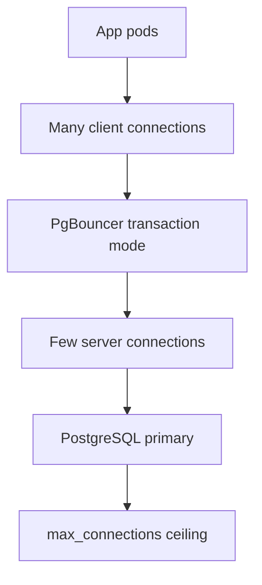

A database connection is a process or a thread on the server, memory for buffers, and a session of state: search path, open transaction, prepared statements, advisory locks. Opening one is not free. Closing one is not free. A web worker that opens a connection per request will spend more time in handshake than in SQL once traffic rises, and a fleet of workers will hit the server's connection limit long before they hit CPU.

Connection pooling keeps a set of live connections and hands them to callers for the duration of a request or a transaction. The application thinks it opened a connection. It borrowed one. When it "closes," the pool returns the connection, after a reset of session state you actually reset. The server sees far fewer connections than there are application threads.

PostgreSQL's `max_connections` default of 100 is a ceiling many teams hit with a handful of app nodes. Each connection is a backend process. A thousand backends is a thousand copies of work the machines could have spent on queries. MySQL's thread-per-connection model has a different cost curve and the same conclusion: cap connections at the server, multiplex at the edge.

PgBouncer is the pooler you will actually operate in front of PostgreSQL. Its session mode and transaction mode are not interchangeable. Pick the wrong one and prepared statements, advisory locks, or `SET` in a session vanish between requests — or you never get the multiplexing you needed.

## Concept

Without a pool, `N` application processes times `M` threads each hold a connection, most of them idle between queries. The server pays for idle connections. The kernel pays for file descriptors. The pool sits between those processes and the server and keeps `P` connections open, with `P` sized to what the database can usefully run at once, not to how many HTTP workers you started.

### Where the pool lives

In-process pools (JDBC, SQLAlchemy, ActiveRecord, Npgsql) live inside each application runtime. They stop one process from opening a connection per request. They do not stop fifty processes from each opening twenty connections. The server still sees the product.

A shared pooler — PgBouncer, Odyssey, ProxySQL, Amazon RDS Proxy — sits as a separate tier. Application processes connect to the pooler with cheap, often short-lived connections. The pooler holds a smaller set of server connections. This is the design that lets a Kubernetes deployment with hundreds of pods talk to a PostgreSQL primary that allows two hundred backends.

Size from the server outward. Decide how many active queries the primary should run (`max_connections` minus superuser reserve minus maintenance). That is the pool's server-side size, perhaps per database and user. Then let the client side of the pooler accept more connections than that; extras wait. Waiting in the pooler is better than waiting on `too many connections` after a failed handshake.

### Session mode versus transaction mode

PgBouncer session mode pins a server connection to a client for the client's entire connection lifetime. Session state works: `SET`, temporary tables, prepared statements, `LISTEN`, advisory locks held until commit-or-disconnect. Multiplexing is weak. You have roughly as many server connections as concurrent client connections.

Transaction mode assigns a server connection for one transaction and returns it at commit or rollback. Many clients share few server connections. Session state must not matter across transactions, because the next transaction may run on a different backend. Prepared statements at the session level break unless you use protocol-level named statements carefully or PgBouncer's `max_prepared_statements` support in recent versions. Temporary tables vanish. `SET` in a transaction is fine; `SET` as session configuration is not, unless the pooler resets it.

Statement mode is even more aggressive: a connection per statement, which breaks multi-statement transactions. Leave it alone for OLTP.

Most web applications should run transaction mode and keep transactions short. Applications that need session features (a reporting job with temp tables, `LISTEN/NOTIFY` on a dedicated connection) get a separate pool in session mode, or they bypass the pooler.

### Reset, timeouts, and idle

A borrowed connection may still be `idle in transaction` if the caller forgot to commit. That pins a server backend and holds locks. Poolers must have server idle timeouts, client timeouts, and a server reset query (`DISCARD ALL` in PostgreSQL) on return. `DISCARD ALL` drops prepared statements, temp tables, and `SET`. That is correct for transaction pooling. It is surprising if you thought a prepared statement lived on "your" connection.

Match pool size to `statement_timeout` and to the number of shards. A pool of 50 per app node times 40 nodes is 2,000 attempted backends. Do the arithmetic on a whiteboard before you copy a blog's `pool_size = 25`.

Pool wait is a signal. If clients spend hundreds of milliseconds acquiring a connection, the database is already at useful concurrency, or the pool is too small, or queries are too long. Raising the pool in the first case only adds backends that contend for the same CPU. Shorten the queries, add read replicas for the read-heavy work, or admit that this primary is at capacity. Raising `max_connections` to make the error go away is how a connection incident becomes a memory incident.

Transaction mode also changes how you think about connection-level features in ORMs. A Rails or Django worker that checks out a connection for the request, opens a transaction, runs three queries, and returns the connection is the happy path. A worker that checks out a connection, sets a session `SET`, and assumes the next request on that thread still has it, is not, once PgBouncer has handed the backend to someone else. Keep session configuration in the startup query the pooler runs, or in `SET LOCAL` inside the transaction.

## Trade-offs

| Approach | When it wins | Cost / risk |
| -------- | ------------ | ----------- |
| No pool / connection per request | Scripts, tiny traffic | Handshake cost, `max_connections` exhaustion |
| In-process pool only | One app process, or a few | Fleet-wide oversubscription of the server |
| PgBouncer session mode | Session state, `LISTEN`, temp tables | Little multiplexing; still easy to hit server limits |
| PgBouncer transaction mode | Web OLTP, many pods, short transactions | Session features break; must reset state |

RDS Proxy and similar managed poolers add failover token sharing and TLS, with their own limits on multiplexing (pinning when a session uses a temp table or a prepared statement). Read the pinning rules. A feature that pins every connection turns the proxy into an expensive TCP forwarder.

## Diagram

## Failure modes

### Pool sized past the server

**Detection.** Errors: `FATAL: remaining connection slots are reserved` or MySQL `Too many connections`. App nodes each have a healthy-looking local pool. The product of pools exceeds `max_connections`. Deploying one more replica of the app causes the outage.

**Mitigation.** Central pooler with a hard server-side cap. Per-process pools whose sizes are computed from `max_connections / expected_processes`. Load-test connection storms (cold start of a Kubernetes deployment). Leave headroom for migrations, superuser, and replica connections.

### Transaction-mode surprises

**Detection.** Prepared statement does not exist. Temp table vanished. Advisory lock did not block the other request. `SET TIME ZONE` did not stick. The same code worked against a direct connection or session mode.

**Mitigation.** Run OLTP in transaction mode and remove session-scoped features from request code. Put `LISTEN` workers on a session-mode pool. Enable PgBouncer's prepared-statement support if you need it, and test. Document the mode next to the connection string so the next engineer does not "fix" it by switching to session mode and melting `max_connections`.

### Idle-in-transaction pins

**Detection.** Pooler shows all server connections busy. `pg_stat_activity` shows `idle in transaction`. An exception path opened a transaction, called a remote API, and never committed. Unrelated queries wait on locks or on the pool.

**Mitigation.** `idle_in_transaction_session_timeout` on the server. No remote I/O inside a transaction. Pooler `query_wait_timeout` so waiters fail fast. APM traces that include time-to-acquire-connection. Treat pool wait as a first-class SLO.

### Connection storms on deploy or failover

**Detection.** A rolling deploy restarts every pod. Each pod fills its pool at once. The primary's CPU is handshake, not queries. After a leader failover, every client reconnects together and the new primary staggers.

**Mitigation.** Slow pool ramp, jittered retries, and a pooler that already holds server connections through app restarts (the point of a shared pooler). On failover, PgBouncer `PAUSE`/`RESUME` or RDS Proxy's client hold. Cap concurrent connection attempts.

## Real-world example

GitLab's documented PostgreSQL architecture puts PgBouncer in front of the primary, in transaction mode for the web and API workload. Application processes connect to PgBouncer, not to PostgreSQL. The number of PostgreSQL backends stays bounded while Puma and Sidekiq process counts grow. GitLab also runs extra connection paths: extra PgBouncer instances for load, and session-mode or direct connections where a component needs session semantics. Their public runbooks treat `pgbouncer` saturation and `idle in transaction` as paging conditions.

Heroku Postgres historically offered a PgBouncer buildpack for the same reason: dynos times Rails pool size exceeded the plan's connection limit. The fix was not "raise `max_connections`." The fix was multiplexing. Raising `max_connections` on PostgreSQL to match a large fleet is how you trade a connection error for a memory and context-switch stall.

If you take one operational practice from those systems, take this: count backends on the primary, count waiters on the pooler, and size the pool to the query capacity of the machine. Connection pooling is not an application convenience. It is how you keep the database from spending its budget on sitting still.

## What to remember

- Server connections are scarce. Pool to the database's useful concurrency, not to the number of app threads.
- In-process pools do not protect a fleet. Use a shared pooler when process count is large.
- PgBouncer transaction mode multiplexes; session mode preserves session state. Do not mix the needs.
- Cap, timeout, and reset. Idle-in-transaction and deploy storms are the outages the pool exists to prevent — or to cause, if mis-sized.
