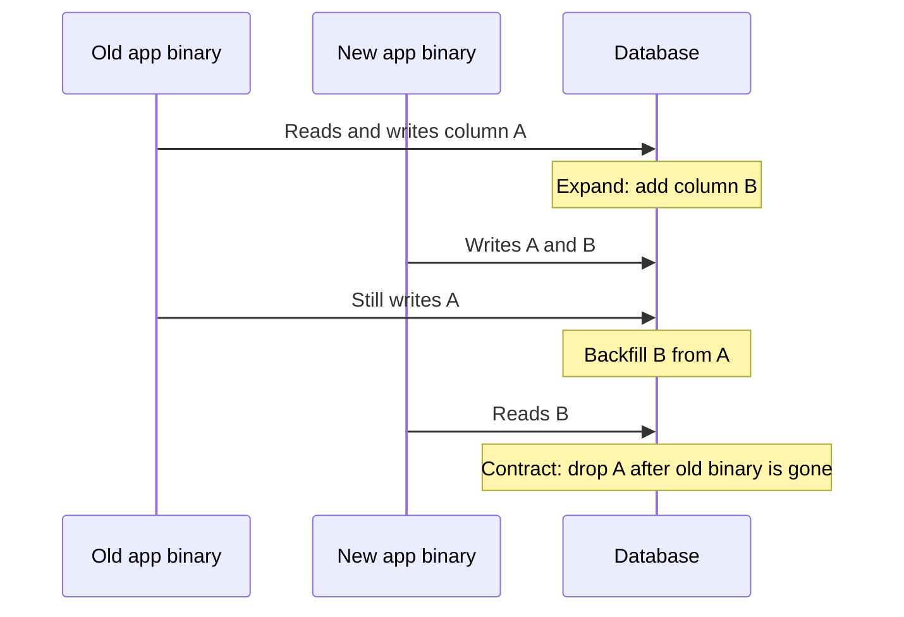

A migration is a versioned change to the schema or to existing data. In production it must run while the old application and the new application may both be live. That constraint, not the SQL dialect, is the design. If the deploy is a single cut where you stop the world, you can do almost anything. If the deploy is rolling, every migration has to be backward compatible with the code that is still running.

The expand/contract pattern is the working method. Expand: add the new structure while keeping the old one working. Deploy code that writes both, or that reads from the old column and falls back. Backfill. Switch reads. Contract: remove the old structure once no running process needs it. Two deploys at least, often three. One clever `ALTER` that renames a column in place will 500 the old pods still selecting the old name.

Locks are the other half. PostgreSQL `ALTER TABLE` can take `ACCESS EXCLUSIVE`, which blocks reads and writes for the duration. Adding a column with a constant default is cheap on modern PostgreSQL. Adding a column with a volatile default, rewriting the table, or adding an index without `CONCURRENTLY` is a lock that will queue every query behind it. MySQL's historic table copies were the same class of outage; online schema change tools exist because of it.

If your migration story is "Rails migrate on boot," you do not yet have a production migration story. You have a development convenience that will lock a busy table at the worst time.

## Concept

Treat schema change as an API change between processes that do not restart together. The database is the shared memory. Both binaries must agree on it at every instant of the rollout.

### Expand, backfill, contract

Rename a column without downtime: add the new column (expand). Deploy code that writes both columns. Backfill the new column from the old. Deploy code that reads the new column. Stop writing the old column. Drop the old column (contract). Each step is a migration or a code deploy that can roll back one step.

Add a `NOT NULL` constraint the same way: add the column nullable, backfill, constrain. PostgreSQL can add `NOT NULL` without a full rewrite in current versions if there is no constraint to verify on every row, but a `VALIDATE` of a check still scans. Do the scan when you choose to, not as a surprise inside a deploy hook.

Split a table, merge tables, move a column to JSON, extract a one-to-many: always dual write or dual read through a transition. Data migrations (`UPDATE ...`) on large tables belong in batched jobs with a sleep and a replica-lag check, not in a single transaction that holds row locks for an hour.

### Backward compatible deploys

Compatible means the old code still runs. Do not drop a column the old code selects. Do not add a new `NOT NULL` column without a default the old code's `INSERT` will satisfy. Do not rename a table under a running binary. Do not add a check constraint that the old writer will violate.

Expand-only migrations can ship with the code that starts using the new shape, if the old shape remains. Contract migrations ship after the old code is gone from every process, including cron, workers, and that one forgotten canary. Feature flags help for application behavior. They do not help if the worker binary still has the old SQL compiled in.

Multiple databases and multiple services sharing a schema raise the bar. The slowest consumer defines when you may contract.

### Locks and online changes

Know the lock. In PostgreSQL, `CREATE INDEX` blocks writes; `CREATE INDEX CONCURRENTLY` does not, and it cannot run in a transaction (so your migration runner must allow that). `ALTER TABLE ... ADD COLUMN` with a non-constant default rewrites. `VACUUM` and long transactions block the lock, and the lock queues behind them, and then everything queues behind the lock. Set `lock_timeout` so the migration fails instead of waiting forever in a queue that has stopped the site. Retry.

MySQL and MariaDB: prefer online DDL where the engine supports it, or an external online schema change tool that copies the table and applies a changelog. GitHub's gh-ost and Percona's pt-online-schema-change exist for this. They are not magic; they load the primary with a copy and they need a cutover window.

Never run an unbounded data backfill inside the schema transaction. Commit the DDL (or the expand) first. Backfill in chunks of thousands of rows with a primary key range, a pause, and monitoring of replication lag and WAL generation.

Triggers that keep two columns in sync during the dual-write window are a valid expand tactic when you cannot change every writer at once. They have a cost: every write becomes two writes, and a bug in the trigger duplicates the bug on both columns. Prefer application dual-write when you own every writer. Use a trigger when a console, a second language, or a forgotten job still writes the old column. Drop the trigger in the contract step, or it will surprise the next person who loads a row.

Version the migration in the same review as the code that needs it. A schema change merged on Friday and a code change merged on Monday is how production runs a week with a column nobody reads, or worse, with a constraint the old writer fails. The expand migration can land first. The contract migration cannot land before the code.

## Trade-offs

| Approach | When it wins | Cost / risk |
| -------- | ------------ | ----------- |
| Stop-the-world migrate | Tiny data, maintenance window, internal tools | Downtime; people skip the window |
| Expand/contract with rolling deploys | Always-on OLTP | More deploys; dual-write bugs; longer calendar time |
| In-place DDL with exclusive lock | Instant catalog change on small tables | Blocked queries, replica lag, a site-wide stall |
| Online schema change / `CONCURRENTLY` | Large tables, busy primaries | Operational complexity; not transaction-wrapped |

The default for a public service is expand/contract plus concurrent indexes plus `lock_timeout`. The default for a nightly internal job with a window can be a straightforward `ALTER`. Mixing those cultures — a startup habit of migrate-on-boot on a table that now has a billion rows — is a predictable incident.

## Diagram

## Failure modes

### Exclusive lock behind a long transaction

**Detection.** The migration waits. Application queries pile up in `wait_event` for LockManager or `relation`. `pg_stat_activity` shows an old `idle in transaction` session. The site is effectively down while the `ALTER` has not even started.

**Mitigation.** `lock_timeout` (seconds, not minutes) on migration connections. Kill or wait out idle-in-transaction before retrying. Run migrations from a controlled job, not from every app boot. Watch replicas: even a brief exclusive lock can stall apply.

### Expand skipped, contract in one deploy

**Detection.** Rolling deploy: some pods have the new code that selects `user_uuid`, others still select `user_id` after the column was renamed. Error rate tracks the deploy percentage. Rollback of code cannot help if the column is already gone.

**Mitigation.** Two-step (or three-step) deploys. Rename is add + dual write + drop, never `RENAME` in production on a hot path. Feature-flag the read switch independently of the DDL. Practice rollback: the previous binary must still run against the post-expand schema.

### Backfill that never finishes or never validates

**Detection.** Dual write is live, but old rows have NULL in the new column. The `NOT NULL` migration fails at 3 a.m. Or the backfill `UPDATE` without a range lock-storms the table.

**Mitigation.** Batched backfill with a progress table. Metrics for remaining NULL count. Validate with a query before the constrain step. Throttle against lag. Idempotent batches so you can restart.

### Index build without `CONCURRENTLY`

**Detection.** Writes stall for the duration of `CREATE INDEX` on a large table. Disk fills with a sort. Replicas fall behind. Someone runs it in a transaction runner that cannot use `CONCURRENTLY`.

**Mitigation.** `CREATE INDEX CONCURRENTLY` (and `DROP INDEX CONCURRENTLY`) on PostgreSQL. Online tools on MySQL. Create indexes in their own migration that the runner knows is not transactional. If the concurrent build fails, it leaves an invalid index you must drop and retry.

## Real-world example

GitHub built gh-ost to change MySQL schemas without the long table locks of older DDL. The tool copies the table in chunks, applies ongoing writes from the binary log to the copy, and cuts over by renaming tables. GitHub's engineering writing on gh-ost is explicit about why: a busy `users` or `repositories` table cannot sit behind `ACCESS EXCLUSIVE` equivalent for the time a copy takes. Cutover is still a brief exclusive moment. The point is that the copy happened outside that moment.

Rails' `strong_migrations` gem encodes a subset of these rules for PostgreSQL: it rejects `ADD INDEX` without `algorithm: :concurrently`, rejects removing a column in the same deploy that still uses it, and rejects adding a `NOT NULL` column without a default on older PostgreSQL. It is a lint for expand/contract, not a substitute for thinking. Teams that enable it still dual-write on purpose for renames.

On PostgreSQL, adding a nullable column, adding a constant-default column in current versions, and creating an index concurrently are the operations you want to stay within. Table rewrites, `ALTER TYPE` of a column, and unconstrained `UPDATE` of every row are the operations you split, batch, or move to a copy-and-swap. The engine will do what you asked. Production safety is asking for the version that does not take the site with it.

## What to remember

- Rolling deploys require expand/contract. Old binaries must run against the new schema until they are gone.
- Set `lock_timeout`. An exclusive lock waiting behind `idle in transaction` is an outage.
- Backfill in batches with lag checks. Do not hide a full-table rewrite inside a "simple" `ALTER`.
- Concurrent indexes and online schema-change tools exist because in-place DDL on a hot table is a lock. Use them.
