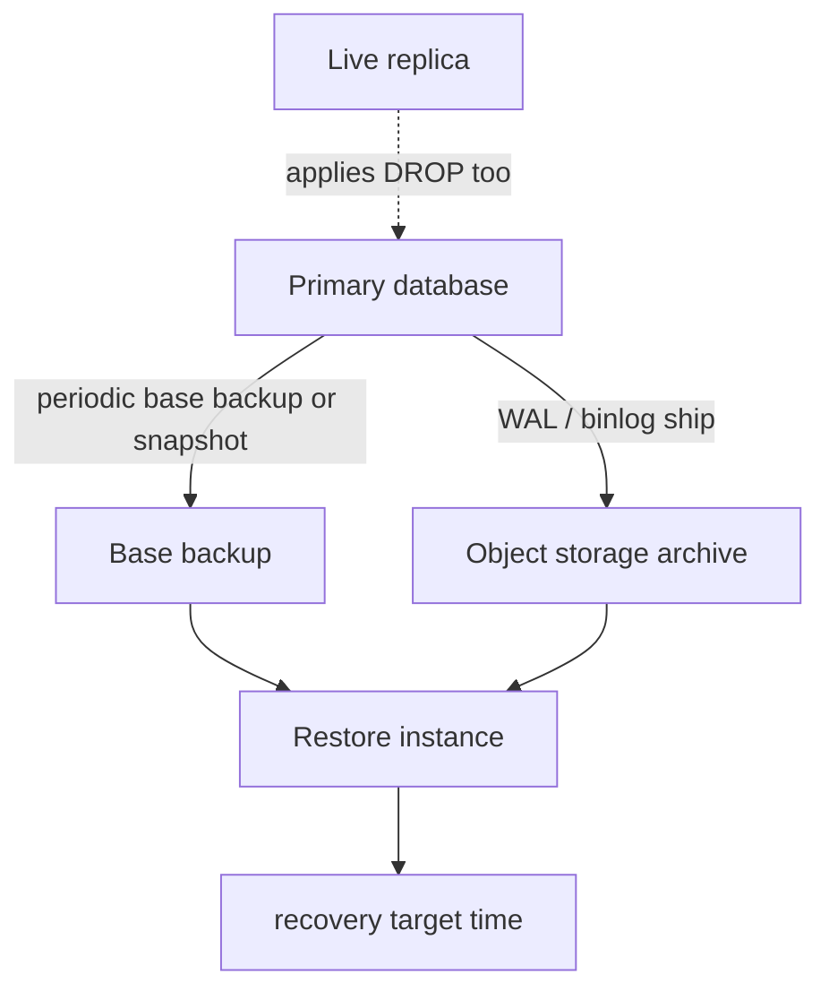

A backup is a copy you can restore. If you have not restored it, you have a file of unknown quality. Replication is not a backup: replicas apply the same `DROP TABLE` the primary applied. Snapshots in the same account, with the same IAM principal that can delete volumes, are a thin backup. The design starts from two numbers the business has to own.

Recovery Point Objective (RPO) is how much committed data you may lose: zero minutes, five minutes, a day. Recovery Time Objective (RTO) is how long the service may stay down or degraded while you restore: minutes, hours. A nightly logical dump has an RPO of up to 24 hours and an RTO of however long `pg_restore` takes on that size. Continuous WAL archiving plus a base backup can offer an RPO of seconds and an RTO that still includes provisioning disks and replaying WAL.

Pick the numbers first. Then pick the mechanism. Teams that buy a snapshot schedule without an RPO are buying comfort. Teams that skip restore tests find out during the incident that compression flags, extensions, or users were not in the dump.

This essay is the minimum production shape: what to copy, where to put it, how to get back to a point in time, and how to know it works.

## Concept

You need a consistent picture of the data files, plus a way to roll forward to a chosen time if the RPO demands it. Everything else is packaging.

### Snapshots versus logical dumps

A physical backup copies the database's files: PostgreSQL `pg_basebackup`, a volume snapshot taken with a freeze or a backup API, Percona XtraBackup, a managed snapshot. Restore is "put these files on a machine and start the engine," then optionally replay WAL. It is fast to restore at large size relative to replaying SQL. It is tied to the engine version and often to the same OS/architecture assumptions. You get everything: heap, indexes, clutter.

A logical dump copies SQL or a custom archive of objects: `pg_dump`, `mysqldump`, engine-native export. Restore is replay of statements. You can restore one table, remap owners, and often cross to a newer major version. It is slower at large size, it load-tests the target with index builds, and it can miss objects you did not include (`--globals`, roles, publications). Logical dumps are excellent for small estates, for selective restore, and for migration between versions. They are a poor sole strategy for a multi-terabyte primary if the RTO is tight.

Volume snapshots without application cooperation can capture torn pages. Use the engine's backup interface or a filesystem freeze the engine documents. Crash-consistent snapshots plus WAL archive can be made correct; crash-consistent snapshots alone are a gamble you should not take on the only copy.

### Point-in-time recovery

PITR means: restore a base backup from before the event, then replay the write-ahead log (or binlog) up to a timestamp or a transaction id just before the bad statement. PostgreSQL continuous archiving (`archive_command` or a shipping service) plus `recovery_target_time` is the textbook form. RDS and Cloud SQL expose the same idea as "restore to a time in the retention window."

Without a WAL/binlog archive, a snapshot is a single instant. You cannot land between snapshots. If RPO is five minutes, you need log shipping at least that often, and a restore drill that uses it. Retention of the archive must cover the oldest base backup you still intend to use.

Delayed replicas give you a short undo window (a replica that applies with a configured delay). They still eventually apply the drop. They are a convenience, not an archive.

The restore target is part of PITR. You name a timestamp, a transaction id, or a named restore point created just before a risky migration. PostgreSQL will pause recovery at that target. You then inspect, and only then promote the instance to accept writes. Promoting too early, or restoring onto the original primary's volumes, is how a drill becomes a second incident. Restore always into new storage until you have checked the data.

WAL shipping must complete for a commit to be in the archive if you configured it that way; if you did not, a crash between local commit and archive can still miss the last segments. That gap is your true RPO, even if the brochure said "continuous." Measure archive lag the way you measure replica lag.

### Test restore

A backup job that writes to object storage and never reads back is a monitoring green light. Schedule a restore to a scratch instance: start the engine, run `SELECT` against a known table, compare row counts or checksums, restore a single database, restore to a point in time. Time it. That duration is your actual RTO, plus DNS and application config, not the vendor's brochure.

Store backups in a different failure domain: another account, another region, immutability or object-lock if the threat includes ransomware. The primary's IAM role should not be able to delete the only copies. Encryption keys for the backup should survive a restore of the database account.

Document who may restore, to where, and how you prevent the restore from taking over production DNS until you intend it to. A restore drill that writes to the production hostname is not a drill.

## Trade-offs

| Approach | When it wins | Cost / risk |
| -------- | ------------ | ----------- |
| Logical dump on a schedule | Small data, portable SQL, selective restore | Slow RTO at size; RPO equals dump interval |
| Physical base backup plus WAL archive | Tight RPO, faster large restore, PITR | Engine-specific; you must operate the archive |
| Volume snapshots only | Convenient infrastructure-level copies | Torn pages without freeze; weak PITR; same-account deletion |
| Replica as "backup" | Never | Replicates bad writes; no point-in-time |

A common production mix is: continuous physical backup (or managed snapshots plus transaction logs) for disaster recovery, plus an occasional logical dump of small critical tables for surgical undo. The mix is justified. Replacing the physical path with "we have a replica in another AZ" is not.

## Diagram

## Failure modes

### Never-tested backup

**Detection.** The first restore is the incident. The dump is empty, the credentials expired, the extension is missing, WAL segments have a gap, or the snapshot is of the wrong volume. The job has been "green" for a year.

**Mitigation.** Automated restore to a throwaway instance on a schedule. Alert on restore failure, not only on backup job success. Include extensions, roles, and a row-count check. Time the restore and put that number in the disaster plan.

### WAL gap, broken PITR

**Detection.** Base backup restores. Replay stops at a missing segment. `pg_wal` / archive has a hole after a disk-full event or a misconfigured `archive_command` that returned success without shipping. RDS retention elapsed.

**Mitigation.** Monitor archive success and WAL age. Fail the primary's archive if shipping fails (PostgreSQL can pause or you page). Keep base backups inside the archive retention. Practice PITR, not only latest-snapshot restore. A gap makes every backup after the gap a latest-only restore.

### RPO/RTO nobody agreed to

**Detection.** After data loss, executives expected five minutes; the system dumped nightly. Or restore takes twelve hours onto disks you did not pre-provision, against an RTO of one hour.

**Mitigation.** Write RPO and RTO per datastore. Size backup frequency, archive, disk provisioning, and staff runbooks to those numbers. If the business will not pay for the RPO they named, change the number in writing before the incident, not after.

### Backup in the blast radius

**Detection.** Ransomware or a bad IAM policy deletes the database and the bucket. Snapshots live in the same account with delete permission on the operator role. A `lifecycle` rule expires the only copy during the incident.

**Mitigation.** Separate account or vault, object lock or equivalent, least privilege on delete, and a copy off-cloud or cross-region. Lifecycle must match the retention the RPO requires. Test that the restore role can read and that the production role cannot wipe the vault.

## Real-world example

PostgreSQL's documented continuous archiving and PITR is the reference mechanism. You take a base backup (`pg_basebackup` or a snapshot coordinated with `pg_backup_start` / `pg_backup_stop` in current versions), you archive every WAL segment to durable storage, and you restore by starting a new instance in recovery with a `recovery_target_time`. GitLab's public documentation for self-managed instances describes backups of PostgreSQL, object storage, and repository data as separate components: restoring the application means restoring all of them to a consistent-enough point, which is why they warn that a database backup without the matching Git data is not a full restore of GitLab.

Amazon RDS exposes the same split with different knobs: automated backups plus transaction logs enable point-in-time restore within a retention window (up to 35 days on RDS), and manual snapshots last until you delete them. Multi-AZ failover is not that feature. A deleted database can be restored from backup only if the backup still exists and the caller has permission. That is the RPO window you actually bought.

If you run the engine yourself, your `archive_command` (or a WAL shipper like wal-g or pgBackRest) is a production dependency equal to the primary. If it silently fails, you will learn at restore time. Page on archive failure. Restore on a schedule. Those two alarms are the backup system.

## What to remember

- RPO and RTO are business numbers. The backup mechanism is how you meet them, not the other way around.
- Replication is not a backup. Tested restores of physical copies plus WAL (or logical dumps at small size) are.
- PITR needs a base backup and an unbroken log archive. A WAL gap ends your choice of restore time.
- Restore drills measure real RTO and prove the copy is not an empty file in a bucket you cannot read.
