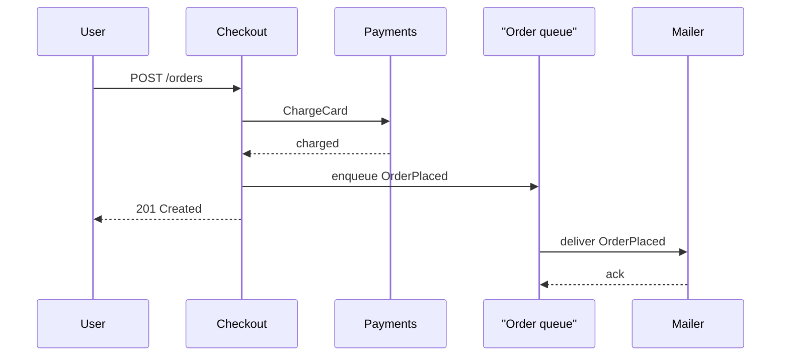

Synchronous communication is a round trip you sit in. The caller sends a request, holds a thread, a socket, or a future, and does not continue until a response arrives or a timeout fires. Asynchronous communication is a handoff. The caller records work in a durable place, receives an acknowledgment that the record exists, and continues. The work finishes later, on another process, often after the original caller has already returned to its own caller.

Those two shapes couple different things. A synchronous call couples the caller's availability to the callee's availability, and the caller's latency to the callee's latency plus the network. If payments is down, checkout is down. If payments takes 800 ms, checkout takes at least 800 ms plus its own work. An asynchronous path decouples those. Checkout can succeed while the mailer is restarting. The price is a queue, an ordering question, a duplicate question, and a new failure mode: the work was accepted and then never finished.

Engineers who have only written HTTP handlers often treat "async" as `await` inside one process. That is concurrency, not distribution. The architectural choice is whether two services share a request lifetime. If they do, you have designed a single availability domain even if the code lives in two repositories.

Choose the shape from the user's clock, not from fashion. A human waiting on a spinner needs a known result before you close the request. A warehouse, a search index, and a weekly report do not.

## Concept

### The synchronous call as shared fate

A synchronous RPC or HTTP call has a clear contract. Before the caller returns, it knows whether the work succeeded, failed, or timed out. Timeouts are part of that contract, not an afterthought. Without one, a hung callee holds the caller's threads and connections until something else fails first: a load balancer idle timeout, a language runtime, or an exhausted pool.

Retries on a synchronous path multiply load. One timeout followed by two retries turns one slow request into three. If the callee is already overloaded, retries are how a slowdown becomes an outage. Idempotency keys belong on any mutating call you are willing to retry. A timeout is not proof that the callee did nothing; it is proof that you stopped waiting.

Synchronous is the right default when the user is waiting and the answer must be known now: authorization, an inventory hold for the current cart, a card charge when you cannot fulfill otherwise. It is the wrong default for fan-out, for work that takes seconds, and for any callee whose error budget is worse than the caller's.

Keep the synchronous graph shallow. Each extra hop adds tail latency and another availability number you inherit. Three services in a chain, each at 99.9 percent, are not a 99.9 percent path. They are a path whose combined downtime you will meet in production.

### The asynchronous handoff

Asynchronous communication inserts a buffer between send and complete. That buffer is usually a queue, a log, or a mailbox. The producer writes a message. The broker acknowledges the write. A consumer reads the message later and performs the work. The producer's success means "durably recorded," not "done."

That shift changes three questions you cannot postpone.

First, ordering. A competing-consumer queue may deliver out of order. A partitioned log preserves order only within a partition. If a cancel can overtake a create, the consumer must tolerate that, or both messages must share a key that hashes to one partition.

Second, duplicates. Producers retry after a timeout. Brokers redeliver after a crash or a visibility timeout. At-least-once is the common contract. Exactly-once is a property you build in the consumer with idempotency, not a checkbox on a vendor page.

Third, completion signaling. The original user still needs a result. Return an accepted status and an identifier, then expose a status endpoint, a websocket, or an email. Do not hold the HTTP request open for the worker. The request budget and the job budget are different clocks.

### Mixing them on one product path

Almost every product path is mixed. The user-facing request is synchronous through the edge, the API, and the database write that makes the order real. Side effects after that write are asynchronous: mail, search, analytics, warehouse. The boundary is the commit. Work that must be true before you tell the user "paid" stays on the synchronous path. Work that can finish in the next few seconds or minutes leaves through a queue.

Do not hide a synchronous call behind an asynchronous name. A worker that HTTP-calls three services in sequence is still coupled to those three for the duration of the job. You have moved the coupling off the user's request, which is useful, and you have not removed it. Timeouts, retries, and bulkheads still apply inside the worker. The queue only bought you isolation from the original request's availability.

A useful test: if the callee is down, can the caller still return a correct answer to its user? If yes, the path is asynchronous with respect to that callee. If no, you are synchronous, and you should provision, page, and budget as if those two services were one system.

### What "success" means

On a synchronous path, success is a response code and a body the caller can act on. On an asynchronous path, you have at least two successes, and they must not be confused. Enqueue success means the broker has the message. Processing success means the consumer finished the side effect. User-visible success is a product decision: sometimes it is the enqueue, sometimes it is the processing, and lying about which one you mean is how support tickets start.

Instrument both. A 202 from the API with a growing queue and a silent worker is not a healthy system. It is a system that moved the failure out of the request log and into a backlog.

## Trade-offs

| Approach | When it wins | Cost / risk |
| -------- | ------------ | ----------- |
| Synchronous RPC / HTTP | The caller needs the result before continuing; the callee fits the same SLO budget | Shared availability; latencies add; retry storms under load |
| Asynchronous queue or log | The callee can lag; spikes should buffer; many workers can drain one pile | Ordering and duplicates; "accepted" is not "done"; backlog is delayed work |
| Hybrid: sync commit, async side effects | User-visible truth is small and local; notifications and projections can wait | Dual-write bugs if the publish is not in the same transaction as the commit |
| In-process async only | One process, one request, parallel I/O | Does not isolate failure domains; still one availability number |

A hybrid path is the usual production shape, and the usual production bug is a dual write: the database commit succeeds and the enqueue fails, or the reverse. Outbox tables, transactional messaging, or a reconciliation job exist because that bug is not rare. Pick one of those three before you ship the mixed path, not after the first missing email.

## Diagram

## Failure modes

### Callee timeout on a synchronous path

**Detection.** p99 latency climbs, then timeout rates, then thread or connection pool exhaustion on the caller. The caller's error budget burns even when its own code is healthy. Dependency dashboards show the callee slow or saturated; the caller's CPU looks idle while request queues grow.

**Mitigation.** Set timeouts shorter than the remaining budget on the caller. Cap retries and add jitter. Bulkhead the client's pool so one dependency cannot take every thread. Fail the user-facing request with a named error. Circuit-break a callee that is already failing so you stop paying the timeout tax on every request.

### Backlog growth on an asynchronous path

**Detection.** Queue depth and the age of the oldest message rise. Consumer lag on a log is the same signal. User reports of "I paid but got no mail" arrive hours later if you only watch consumer error rates. Depth without age is a weak page; a million tiny messages can be a one-minute delay, and ten huge messages can be an hour.

**Mitigation.** Alert on age against the product SLO, not only on count. Autoscale consumers up to a cap set by the downstream's safe rate. Shed at enqueue time when a watermark trips: reject, degrade, or ask the user to wait. Dead-letter poison messages so one bad payload does not stall a partition or a worker forever.

### Duplicate processing

**Detection.** Double charges, double emails, unique-constraint errors on a table that should have one row per business id. Broker redelivery counts and producer retry counts are both high. An idempotency table shows colliding keys from overlapping in-flight work.

**Mitigation.** Put a stable idempotency key on every message and every mutating RPC. Consumers upsert by that key before they call money-moving APIs. Treat at-least-once as the contract you write code for. Make the handler safe to run twice, then assume it will.

### Silent drop after accept

**Detection.** The API returned 202 or 201. No worker log line exists for that id. The broker has no message. An outbox row sits in `pending` past its SLA. Support can see the order and cannot see the side effect.

**Mitigation.** Publish through an outbox in the same database transaction as the business write, then have a publisher drain the outbox. Reconcile stuck pending rows on a timer. Expose the work id so a human can look it up. Never tell the user a side effect is done when you have only accepted it.

## Real-world example

Stripe's HTTP API is synchronous for the operation you asked for. Creating a PaymentIntent is request-response: your server learns whether the object was created before it continues. Many later facts do not travel on that same connection. Stripe emits Event objects and delivers them to endpoints you register as webhooks: `payment_intent.succeeded`, `charge.failed`, and the rest. Your server acknowledges receipt with a 2xx, and Stripe retries delivery on failure, with backoff, for a documented window.

That split is the mixed path in production form. The charge path stays synchronous because the user, or your API client, is waiting on a decision from the card network. Bookkeeping in your own system — provisioning an account, sending a receipt, updating a ledger projection — is asynchronous because it can lag without blocking that decision. If your webhook handler then calls three more of your services synchronously without timeouts, you have reintroduced shared fate on the worker side. The webhook only moved the coupling off Stripe's request.

## What to remember

- Synchronous calls share latency and availability with the callee; a timeout is part of the contract, not an optional extra.
- Asynchronous calls mean "recorded," not "finished"; you still owe the user a way to learn the result.
- Ordering and duplicates are consumer design problems, not broker trivia you can ignore after the demo.
- Put the commit the user waits for on the synchronous path, and put fan-out behind a queue with an outbox.
