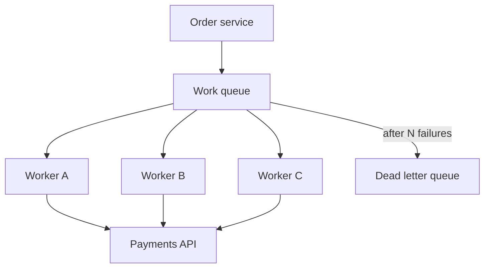

A message queue is a durable buffer between a producer that wants work done and a consumer that can do it. The producer writes a message and continues. One consumer later reads that message, processes it, and acknowledges it so the broker can delete it. Other consumers on the same queue are competitors, not copies. That is the point-to-point contract: each message is delivered to one worker, not to every worker.

A queue is not a topic. A topic fans out. Each subscriber gets its own copy. If you need three systems to react to the same order, a queue alone will not do that unless you put three queues behind a fan-out hop. If you need three workers to share a pile of jobs, a queue is the right primitive. Mixing those two in conversation is how teams buy the wrong broker feature and then write glue to fake the other.

The queue buys you load leveling, isolation from the caller's request lifetime, and a place to put work when the consumer is down. It costs you ordering questions, duplicate delivery, and a backlog that is delayed user-visible work. Treat depth as a product number, not as infinite hospitality.

## Concept

### Point-to-point and competing consumers

Producers enqueue. Consumers poll or receive. The broker hands each message to one consumer in the group. If you run five workers against one queue, you are spreading work, not broadcasting it. That pattern is competing consumers. Throughput scales with worker count until the downstream those workers call cannot take more load.

Visibility timeout, or a lock with a deadline, is how the broker recovers from a consumer that dies mid-work. The message becomes invisible while one worker holds it. If the worker acks, the message is gone. If the worker crashes, the timeout expires and another worker can receive it. That is why queues are at-least-once in practice. Design the handler as if the same payload will run twice.

Standard queues usually offer best-effort ordering. FIFO queues, where the product exists, order per group id and add producer-side deduplication windows. You pay for that with throughput limits and with a new stall mode: one poison message at the head of a group blocks that group. Do not buy FIFO because "order feels safer." Buy it because two messages for the same business key must not swap, and because you have a dead-letter path for the message that will not complete.

### What the broker actually stores

A message has a body and attributes. The body is the payload you will parse. Attributes are routing and metadata: a type, a correlation id, a retry count the broker or you increment. Keep the body a contract. Version it. Do not stuff an entire object graph if a pointer plus a type will do, and do not make the consumer HTTP-call back to the producer for every field unless you like coupling them again.

Durability is a broker setting with teeth. In-memory queues die with the process. Disk-backed or replicated queues survive a node loss at the cost of fsync and replication lag. At-least-once producers retry the send until the broker acks. That retry is another source of duplicates. An idempotency key in the message, honored by the consumer, is the usual fix.

Retention is not infinite. Some brokers delete on ack. Logs retain by time or size whether you have consumed or not. A queue that deletes on ack is a work pile. A log you can rewind is a history. Both can level load. They answer different replay questions.

### Enqueue, process, ack

The consumer loop is simple and easy to get wrong. Receive, process, ack. Ack after the side effect is durable, not after you parsed JSON. Ack before the database write and a crash will drop the work. Process without a timeout and a stuck handler holds the message until visibility expires, then a second handler starts, and now you have overlap.

Prefetch, or in-flight limits, cap how many messages a consumer may hold unacked. Too high and one worker hoards work while others idle, and a crash redelivers a large batch. Too low and you underuse the worker. Set it from handler time and downstream capacity, not from a default in a tutorial.

Poison messages need a maximum receive count. After N failed attempts, the broker should move the message off the work queue. Leave it in place and one bad payload can occupy a worker forever, or, on a FIFO group, freeze every later message with the same key.

### Queue versus the HTTP retry loop

Teams sometimes skip the queue and retry HTTP from the request path. That couples retries to the user's connection and to the caller's thread pool. A queue moves retries to a worker with its own budget. It also gives you a single place to observe depth, age, and failure rate. If the work must complete before you answer the user, a queue will not save you; you still need a synchronous call. If the work can complete after, stop retrying it on the request thread.

## Trade-offs

| Approach | When it wins | Cost / risk |
| -------- | ------------ | ----------- |
| Competing-consumer queue | Many workers share a job pile; order across messages is not required | Out-of-order delivery; at-least-once duplicates; head-of-line on FIFO groups |
| FIFO / ordered queue | Two messages for one business key must not swap | Lower throughput; one poison message stalls the group |
| Pub/sub topic | Independent subscribers each need a copy | Not a work pile; one slow subscriber policy can still hurt if misconfigured |
| Synchronous RPC instead of a queue | The caller must know the result before returning | Shared availability; no load leveling; retries hit the request path |

A queue is the right primitive for work. A topic is the right primitive for facts many parties should see. If you need both — notify billing, mail, and search, and also have a pool of mail workers — fan out from a topic into queues, one queue per subscriber. Do not stretch a single queue into a broadcast by making every consumer copy the message and pray they do not ack each other's work.

## Diagram

## Failure modes

### Unbounded backlog

**Detection.** Queue depth climbs and the age of the oldest message crosses the product SLO. Consumer CPU is maxed, or worse, consumers are idle while depth grows because they cannot poll. User-visible symptoms lag: missing emails, late invoices, search that does not include today's orders.

**Mitigation.** Page on age, not only on count. Autoscale workers up to a cap the downstream can survive. Stop accepting unbounded enqueue when a watermark trips. Split hot message types onto their own queues so one flood cannot starve another. Size the broker for a named peak and a named drain time.

### Duplicate delivery after a crash

**Detection.** Unique-constraint errors, double side effects, or an idempotency store showing the same key processed in overlapping windows. Visibility-timeout expirations correlate with the duplicates. Worker deploy or OOM events sit next to the spike.

**Mitigation.** Ack only after the side effect is durable. Set visibility timeout above p99 handler time, and extend it for long jobs instead of guessing a huge default. Make handlers idempotent with a business key. Cap in-flight messages so a crash does not redeliver a thousand half-done jobs.

### Poison message stall

**Detection.** The same message id appears in receive metrics over and over. One FIFO group stops draining while others continue. Error logs repeat one payload. Depth is small but age is high — a signature of a blocked head, not of a flood.

**Mitigation.** Set a max receive count and a dead-letter queue. Capture the original payload, the exception, and the attempt count on the dead letter. Alert when the DLQ is non-empty. Provide a replay path after a human or a fixer job has classified the failure. Do not infinite-retry a payload that cannot succeed.

### Consumer cannot keep the downstream healthy

**Detection.** The queue drains, but the database, the payment API, or the partner HTTP endpoint times out. Worker success rates look fine while the next hop's error rate climbs. You leveled load off the producer and concentrated it onto a worse bottleneck.

**Mitigation.** Bound worker concurrency from the downstream's safe rate, not from how many pods you can start. Use bulkheads per destination. If the downstream must shed, let the queue hold work rather than amplifying load with retries. The queue is for leveling, not for turning a spike into a stampede three hops later.

## Real-world example

Amazon SQS is a managed competing-consumer queue. Producers call `SendMessage`. Workers call `ReceiveMessage`, which makes the message invisible for a visibility timeout you configure. If the worker calls `DeleteMessage` in time, the work is done. If it does not, SQS shows the message again. Standard queues deliver at-least-once with best-effort ordering. FIFO queues order per message group id and offer a producer deduplication interval.

A redrive policy moves a message to a dead-letter queue after `maxReceiveCount` receives. That is the poison path. Teams use SQS this way for thumbnail jobs, webhook delivery, and order side effects: many workers poll one queue, each message is processed by one worker, and a second queue holds the leftovers a human or a replay job must handle. SNS sits in front when the same event must reach more than one queue. That pairing exists because a queue is not a topic.

## What to remember

- A queue is point-to-point: competing consumers share work, and each message goes to one of them.
- A topic fans out copies; do not treat a queue and a topic as the same primitive.
- At-least-once plus visibility timeout means your handler will run twice; ack after the durable side effect.
- Depth is delayed work. Page on age, cap retries into a DLQ, and cap worker concurrency from the downstream.
