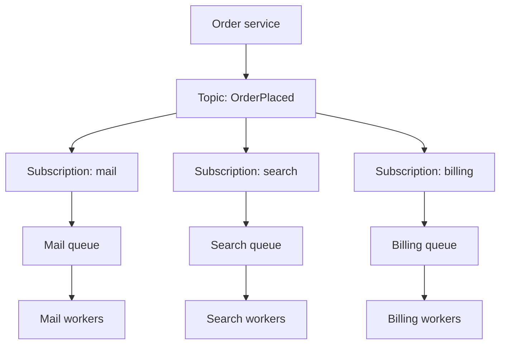

Publish/subscribe is fan-out. A publisher writes an event to a topic. The broker copies that event to every subscription. Each subscriber receives its own copy and processes it independently. Billing does not steal the message from mail. Search does not wait for billing to ack. That is the contract that makes pub/sub useful, and the contract that makes it different from a queue.

A queue is a pile of work. Many consumers compete, and one of them wins each message. If you attach three workers to a queue, you get more throughput on the same jobs. If you attach three subscribers to a topic, you get three executions of the same fact. Teams that blur those two primitives ship a "bus" where only one downstream ever runs, or a "queue" they then fork in application code because a second team also needed the event.

The publisher should not know who is listening. That is the decoupling you are buying. The cost is lost control: you cannot, from the publisher, know that every subscriber succeeded. You know the topic accepted the publish. Subscriber lag, subscriber bugs, and subscriber retries become a fleet problem, not a function call.

## Concept

### Topics, subscriptions, and copies

A topic is a named stream of messages. A subscription is a durable interest in that topic. When the publisher puts a message on the topic, the broker writes a copy into each subscription's buffer. From that moment, each subscriber is on its own clock. One can be seconds behind. Another can be hours behind. The publisher has already moved on.

"Each subscriber gets a copy" is literal. If mail, search, and analytics subscribe, a single `OrderPlaced` becomes three messages in three places. Failures do not travel sideways. Mail can dead-letter while search stays healthy. That isolation is the operational win. The corresponding cost is three times the processing, three times the chance of a duplicate, and three schemas to keep compatible.

Subscriptions are not consumers. A subscription can itself be drained by competing consumers: a queue subscribed to a topic, or a consumer group on a log. Fan-out first, then compete. That two-level shape is how you notify many systems and still scale each system's workers.

### Push, pull, and filtering

Some brokers push to an HTTP endpoint. Some wait for the subscriber to pull. Push is simpler to start and couples you to the subscriber's availability and timeout. Pull lets the subscriber apply backpressure by not asking. Production systems that care about overload pull, or they push into a queue the subscriber owns so the push target is a broker, not application code.

Filtering belongs on the subscription, not in every subscriber's first `if`. Server-side filters drop messages the subscriber does not care about before they become backlog. Over-filtering in the publisher ("I will have a topic per listener") recreates point-to-point coupling and a topic explosion. Under-filtering ("one topic, everyone parses everything") wastes I/O. Name topics by the fact, not by the listener: `order-placed`, not `notify-mailer`.

### Facts versus commands

Pub/sub works when the payload is a fact that already happened. `OrderPlaced` is a fact. `SendInvoice` is a command aimed at one owner. Publishing commands to a topic invites two subscribers to send the invoice. If you need one worker to do a job, use a queue. If you need many systems to react to a fact, use a topic. Mixing those words in an event catalog is how you get double charges from "helpful" extra subscribers.

The publisher's responsibility stops at a durable, versioned payload. Subscriber-specific fields do not belong on the event. If billing needs a tax code the publisher never had, billing looks it up. If you start stuffing every subscriber's needs into the message, the topic becomes a hidden API with a crowd of owners, and you have not decoupled anything.

### Delivery, order, and replay

Expect at-least-once delivery per subscription. The broker will retry. The subscriber will see duplicates. Idempotent handlers are not optional. Ordering, if it exists, is usually per key or per partition, not global. A subscriber that infers "this cancel arrived, so the create already did" will be wrong on a bad day.

Replay is a topic superpower when the broker is a log: a new subscriber can start at an offset and catch up. Queues that delete on ack do not give you that. If you will onboard a new projection, prefer a log-shaped topic. If you will only ever drain live work, a queue subscription is enough. Do not promise replay from a broker that cannot rewind.

Retention is a product number. Keep a day of `OrderPlaced` if a new search indexer must catch up overnight. Keep seven days if finance will replay a broken consumer after a weekend. Keep forever and you will pay for storage of facts nobody will read. Document the retention next to the event name so a subscriber does not assume history that the broker already deleted.

## Trade-offs

| Approach | When it wins | Cost / risk |
| -------- | ------------ | ----------- |
| Topic with independent subscriptions | Many systems must react to one fact; publishers should not list listeners | Copies multiply work; publisher cannot see subscriber success; schema becomes a crowd |
| Queue of competing consumers | One job should run once; workers share a pile | No fan-out; a second listener must not share that queue |
| Topic then queue per subscriber | Fan-out plus per-team competing workers and DLQs | More moving parts; two hops of latency and two places to lose a message |
| Direct RPC fan-out from the publisher | You need an immediate result from each callee | Publisher availability is the min of the callees; adding a listener changes the publisher |

The usual production topology is the third row: a topic for the fact, a queue per subscriber for the work. That is SNS to SQS, or a Kafka topic with one consumer group per service. Do not skip the per-subscriber buffer unless the subscriber is a managed function with its own retry budget and you accept that a code bug retries on the broker's schedule, not yours.

## Diagram

## Failure modes

### Slow subscriber that looks like a broker problem

**Detection.** One subscription's lag or queue age climbs while others stay near zero. The topic's publish success rate is fine. On-call for the publisher gets paged because "events are stuck," and the stuckness is one team's consumer.

**Mitigation.** Isolate subscriptions. Give each team its own queue, its own DLQ, and its own lag alert. Cap that team's workers from its downstream, not from the publisher's peak. Never let one subscriber's ack policy block another. If the broker has a shared partition, watch for hot keys that stall everyone; that is a different bug.

### Schema change that splits the fleet

**Detection.** After a publisher deploy, a subset of subscribers error on parse, poison their queues, and dead-letter. Others, written more loosely, silently drop fields. Replay from the log re-breaks the same consumers.

**Mitigation.** Version events. Add fields as optional. Do not reuse field names for new meanings. Run a compatibility check in CI against a registry when you have one. Roll subscribers that need a new field before the publisher starts emitting it, or emit both shapes during a window. Treat the payload as a public API even if it never leaves the VPC.

### Duplicate fan-out

**Detection.** Users get two emails. Search indexes two documents for one order id. Metrics show twice the expected handler invocations per publish. Publisher retries and broker redelivery both exist, and each subscription multiplies them.

**Mitigation.** Idempotency keys on the event, honored per subscriber. Deduplicate at the business id, not at "I think I processed this offset." Publisher-side retries must use the same message id so the broker can dedupe if it supports that. Remember that three subscribers mean three places to get this wrong.

### Accidental command broadcast

**Detection.** Two services send the same invoice, charge the same card, or fulfill the same shipment because both subscribed to a "command-like" topic. The catalog says `ChargeCustomer` and three teams thought they were being helpful.

**Mitigation.** Name events as facts in the past tense. Put commands on queues with a single owning consumer group. Review new subscriptions as you would review a new RPC client: who runs, what happens if two run, what happens if none run. If exactly one handler must run, pub/sub is the wrong primitive.

## Real-world example

Amazon Simple Notification Service is a topic. You create a topic, publish a JSON message, and attach subscriptions: SQS queues, Lambda functions, HTTPS endpoints, email, and others. Each matching subscription receives a copy. Teams commonly subscribe SQS queues to an SNS topic so that mail, billing, and search each get a queue they own, with their own redrive policy. SNS is the fan-out. SQS is the competing-consumer work pile. That pairing is documented because the two services are not interchangeable.

Kafka reaches the same shape with a different mechanism. A topic is a partitioned log. Each consumer group tracks its own offsets. Two groups reading `orders` each see every record. Members inside one group split partitions, which is competing consumers on that group's copy of the stream. LinkedIn built Kafka for this: activity events published once, many independent pipelines reading them. The log also lets a new group start at an old offset, which a delete-on-ack queue cannot do.

## What to remember

- Pub/sub is fan-out: each subscriber gets a copy, and copies do not compete with each other.
- A queue is point-to-point work; do not attach two unrelated systems to the same queue and call it a topic.
- Publish facts that happened. Put commands that must run once on a queue with one owner.
- Isolate lag, retries, and DLQs per subscriber so one slow team cannot define the publisher's health.
