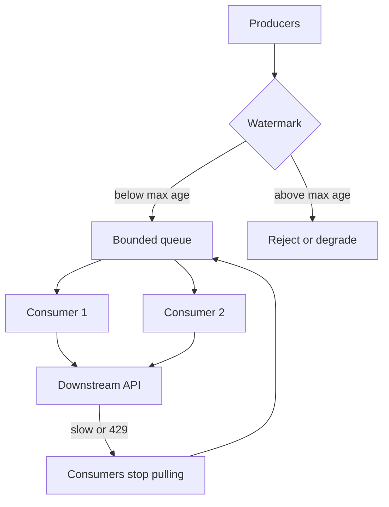

Producer-consumer is a rate-matching problem. One side creates work faster, slower, or in bursts relative to the side that executes it. A buffer sits between them so the producer can continue without waiting for each execution, and so the consumer can run at a steady pace. Without a buffer you have a synchronous call. With an unbounded buffer you have a time bomb. The design is the buffer plus the rules that keep it from becoming either of those.

Backpressure is those rules. When the buffer is past a watermark, the producer must slow down, shed, or fail a user-facing request. When the consumer is saturated, it must stop taking more work, not prefetch the world. A queue that always accepts and a worker that always pulls is not a complete design. It is a way to move an overload a few minutes into the future and then meet it as a multi-hour backlog.

In one process this is a blocking queue and a thread pool. Across services it is a broker, a visibility timeout, and a consumer concurrency cap. The physics do not change. Only the failure domain does.

## Concept

### The buffer as a contract

The producer needs a definition of success. For an in-memory queue, success is "the put did not block or throw." For a broker, success is "the broker acked a durable write." That ack is not consumer success. Document the difference in the API the producer presents to its own callers. A 201 that means "queued" must not be copy that says "done."

The consumer needs a definition of in-flight work. How many items may it hold unacked? How long may it hold them? What happens on a crash? In-process, a thread interrupted mid-work loses the item unless you have another store. Across a broker, visibility timeout returns the item to the pile. Both cases require an idempotent handler, because the same item will be seen twice.

Capacity is a number you pick. In-memory: the queue bound, in items or bytes. Broker: retention, max depth, or a product watermark you enforce even if the broker would take more. Infinite capacity is not available. Disk fills. Memory fills. A seven-day retention on a log that receives a day's worth of peak every hour is a bill, not a strategy.

### Backpressure, not hope

Backpressure is a signal toward the producer that the consumer cannot keep up. Blocking put, a full-queue exception, HTTP 429, a rejected publish, a TCP window of zero — those are backpressure. Buffering without a signal is delay. You need both, in that order of preference: try to slow the producer, then buffer a named amount, then shed.

At the edge, shedding is a product behavior. Close checkout. Return "we will email you." Refuse the upload. Inside the platform, the broker can refuse or slow publishes, and the consumer can refuse to increase concurrency. Do not autoscale consumers without a cap. The cap is the downstream's safe rate. Scale past it and you have used the pattern to concentrate load onto the database the workers all call.

A watermark needs two numbers: max depth and max age. Count lies when messages vary in size. Age is what the user feels. Page on age against the SLO. When either number trips, the producer path changes. If you only log a metric and keep accepting, you have a dashboard, not backpressure.

### Slow consumers and fast producers

The common mismatch is bursty produce and expensive consume. Image thumbnailing, PDF generation, virus scans, and LLM calls all cost more to run than to enqueue. Size the consumer from p99 handler time and the SLO for age. If you must drain a one-hour sale in ten minutes, you need six times the steady-state workers, and the downstream must survive that. If it cannot, the SLO is a fantasy, not a queue setting.

Batching on the consumer raises throughput and raises latency. Pull ten, write once, ack ten. A crash then redelivers ten. Idempotency must cover the batch. Batching on the producer raises broker efficiency and risks a large message that fails as a unit. Keep batches small enough that a retry is acceptable.

### In-process versus distributed

`java.util.concurrent.BlockingQueue`, Go channels with a bound, and Python `queue.Queue` are the in-process form. They vanish on process death. Use them to absorb microseconds and to limit thread counts. Do not use them as the only store for work a user already paid for.

A broker is the distributed form. Producers and consumers fail independently. The buffer survives a deploy. You pay with network, serialization, at-least-once delivery, and operational surface. Choose the broker from the retry and ordering needs. A competing-consumer queue matches a job pile. A partitioned log matches replay and per-key order. Do not pick from which logo is already in the account.

Hot keys break the picture. If one customer id is 40 percent of traffic, one partition or one FIFO group carries that 40 percent, and extra consumers cannot help. Split the work inside the key, or accept that backpressure for that key is a single-threaded problem. Autoscaling the consumer group will not fix a hot key. It will only add idle workers.

## Trade-offs

| Approach | When it wins | Cost / risk |
| -------- | ------------ | ----------- |
| Bounded in-process queue | Absorb bursts inside one request or one process; cheap coordination | Lost on crash; no isolation between services; easy to size wrong and deadlock |
| Broker queue with competing consumers | Durable work pile; workers scale independently of producers | Duplicates; ordering is weak unless you pay for FIFO or partitions |
| Unbounded buffer, no watermark | Never; it only hides a mismatch until disk or SLO dies | Multi-hour lag; surprise cost; no producer signal |
| Synchronous wait on the consumer | The caller must have the result now | No leveling; producer availability equals consumer availability |

The winning production shape is a bounded durable buffer plus a watermark plus a consumer cap. Anything with "unbounded" in the sentence is a backlog you have not named yet. Anything with no consumer cap is a stampede waiting for the next sale.

## Diagram

## Failure modes

### Unbounded growth with no producer signal

**Detection.** Depth and age climb for hours. Produce success rate stays 100 percent. Consumer lag pages late, or never, because the only alert was error rate and the consumers are "healthy" while behind. Disk on the broker or the Redis backing the queue grows. The first human signal is a user who did not get a confirmation inside the promised window.

**Mitigation.** Bound the buffer. Publish watermarks as SLOs. Reject or degrade enqueue when age or depth trips. Make produce failure visible to the user-facing path. Record the named drain time with the named peak so finance and on-call agree on how large "large" is.

### Consumer stampede after a lull

**Detection.** After a blockage, workers scale out, in-flight limits open, and the downstream's latency and error rate spike. Queue depth falls quickly while database CPU or partner 429s take over. You drained the buffer by breaking the next hop.

**Mitigation.** Cap concurrency from the downstream's safe rate. Ramp workers, do not jump from zero to max. Honor downstream 429s as backpressure: slow pull, do not retry immediately. Keep a bulkhead per destination so one API cannot be the dump for every consumer thread.

### Lost in-flight work on crash

**Detection.** A deploy or an OOM coincides with missing jobs. In-process queues are empty after restart. On a broker, messages reappear after visibility timeout and run twice, or they vanish because the handler acked too early. Support finds the user-facing accept and no side effect.

**Mitigation.** Do not store must-complete work only in memory. Ack after the durable side effect. Set visibility above p99 duration and extend it for long jobs. Idempotency keys on every item. For in-process pipelines, persist before you tell the user success.

### Deadlock from a full bound

**Detection.** Producers block on put. Consumers cannot run because they need to produce downstream into the same bounded structure, or a thread pool is exhausted on blocking puts. The process looks frozen. Thread dumps show waiters on the queue.

**Mitigation.** Separate inbound and outbound buffers. Never have a consumer that must enqueue on a queue that the same pool is waiting to put on. Use timeouts on blocking put. Prefer fail-open to a shed path rather than a thread that waits forever. In distributed form, do not block a request thread on a broker publish without a timeout.

## Real-world example

Kafka consumer groups are the distributed producer-consumer pattern with partitions as the unit of parallelism. Producers write records to a topic. Each partition is an ordered log. A consumer group assigns each partition to one member. Add members and you add consume capacity until you hit the partition count. Lag is the difference between the log end and the group's committed offset — age in disguise.

Backpressure shows up in two places. Producers can block or error when broker quotas, disk, or in-flight produce buffers fill. Consumers control pull: `max.poll.records`, session timeout, and how they pause partitions when a downstream is sick. LinkedIn built Kafka so activity events could be produced once and consumed at independent rates. The pattern fails in the usual way when a group is scaled without a cap and every member hammers the same database, or when a single hot key lands in one partition and one consumer falls behind while others idle.

## What to remember

- Producer-consumer is rate matching: a buffer absorbs a mismatch, backpressure stops the mismatch from becoming a multi-hour backlog.
- Bound the buffer. Page on age. Cap consumer concurrency from the downstream, not from pod count.
- Ack after the durable side effect; crashes and visibility timeouts will otherwise duplicate or drop work.
- In-process queues are for microseconds; work a user already paid for belongs on a durable broker.
