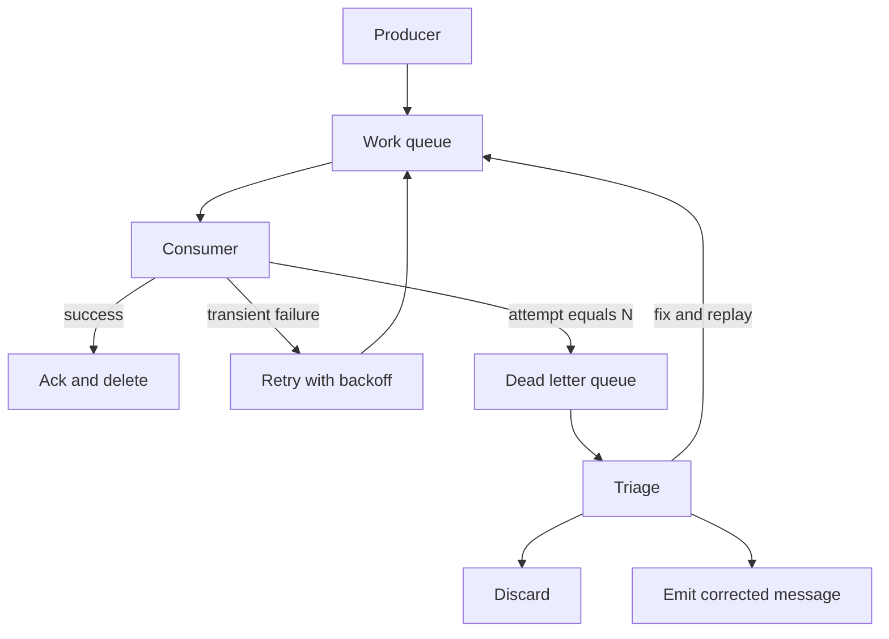

A dead letter queue holds messages that a consumer could not process after a bounded number of attempts. The original payload goes with them. So does the error: exception text, HTTP status, attempt count, last seen time. The work queue is then free to drain. A human or a replay job decides what happens next. Without that side path, a poison message retries forever, occupies a worker, and on an ordered queue or a partition, blocks every later message with the same key.

Poison is not the same as "the downstream was briefly down." Brief failures belong on a retry with backoff. Poison is a payload that will not succeed with the current code and data: a schema the parser rejects, a business id that does not exist, a handler bug that throws on a field value. The DLQ exists so those two classes of failure do not share an infinite loop.

A DLQ you never look at is a silent drop with extra steps. Budget time for triage the way you budget time for pages. If nothing consumes the DLQ, you have designed an attic, not a recovery path.

## Concept

### When a message becomes a dead letter

The broker, or your consumer wrapper, counts receives or failed attempts. After N, it moves the message off the work queue onto the DLQ. N is a product number. Too small and a downstream blip fills the DLQ with healthy work. Too large and a poison payload burns retries, visibility timeouts, and worker time before it leaves. Start from "how many times is a transient error likely to clear" and add a small margin, not from a lucky default of 100.

Move the original payload, not a summary. The person who debugs at 2 a.m. needs the bytes the handler saw. Attach the error, the attempt timestamps, the consumer version if you have it, and the destination that failed. Redacting secrets is required; stripping the body to "see logs" is how you guarantee you cannot replay.

Do not dead-letter on the first timeout. Retry with backoff on the work queue for faults that are downstream unavailability. Dead-letter for faults that are the message itself, or for retries that have exhausted that distinction. Many wrappers treat any exception as a receive. That is acceptable if N is high enough to cover blips and if you still alert on DLQ depth.

### The replay path is part of the design

A DLQ without replay is a grave. Replay means: fix the handler or the data, then send the message back to the work queue, or to a corrected handler, without losing identity. Keep the original message id so idempotency still holds. If replay mints a new id, you can double-apply work that partially succeeded on an earlier attempt.

Triage has three exits. Discard: the work is obsolete or a duplicate of something already done. Replay: the bug is fixed. Rewrite: the payload was wrong and a human or a script emits a corrected message. Record which exit you took. Unexplained discards are how money-moving events vanish.

Access control on the DLQ is stricter than on the work queue. Payloads contain user data, tokens you failed to keep out, and business details. Limit who can read and who can replay. Audit replays. A DLQ is not a debug playground.

### What does not belong there

Do not use the DLQ as a second work queue for a slow path. If a class of messages should run later, that is a delay queue or a scheduler, not a dead letter. Do not dump validation failures from the producer into the DLQ; reject at enqueue and make the producer fix the contract. Do not share one DLQ across unrelated message types unless you like mixing poison invoices with poison thumbnail jobs in one triage stream.

Per-subscription or per-queue DLQs match team ownership. Mail's poison is mail's problem. Billing's poison is billing's problem. A shared attic becomes nobody's.

### Ordered queues and partitions

On a FIFO queue, a poison message at the head of a group blocks that group until it is removed. The DLQ is how you remove it without deleting it from existence. On a Kafka partition, a consumer that retries one record forever never advances the offset. "Skip and publish to a DLQ topic" is the usual pattern; "block the partition" is the outage. Choose skip-with-DLQ for handlers you can make eventually consistent, and choose block only when processing out of order is worse than stalling, which is rare outside of money ledgers with strict sequence numbers.

## Trade-offs

| Approach | When it wins | Cost / risk |
| -------- | ------------ | ----------- |
| DLQ after N attempts | Poison must leave the work pile; you need the payload and the error for humans | Too-small N dumps transients; an unread DLQ is a silent drop |
| Infinite retry on the work queue | Never, except a tiny in-memory buffer you are willing to lose | Head-of-line blocking; worker burn; no triage artifact |
| Drop after N with no DLQ | Telemetry you can truly afford to lose | You cannot replay; you cannot prove what arrived |
| Block the partition until a human fixes it | Strict per-key sequence where skip is a correctness bug | One bad record stalls all later work on that key |

The default for user-facing side effects is the first row: bounded retries, then a DLQ with payload plus error, then a replay path with the same identity. Drop is for metrics. Block is for a ledger you have explicitly designed to halt rather than skip, and even then you still want a copy of the poison somewhere you can inspect.

## Diagram

## Failure modes

### DLQ as a black hole

**Detection.** DLQ depth is non-zero for days. No ticket, no dashboard panel a human watches, no consumer on the DLQ. Work-queue error rates look "fine" because the poison left. Users still miss the side effect. You discover the gap in a support thread, not in an alert.

**Mitigation.** Alert on DLQ depth and on age of the oldest dead letter, the same way you alert on the work queue. Assign an owner. Budget a triage rotation. If the volume is high, you do not have a DLQ problem; you have a handler or schema problem that the DLQ is documenting.

### Transients misclassified as poison

**Detection.** A downstream outage fills the DLQ in minutes. When the downstream returns, the work queue is quiet and the DLQ is huge. Replay then stamps the downstream with a storm unless you pace it. N was 2, and visibility timeouts were shorter than the outage.

**Mitigation.** Separate retry policy from DLQ policy. Back off on 429 and 503. Set N from outage length you are willing to ride on the work queue. Replay from the DLQ with a rate limit, not with a firehose. Consider a delay or a circuit: stop receiving while the downstream is known down, so you do not spend the attempt budget during the outage.

### Replay doubles a side effect

**Detection.** After a replay, users get a second email, a second charge, or a unique-constraint error. The first attempts had partially succeeded; the handler threw after the side effect and before the ack. Replay used a new message id, so the idempotency key did not match.

**Mitigation.** Handlers must be idempotent on a business key that survives replay. Store the original message id on the dead letter and reuse it. Ack only after the side effect is durable so partial success is rarer. For money-moving calls, check the processor's idempotency key before you call it again from a replay tool.

### Payload stripped or unreadable

**Detection.** The DLQ message is a wrapper with an error string and no body, or the body is encrypted with a key the triage role cannot use, or a binary blob nobody can decode because the schema version was not stored. Humans cannot tell discard from replay.

**Mitigation.** Preserve the original bytes. Record content type, schema version, and the error. Redact secrets at the producer so you are not choosing between compliance and operability at 2 a.m. Provide a decoder in the same repo as the handler. If you must encrypt at rest, make the triage role able to decrypt.

## Real-world example

Amazon SQS implements this as a redrive policy. You set `maxReceiveCount` on a source queue and name a dead-letter queue. Each `ReceiveMessage` increments the receive count. When the count exceeds the maximum, SQS moves the message to the DLQ instead of making it visible on the source again. The body is the original body. Attributes include the receive count and, with a redrive, enough metadata to identify the source.

Operators then inspect the DLQ, fix the consumer or the data, and replay with `StartMessageMoveTask` or by writing a small tool that reads the DLQ and `SendMessage`s back to the source. FIFO source queues use FIFO DLQs so group order is not silently converted to a standard queue. The feature exists because infinite redelivery of a JSON payload that always throws is an outage, and dropping that payload without a copy is a different outage you will not notice until a human asks where the order went.

## What to remember

- After N attempts, move the message off the work pile; poison must not retry forever or block a partition.
- Keep the original payload and the error on the dead letter; a summary is not enough to triage or replay.
- Replay with the same identity into an idempotent handler, and pace replays after an outage.
- An unread DLQ is a silent drop. Alert on depth and age, and give it an owner.
