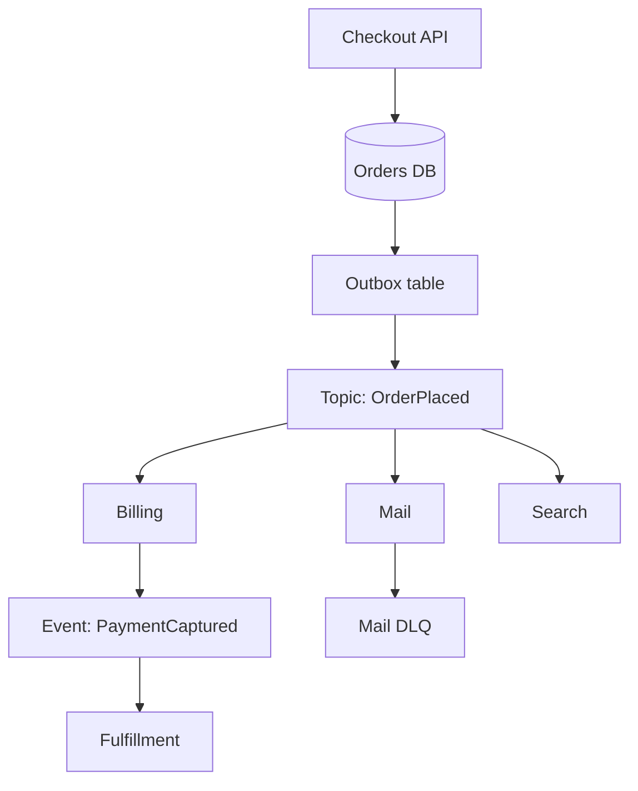

Event-driven architecture treats facts that already happened as the integration currency. A service writes `OrderPlaced` because an order was placed. Other services react: billing, mail, search, fraud. The writer does not call those services. It does not wait for them. It publishes a fact and continues. That is the opposite of an orchestration script that HTTP-calls each collaborator in turn and treats their availability as its own.

An event is a fact. A command is a request for work. `OrderPlaced` happened. `SendInvoice` asks billing to do something. Commands have one owner and belong on a queue aimed at that owner. Events have many listeners and belong on a topic. If you publish commands as if they were events, two subscribers will do the work. If you pretend events are commands, you will wait for listeners that you should not couple to.

Choreography is listeners reacting to facts without a central conductor. It scales as a drawing and rots as a ball of implicit couplings: nobody can say what happens after `OrderPlaced` without grepping the company. Orchestration is a conductor that sends commands and waits. It is easier to see and easier to turn into a single availability domain. Most working systems mix them, with a small orchestrator around the money path and choreography around projections.

## Concept

### Facts, not "messages we hope someone handles"

Write events in the past tense, named for the business fact, with a payload that a stranger in a year can interpret. Include the identity of the thing that changed, a time, a version, and the fields a consumer cannot cheaply look up. Do not include a to-do list for listeners. Do not include "please also." Those are commands smuggled into a fact.

The producer owns the meaning of the event. Consumers own their reactions. When consumers start requesting fields "just for us," the event becomes a hidden RPC. Push back. Let the consumer call a query API for rare data, or emit a new event from a service that actually owns that data. A fat event that tries to please everyone becomes unchangeable, which defeats the point of decoupling.

Causation and correlation ids are how you reconstruct a story from logs. One user action may produce a chain of facts. Without those ids you have a pile of topics and a guess.

### Choreography versus the hidden ball

In choreography, `OrderPlaced` triggers inventory, inventory emits `StockReserved`, mail listens to `OrderPlaced`, search listens to both. No service contains the whole workflow. Adding a listener does not require a deploy of the producer. That is the prize.

The cost is operational blindness. The workflow lives in subscriptions. A new hire cannot read one function and know the path. Failure is partial: inventory reserved, mail never sent, search stale. You need correlation, tracing, and a definition of "done" that is a query over several systems, not a return value.

Watch for choreography that has become a distributed state machine nobody named. If `OrderPlaced` must be followed by `FraudChecked` must be followed by `PaymentCaptured` and each step is "a service that happens to listen," you have an orchestrator with extra hops and extra ways to get stuck. Pull that sequence into a workflow engine or a service that sends commands, and keep choreography for fan-out that is allowed to lag.

### Commands, sagas, and dual writes

A saga is how you run a multi-step business process when you cannot have one transaction across services. Each step emits a fact or sends a command; compensating actions undo prior steps when a later step fails. That is still event-driven, and it is not a replacement for thinking about identity. Compensations must be idempotent. Timeouts must exist. "The other service will emit the next event" is not a timeout.

Dual writes remain the original sin. A service commits to its database and then publishes. Either hop can fail. The outbox pattern — write the event row in the same transaction as the business row, then publish from that table — exists because "we will remember to publish" does not survive a crash. If you skip the outbox, you will write a reconciler later, under pressure.

### Topology

A log-shaped broker (Kafka and friends) gives replay, per-key order inside a partition, and independent consumer groups. A topic-plus-queue topology (SNS to SQS, or equivalent) gives fan-out into competing consumers and DLQs per team. HTTP callbacks (webhooks) are events delivered as push, with the subscriber's timeout and retry policy. Pick from replay needs and ownership, not from a single "event bus" slide.

Do not build one global topic for all facts. Name topics by aggregate or bounded context. A firehose named `everything` makes authorization, schema evolution, and lag isolation everyone's problem at once.

Consumers must be allowed to lag without becoming the publisher's incident. That means per-subscriber buffers, per-subscriber dead letters, and SLOs written as "mail within two minutes of the fact," not "the bus is up." If you cannot name the fact, the owner, and the allowed lag, you do not have an architecture. You have a pile of listeners.

## Trade-offs

| Approach | When it wins | Cost / risk |
| -------- | ------------ | ----------- |
| Choreographed events | Many independent reactions; producer should not list listeners | Implicit workflow; partial failure; hard "is it done?" |
| Orchestrated commands | A money or fulfillment sequence that must be visible and bounded | Conductor is an availability bottleneck; easy to re-create a monolith of calls |
| Mixed: orchestrate the core, choreograph projections | Checkout is a workflow; search and mail may lag | Two styles to operate; dual-write still exists at each emit |
| Synchronous RPC mesh | You need an answer now and the graph is small | Shared fate; every new collaborator is a deploy and a timeout |

If the user is waiting, you still need a synchronous path for the decision you owe them. Event-driven is how the rest of the company learns. It is not a way to hide a three-second workflow behind a 200 OK and hope.

## Diagram

## Failure modes

### Dual write: commit without publish

**Detection.** Rows exist in the business table. No event on the topic. Downstream projections miss the entity. Support sees an order and no mail. Outbox-free services show a gap after deploys and crashes, clustered around write time.

**Mitigation.** Use an outbox in the same transaction as the business write. Run a publisher that drains the outbox and retries. Reconcile by comparing ids in the source table against the log. Never tell a caller the side effects exist because the row exists. A periodic scanner of `pending` outbox rows is part of the design, not a chore you add after the first missing event.

### Choreography that nobody can operate

**Detection.** Incidents require four teams on a call to reconstruct a path. There is no diagram that matches production subscriptions. A missing listener is discovered by a user, not by a test. Metrics exist per service and not per workflow.

**Mitigation.** Keep a living catalog of events, owners, and subscribers. Trace with correlation ids. Define workflow SLOs: "mail within two minutes of `OrderPlaced`," not only "mail service p99." If a sequence is load-bearing, replace that slice with an orchestrator you can see, rather than adding more listeners.

### Event as hidden command

**Detection.** Two services charge the customer. Or none do, because each thought the other listened. The payload is named `ProcessPayment` and the catalog lists three subscribers. Idempotency keys collide or do not exist.

**Mitigation.** Rename to facts. Put work that must happen once on a command queue with one consumer group. Review new subscriptions. Test "exactly one handler" where money moves. If you need a reaction that must succeed, that is a command with retries and a DLQ, not a polite event.

### Schema drift across listeners

**Detection.** A publisher deploy breaks a subset of consumers. DLQs fill for old parsers. New consumers cannot read old retained messages. Replay for a new projection fails halfway through last month.

**Mitigation.** Version events. Add optional fields. Run compatibility checks. Keep a schema registry if the broker is a log you will replay. Roll consumers before producers when a field becomes required. Treat the event as a public API.

## Real-world example

LinkedIn built Kafka to move activity facts — profile changes, clicks, operational metrics — from the systems that produce them to many independent pipelines: search, feed, analytics, monitoring. Producers write once to a topic. Each consumer group tracks its own offsets, so feed and analytics do not compete for the same copy and do not share lag. The log retains records long enough that a new pipeline can start at an old offset and catch up, which a delete-on-ack queue cannot do.

That is choreography at company scale: a fact published without a list of listeners, and listeners that fail or lag in isolation. It is also a reminder of the coupling that remains. The payload is a contract. Partition keys decide order. A consumer that treats the log as a command bus aimed at itself will still double-apply if it is not idempotent. Kafka did not remove those problems; it made the fan-out of facts cheap enough to be the default.

## What to remember

- Events are facts that happened; commands ask one owner to do work. Do not publish commands on a topic.
- Choreography decouples deploys and couples you to an implicit workflow; catalog it, or pull load-bearing sequences into an orchestrator.
- Dual writes are the default bug: commit and publish in one transaction via an outbox.
- Fan-out is a topic plus per-subscriber queues or consumer groups, each with its own lag, retries, and DLQ.
