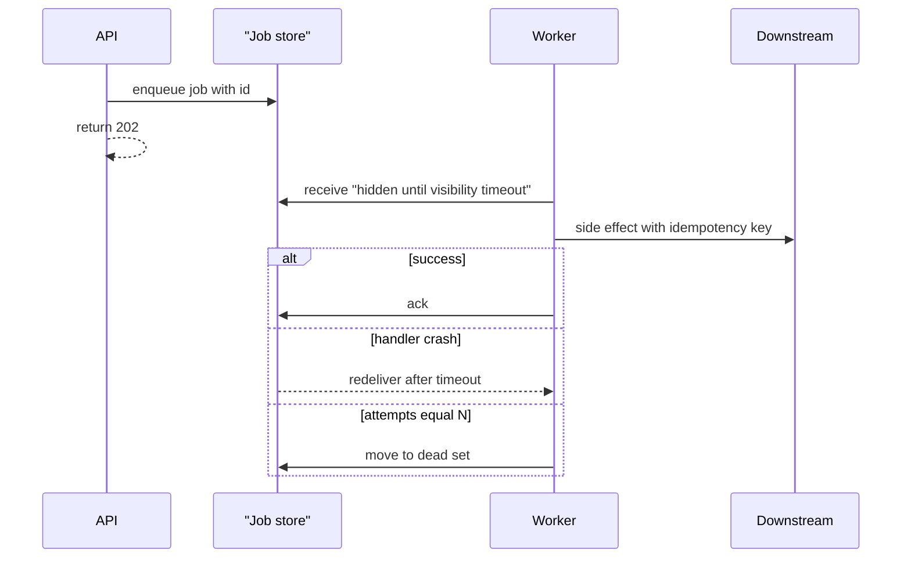

A background job is work you refused to do on the request thread. The API writes a record — a row, a queue message, a Redis list item — and returns. A worker process, often many of them, pulls that record, runs a handler, and marks the job complete. The user is not waiting. The worker's clock is minutes, retries, and visibility, not the HTTP timeout of the load balancer.

Workers execute at-least-once. The worker can die after doing the work and before acknowledging it. The broker will show the job again. The handler must be safe to run twice: same mail, same charge, same index write. Idempotency is not a flourish. It is the difference between a retry and an incident.

Visibility timeout is how the broker decides the worker is dead. While a job is in-flight it is hidden from other workers. If the timeout expires, another worker may take it. Set the timeout above p99 handler duration, and extend it for long jobs. Guess too short and you overlap. Guess too long and a crashed worker's job sits invisible while the user waits.

## Concept

### The job record

A job has a type, a payload, an identity, and an attempt count. The type selects the handler. The payload is the data the handler must not have to fetch if fetching would race. The identity is the idempotency key: order id plus purpose, or a UUID the producer reused on retry. The attempt count drives backoff and the trip to the dead set.

Persist the job before you tell the user you accepted the side effect. An in-memory list in the API process is not a job system; a crash drops the promise. Databases, Redis-backed lists, SQS, and log topics are all used as stores. Pick from durability, latency, and whether you need replay. Redis is fast and easy to lose if you miss AOF or replication. SQS is slower to start and harder to lose.

Do not store a live database connection, a file handle, or a huge blob in the payload. Store ids. The worker loads what it needs. If the source row may vanish before the worker runs, copy the fields the handler requires at enqueue time and accept that you have frozen a snapshot.

### The worker loop

Poll or pop. Deserialize. Run the handler with a deadline. Ack or delete on success. On failure, increment attempts, apply backoff, and either requeue or send to a dead set. Heartbeat or extend visibility while still working. Exit on SIGTERM only after you have stopped taking new jobs and have finished or returned in-flight ones. A deploy that kills in-flight work without returning it is how you get duplicates and gaps in the same release.

Concurrency inside a worker is a bulkhead. Too many threads and you stampede the database. Too few and the queue ages. Set concurrency from downstream capacity. Separate queues per job class so a flood of thumbnail jobs cannot starve password-reset mail. Priority is a second queue, not a hope that workers will sort fairly inside one list.

Scheduled and delayed jobs are first-class: send this in ten minutes, run this every night. Those are not the same as retries. A delayed job is work you intended to postpone. A retry is work that failed. Keep the clocks distinct in metrics.

Separate queues by failure domain and by SLO. Password-reset mail should not sit behind a million thumbnail jobs. A single "default" queue is how a batch export takes the latency budget of a user-facing email. Give each class a name, a concurrency cap, and an age alert. The worker binary can be shared. The pile should not.

### At-least-once and the exactly-once story

Vendors will say "exactly once." What you can have is at-least-once delivery plus an idempotent handler, which yields at-most-once effects. The handler writes to a table keyed by job identity, or it calls a payment API with an idempotency key, or it upserts a document. If the write is already there, it acks and leaves. If you cannot name the key, you do not have exactly-once effects.

At-most-once delivery — drop on failure — is acceptable for metrics and unacceptable for money. Do not choose it by accident because you acked before the side effect.

### Timeouts, heartbeats, and poison

A handler without a deadline will hold a job until visibility expires, then overlap, then perhaps deadlock a row it already locked. Give every handler a timeout below the visibility timeout. For long work, heartbeat. For work that always throws, bounded attempts then a dead set with payload and error. The dead set is a DLQ. It needs an owner and a replay tool.

Idempotency does not make poison safe. A handler that throws before the idempotent write will retry until N. A handler that throws after a non-idempotent call needs a human. Write the side effect through an API that honors keys, or record the attempt in your database before the call.

## Trade-offs

| Approach | When it wins | Cost / risk |
| -------- | ------------ | ----------- |
| Queue-backed workers | Durable jobs, competing consumers, independent deploys from the API | At-least-once duplicates; operational surface; lag is delayed UX |
| In-request work | Tiny, must-succeed-now work that fits the HTTP budget | Timeouts; user waits; cannot retry after disconnect |
| Cron in the API process | Never for work you care about | Missed runs on scale-out; missed runs on crash; no visibility timeout |
| Serverless function per message | Spiky load, little ops, short handlers | Cold starts; easy to forget idempotency; retry policy lives in the platform |

The default for mail, webhooks, thumbnails, and exports is queue-backed workers with idempotent handlers and a dead set. Do the authorization check and the durable write of the user-visible fact on the request path. Put everything else in a job.

## Diagram

## Failure modes

### Ack before the side effect

**Detection.** Jobs vanish from the queue. The downstream never saw the call, or saw it and the worker crashed before recording that fact. After a deploy, a slice of work is gone. Logs show a delete or ack, then no outbound request. Support finds the 202 and no mail.

**Mitigation.** Ack after the durable side effect. If the side effect is an HTTP call, use an idempotency key and persist "attempted" before the call if you cannot persist "done" after. Prefer writing a local status row in the same place you will look during replay. Never ack in a `finally` that runs on timeout as well as on success.

### Visibility timeout shorter than the handler

**Detection.** The same job id runs on two workers at once. Unique constraints fire. Users get two emails. Metrics show receive count greater than one while the first worker is still in the handler. Slow jobs cluster around p99 duration just above the timeout.

**Mitigation.** Set visibility above p99, then add a margin. Extend visibility on a heartbeat for long jobs. Put a deadline in the handler so it dies before the timeout when it cannot finish. Make the handler idempotent so overlap is ugly, not catastrophic. Split huge jobs into smaller steps with their own ids.

### Retry storm into a sick downstream

**Detection.** A 500 from a partner produces immediate retries across all workers. Queue depth falls, then the partner falls over harder. Your success rate is low; your attempt rate is high. Backoff is missing or is a fixed one-second sleep.

**Mitigation.** Exponential backoff with jitter. Honor 429 and Retry-After. Cap in-flight jobs per destination. After N attempts, dead-letter rather than heat the partner forever. If the outage is known, pause the queue and keep attempt budget for after recovery.

### Poison job with no dead set

**Detection.** One payload throws on every run. A worker core is pegged on that job. An ordered queue or a partition stops draining. Error logs repeat. Depth is small, age is high. There is nowhere for a human to look at the bytes.

**Mitigation.** Bound attempts. Move payload plus error to a dead set. Alert on dead-set depth. Provide replay that reuses the job identity. Fix the handler or discard with a recorded reason. Do not infinite-retry a JSON blob that cannot succeed.

## Real-world example

Sidekiq, widely used in Ruby shops including large Rails applications, stores jobs in Redis lists and sorted sets. The web process enqueues JSON. Worker processes `BRPOP` a queue, run a class's `perform`, and retry on exception with backoff. After the retry budget, the job lands in the Dead set in Redis, with the error and the original arguments, where a human can retry or delete it through Web UI or API.

Reliability still sits on the handler. Redis is not magically at-least-once in the effect sense: a killed worker can leave a job already half-done. Sidekiq's reliability features (and similar ones in other processors) use a working set and a heartbeat so crashed jobs requeue after a timeout — visibility timeout under another name. Teams that ack by popping first and emailing second will double-mail on that requeue unless `perform` is idempotent. The product is a worker runtime. The exactly-once effect is still your unique index or the provider's idempotency key.

## What to remember

- Workers run at-least-once; write idempotent handlers keyed by a stable job identity.
- Visibility timeout must exceed handler time, with a heartbeat for long work, or you will overlap jobs.
- Ack after the durable side effect; ack-before-work is a silent drop.
- Bound retries into a dead set with payload and error, then replay with the same id.
