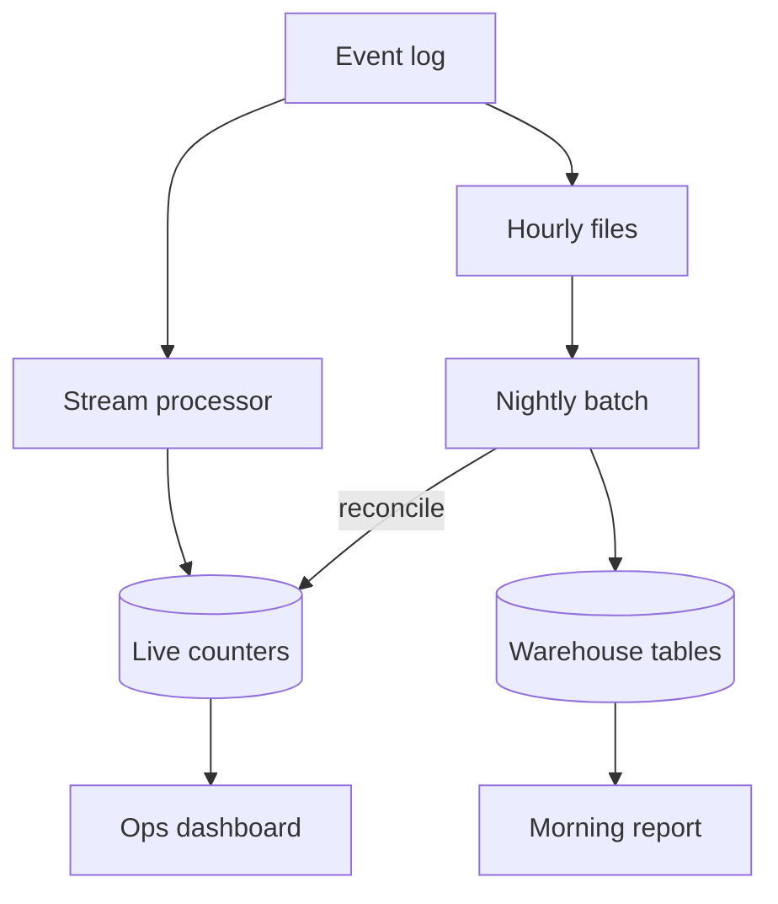

Batch processing runs a job over a finite pile of data that already exists: last night's orders, last hour's logs, a full table. Throughput is the point. The result is as stale as the window you chose. Stream processing runs a job per event as events arrive, or in small time windows on an unbounded stream. Latency is the point. Correctness gets harder: event time versus processing time, late data, and windows that do not close when you hope.

Neither replaces the other. A warehouse that rebuilds a daily aggregate is a batch job. A fraud score that must move before the charge settles is a stream job. Teams that "go streaming" for a report nobody reads until morning pay in complexity for a freshness nobody uses. Teams that batch a fraud check into an hourly file pay in fraud.

The clock you care about is the business clock. Batch freshness is "as of the last successful run." Stream freshness is "as of the last processed event," which is not the same as "as of the last event that happened," because events arrive late and out of order.

## Concept

### Batch: bounded input, high throughput

A batch job has a start and a finish. It reads a snapshot or a file or a partition of a table, writes an output, and exits. Failures retry the job or a stage. You can reason about completeness: if the job succeeded, that window is done. That is a strong operational story. Reruns are possible if inputs are immutable. Idempotent writes (overwrite a partition, not append forever) make reruns safe.

Throughput comes from sequential I/O, large scans, and parallelism over files or table shards. You amortize startup — cluster spin-up, query planning — over a lot of bytes. That is why batch wins at night for ETL, index rebuilds, and training-data dumps.

Staleness is the window plus the run time. A daily job that takes three hours means numbers that are up to 27 hours old. An hourly job that takes 40 minutes is fresher and more expensive. If a run fails at 3 a.m. and nobody notices until 9 a.m., the window is emptier than the dashboard implies. Success of the last run is a first-class metric.

### Stream: unbounded input, per-event work

A stream job does not exit. It reads from a log or a queue and updates state: a count, a session, a join against a table. Output is a new event, a database upsert, or an alert. Failures are per event or per micro-batch. Completeness is a watermark, not a job status.

Event time is when the fact happened. Processing time is when your job saw it. They diverge when a mobile client is offline, when a partition lags, when a producer retries. Windows keyed on processing time are easy and wrong for "sessions in the real world." Windows keyed on event time need a watermark: a declaration that you will not wait forever for late data. Late events after the watermark need a policy: drop, update, or send to a side output.

State is the hard part. A count of events per user in the last 15 minutes is state you must checkpoint, restore after a crash, and partition by key. Exactly-once output from a stream job is a protocol among source offsets, checkpoints, and sink idempotency. At-least-once plus idempotent sinks is the design you can actually operate if you do not want to live in the engine's internals.

### Micro-batch sits in the middle

Some engines take the stream and process it in small batches every few seconds. You get better throughput than one-at-a-time and worse latency than true per-event. Spark Structured Streaming's original mode looks like this. The completeness story is "this micro-batch committed." Late data still exists. Do not pretend a 10-second micro-batch is a daily warehouse job, and do not pretend it is a 5-millisecond fraud check.

### Choosing

If the consumer of the result is a human in the morning, batch. If the consumer is another machine that will block a user, stream. If you need both — a real-time view and a reconcilable daily truth — compute the stream for the view and recompute the day from immutable inputs in batch. That dual path is how you catch stream bugs. It is also two systems to fund.

Do not stream because the data "arrives continuously." Logs arrive continuously and still batch well into hourly files. Stream because waiting for the next file is the wrong SLO.

Windows are how a stream pretends to be finite. Tumbling windows close and emit. Sliding windows overlap. Session windows close after a gap in event time. Each needs a watermark and a late-data policy. If you cannot explain what happens to an event that arrives an hour late, you have not finished the stream design. Batch avoids that question by waiting until the window is supposed to be complete, which is why it is slower and easier to audit.

## Trade-offs

| Approach | When it wins | Cost / risk |
| -------- | ------------ | ----------- |
| Batch over a finite window | High throughput, rerunnable, completeness is a job status | Result is stale by the window plus runtime; failed nights go unnoticed |
| Stream per event or small windows | Low latency reactions; unbounded input | Event time, late data, state, harder exactly-once; always-on ops |
| Micro-batch on a stream | Engine simplicity; seconds of latency are acceptable | Not a warehouse; not sub-second; still need watermarks |
| Dual: stream for now, batch to correct | Auditable daily truth plus a live view | Two pipelines, two schemas, two ways to disagree |

When the two pipelines disagree, believe the batch if inputs were immutable and the job is idempotent. Use the disagreement as a test, not as a coin flip. If you cannot rerun batch, you do not have a truth, you have a stream with a PR deck.

## Diagram

## Failure modes

### Silent stale batch

**Detection.** The dashboard still shows yesterday's successful run. Today's partition is missing. Downstream reports look "stable" because they keep serving the last good output. Job-success metrics are green on a skip, or the scheduler is muted. Users make decisions on old numbers.

**Mitigation.** Alert on "window not closed by T+SLA," not only on process crash. Write output to a dated partition and have readers fail or warn if the partition is missing. Page a human if the nightly job is not SUCCESS before the hour the business opens. Make reruns cheap with immutable inputs and overwrite semantics. A skipped window should look like an empty partition you can see, not like last night's numbers still sitting in the default table.

### Event-time mistakes in a stream

**Detection.** Session metrics jump at deploy time rather than at user time. Late mobile events are dropped or double-counted. Windows close early on a quiet partition and late on a hot one. Fraud scores miss the events that arrived after the watermark.

**Mitigation.** Key windows on event time. Set watermarks from a measured late-arrival distribution, not from a guess. Define a late-data policy and a side output you inspect. Do not use processing-time windows for anything you would defend in an audit. Monitor the gap between event time and processing time per partition.

### State loss after a restart

**Detection.** After a worker bounce, counts reset, sessions vanish, or joins emit a storm of retractions. Checkpoint storage was empty, on the wrong disk, or not fsynced. Exactly-once settings were off and the sink appended duplicates.

**Mitigation.** Checkpoint on durable storage. Test kill-and-restore. Make sinks idempotent by key even if the engine claims exactly-once. Size state so restore time fits your SLO; a 20-minute restore is a 20-minute gap. Do not keep the only copy of state in the worker's memory.

### Dual pipeline disagreement ignored

**Detection.** Live counters and warehouse totals diverge by more than noise. Each team trusts its own number. Finance uses one, ops uses the other, and nobody owns the delta. The stream has a bug that batch would have caught on rerun.

**Mitigation.** Compute a daily diff job. Page above a threshold. Treat batch as the reconcilable path. Fix the stream, do not average the two. If you cannot explain the delta, you do not have two views of one fact; you have two products.

## Real-world example

Google's MapReduce paper, and the systems that followed it, made batch the default for web-scale ETL: crawl data in, index shards out, job succeeds or the shard reruns. Completeness is a finished job. Staleness is however long the crawl-plus-index window is.

LinkedIn's stream path on Kafka is the other pole: activity events land on a log and processors update feeds, counters, and monitoring without waiting for a nightly file. The same company still runs batch on copies of that data for analytics and for jobs that must be rerun. The split is the point. Kafka gives per-event latency to products that need it. Hadoop and later Spark-style batch give high-throughput, replayable windows to products that can wait. Treating the log as a warehouse, or the warehouse as a fraud engine, is how you get the worst of both clocks.

## What to remember

- Batch is a finite window, high throughput, and a result as stale as that window plus runtime; completeness is a job status.
- Stream is per-event (or micro-batch) on an unbounded input; you buy latency and you pay with event time, watermarks, and state.
- Late data is normal. Windows on processing time will lie about the real world.
- If you run both, reconcile them. Dual pipelines that disagree without an owner are two sources of truth.
