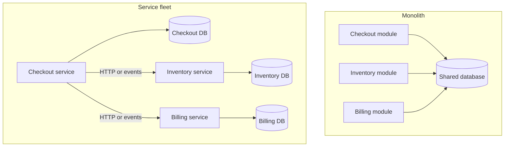

A monolith is one deployable: one process model, one release train, one database that every module can reach. A microservice architecture is many deployables, each with its own release train and, if you are doing the job honestly, its own data. The prize is independent deploy and independent failure: billing can ship on Tuesday without waiting for search, and a crash in recommendations does not take down checkout. The bill is the network, data ownership, and operability. You traded function calls for HTTP, in-process transactions for sagas, and one stack trace for a distributed trace you might not have.

This is not a maturity ladder. A well-cut monolith is a better product than a fleet of services that still share a database and still deploy together. That fleet is a distributed monolith: you paid the network tax and kept the coupling. Start from the failure domains and the release cadence you actually need. Split when a module's deploy risk, scaling axis, or team boundary is strangling the rest. Do not split because a slide said "microservices."

SOA is a related ancestor — coarser services, often an enterprise bus — and it is not the same thing. Microservices as a style pushed smaller units, dumb pipes, and team-owned data. If you rebuild an ESB and call the boxes microservices, you have SOA with new names.

## Concept

### What you actually split

A service boundary is a data boundary. If checkout and inventory share tables and foreign keys, they are modules, not services, even if they listen on two ports. Independent deploy requires independent schema change. Independent failure requires that one service's database being down does not freeze the other. That means duplication, eventual consistency, and APIs for data you used to join.

The network is now in the call path. Latency jumps from microseconds to milliseconds. Timeouts become mandatory. Partial failure becomes the default: the callee is slow, the callee is gone, the callee returned 200 with a stale body. Retries need idempotency. Load balancing, service discovery, and health checks become product work.

Transactions that spanned modules in one database now span systems. You get sagas, outboxes, and compensating actions. You do not get `BEGIN` across checkout and billing. If that sentence is unacceptable for a particular flow, that flow may still belong in one service.

### When the monolith wins

One team, one product, one scaling axis, and a domain that still changes shape every week: stay in one process. Join tables. Refactor across modules in one pull request. Ship one artifact. Observe one request with one log. The operational surface is a process, a database, and a queue you may not even need yet.

The monolith fails when different parts need different scale, different release risk, or different teams that cannot coordinate on one train. A report job that saturates CPU should not share a process with checkout. A mobile API that ships daily should not wait for a yearly compliance module. Those are split signals. Headcount is a split signal only when communication cost inside the repo is already the bottleneck; splitting first to "enable teams" often creates the bottleneck as integration work.

Modular monoliths — packages with enforced boundaries, no cross-module table reads — buy you many of the cognitive benefits without the network. They are a valid destination, not a coward's compromise. Extract a service when a module's boundary has proven stable and the operational case is real.

### When services win

Independent deploy: a team can release without a company-wide freeze. Independent scale: image processing grows without buying checkout capacity. Independent failure: a bad deploy in recommendations does not page the payments on-call. Independent technology: a team can pick a store that fits, at the cost of another operational dialect you must staff.

Those wins appear only if you pay for the platform: CI per service, tracing, standardized auth, a paved road for deploys, on-call per service, and a story for data that used to be a join. Without that platform, you have multiplied snowflakes.

Do not split along technical layers (a "user service" that is only a table with HTTP). Split along business capabilities that can own their data and their incidents.

### Data ownership and the join you lost

Queries that spanned modules become APIs, events, or a copy. Copies mean lag and disagreement. APIs mean the owner is on your critical path. Events mean you build a projection and accept staleness. Pick per use case. "We will just call them all" is a latency budget you will miss. "We will copy everything" is a consistency budget you will miss. The monolith hid this behind a SQL join.

Write down the freshness you owe. A checkout page that must show live stock is an API to inventory, with a timeout and a fallback. A recommendation panel that can be minutes behind is a projection. Mixing those without naming them is how you get a "microservice" call graph that is slower and more brittle than the monolith it replaced, and still wrong on stock.

## Trade-offs

| Approach | When it wins | Cost / risk |
| -------- | ------------ | ----------- |
| Single monolith | Small team, changing domain, one scale axis, joins that must be consistent now | Coupled deploys; one failure domain; scale and risk concentrate |
| Modular monolith | Boundaries are real; you do not yet need independent runtime | Discipline can rot; still one process and one store to lose |
| Microservices with owned data | Independent deploy, scale, and failure; stable capabilities; platform exists | Network, sagas, operability, duplicated data, organizational overhead |
| "Services" sharing a database | Never as a destination | Distributed monolith: you pay both sides |

The honest comparison is monolith versus services that own data. Anything that still shares a schema is a monolith you have made harder to operate. If you are not ready to lose the join, you are not ready to split the write path.

## Diagram

## Failure modes

### Distributed monolith

**Detection.** Many repos, many processes, one database, one Friday night deploy because a column change touches everyone. Latency is worse. Failure isolation is a slide. Teams still wait on a release train. A join still happens, now as three HTTP calls inside a request.

**Mitigation.** Either merge back to a modular monolith or finish the split: owned databases, published events, no cross-service table access. Stop calling the current state microservices. Measure whether a team can deploy on a Tuesday without a meeting. If not, the architecture has not delivered the prize.

### Failure that crosses the old join

**Detection.** Checkout is up, inventory is down, users can pay for items you cannot fulfill, or checkout hangs until inventory times out. Cascades take the fleet because timeouts are missing or retries amplify load. The monolith used to fail together; now it fails inconsistently.

**Mitigation.** Timeouts, bulkheads, and default behaviors when a collaborator is gone: fail the request, or sell and reconcile, but pick explicitly. Do not retry without idempotency. Circuit-break a sick dependency. Test the down case; it is now a product path.

### Data disagreement after a split

**Detection.** Support sees different balances in two services. Reports double-count. A saga completed on one side and compensated on the other without a human noticing. "Eventual" has no SLO, so it means "maybe this week."

**Mitigation.** Name an owner for each fact. Projections have freshness SLOs. Reconcile on a schedule. Use outboxes so events match commits. Do not split a write that must be atomic until you have a saga you can operate, including compensations and timeouts.

### Operability collapse

**Detection.** Nobody can find the service that owns a bug. Dashboards are per process and not per user journey. On-call is either one exhausted platform team or twenty teams that page each other. Deploys are frequent and incidents are more frequent.

**Mitigation.** Paved road: tracing, standardized logs, golden signals per service, a catalog of owners, and a limit on how many languages and stores you will staff. Require a runbook before extraction. If the platform cannot carry another service, do not extract another service.

## Real-world example

Netflix moved from a single-data-center DVD-rental application to a public-cloud fleet of independently deployable services after the 2008 datacenter incident and the subsequent AWS migration. The company has described the goal in those terms: isolate failure, let teams ship, and scale playback and encoding on different axes than the account site. The cost was a platform — discovery, chaos testing, client libraries, observability — that exists because hundreds of services do not operate themselves.

Amazon's earlier internal mandate that teams expose data through service interfaces, not through other teams' databases, is the same split of data ownership. Both stories are often told as inevitabilities. They were bets by companies that already had the org chart and the traffic to pay for the platform. A ten-person product that copies the fleet without the platform copies the cost and not the isolation.

Shopify has been public about the other direction: a very large Rails monolith (Shopify Core) that still runs a huge fraction of the product, plus extracted services where the boundary and the load justified it. The lesson is not "Netflix yes, Shopify no." The lesson is that independent deploy and failure domains are expensive, and a modular monolith remains a valid production shape while those expenses exceed the pain of a single release train.

## What to remember

- Microservices buy independent deploy and failure domains; you pay with network, data ownership, and operability.
- A service that shares a database is a module with extra latency. Finish the data split or stay a monolith.
- Split on stable business capabilities and real scaling or release pressure, not on layers or fashion.
- SOA, a modular monolith, and a service fleet are different shapes. Do not equate the slide with the runtime.
