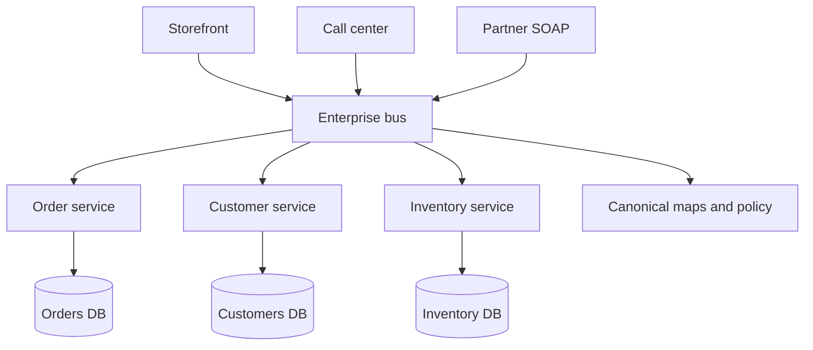

Service-oriented architecture is coarse-grained services that expose business capabilities through standard interfaces, often with a broker or enterprise service bus in the middle. A billing service, an inventory service, a customer service: each is meant to be reused across channels and applications. Callers should not reach into those services' databases. That reuse story predates the word "microservices" by a decade and more. Equating the two is how you inherit an ESB and think you have independent deploy.

Microservices, as popularized later, pushed smaller units, lightweight protocols, and dumb pipes: HTTP, queues, logs. SOA as practiced in enterprises often pushed larger units, richer contracts (SOAP, WSDL, WS-*), and a smart bus that routed, transformed, and orchestrated. The bus became the coupling. Every new consumer was a mapping in the middleware, and the middleware team became the release bottleneck.

You can take the useful SOA idea — capability services with explicit interfaces and owned data — without the bus as a second architecture. You can also build microservices that recreate the bus under a new logo. Judge the runtime: where does routing live, who owns a change, and what fails when the broker is down.

## Concept

### Services as capabilities, not layers

A SOA service is a business capability with a contract: "place an order," "get customer," "allocate stock." It is not a "database service" or a "DAO service." Layer services recreate the monolith as a set of network hops with the same coupling. Capability services can be called from a storefront, a call center, and a partner API without each channel embedding the rules.

The contract is the product. Version it. Keep it stable enough that a consumer written last year still works. That is why enterprise SOA invested in schemas and registries. The failure mode is a contract so heavy that changing a field takes a committee, or so loose that every consumer parses a different dialect.

Coarse-grained is a size heuristic, not a law. SOA services tended to be larger than a microservice team would cut: an "Order Management" service rather than separate checkout, pricing, and cart processes. Larger services mean fewer network hops and larger release trains. Smaller services mean more hops and more trains. SOA chose fewer, bigger, and then often glued them with a bus.

### The enterprise service bus

An ESB routes messages, transforms payloads, applies policy, and sometimes orchestrates. Producers send a canonical message. The bus maps it into what each consumer understands. On a whiteboard this isolates change. In production the mappings are the system, the canonical model is a fourth dialect, and debugging means reading middleware XML at 2 a.m.

Dumb pipes — a queue that does not rewrite your payload, an HTTP call that does not pass through a transformation engine — move that logic back into services. Transformations still exist; they live with the owner of the contract. Policy still exists; an API gateway can authenticate without owning business maps. The SOA lesson that remains is "do not let every consumer speak a private dialect into the provider's database." The lesson to drop is "put the dialect translation in a shared runtime that every team files tickets against."

Orchestration on the bus is a central workflow engine. That can be the right place for a long-running process you must see. It is the wrong place if every CRUD call is a bus orchestration. Then you have a distributed monolith with a vendor in the middle.

### Governance, registries, and reuse

SOA programs invested in service registries, SLA documents, and reuse targets. Reuse is real when a capability is stable and many channels need it. Reuse is fiction when you force two domains to share a "customer service" that then accumulates every attribute anyone ever wanted. The service becomes unchangeable, which is coupling by popularity.

Governance that reviews contracts for breaking changes is useful at any grain. Governance that requires a bus mapping before a team can add a field is how SOA earned its reputation for slowness. Apply the first. Refuse the second unless you are in a regulated integration with external parties who truly cannot take a native HTTP contract.

### SOA versus microservices versus a monolith

A monolith inverts the problem: no reuse across deployables because there is one deployable. Fine for one product. Awkward when a second channel or a second business unit needs the same capability without sharing a release train.

Microservices invert the size and the pipe: many small deployables, thin transport, team-owned data. They share SOA's insistence on interfaces rather than shared databases. They reject the smart bus as the default, and they reject giant shared "enterprise" services as the default cut.

If your "microservices" dump events onto a bus that rewrites them into canonical XML for SOAP endpoints, you are running SOA. Name it, staff the bus, and version the canonical model. If your SOA services talk REST to each other without a transformation layer, you are closer to the later style than to 2005 vendor diagrams. Name that too.

## Trade-offs

| Approach | When it wins | Cost / risk |
| -------- | ------------ | ----------- |
| Coarse SOA services, dumb pipes | Stable capabilities reused by several channels; fewer deployables than a fine fleet | Large release trains; temptation to share a database behind the contract |
| SOA with a smart ESB | Many heterogeneous consumers, including partners on old protocols | Bus becomes the bottleneck and the failure domain; mapping sprawl |
| Fine-grained microservices | Independent deploy and scale on stable small boundaries; platform is funded | Operational load; network; easy to recreate an ESB by accident |
| Integration through shared databases | Never as an architecture | Hidden coupling; no contract; every SQL change is a breaking change |

The reusable idea is the capability contract. The expensive idea is a smart bus that owns routing for everyone. Pick services coarse enough that a hop is a business call, not a getter, and keep the pipe dumb unless a specific partner protocol forces a translator at the edge.

## Diagram

## Failure modes

### The bus as a single point of delay and failure

**Detection.** All channels slow when the ESB cluster is hot. Incidents mention mapping deployments. A transformation change for one partner changes latency for everyone. On-call for the bus is the most interrupted team in the company. Services look healthy; the path through the bus is not.

**Mitigation.** Remove the bus from intra-company calls that can speak a native contract. Keep translators at the edge for partners who cannot change. Give the bus an SLO and capacity planning as if it were the product, because it is. Do not add canonical mappings for new internal consumers; give them the service API.

### Canonical model that cannot change

**Detection.** Adding a field takes months of committee. Teams stuff extensions into untyped bags. Two consumers interpret the same optional element differently. The registry lists versions nobody can retire.

**Mitigation.** Version contracts. Allow additive change without a bus-wide release. Let a service own its schema; map at the consumer or at a dedicated adapter for a legacy party. Retire versions on a published schedule. If the canonical model is the only model, you have a monolith of XML.

### Shared database behind "services"

**Detection.** Services have WSDL or OpenAPI files and still query each other's tables. A column rename requires a weekend. The bus is ceremonial. SQL is the real integration.

**Mitigation.** Block cross-service credentials. Provide APIs or events for data you used to join. If a join is load-bearing and must be consistent, those two capabilities may be one service. SOA without data ownership is a naming convention.

### Reuse target that creates a god service

**Detection.** "Customer" has hundreds of fields, dozens of consumers, and a release train that cannot move. Every new product waits on Customer. Availability of the company tracks availability of that one process.

**Mitigation.** Split along change rate and ownership. A lightweight identity lookup is not the same capability as marketing preferences or credit risk. Reuse at the grain of a stable contract, not at the grain of an English noun. Duplicate data that must move independently.

## Real-world example

Amazon's early-2000s internal shift — teams must expose functionality through service interfaces, no other team's database, and services must be designed as if they were external — is the SOA idea at company scale, documented later in talks and in Jeff Bezos's mandate as retold by people who worked there. That mandate is about contracts and data ownership. It is not an ESB product.

The ESB product era is IBM WebSphere ESB, TIBCO, Oracle SOA Suite, and peers: integration middleware that routed SOAP and later REST, applied XSLT maps, and hosted orchestrations (BPEL and similar). Enterprises bought them to connect packaged systems (ERP, CRM) whose protocols would never match. That job is real. The failure was using the same bus as the backbone for every new internal application, so that a product team's release included a mapping ticket and a bus deploy. Microservices talks from the 2010s were, in part, a reaction to that bottleneck: keep the capability service, drop the smart pipe as the default.

If you are connecting SAP to a custom storefront and a 15-year-old SOAP partner, an integration layer at the edge is SOA doing honest work. If you are connecting two services your company wrote last year, an HTTP contract and a queue are enough. Calling both "the ESB strategy" is how the second path inherits the first path's governance without inheriting its problem.

## What to remember

- SOA is coarse capability services with explicit contracts; it is not the same as microservices, and it is not "REST plus Kubernetes."
- A smart enterprise bus centralizes mapping and often becomes the bottleneck and the failure domain.
- Data ownership still matters: a service that shares tables is not a service, regardless of WSDL.
- Keep translators at the edge for real protocol mismatches; keep internal pipes dumb.
