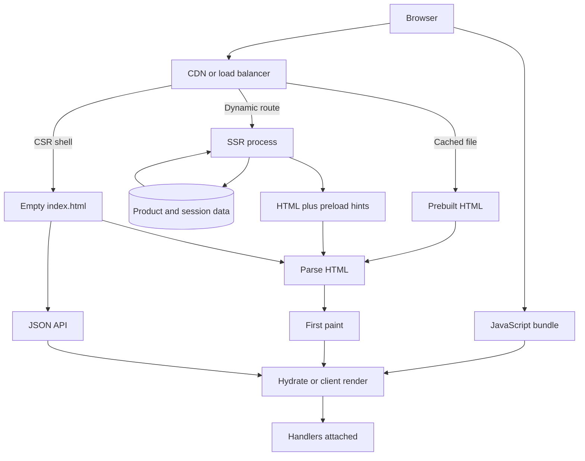

A browser asked for a page. Something has to turn product data into HTML, CSS, and a script the user can click. That work can happen on a machine you own at request time, on a machine you own at build time, or on the user's machine after JavaScript arrives. The choice is not a framework preference. It decides time to first byte, whether a crawler stores the words you care about, and how much CPU a phone spends before the first tap works.

Client-side rendering ships a shell and a bundle. The shell is often an empty root node. The bundle fetches JSON, builds a tree in memory, and paints. Server-side rendering runs that same tree on a server, sends HTML, then the browser downloads the bundle and hydrates: it walks the existing DOM and attaches handlers so the document becomes an application. Static generation runs the tree at build, writes files, and serves them from a CDN. Most production sites mix the three per route.

The metrics people quote without defining them are where arguments go wrong. Time to first byte is when the first byte of the response leaves your edge. First contentful paint is when something visible appears. Time to interactive is when the main thread can handle a click without a long task in the way. Hydration is often that long task. Search visibility is whether the HTML a crawler stored contains the title, price, and copy you need, not whether a bot can eventually execute your bundle.

## Concept

### Three clocks for HTML

HTML is born on one of three clocks, and mixing them without naming the clock is how a "fast" site ships a blank first paint.

Build time: CI runs the renderer, writes HTML to object storage, and a CDN serves the file. Time to first byte is cache-hit time at the edge. Freshness is the last successful build, or the last incremental regeneration if you added that later.

Request time on the server: a process receives the URL, loads data, renders HTML, and returns it. Time to first byte includes the data fetch and the render. The HTML is as fresh as the query you just ran. The origin now sits on the user path for every miss.

Request time in the browser: the server returns a shell quickly, often from the same CDN. Time to first byte can look excellent on a dashboard. The user still waits for script download, parse, data fetch, and paint. A crawler that does not execute JavaScript stores the shell. React, Vue, Svelte, and Rails views fill these clocks; they are not a fourth clock.

### Client-side rendering: the application is the page

Client-side rendering is how single-page applications earned the name. One origin serves a small HTML file and a hashed bundle. Routing is a client concern. The data API is a separate contract. After the first load, navigation can skip a full document request.

This wins for authenticated dashboards and editors. Search engines do not need to rank the rows. The empty first HTML is honest: nothing useful exists until the user's token does.

You pay a JavaScript tax on every cold visit. A mid-range phone will spend hundreds of milliseconds parsing a large bundle, then more time on the API round trip. Until that work finishes, buttons are dead even if they are painted. You also own loading states and a story for users who block scripts. CSR is not "no server": the JSON API still needs caching, pagination, and a cache policy you may never have designed because you treated the HTML origin as the only origin that mattered.

### Server-side rendering: HTML first, application second

Server-side rendering runs the component tree where you control CPU, the database, and secrets. The first paint can include the product title, the price, and the hero image URL. Crawlers see text. Users on slow CPUs see content before they can interact. Social unfurls that do not run your bundle still get a title and an image.

You pay time to first byte. If the server waits for three sequential queries before it emits a byte, the browser sits on a blank connection. There is not even a spinner yet. Streaming SSR changes when the first byte leaves: the document starts flushing while slower fragments continue. That is still server rendering. It does not remove the origin from the path; it overlaps wait with parse.

Then hydration. The browser must download the same components, re-execute them, and match the DOM the server sent. A mismatch — UTC on the server, local time on the client — throws away nodes and rebuilds. Hydration cost scales with the interactive tree, not with how pretty the HTML was. A thousand server-rendered rows still become a thousand client instances before a click is safe. Islands shrink that tree: read-only bodies stay HTML; a cart button hydrates. Decide per region whether you need handlers or only bytes.

### Static generation and the regeneration cache

Static generation is server rendering with the clock moved to CI. Marketing pages, documentation, and blogs belong here. A product page with inventory does not, unless you regenerate on a webhook or you accept staleness measured in the build interval.

Incremental static regeneration keeps a file at the edge, serves it stale, rebuilds in the background, and swaps. You get CDN time to first byte with a freshness window, and you get a cache-invalidation problem. Treat regeneration as caching: name the key, the TTL, and who may purge. Personalized HTML does not belong here. A cart count or a discounted price needs request-time SSR, a client fetch after a static shell, or an edge cache key that includes the session. Caching personalized HTML without a vary rule is how one user sees another user's cart.

### Where TTFB, SEO, and hydration actually land

Time to first byte is a server and network number. CSR can win it with a tiny CDN shell while losing every user-visible metric. SSR can lose it because the process is blocked on a downstream, while winning largest contentful paint because the HTML already contains the hero image tag. Measure the job: crawlable text, first paint of content, or time to a working button. Do not optimize TTFB on a CSR app and declare the page fast.

Search engines have executed JavaScript for years. They still budget crawl time, and they still prefer HTML they do not have to run. Link previews in Slack, iMessage, and many social crawlers often do not run your bundle at all. If the title and image must appear in a preview, they must be in the first HTML.

Hydration is the bill for turning HTML back into an application. It lands on the user's main thread after the network work you already paid. Virtualize long lists. Do not hydrate rows that cannot be clicked. SSR without a hydration budget is how a "server-rendered" site janks on the first scroll.

## Trade-offs

| Approach | When it wins | Cost / risk |
| -------- | ------------ | ----------- |
| Client-side SPA | Authenticated dashboards, long sessions, ranking does not matter | JS parse on every cold visit; empty HTML for crawlers and unfurls |
| Per-request SSR | Personalized or fast-changing public pages | TTFB bound to data; hydration CPU; origin on every miss |
| Static generation | Docs, marketing, catalogs that change on a publish | Stale content; rebuild fan-out; wrong for per-user HTML |
| Incremental regeneration | Public pages that can be seconds to minutes stale | Invalidation bugs; rebuild stampedes after purge |
| Islands / partial hydration | Mostly-read pages with a few widgets | Two rendering models on one URL; framework complexity |

A hybrid framework is a router that picks one of those rows per path. The failure is defaulting every route to per-request SSR because the starter template did, or to CSR because the dashboard was built first.

## Diagram

A page request hits an edge first. Static HTML can end there. Dynamic routes render on the origin and still leave a bundle to hydrate. A CSR shell skips origin render and pays for interactivity after a JSON fetch.

## Failure modes

### Hydration mismatch

**Detection.** The console reports that server HTML did not match client HTML. Users see a flash where a node is replaced. Dates, feature flags, A/B buckets, and `window`-gated markup are the usual sources. HTTP 200 checks will not see it; compare a curl of the HTML to a headless render after script.

**Mitigation.** Render the first HTML from data both sides agree on. Format dates in a timezone you control, or fill time on the client after mount without claiming it was server HTML. Gate A/B variants on a cookie the server read. Forbid `typeof window` branches that change the first client tree. Treat a mismatch as a correctness bug, not a noisy warning.

### Blocking time to first byte

**Detection.** TTFB is high while CDN cache-hit ratio is low. Server traces show the handler waiting on a waterfall of queries or on a single downstream with a long timeout. Users on far networks report a white screen. Lab tools that wait for first paint will blame "the server" even when the render itself is cheap.

**Mitigation.** Fetch in parallel. Stream the document so above-the-fold HTML leaves before slower fragments. Timeout downstreams that are not required for first paint, and render a fallback. Cache HTML at the edge for anonymous pages. If the wait is data you already cache, SSR is paying an origin tax a static file should have avoided.

### Empty HTML for crawlers and unfurls

**Detection.** `curl` of the public URL returns a root node and a script tag. A social debugger shows a generic title. Ranking never moves. Slack unfurls have no image.

**Mitigation.** Put title, description, canonical URL, and the primary image in the first HTML via static generation, SSR, or a prerender for bots. Do not depend on a crawler executing your bundle for a chat preview that will never run it. Keep Open Graph tags on the server path, not in a `useEffect`.

### Origin melt and JavaScript tax

**Detection.** SSR CPU climbs with traffic because every miss renders. Or the opposite: CSR bundle size climbs, main-thread time on mobile is hundreds of milliseconds, and "fast TTFB" still produces rage taps. RUM shows a gap between first paint and first input.

**Mitigation.** Cache HTML for anonymous work. Move stable routes to static or incremental generation. Cap the hydrated tree with islands and route-level splitting. Set a budget on bundle bytes and hydration time for a mid-tier phone, and fail CI when a route exceeds it. Both modes fail by putting unbounded CPU on the wrong machine; pick the machine on purpose.

## Real-world example

GitHub.com is a useful production shape because it never treated "the site" as one rendering mode.

The HTML for repositories, issues, pull requests, and blob views is produced on the origin. A crawler, a `curl`, and a browser with scripts blocked still see titles, file names, and comment text. That is why pages rank, unfurls work, and a slow phone shows content before it can star a repo. Assets come from a CDN. Interactive controls, including React on newer surfaces, enhance that HTML rather than replacing it with an empty shell.

Marketing pages and docs have a different freshness clock than an issue thread. Treating both as a per-request React render would put origin CPU on pages a CDN file should serve. Treating both as a client-only SPA would hide issue titles from crawlers. GitHub's public HTML is the tell: the document is the product for read paths, and the script is the enhancement for actions.

A Next.js storefront splits clocks per route: SSR or incremental regeneration for product pages so title and price exist in the first HTML, CSR for the account dashboard, static for the blog. Hydration is paid for add-to-cart, not for the description body. TTFB, SEO, and hydration are properties of a route, not of "the site."

## What to remember

- Name the clock that produces HTML for each route: build, request-time server, or request-time browser.
- TTFB can look fine on a CSR shell while crawlers, unfurls, and phones still wait; put title and primary content in the first HTML when those jobs matter.
- Hydration cost lives on the user's CPU and scales with the interactive tree, not with how complete the server HTML was.
- Hybrid frameworks pick a row in the trade-off table per path; a default for every route is how the wrong clock ships.
