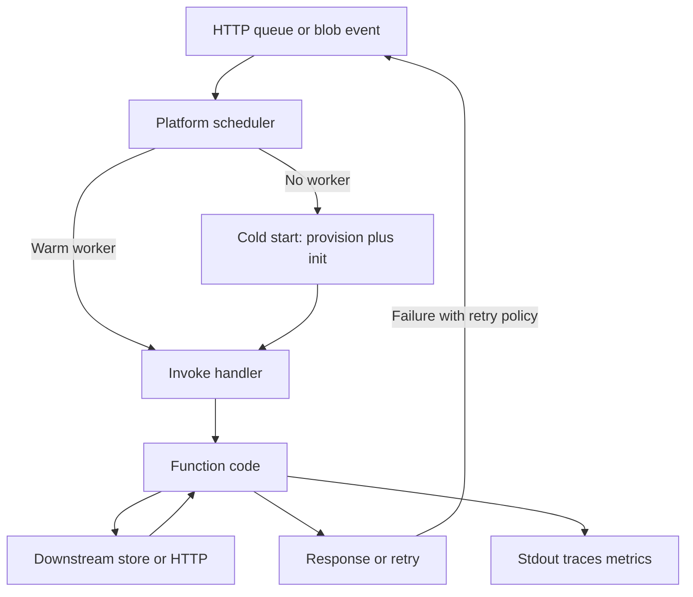

Serverless is a billing and scheduling contract, not the absence of servers. You ship a function, a container, or a short-lived worker. The platform provisions a process when an event arrives, bills you for the time it ran, and can scale that process to zero when nothing is waiting. You still have CPUs, networks, and failure domains. You no longer have a long-lived VM you patch on Tuesday, and you no longer have a process that is allowed to remember last request's customers in memory.

The unit of work is an invocation. An HTTP call, a queue message, a blob-created event, a scheduled tick — each becomes a call into your handler with a payload the vendor defined. That event model is the architecture. If your design needs a sticky in-memory session, a 45-minute video encode in one request, or a conversation that holds a TCP connection open for hours, you are arguing with the scheduler. Move that work, or pick a different runtime.

Cold start is the visible tax of scale-to-zero. When no worker is warm, the platform must place your code, start the language runtime, run your init, then enter the handler. Warm invocations skip the provision step. Time limits are the other hard wall: AWS Lambda's cap has long been fifteen minutes of wall clock per invoke; other platforms are shorter or bill in small quanta. Sticky state does not fit because the next event can land on a different worker, or on no worker at all.

## Concept

### Scale to zero and the invocation

A conventional service keeps N processes running so the next request has a listening socket. You pay for N even at 3 a.m. Serverless inverts that: the platform may run zero copies. Traffic appears, copies appear. Traffic dies, copies die. The economic win is bursty work: a webhook that is quiet all day, an image pipeline that follows uploads, a cron idle most of the hour.

Capacity planning for the function becomes "set a concurrency limit." Everything around it still needs planning: databases, connection slots, burst quotas, regional limits. Scale-to-zero compute does not scale-to-zero the RDS max_connections graph. Teams discover this on the first successful launch.

An invocation is not only HTTP. Queue messages, object-created events, stream records, and scheduled ticks are the same unit with a vendor payload. Your domain sits behind an adapter that turns that payload into a command. If you write the domain against Lambda event JSON, you will rewrite the domain when you change triggers.

Concurrency is a platform number, not a thread pool you tuned. When you hit the reserved or account limit, HTTP callers see 429 or 502, queues backlog, and streams fall behind. Know which of those your trigger does. "Serverless will just scale" is false at the limit you forgot to set and at the limit the vendor already set.

### Cold start, init, and the two clocks

A cold start has two clocks you should measure separately.

Provision and runtime start: the platform finds capacity, downloads your artifact, starts the isolate or process. Package size and language dominate. A large JVM artifact is slower than a small Go binary or a warmed isolate. This clock is mostly outside your handler.

Init is yours: static constructors, secret fetches, SDK clients, TCP handshakes. A handler that opens a new connection pool on every cold start will look like "Lambda is slow" in a trace that is actually "we connected to Postgres in init." Reuse the client in the global scope so warm invokes skip it. That reuse is a cached client, not sticky business state.

Provisioned concurrency and snapshots buy a pool of already-init workers. You pay to keep them. Use that floor on the user-facing path where a p99 cold start is a product incident, not on a nightly batch that can wait two seconds. Warm is not a guarantee: platforms freeze, thaw, and recycle. A module-level map is a cache with no TTL. If the next invoke must see it, it does not belong in the process.

### Time limits, payload limits, and what you must cut short

Platforms cap wall clock, payload size, and often local disk. A fifteen-minute function cannot be your video transcoder for a two-hour file. A 6 MB synchronous payload cannot be your CSV import. Those caps are architectural, not "we'll request a quota increase."

The production pattern is: the short function accepts the event, writes a job record, enqueues the long work, and returns. The long work runs on a worker fleet, a container job, a step machine, or a media service that is allowed to run for hours. The function's job is the handshake, not the encode.

Retries are part of the event model. Queue and stream triggers retry on error; HTTP usually does not unless the caller does. If the handler is not idempotent, a timeout plus a retry double-charges a card. Timeouts are a duplication problem. Set the handler timeout below the caller's, make the work idempotent, and read the dead-letter queue.

### Sticky state does not fit

A load balancer with session affinity pins a user to a process so in-memory session or a local LRU stays valid. Serverless schedulers do not offer that pin. The next event can run anywhere, including a cold start on a different host. Websocket fan-out, if offered, is a separate service with its own store, not "my function remembered the socket."

Put session, locks, and occupancy in an external store. The function becomes a stateless step. There may be zero workers, so "we'll just keep one instance" is not a setting you own. If the product needs a sticky conversation — a multiplayer room, a streaming RPC — functions are the wrong unit. Use a long-lived service or a product built for connections.

### The vendor event model is the coupling

You are coupled to how the vendor describes events, identity, tracing, and retries. IAM roles, event source mappings, and the JSON envelope are part of your system. A "portable function" that still uses the vendor's event shape and secret store is portable in slides.

Keep the handler thin. Parse the event, call a domain function that takes plain types, map the result back. Domain tests should run without the vendor SDK; adapter tests should use recorded fixtures. When you add a second trigger for the same command, the domain does not change.

The process is gone when the invoke ends. Emit structured logs to stdout, traces with the vendor's context, and metrics on cold start and errors. You cannot SSH in. If you buffered logs and the platform killed the isolate, those lines never left.

## Trade-offs

| Approach | When it wins | Cost / risk |
| -------- | ------------ | ----------- |
| Functions scaled to zero | Bursty, event-shaped work with minutes-or-less runtime | Cold starts, time caps, downstream connection storms |
| Provisioned or snapshotted workers | User-facing p99 that cannot absorb a cold start | You pay for idle floor; still not sticky state |
| Containers on a serverless platform | Longer work, custom runtimes, existing images | Cold start can grow; still an invoke model |
| Always-on service | Sticky connections, long jobs, steady high QPS | You own patching, idle cost, and capacity |
| Workflow of many short functions | Multi-step jobs with retries and human waits | Orchestration cost; distributed failure across steps |

Serverless is a poor default for a steadily loaded API whose p99 is already fine on two small VMs, and a strong default for a queue consumer that is idle twenty hours a day. Pick it for the shape of the load, not for the resume line.

## Diagram

An event wakes the platform. A warm worker runs the handler; otherwise provision and init run first. The next event may land elsewhere; nothing in the worker is the source of truth.

## Failure modes

### Cold start on the user path

**Detection.** p99 latency has a second hump. Traces show a long gap before your first line of handler code. The hump grows after idle periods and after deploys. Synthetic checks every minute will keep workers warm and hide what real users hit at 7 a.m.

**Mitigation.** Shrink the artifact. Lazy-load heavy libraries inside the path that needs them. Reuse clients in init. For the interactive path, buy provisioned concurrency or a snapshot, or keep a small always-on service in front. Do not "fix" it by pinging the function every minute from a cron you forgot to document; that is provisioned concurrency with extra failure modes.

### Timeouts that retry as duplicates

**Detection.** The vendor metric for timeouts rises. Downstream shows duplicate orders, double webhooks, or overlapping batches. Dead-letter queues stay empty because the retry "succeeds" the second time after the first already wrote. Caller timeouts are shorter than the function timeout, so the user retries while the first invoke still runs.

**Mitigation.** Make the handler idempotent with an idempotency key stored outside the process. Set the function timeout below the caller's patience, and set downstream timeouts below the function. Use a queue plus a worker for anything that cannot finish with margin. Read the dead-letter queue. A timeout is a retry event, not a clean abort.

### Downstream connection and quota collapse

**Detection.** The function concurrency graph looks healthy. The database reports too many connections, the partner API returns 429, or the NAT gateway's port allocation saturates. Incidents cluster when a traffic spike or a retry storm multiplies workers faster than the store can accept them.

**Mitigation.** Cap reserved concurrency at what the downstream can take, not at what the platform will give. Use connection pooling through a proxy (RDS Proxy and equivalents) so each worker does not own a private pool of ten. Cache tokens. Back off on 429. Scale-to-zero compute with an unscaled database is how a successful launch takes down the thing you did not migrate.

### State in the worker, gone on the next invoke

**Detection.** A feature works in a local long-running process and flakes in production: lost uploads, missing websocket recipients, counters that reset, file handles on `/tmp` that vanish. It correlates with idle time and with concurrency, not with a code path you can reproduce on one process.

**Mitigation.** Put durable state in a store the next invoke can see. Treat `/tmp` and module-level maps as scratch. If you need a conversation, use a product that holds connections, or a service you keep running. Do not build affinity with a cookie and a hope that the scheduler is kind.

## Real-world example

AWS Lambda is the production shape most teams mean, and the constraints are public.

A common backend is API Gateway or a function URL in front of a handler, DynamoDB or RDS for data, S3 for objects, and SQS for work that must not run on the request path. Uploads land in S3; an object-created event invokes a function that writes a thumbnail or a virus-scan result. That pipeline is why the event model exists. The function scales from zero when nobody is uploading, and it scales out when a batch of images arrives. It does not keep a sticky list of "images I am currently processing" in memory. The object key and a table row are the state.

The same account will also grow an HTTP API. Cold starts show up on the first request after idle. The fifteen-minute cap is irrelevant for a JSON handler and fatal if someone puts a report generator in the request. Connection storms show up when a handler opens a Postgres pool per worker and reserved concurrency is left at the account default. Teams that last keep the handler thin, put long work on a queue, cap concurrency at the database's true limit, and buy provisioned concurrency only for login and checkout.

Netflix has described using Lambda for event-driven encoding and backup-style work rather than as the runtime for every user request. That split is the lesson. Burst event processing matches scale-to-zero. A high-QPS, latency-bound API with sticky needs does not start there. Lambda, Cloud Functions, Azure Functions, and Cloudflare Workers differ in isolate model and start time; they agree on an event, a short invoke, no affinity, and a vendor envelope that should not enter the domain.

## What to remember

- Serverless is scale-to-zero scheduling and invocation billing; the servers remain, and so do downstream limits.
- Cold start, wall-clock caps, and payload caps are design inputs, not surprises to be tuned away after launch.
- Sticky in-memory state does not fit; the next event can run anywhere, including nowhere.
- Keep handlers thin against the vendor event, make work idempotent, and cap concurrency at what the database and partners can take.
