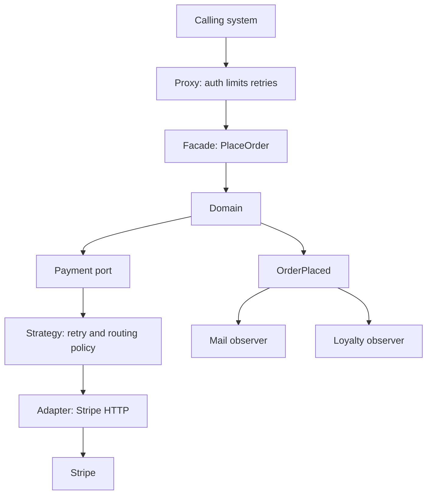

The Gang of Four book catalogued object relationships. Architects still trip over a subset of those relationships every week, usually without opening the book. The useful move is not to memorize twenty-three class diagrams. It is to name the problem a pattern isolates when the unit is a service, a library, or a process, not a class.

Six show up in production systems until you can see them without a UML tool: adapter, facade, strategy, observer, proxy, and decorator. Each one draws a boundary around a kind of change. If you skip the boundary, the change leaks into places that should have been stable. If you apply all six as a layer cake, you get a call stack nobody can debug. Use them as named seams, and stop when the seam has a test.

These are not "Java patterns." An Envoy sidecar is a proxy. A payments port with a Stripe implementation is an adapter. A retry policy you swap in tests is a strategy. A webhook fan-out is an observer. The original examples used Smalltalk and C++. The systems you ship use HTTP, queues, and process boundaries. The isolation is the same.

## Concept

### Adapter: foreign shape, local language

An adapter converts a shape you do not control into a shape you do. The problem it isolates is vendor drift. Stripe's charge object, a bank's ISO message, S3's error codes, and a partner's SOAP fault should not appear in your domain module. The adapter speaks their protocol on one side and your port on the other.

At process scale this is the anti-corruption layer's younger sibling: one integration, one direction of speech, a type you own. When the vendor adds a field, the adapter changes. When you add a business rule, the domain changes. If both change in the same class, you do not have an adapter. You have a vendor SDK call sitting in a use case.

The failure is a "generic adapter" that exposes `Map<String, Object>` and calls it integration. That isolates nothing. The adapter's job is a typed translation with invariants, not a pass-through of their JSON.

### Facade: one door instead of a maze

A facade presents a single, coarser operation in front of several moving parts. The problem it isolates is orchestration complexity leaking to callers. A "place order" facade may reserve inventory, authorize payment, and write the order. Callers should not wire those three. They should not know the order of the three. They should not retry the three independently with different ideas of success.

API gateways and Backend-for-Frontend layers are facades when they compose. They are not facades when they are a transparent TCP pass-through. A pass-through isolates nothing; it relocates TLS. Use a facade when the caller would otherwise have to become an expert in your internals. Do not use one as a place to hide a distributed transaction you have not designed.

Facades go stale when they grow a kitchen-sink surface: every internal RPC gets a public twin. That is a second public API, not a simplification. Keep the facade on the use cases you are willing to support as a product.

### Strategy: a replaceable algorithm behind a stable verb

A strategy isolates a family of algorithms behind one interface: how we authenticate, how we price, how we retry, how we pick a replica, how we rank search hits. The verb stays. The policy changes. Tests inject a fake. Production injects the real policy from configuration or from a flag.

At system scale, retry and backoff are strategies. So is "which warehouse fulfills this." So is the load-balancing algorithm in front of a pool. The point is not a Strategy interface with a single implementor that never changes. That is ceremony. The point is that the rest of the service can call `route(order)` without compiling against overnight-shipping math.

Swap strategies at the boundary you own. If every team copies a retry loop with different status-code lists, you do not have a strategy. You have drift. Put the policy in one module and give it a name people can find in an incident.

### Observer: fan-out without compile-time names

An observer isolates "who cares that this happened" from "this happened." The subject publishes; subscribers react. In-process, that is a listener list. Across services, that is a topic, an event bus, or a webhook list. The publisher should not import the subscriber's module.

This is how you keep a checkout service from compiling against email, loyalty, and analytics. Checkout emits `OrderPlaced`. Other systems apply. The cost is that you now have a delivered-at-least-once story, an ordering story, and a schema story. Observer is not free decoupling. It is a different coupling: to an event contract instead of to a function call.

In-process observers on a request thread are how a "simple event" becomes a latency budget surprise. If a listener writes to a partner API synchronously, your p99 is their p99. Publish, then let a worker observe.

### Proxy: the same contract, extra behavior on the way

A proxy implements the same interface as a real subject and stands in front of it. The problem it isolates is cross-cutting control: access, caching, rate limits, circuit breaking, transport. The caller still thinks it is talking to the subject.

Sidecars, API gateways doing authn, and client-side stubs that retry are proxies. A remote proxy makes a local-looking call into a network call. That lie is useful until people forget it is a lie and put a loop of 10,000 calls in a request. The proxy should make the extra behavior obvious in traces: spans named `authz`, `cache`, `circuit`.

A proxy that changes return types or invents methods is not a proxy. It is an adapter wearing a disguise. Keep the contract identical so you can insert or remove the proxy without rewriting callers.

### Decorator: stacked wrappers, same contract

A decorator also implements the same interface, but the intent is stacking: compression around encryption around metrics around the core. Each wrapper does one extra job. You compose them at boot. Java's stream types are the textbook; HTTP middleware and servlet filters are the production form.

The problem it isolates is "I need another concern without editing the core." Logging, timeouts, and instrumentation belong here. Business rules do not. A decorator that starts rejecting orders because of inventory is a use case hiding in a wrapper, and the next reader will not look there.

Order matters. A timeout decorator outside a retry decorator produces different failure than the reverse. Write the stack down. Test it as a stack. Unlimited decorator depth is how a 5 ms call grows twelve layers and a 200 ms surprise.

### What you should not do with the other seventeen

Factory, singleton, visitor, and flyweight have homes. They are not the weekly architectural vocabulary. A DI container already did most of what factory and singleton were doing in 1994. Visitor shows up in compilers, not in every service. Name the seam you need: translation, simplification, policy, fan-out, control, stacking. If none of those is the problem, you may need a data model, not a GoF name.

## Trade-offs

| Approach | When it wins | Cost / risk |
| -------- | ------------ | ----------- |
| Adapter on every foreign system | Vendor schemas must not enter the domain | Extra types; a lazy adapter that becomes a pass-through map |
| Facade over a use case | Callers should not orchestrate your internals | Kitchen-sink API; hidden distributed transactions |
| Strategy for a policy family | Retry, routing, pricing, ranking will change independently | Ceremony for a policy that has one implementor forever |
| Observer / events for fan-out | Many consumers, publisher must not import them | Schema, delivery, and latency now live on the bus |
| Proxy or sidecar | Auth, TLS, retries, limits without changing the subject | The network lie; extra hops; debugging through a mesh |
| Decorator / middleware stack | Timeouts, logs, metrics around a core | Stack order bugs; business rules buried in wrappers |

Pick one seam per problem. An adapter behind a facade behind a proxy behind three decorators around a strategy is how a 20-line feature becomes a scavenger hunt.

## Diagram

A caller hits a facade for a use case. A proxy applies control. The domain talks to the world through an adapter. Policies sit behind a strategy port. Events leave to observers so the domain does not name them.

## Failure modes

### Vendor types in the core

**Detection.** Domain modules import generated clients, SDK models, or a partner's package names. A column is named after their status code. Changing payment providers requires a rewrite of checkout, not of one adapter class. A grep for the vendor name in the domain package is the detector.

**Mitigation.** One adapter module is allowed to import the SDK. The domain accepts types you own. Fail the build on a forbidden import if the language can. Store your identifiers and your status. Keep their identifiers in the adapter's mapping table when you must round-trip.

### Observer on the request path

**Detection.** p99 for a write includes a fan-out to email, analytics, and a partner webhook. Timeouts in a listener fail the user's checkout. Adding a subscriber changes latency for everyone. Traces show downstream HTTP inside the request span of the publisher.

**Mitigation.** Publish to a bus or a table, return to the user, let workers observe. If you must stay in-process, give listeners a budget and isolate their failures. The publisher's success is "the event was recorded," not "every subscriber finished."

### Proxy as an invisible network

**Detection.** A for-loop of service calls looks local and costs seconds. Timeouts fire in the sidecar, not in application code, and the app retries on top of the sidecar's retries. Multiplied traffic during an outage. Dashboards that only show application CPU look fine while the mesh is saturated.

**Mitigation.** Make hops explicit in traces and in budgets. Disable retry at one layer: app or mesh, not both, unless you can state the idempotency. Teach the team that a proxy preserves the contract and adds a network. Load-test through the proxy you will run in production.

### Decorator stack with a buried rule

**Detection.** A behavior cannot be found in the use case. It lives in middleware: a filter that mutates the body, a decorator that rejects certain SKUs, a wrapper that changes status codes. New engineers add a second copy in the domain because they never looked in the stack. Order-of-wrapper bugs appear only when two decorators are both enabled.

**Mitigation.** Restrict decorators to mechanical concerns: timeout, log, metric, authn, size limit. Put business rules in the domain. Print the stack at boot. Test combinations you actually deploy, not each decorator in isolation only.

## Real-world example

The Java platform and the HTTP middleware stack in front of almost every service are where these six live in public.

`InputStream` wrapping is decorator: `BufferedInputStream` around `GZIPInputStream` around a socket stream, each preserving the stream contract. JDBC and later Spring `JdbcTemplate` act as a facade over connection, statement, and result set choreography so application code does not. `Comparator` is strategy. Servlet filters and HTTP middleware are decorator plus proxy: the request still looks like a request, with auth and logging stacked. A JDK dynamic proxy is how many transaction and retry interceptors attach without the caller changing types.

On the network, Envoy and sidecar meshes are the proxy as a process: the service still speaks HTTP to localhost, and the proxy adds TLS, retries, and limits. Stripe's SDK is not your adapter; your adapter turns their objects into your `Charge` so checkout does not import Stripe types. GitHub webhooks are observer: GitHub does not compile against your CI. Kubernetes admission webhooks wrap the API server's write path: the object contract stays, extra policy stacks.

A payments service that lasts uses all six without naming them in every PR. Facade: `Checkout.place`. Adapter: Stripe. Strategy: retry and which processor to try first. Observer: `OrderPlaced`. Proxy: the mesh. Decorator: timeout and metrics on the HTTP client. The review question is whether each change has a place that does not force the others to recompile.

## What to remember

- Learn the six seams that keep showing up: adapter, facade, strategy, observer, proxy, decorator; do not treat the full catalogue as an architecture checklist.
- Each pattern isolates a kind of change: vendor shape, caller complexity, policy, fan-out, control, stacked mechanics.
- Observer and proxy move coupling onto contracts and networks; they do not remove it.
- One seam per problem; a stack of all six around a 20-line feature is hiding the design, not showing it.
