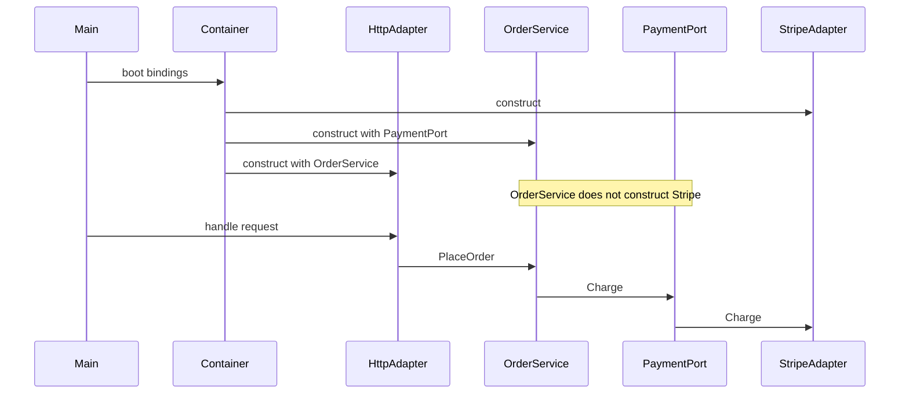

Inversion of control means the framework or composition root calls your code, not the other way around. A servlet container calls `doGet`. A message worker calls `handle`. A test harness calls `placeOrder` with fakes you passed in. You do not construct the world from inside a use case and hope production and tests agree.

Dependency injection is the usual way to invert construction: the thing you need is passed to you, as a constructor argument, a parameter, or a setter you should almost never use for required collaborators. The point is a seam. In a test, the payment port is an in-memory fake. In production, it is Stripe. The use case class does not know which, and it does not call `new StripeClient()` on line 40.

A container — Spring, Guice, Dagger, the ASP.NET Core service collection, a handwritten composition root — is optional machinery. It is not the idea. Teams that "adopt DI" by sprinkling `@Inject` on every concrete class, then mocking the container in tests, have missed the seam. The container exists to call you with the graph already built. If you cannot build that graph in a test without the container, the design still owns you.

## Concept

### Who constructs, who is called

Control, in the old sense, was a `main` that constructed objects and a business method that constructed the rest: `new Repository()`, `new EmailClient()`, `new Clock()`. That method cannot be tested without a database, a mail server, and the system clock. It also cannot be reused with a different repository. The call graph and the construction graph are the same graph.

Inversion splits them. Construction happens at the edge: `main`, a framework bootstrap, a test's `beforeEach`. Runtime calls happen inward: HTTP adapter to application service to domain. The application service receives a `Payments` port. It never asks where the implementation lives. The container, or your `main`, is the only place that is allowed to know that `Payments` is `StripePayments`.

This is why "the container calls you" is the right slogan. Request scope, servlet dispatch, a Lambda handler, a CLI command — something outside the use case decides when it runs and with which graph. Your code is a library the host loads. If you fight that by building a second service locator inside the use case (`Payments.getInstance()`), you have inverted nothing. You have a global.

### The seam is the port, not the annotation

A seam is a place you can change behavior without editing the use case. The port is an interface or function type the use case depends on. The adapter implements it. Injection is how the adapter arrives. Tests prove the seam: if you cannot run the use case with a fake clock and a fake store, you do not have a seam. You have a layer of annotations on top of `new`.

Constructor injection is the default for required collaborators. The object cannot exist in a half-wired state. Optional collaborators can be parameters with defaults, or a second constructor. Setter injection leaves a window where the object is live and incomplete. Field injection, common in Spring examples, hides the dependencies from the constructor and forces a container (or reflection) to create the object. That makes the unit test depend on the framework. I reject field injection for application services.

Do not inject what you should pass. A `UserId` for this request is not a dependency of the service class; it is an argument of the method. Injecting the current user from a thread-local "request context" recreates the global. Inject long-lived capabilities: stores, clocks, publishers, clients. Pass per-request data as arguments.

### Containers: useful, not the point

A composition root that is thirty lines of `new` is DI. A Spring context with component scanning is also DI. The container earns its keep when the graph is large, when lifetimes differ (singleton client, per-request unit of work), and when you want a failed boot if a collaborator is missing.

It costs you when the graph is implicit. Component scanning plus classpath magic means the wiring lives in annotations scattered across packages. Nobody can read `main` and say what production is. Startup failures become "unsatisfied dependency" with a chain of proxies. Circular dependencies get papered over with `@Lazy` instead of being treated as a design smell: two modules that cannot exist without each other are one module, or they need a third event they both consume.

I want a composition root I can read. In Spring that can be a handful of `@Bean` methods in one module, with the domain free of framework imports. In a small Go or Node service it is `main`. Dagger makes the graph compile-time, which catches missing bindings before production. Guice and Spring do it at runtime. Pick based on how much implicit wiring you will tolerate, not based on which conference talk named IoC last.

Service locator — ask a global registry at runtime for `Payments.class` — is the anti-pattern that looks like DI. Every class can fetch anything. Tests have to populate the registry. Hidden dependencies return. The container should push collaborators in, not wait to be asked from deep in a domain method.

### Testability is the proof, not a side effect

If the design is right, a test constructs the use case with fakes in a few lines and asserts on a result or on a fake that recorded a call. No web server. No container. No Dockerized database unless you are testing the adapter.

Adapter tests are separate: they talk to a real or recorded Stripe, a real schema, a real queue. They prove the translation. Mixing those tests with use-case tests is how a "unit suite" becomes a 40-minute integration suite and people stop running it.

Mocking the container, or spinning Spring in every unit test, is a signal the seam is in the wrong place. Mock the port you own. If you cannot, the use case took a concrete class, or a type with twenty methods, and you are now simulating a framework.

### Lifetimes, scopes, and captured state

Injection without lifetimes is how you share a non-thread-safe object across requests, or how you create a database connection per call and exhaust the pool. Singletons for immutable clients and thread-safe stores. Per-request (or per-message) for units of work and identity of the current transaction. Transient for cheap, stateless helpers.

The failure is a singleton that captured a request-scoped object at boot, or a scoped object that captured a stale user. Another failure is injecting an ORM session as a singleton. The container will happily do it. The data will not.

Close resources at the boundary that opened them. If the container owns the DataSource, it closes it on shutdown. If your adapter opens a stream, the adapter closes it. IoC is not an excuse to leak because "the framework will handle it" on a path the framework never saw.

## Trade-offs

| Approach | When it wins | Cost / risk |
| -------- | ------------ | ----------- |
| Constructor injection plus a readable composition root | You need a seam for tests and a graph you can explain | More constructors; boot code to keep honest |
| Framework container with explicit bindings | Large graph, mixed lifetimes, fail-fast boot | Framework types leaking inward if you let them |
| Component scanning and field injection | Demo speed, existing Spring culture | Hidden graph; tests need the container; half-wired objects |
| Service locator / ambient context | You think you need a dependency from anywhere | Hidden deps, untestable paths, thread-local bugs |
| `new` inside the use case | Truly private helpers with no substitute | No seam; tests hit the network or the clock |

The container is a boot-time tool. If application packages import it, the inversion has leaked. The domain should compile without Spring, Guice, or the web framework.

## Diagram

Boot builds the graph and then gets out of the way. A request hits an adapter the container constructed. The adapter calls a service that already holds a port. The service never constructs the adapter on the other side of that port.

## Failure modes

### `new` of an infrastructure type in the use case

**Detection.** Application or domain packages import an HTTP client, an SDK, `java.time.Clock.systemUTC()` at the call site, or `new FileWriter`. Tests of "place order" fail without network unless they use PowerMock-style tricks. A grep for `new` next to vendor types in the use-case package is enough.

**Mitigation.** Depend on a port you own. Construct the adapter in `main` or in one config module. Inject a `Clock` port if time matters. Pass the file path or a `BlobStore` port if storage matters. The use case should compile in a module that cannot see the SDK.

### The container as a runtime bus

**Detection.** Code calls `context.getBean`, `serviceLocator.get`, or a static `App.services.payments()` from deep in the call stack. Tests require a full context. Circular dependencies are resolved with lazy proxies. New engineers cannot draw the graph without running the app.

**Mitigation.** Push collaborators through constructors. Ban service-locator calls outside the composition root, with an architectural test if needed. Break cycles by splitting a module or by replacing a mutual call with an event. If two services must call each other at boot, they are one service.

### Request data injected as a singleton

**Detection.** The "current user" is a field on a singleton service, a thread-local the next task on the pool still sees, or a scoped object injected into a singleton at construction and frozen. Users see another user's cart. Workers process the wrong tenant. It shows up under load, not in a single-threaded test.

**Mitigation.** Pass `UserId` and `TenantId` as method arguments. If you use request scope, never inject it into a singleton. Clear thread-locals in a finally on the worker. Review the container's scope rules the way you review a data model: they are part of the design.

### Tests that only boot the framework

**Detection.** The "unit" suite starts Spring or the web host. Runtime is minutes. Failures are wiring errors. Nobody injects a fake payment port because the type under test is a concrete class with field injection. Coverage of the domain exists only as a side effect of an API test.

**Mitigation.** Split tests by seam. Domain and application tests construct objects. Adapter tests use recorded HTTP or a test database. A small number of boot tests prove the production graph wires. If a class cannot be constructed in a test without the container, change the class, not the test base.

## Real-world example

Spring Framework is the production shape most JVM services still run, and the lesson is visible in how the good services use it versus how the default tutorial uses it.

A checkout service that lasts looks like this. `PlaceOrderHandler` is a class with a constructor that takes `OrderStore`, `Payments`, and `Clock`. Those are interfaces in the application module. `StripePayments` lives in an infrastructure module with the Stripe SDK. `PostgresOrderStore` lives next to the schema. A single config class, or a handful of `@Bean` methods, binds the interfaces to the adapters. The web adapter is a controller that receives HTTP, maps to a command, and calls the handler. Tests of `PlaceOrderHandler` pass a fake store, a fake payments port, and a fixed clock. They run in milliseconds. Tests of `StripePayments` use recorded fixtures. A single Spring boot test proves the context starts.

The tutorial shape inverts the wrong thing. Controllers `@Autowired` concrete repositories. Domain classes sit in the same package as JPA entities and call `EntityManager`. Field injection is everywhere. "Unit tests" are `@SpringBootTest` with an in-memory database. Replacing Stripe means editing the handler. The container is calling you, which satisfies a slogan, and there is no seam, which fails the job.

Google Guice inside Android and server code, Dagger's compile-time graph, and ASP.NET Core's `IServiceCollection` are the same design with different wiring times. The successful pattern is identical: composition at the edge, ports inward, tests that do not boot the host. The unsuccessful pattern is also identical: a service locator, a concrete `new`, or a framework type that leaked into the module that should have been a library.

## What to remember

- IoC means the host calls you; DI is how collaborators arrive so the use case does not construct the world.
- The proof is a test that runs the use case with fakes and no container, not an `@Inject` annotation.
- Inject long-lived capabilities through constructors; pass per-request data as arguments.
- Keep the composition root readable and the domain free of the container; a service locator is a global with extra steps.
