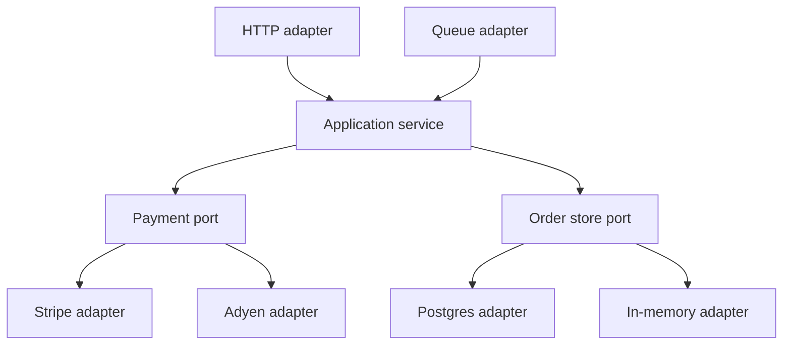

SOLID was written for classes. The letters still pay rent when the unit is a service, a package, or an adapter, and they become slogans when a review recites the acronym and then merges a service that changes for five unrelated reasons. At architecture scale the useful translations are few: a service should have one reason to change, its published interface should stay stable while internals move, callers should depend on that interface rather than on a sibling's database, and you should be able to substitute an adapter without rewriting the core.

The class-level examples — a rectangle that is not a square, a worker that should not be forced to implement `eat()` — are true and too small. A platform review should ask: if we replace Postgres with a different store, which deployables recompile? If finance changes invoice rules, why is the notification service in the same release train? If a new payment processor arrives, do we add a class behind a port or an `if` in the checkout that already knows Stripe's error codes?

Do not hang a poster of the five letters on a wiki and stop. Take each letter as a system consequence, or skip it in that review. A service that is "SOLID" because every class has an interface with one implementor has paid the ceremony and missed the point.

## Concept

### Single reason to change, at service grain

A reason to change is an owner and a trigger. Inventory rules change because merchandising said so. Tax rules change because a jurisdiction said so. The HTML of the admin UI changes because a designer said so. If those three live in one deployable, that deployable has three reasons to change, three test suites that share a release, and three chances to block a hotfix.

At class scale this is "one axis of change." At system scale it is the service or module boundary. You will not get to one reason with mathematical purity. You will get to a boundary where the people who change tax do not need the people who change the storefront CSS to be in the same pipeline. When they are, you have a monolith of ownership even if the repo is split into folders.

A bad split is worse than a wide service. Five microservices that all change when an order field is added — because each one deserialized the same blob — have not given you single responsibility. They have given you a distributed reason to change. The test is: name the actor who asks for the change, and list the deployables that must ship. If the list always includes "all of them," the letters on the wiki are decoration.

### Stable published interfaces

Open for extension, closed for modification is not "never edit files." It is "the contract other teams compiled against should survive a change of internals." At architecture scale that contract is an API, an event schema, a package you publish, a port. You extend by adding an adapter, a new event type with a compatibility rule, an additive field. You modify the interior.

Closed for modification, taken as dogma, produces frozen wrong interfaces and a zoo of `v2` services that never die. The system consequence you want is: internals can move without a flag day for callers. Version, add, deprecate. Do not rename a field on a public event because a table column changed. That is modifying the contract because the interior moved, which is the violation.

Extension also has a shape: plugins, adapters, and feature flags that introduce behavior without editing the core path every time. If every new payment method is a pull request that touches the checkout's switch statement, the core is open for modification by every processor vendor. Put a port there. Add an adapter. The checkout stays closed to that axis.

### Substitution of adapters

Liskov substitution, at system scale, is the right to replace an adapter without lying to callers. If `Payments` is a port, Stripe and Adyen must honor the same invariants: idempotent charge with a key, a captured-or-failed result, no thrown "success" that did not move money. If the Postgres adapter for `OrderStore` hides a lost update that the in-memory adapter surfaces, tests that passed on the fake will fail in production, which is a substitution failure.

Kubernetes made this concrete with the Container Runtime Interface. kubelet does not compile against Docker's engine API anymore. It talks CRI. containerd and CRI-O substitute. When Docker's shim went away, the control plane's job did not rewrite. That is Liskov at process scale: the platform depended on a contract, and runtimes that could not honor it did not belong behind that contract.

A substitution that weakens the contract — a "cache store" that is allowed to drop writes while the interface still says `save` — is a lie. Either the port allows loss, and every caller handles it, or the adapter is not a valid substitute. Do not hide a best-effort cache behind a durable store interface.

### Small published surfaces, inversion toward the core

Interface segregation at architecture scale is "do not force a caller to depend on a fat API it does not use." A 200-endpoint service that every client imports as one SDK means a change to an admin-only call bumps a version every consumer must look at. Split published surfaces by consumer job: checkout reads, admin writes, events. Internally it can still be one process if ownership says so. The published surface is the coupling.

Dependency inversion is the letter that already showed up as hexagonal architecture and DI. High-level policy (the domain) must not depend on low-level details (HTTP, SQL, a vendor SDK). Both depend on a port the domain owns. At service scale: checkout depends on a payments port, not on Stripe's JAR. The database adapter depends on the store port, not the other way around. If application code imports the ORM, inversion lost and the schema is now the API.

The system consequence is replaceability and testability of the core. You can run the domain with an in-memory adapter. You can replace the HTTP front with a queue worker. You cannot do either if the domain constructed a servlet and a session factory.

### What the acronym is not

SOLID is not a reason to create an interface for every class. It is not a reason to split a service into five so that each letter has a home. It is not a substitute for naming the actual change you are designing for. If the change is "we are adding a field to an event," the letters you need are stable contracts and substitution of consumers that must ignore unknown fields. If the change is "we are replacing a vendor," the letters you need are inversion and substitution of adapters. Recite those, not the mnemonic.

## Trade-offs

| Approach | When it wins | Cost / risk |
| -------- | ------------ | ----------- |
| One service, one primary owner and change axis | A team can ship without waiting on unrelated rules | The axis was drawn wrong and now two owners share a release |
| Stable published API or event plus adapters | Internals and vendors will move | Extra types; slow evolution if "closed" is taken as frozen |
| Substitutable adapters behind a port | Tests and vendor replacement must not rewrite the core | A fake that is not a valid substitute lies in CI |
| Segregated published surfaces | Different consumers, different change rates | More endpoints to operate if you also split processes too early |
| Depend on ports the domain owns | Core must run without HTTP or SQL | Ceremony if there is one adapter and no test that uses a second |

A module with one implementor per port is still worth it when the second implementor is the test. It is not worth it when the interface is a clone of the class, in the same package, never faked, never replaced.

## Diagram

HTTP and the database are details. The application service depends on ports. Stripe and Adyen substitute behind the same payment contract. A second store adapter can sit in tests. Changing tax rules should not require editing the HTTP adapter.

## Failure modes

### One deployable, five owners

**Detection.** The changelog for a release mixes tax, CSS, invoice PDF, and a payment retry. On-call is a shared rotation that cannot name which feature broke. A hotfix for a checkout timeout waits on a storefront copy change that failed CI. Ownership maps show one repo and four managers.

**Mitigation.** Split along the reason to change, at the grain you can afford: a module with a published API first, a service if the release trains truly diverge. Do not split a table into five services that must still ship together. Name the owner of each published surface.

### Contract tied to an interior change

**Detection.** A column rename becomes a breaking JSON change. An ORM entity is the public event. Consumers recompile when you add an index. `v1` and `v2` of the same service run forever because a field was renamed for taste. Changelog says "internal refactor" and a partner pages you.

**Mitigation.** Publish types you own. Map at the adapter. Additive changes default. Run dual-write or dual-read through a flag if you must reshape. Treat the public event as a product with a version and a deprecation window, not as a dump of the table.

### Adapter that does not honor the port

**Detection.** Tests pass on an in-memory store that never loses a write; production uses a cache that does. Stripe adapter swallows a timeout and returns success; the fake always throws on network errors. Incidents look like "heisenbugs" that only happen with the real vendor.

**Mitigation.** Write contract tests against the port and run them on every adapter, including the fake. State invariants in the port's docs: durability, idempotency, timeout behavior. If an adapter cannot meet them, it is not a substitute; change the port or change the adapter.

### Core depends on a framework type

**Detection.** Domain modules import Spring, JPA, a web `Request`, or a vendor SDK. The only way to exercise a rule is to boot the host. Replacing HTTP with a worker requires editing policy classes. The "interface" is `JpaRepository<Order, Long>` and there is no second implementor, not even a fake.

**Mitigation.** Move framework types to adapters. Domain and application depend on ports they own. A compile-time rule that forbids those imports in the domain package is part of the architecture. If the team will not run the domain without the framework, inversion is a slide.

## Real-world example

Kubernetes' Container Runtime Interface is SOLID at platform scale, in public, with a history you can read.

kubelet used to talk to Docker's Engine API as the way to run containers. That tied the control plane's reason to change to Docker's reason to change. When the project needed other runtimes, and when Docker's API was no longer the thing they wanted to freeze against, they published CRI: a small gRPC surface for image pull, container create, start, stop, logs. containerd and CRI-O implement it. Docker became an extra hop and then, for many clusters, went away. kubelet did not grow a switch statement of vendor SDKs. It depended on a port.

That is single axis: runtime implementation can move without the scheduler's product changing. That is a published interface closed to those modifications and open to new runtimes. That is substitution: a runtime that cannot honor CRI does not sit behind it. That is segregation: CRI is not the whole Kubernetes API; it is the slice a runtime needs. That is inversion: the high-level node agent does not depend on a low-level engine's types.

A payments context in an ordinary company should look the same even if nobody says CRI. Checkout owns a `Payments` port: charge, refund, idempotency key. Stripe and Adyen are adapters. PCI and processor incident response are reasons the adapters change. Pricing rules are a reason checkout changes. If those two reasons share a class that imports Stripe's SDK, you will feel it on the first processor migration. The letters were never the point. The deployable that did not have to change is the point.

## What to remember

- Translate SOLID into system consequences: one reason to change a service, a stable published contract, adapters that honestly substitute, small surfaces, core depending on ports it owns.
- Reciting the acronym without naming who changes what, and which deployables ship, is ceremony.
- A fake or a second vendor that cannot honor the port is a Liskov failure, not a test convenience.
- If the domain cannot run without a framework type, dependency inversion lost, regardless of how many interfaces you drew.
