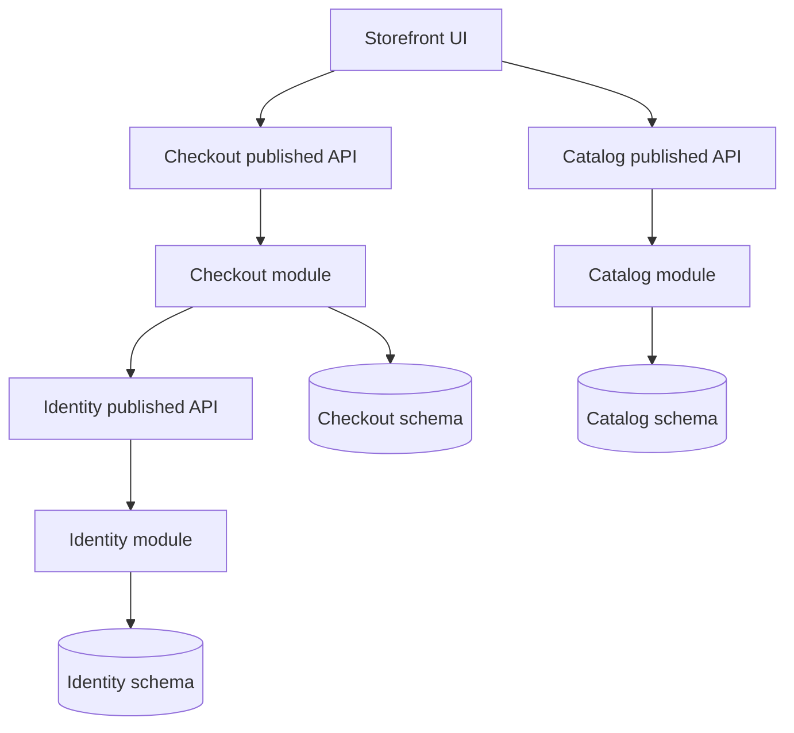

A concern is a reason to change, an owner, and a kind of knowledge. Presentation, domain rules, persistence, and a vendor protocol are different concerns. Separating them means a change to one does not force a rewrite of the others. Modularity is how that separation shows up in the build: a boundary the compiler, the bundler, or the CI graph will enforce. Folders are not that boundary. A `domain/` directory that imports the SQL driver has not separated anything. It has labeled a pile.

The questions that matter are: what can change without a rebuild of what, who is allowed to import whom, and what is the published surface a neighbor may compile against. If two teams can edit the same package without a contract, you have a folder. If a change to CSS rebuilds the billing JAR, the build graph is telling you the modules are a fiction.

Concerns also live across processes. A checkout service that embeds HTML templates, tax tables, and Stripe calls in one class has mixed concerns whether you call it a monolith or a microservice. Split by the axis of change first. Then decide whether the module is a package, a library, or a deployable. Deployables are expensive modules. Do not buy one per folder.

## Concept

### Concerns are axes of change, not layers on a slide

Layered diagrams put UI on top, business in the middle, data at the bottom. That can match concerns if each layer has its own reason to change and its own published API. It fails when "business" is a dumping ground that knows column names, HTTP status codes, and the shape of a React form.

Separate by what changes together. Tax calculation changes with law. The checkout button changes with design. The Stripe retry policy changes with their outage. Those should not be one class, and they often should not be one module. Persistence is a concern because the schema and the queries change for storage reasons, not because "data access" is a virtue. If the only way to change a rule is to change a query, the rule was never separated; it was encoded as SQL.

Cross-cutting concerns — authn, logging, timeouts — are real and they tempt a god filter. Keep them mechanical and at the edge. When a filter starts applying discount law, you have mixed a cross-cut with a domain concern in the one place nobody looks.

### Modules are build and import graphs

A module is a unit the build system can compile, test, and cache independently, with an explicit public surface. Java modules and packages with architectural tests, Go modules, .NET assemblies, Bazel packages, JS packages in a monorepo — the mechanism varies. The property does not: neighbors import the public API, not the internals, and CI can skip a module whose inputs did not change.

Enforce the graph. A rule that `domain` may not import `http` or `sql` is the design. A package convention without a check will last until the first incident. Tools exist: module systems, import linters, Bazel visibility, ArchUnit, Netté. Use one. Code review will not scale to "please do not import that."

Cycle is the failure. A depends on B depends on A, and you no longer have two modules; you have one with a dotted line. Break the cycle with a port, an event, or by merging. `@Lazy` and circular injection are not a module system.

Published surface should be small. Exporting every class because they are `public` makes the module a dump of internals. Export the types you will support across a version. Hide the rest. Binary compatibility is a modularity problem, not a courtesy.

### Folders, layers, and the distributed monolith of packages

A repository layout that mirrors a slide — `controllers/`, `services/`, `repositories/` — groups by technical role. Every feature then touches every folder. That is the opposite of a change-based module. Feature teams live in slices; technical folders force them to meet in every PR.

Prefer grouping by business module (`checkout`, `catalog`, `identity`) with internal layers if you need them, over grouping by layer across the whole app. The catalog's SQL stays in catalog. Checkout may not query catalog tables; it may call a published API or consume an event. If both modules share a database schema without a contract, the database is the coupling and the folders are paint.

Microservices that share a library of entities, or a database, have not modularized. They have put a network between two packages that still change as one. Measure co-change: if two "modules" always ship in the same commit, they are one module with extra latency.

### What to put in a module versus a service

A library module is the default. You get a boundary, tests, and a version. You pay a build. A service adds a network, a failure mode, a release, and an on-call. Buy the service when the ownership, scale, or failure domain truly diverges: a different SLO, a different data store, a different team on a different clock.

Until then, a well-enforced package in a monolith is modularity. Linux did not start as a mesh of RPCs. It started as subsystems with interfaces, and loadable modules where the boundary was real. Your billing code can be a module for a long time. Promote it to a service when the build boundary is not enough — when you must scale it separately, or when a crash of the storefront must not take billing down.

Shared kernels of "common" code become the module that everyone waits on. A `common` or `utils` package that holds domain types is a hidden monolith. Put shared primitives in a small kernel with a high bar, or duplicate a 20-line type rather than couple two domains to a third team's release.

### Tests, ownership, and the right to ignore internals

A module you cannot test without booting its neighbors is not separate. Domain tests run on the domain module. Adapter tests run on the adapter module. Contract tests run against the published surface. If checkout tests need catalog's database, checkout depends on catalog's interior.

Ownership should match the module. One team, one published API, one backlog. Two teams in one module will fight over the public surface. Two modules owned by one team is fine; it is how you keep option value without extra on-call.

The right to ignore internals is the product of modularity. Catalog can rewrite its tables if checkout only consumes `GetProduct`. The day checkout reads `catalog_items` because a join was convenient, the module died. The schema is now a published API you did not version.

## Trade-offs

| Approach | When it wins | Cost / risk |
| -------- | ------------ | ----------- |
| Business modules with enforced import rules | Change and ownership follow the domain | Up-front work on visibility; fights over where a type lives |
| Technical layers across the whole app | Small app, one team, one change rate | Every feature edits every folder; no build isolation |
| Library modules in one deployable | Boundary without network cost | Discipline required; easy to cheat via the database |
| Service per module | Separate scale, SLO, or team clock | Distributed co-change; extra failure modes |
| Shared `common` kernel of domain types | Truly shared primitives with a strict bar | Becomes the monolith everyone waits to release |

If the CI graph always rebuilds everything, you have not modularized the build, even if the folders look neat. Fix visibility and inputs until a catalog-only change does not recompile checkout.

## Diagram

Checkout, catalog, and identity compile against published APIs, not against each other's stores. Each module owns its schema. The storefront UI is a separate concern that talks to checkout's API, not to tables.

## Failure modes

### Folder modularity

**Detection.** Packages are `controllers`, `services`, `entities`. Import graphs allow anything to import anything. A "domain" class uses JDBC types. CI rebuilds the world on a CSS change because there is one artifact. Architectural tests do not exist.

**Mitigation.** Group by business module. Add a visibility or import rule and fail the build on violations. Split artifacts so the UI and billing do not share a compile unit if they do not share a change unit. Treat a forbidden import as a broken contract, not a style comment.

### Shared database as the real module

**Detection.** Two services or two packages join each other's tables. A migration in catalog breaks checkout at runtime, not at compile time. There is no published `GetProduct`; there is a SQL string in a neighbor. Schema ownership is "whoever wrote the query."

**Mitigation.** One schema owner per module. Neighbors call an API or consume an event. If you are not ready to split the database, you are not ready to split the service; keep one deployable with internal modules and still forbid cross-schema joins from the wrong package.

### Cycles and the `common` sink

**Detection.** The dependency graph has a cycle, or every module depends on `common` which depends on something that depends on a domain type. A one-line util change rebuilds the company. People put "just one enum" in `common` every week.

**Mitigation.** Break cycles with ports or events, or merge. Freeze `common` to truly generic primitives with a review bar. Duplicate a small type across modules rather than couple two domains. Measure who depends on whom in CI and make the graph visible in the PR.

### Service split without a change split

**Detection.** Five deployables, one release train, one database, a shared entity JAR. Latency went up. On-call went up. The reason to change a field still touches all five. Co-change in git is the detector: the same PRs list every repo.

**Mitigation.** Merge until the remaining services have independent reasons to change, or drop the network and keep modules. Publish a real contract instead of a shared entity JAR. Modularity is independence of change and build, not a count of processes.

## Real-world example

The Linux kernel is a modular system whose boundaries are enforced by the build and by an ABI, not by a `kernel/` folder named for taste.

Subsystems — scheduler, memory, virtual file system, network stack, drivers — have interfaces other subsystems call. A driver is a module: it can be built in or loaded, it implements a known interface (a file system, a network device, a block device), and it does not get to rewrite the scheduler to fix a NIC. Changing a driver does not require every user of `read()` to recompile userspace, because the syscall surface is a published contract. When that surface does change, the kernel treats it as an event with rules; it does not casually rename a syscall because an internal struct moved.

Loadable modules make the build graph real: you can ship a driver without rebuilding the whole kernel, within the ABI the core committed to. Break that ABI and out-of-tree modules fail, which is the same incident you get when checkout compiled against catalog internals. The concern split is also real: device protocol knowledge lives in the driver, policy in the subsystem, not in a single `misc.c` that includes both.

A product monolith can copy the property without copying C. Bazel or Gradle visibility that forbids checkout from seeing catalog's table types; a published `CatalogClient`; tests that run checkout against a fake catalog; a CI cache that skips billing when only the storefront CSS changed. Google-style monorepos work when the build graph is the module system. They fail when `//common` is a junk drawer and every target depends on it. Linux's lesson is the enforced interface, not the language.

## What to remember

- Concerns are axes of change; modules are build and import boundaries that enforce those axes.
- Folders and layer names do not separate anything unless the compiler or CI can refuse a forbidden import.
- A shared database or a shared entity JAR is a module whether you wanted one or not; publish a contract or accept the coupling.
- Buy a network (a service) only when ownership, scale, or failure domain has already diverged; until then a library module is modularity.
