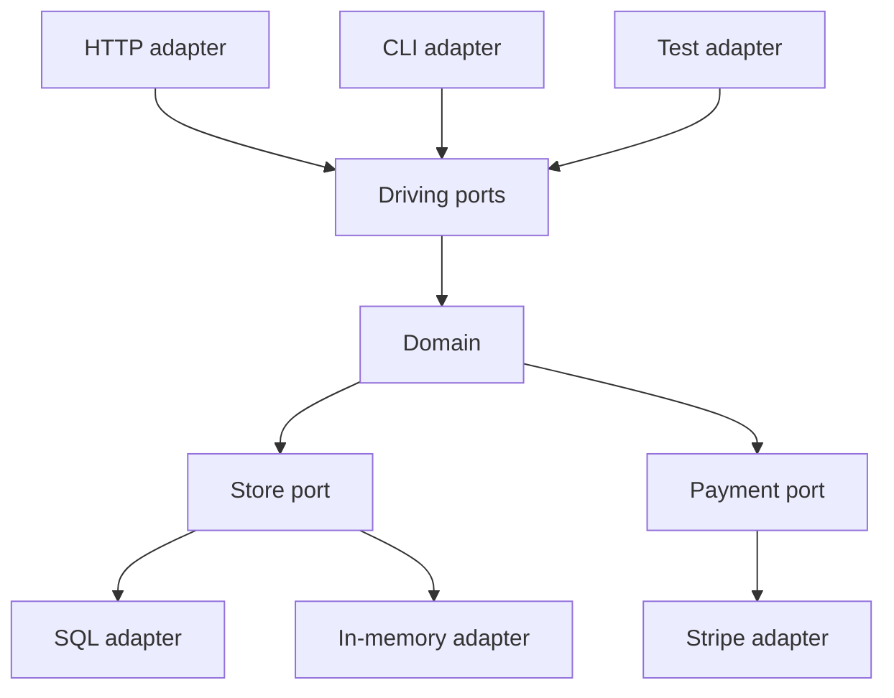

Hexagonal architecture puts the domain in the middle and the world on the rim. The domain does not know HTTP, SQL, a message bus, or a mail vendor. It knows ports: function types or interfaces it owns. Adapters on the outside implement those ports, or they drive the domain through them. The picture is a hexagon because there is no privileged "top" layer. A CLI, a queue worker, and a web controller are equally valid ways in. A database, a mailer, and a clock are equally valid ways out.

Alistair Cockburn named the pattern to stop applications from being written as a web framework with a bit of SQL in the handlers. The test of whether you did it is not a diagram in a wiki. It is whether you can run the domain — place an order, apply a refund, expire a hold — in a unit test with no servlet container, no Postgres, and no vendor SDK. If you cannot, the framework is still in the middle, and the hexagon is a slide.

Driving adapters call in: HTTP, RPC, CLI, tests. Driven adapters are called out: stores, queues, third parties. Both are replaceable. That replaceability is the point. You are not collecting interfaces for sport. You are keeping policy from compiling against a driver.

## Concept

### Domain in the middle

The domain is the rules and the names you would still need if the delivery mechanism changed tomorrow. An order can be placed, paid, cancelled. A hold expires. A refund is bounded by what was captured. Those sentences should not mention REST, JSON, or a table. If they do, the domain has already leaked.

Keep the domain module free of framework imports. Entities, value objects, domain events, and application services that orchestrate them live here. Application services are allowed to depend on ports: `OrderStore`, `Payments`, `Clock`, `EventPublisher`. They are not allowed to construct a `JdbcTemplate` or read `HttpServletRequest`.

This is smaller than people fear. You do not need a full DDD textbook to start. You need a package the web module cannot infect, and a test that instantiates an application service with fakes. Grow the model as the rules grow. Do not start with a hexagon of empty interfaces around a CRUD that is the table.

### Ports: the contract the domain owns

A port is a seam named by the domain, not by the vendor. `Payments.charge(orderId, amount, idempotencyKey)` is a port. `StripeClient.createPaymentIntent` is not. The domain defines the verbs it needs. The adapter translates.

Driving ports are the application's API: `PlaceOrder`, `CancelOrder`. Adapters for HTTP and for a message worker both call those. Driven ports are what the application needs from the world. Direction matters for reading the code: incoming adapters depend on the application; the application depends on outgoing port types; outgoing adapters implement them. Dependency arrows point inward, toward policy.

Ports should be small. A 40-method `UnitOfWork` that is secretly the ORM session is not a port; it is the framework wearing a hat. Split by capability the domain understands. If a method exists only because the database could do it, it does not belong on the port.

### Adapters: HTTP and DB are peers, not layers

An HTTP adapter maps request to command, calls the driving port, maps errors to status codes. It does not compute tax. A SQL adapter maps `OrderStore` to queries and rows. It does not decide whether a cancel is legal. A Stripe adapter maps `Payments` to HTTP calls and webhooks. It does not own the meaning of "paid" beyond what the port states.

Because HTTP and DB are both adapters, the old "controller talks to repository" shortcut is a smell: it skipped the domain. For true CRUD, that shortcut is sometimes honest — admit you have no domain and generate a table API. For anything with a rule, put the rule in the middle and keep both adapters thin.

You will have more than two adapters. Tests are an adapter: they drive the domain. A CLI is an adapter. A Kafka consumer is an adapter. Mail is an adapter. Clock and random are adapters if you need determinism. The hexagon grows faces as you add ways in and out, not as you add layers.

### The test: domain without the framework

Boot a test. Construct `PlaceOrderHandler` with an in-memory store, a payments fake, a fixed clock. Call `place`. Assert an event was recorded and the store has an order. That test is the architecture. If it requires `@SpringBootTest`, Testcontainers, and a random port, the domain is not in the middle.

Adapter tests are a second suite. They prove SQL against a real schema, or HTTP mapping against fixtures, or Stripe against recorded traffic. They are slower and fewer. Mixing them into the domain suite trains the team to boot the world for every rule.

A third test is an architectural one: the domain package must not import the web or SQL packages. Fail the build if it does. Without that, the hexagon lasts until the first "quick" query in a domain service.

### Neighbors: layers, clean architecture, onion

Layered n-tier puts UI / app / domain / DB in a stack and usually lets the domain depend downward on the DB types. Hexagonal forbids that downward arrow. Clean architecture and onion are the same idea with concentric circles: dependencies point inward. Use whichever picture the team will actually enforce. The mechanism is identical: ports inward, adapters out.

Do not stack all three names in one service as separate folders (`hexagon/`, `clean/`, `layers/`). Pick a package layout: `domain`, `app`, `adapters/http`, `adapters/sql`. Enforce imports. Stop.

## Trade-offs

| Approach | When it wins | Cost / risk |
| -------- | ------------ | ----------- |
| Hexagon with domain tests, no framework | Rules will outlive HTTP and the current store | Extra types; overkill for a table with no rules |
| Thin handlers over an ORM | CRUD, one team, schema is the product | Rules in queries and controllers; replacement of either is a rewrite |
| Ports with one production adapter plus a fake | Tests and a future vendor swap | Interface clones of the ORM if the port is not designed |
| Full adapter zoo on day one | You already have CLI, worker, and two stores | Ceremony; empty interfaces nobody fakes |
| Layers that depend downward on SQL types | Familiar slide, fast start | Domain compiles against the driver; the test is the database |

Start the hexagon when the first rule appears that you would want to test without Postgres. Do not wait for a rewrite. Do not prelude a CRUD app with twelve ports.

## Diagram

Driving adapters call inward. The domain talks out through ports. SQL, mail, and an in-memory fake are substitute adapters on those ports. The domain package has no arrow to HTTP or to the database driver.

## Failure modes

### Framework in the middle

**Detection.** Domain classes extend framework base types, hold HTTP types, or import the ORM. The only executable specification of a rule is an API test. Replacing the web layer requires editing policy. A package scan shows Spring or Express types under `domain`.

**Mitigation.** Move those types to adapters. Introduce ports for the capabilities the domain needs. Add a compile rule. Write one domain test that boots nothing. Until that test exists, the refactor is unfinished.

### Ports that are the vendor

**Detection.** The "port" is `StripeGateway` or `JpaOrderRepository` with Stripe or JPA types in the signature. There is one implementor. The fake in tests is a mock of the SDK. Changing vendor is a signature change in the domain.

**Mitigation.** Rename by the capability: `Payments`, `OrderStore`. Use your types in the signature. Put vendor types in the adapter only. If you cannot fake it without the SDK, the port is still the vendor.

### Anemic hexagon around CRUD

**Detection.** Every operation is pass-through: controller to service to repository, no rule, three interfaces per table. PRs take longer. Nobody can explain what the domain knows that the table did not. The team hates "architecture" and bypasses it on the next feature.

**Mitigation.** Use a thinner shape for true CRUD. Spend the hexagon on the flows that have invariants. Not every table needs a port with two adapters on day one. The pattern is for policy, not for mapping rows.

### Outgoing work on the request thread without a port

**Detection.** The domain, or a "service" in the middle, sends email or calls a partner inline. Tests either hit the network or mock a concrete client. Failures in mail fail checkout. There is no `EventPublisher` port, only a `JavaMailSender` field.

**Mitigation.** Publish a domain event through a port. Let an adapter send mail, or a worker do it. Tests record the event. Checkout succeeds when the decision is recorded, not when the SMTP server answers.

## Real-world example

A checkout service in a Spring Boot estate is the production shape most JVM teams actually attempt, and you can tell from the tests whether they got a hexagon or a layered app with extra folders.

The working form: `checkout-domain` is a module with no Spring, no JDBC. `PlaceOrderHandler` takes `OrderStore`, `Payments`, and `Clock`. Tests in that module cover sold-out, duplicate idempotency keys, and cancel-after-capture using an in-memory store and a payments fake. `checkout-http` maps POST bodies to commands and maps domain errors to 409 or 400. `checkout-sql` implements `OrderStore` with SQL or an ORM, confined to that module. `checkout-stripe` implements `Payments`. Boot wiring in a tiny `checkout-app` module binds the ports. You can run the domain suite on a laptop without Docker. You can hang a worker adapter on the same driving ports for a replay of a queue of commands.

The failed form uses the same folder names. Controllers call `OrderService` which autowires `OrderRepository` which is Spring Data. "Domain" entities are JPA entities. Tests are `@SpringBootTest` with Testcontainers. Stripe is called from the service with the SDK types. The hexagon was drawn once on a whiteboard. The build still has one module. The rule "can we run the domain without the framework?" fails in five minutes of trying.

Cockburn's original point was that the application should be runnable from a test harness as the first adapter, not from a UI. That is still the acceptance test for the pattern. Shopify, banking cores, and any shop that has had to replace a processor or a storefront host without rewriting pricing rules are applying it, whether or not they say "hexagon." The named origin is Cockburn's ports and adapters; the named proof is a domain test that never opened a socket.

## What to remember

- Domain in the middle, ports it owns, adapters for HTTP, SQL, queues, and tests; no privileged top layer.
- The proof is running the domain without the framework or the database, not a hexagon in a slide.
- HTTP and the database are peer adapters; a controller that talks to a repository skipped the policy.
- Spend the pattern on flows with rules; an anemic port-per-table is ceremony around CRUD.
