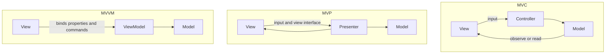

MVC, MVP, and MVVM are answers to two questions: who owns the state the user sees, and who the view is allowed to talk to. They are not three skins of the same diagram. If you mix them — a ViewModel that also is a controller that also mutates widgets — you get the god object these patterns were invented to avoid, with extra types.

In MVC the view is often allowed to observe the model, and a controller interprets input. In MVP the view is passive: it talks only to a presenter, and the presenter talks to the model and back to the view through an interface. In MVVM the view binds to a ViewModel; the ViewModel owns presentation state and commands; the view should not be told "set this button's caption" in imperative code.

These names arrived from Smalltalk, desktop GUIs, and then mobile and web frameworks that stretched them. Rails "MVC" is not Smalltalk MVC. Android Activities that stuffed network calls into `onCreate` were not MVP. WPF and later Android Jetpack made MVVM a default. Read the runtime you have. Ask who holds the state and who the view calls. If you cannot answer, you do not have a pattern. You have a file named `SomethingController`.

## Concept

### State, view, and the conversation

UI architecture fails in a few repeatable ways. The view widget holds business state that the server also holds, and they drift. The view calls the database. The network callback touches widgets from a background thread. A rotation or a navigation destroys the view and takes the in-flight work with it. The patterns below are rules about which of those conversations are legal.

The model is the state and the rules, independent of widgets. In a client app that may be a domain layer plus services. In Rails it is often an ActiveRecord object, which already mixes persistence into the model — a compromise you should see, not copy blindly into a mobile app. The view is pixels and input. The third object — controller, presenter, or ViewModel — is the policy for that screen: what a click means, what to show while loading, what to do on failure.

Who owns presentation state (the current tab, the contents of a text field the user has not submitted, a spinner flag) is the fork. MVC often leaves some of it in the view. MVP puts it in the presenter and pushes it to the view. MVVM puts it in the ViewModel and lets the binder push it.

### MVC: view talks to controller, and often to model

Classic MVC: user action hits the view, the view notifies the controller, the controller mutates the model, the model notifies observers, the view redraws. The view is allowed to read the model. That is why it is easy to leak: a template that calls `order.customer.address.country` has coupled the view to the graph. The controller is supposed to be thin input handling. In web MVC it became a request handler that loads the model and selects a template.

Rails, ASP.NET MVC, and many HTTP frameworks use that web shape. A request arrives. A controller action loads records, maybe runs a command, and renders a view. The view talks to the model objects it was given. There is no long-lived presenter. State for the next request lives in the database or the session, not in the controller instance. That matches a stateless HTTP process. It does not match a screen that must survive a configuration change while a download runs.

Desktop and early iOS MVC often put too much in the controller: networking, formatting, widget mutation. The view controller became the application. If you are still there, you do not need a religious conversion to MVVM overnight. You need to pull model work and presentation state out of the widget class until the widget does not know about URLs.

### MVP: the view talks only to the presenter

MVP makes the view passive. The view implements an interface the presenter owns: `showLoading()`, `showItems(list)`, `showError(message)`. The view forwards clicks to the presenter. The presenter talks to the model, then calls the view interface. The view does not observe the model. Tests instantiate a presenter with a fake view and a fake model and assert that `showItems` was called. No UI toolkit required.

This wins on platforms where the view is painful to test (older Android, some desktop toolkits) and where you want explicit, imperative updates. The cost is a chatty interface: every new widget state is a method. Presenters can become god objects if one presenter owns a whole app. Keep one presenter per screen, and keep it free of Android or WinForms types so the test stays a unit test.

Supervising controller is a milder MVP: the view binds some simple fields itself, and the presenter handles the rest. Passive view is the strict form. Name which one you are using. A "presenter" that receives a `Button` and calls `setText` is not MVP; it is a controller that imported the toolkit.

### MVVM: the view binds, the ViewModel owns presentation state

MVVM gives the view a ViewModel: properties and commands. A binder or reactive pipeline copies property changes to widgets and copies user input back. The ViewModel does not hold a reference to a widget. It does not know that a `RecyclerView` exists. It knows `items`, `isLoading`, `submit`. The view talks to the ViewModel only, through binding, not through a 30-method view interface.

State ownership is the ViewModel's job. On Android, a `ViewModel` from Architecture Components survives rotation; the Activity does not. That is the architectural win: in-flight work and screen state live in an object that is not the widget tree. On WPF and in many web frameworks, the same split exists: destroy the view, keep the ViewModel, bind again.

The failure is a ViewModel that accepts `Context`, mutates views, or becomes a dump of the model's entire graph. Another failure is two-way binding into a domain object that then saves itself on every keystroke. The ViewModel is presentation state. Map to a command when the user means it.

### Choosing on purpose

Use web MVC when the process is request-scoped and the template is the view. Use MVP when you need imperative view updates and a test without the toolkit, and the binder is missing or untrusted. Use MVVM when the platform has a binder and a longer-lived screen state object (Android Jetpack, WPF, many reactive web setups).

Do not run all three on one screen. A fragment that is a view, a presenter that updates it, and a ViewModel that also holds a `View` reference is how teams "adopt architecture" and keep the god object. Pick the conversation: view-to-controller, view-to-presenter, or view-binds-ViewModel.

Server rendering versus client rendering is a different axis. An MVC controller can return HTML or JSON. An MVVM ViewModel can sit in the browser after SSR HTML arrived. Do not pick MVVM because you picked React. React components often become views that own too much state; a store or a ViewModel-like object can still own it. The pattern is the state rule, not the library.

## Trade-offs

| Approach | When it wins | Cost / risk |
| -------- | ------------ | ----------- |
| Web MVC | Request-scoped HTTP, templates, one action per URL | Fat controllers; views coupled to model graphs |
| Classic MVC with observers | Desktop-style views that redraw from a model | Views leak into model shape; controller becomes a dump |
| MVP (passive view) | Toolkit-hard tests; explicit updates | Chatty view interfaces; presenters that import widgets |
| MVVM with a binder | Long-lived screen state, rotation, two-way fields | ViewModels that take `Context`; binding spaghetti |
| Widget god object | A prototype this week | Untestable screens; lost state on rotation; network in `onCreate` |

A "clean architecture" folder set that still puts network calls in the Activity has not chosen. The runtime path is the pattern.

## Diagram

Three legal conversations. In MVC the controller interprets input and the view may read the model. In MVP the view speaks only to the presenter. In MVVM the view binds to properties and commands; the ViewModel never holds a widget.

## Failure modes

### Fat controller or god Activity

**Detection.** A controller, Activity, or Fragment files thousands of lines, imports the HTTP client, formats currency, and mutates dozens of widgets. Tests require a UI runner. Rotation drops in-flight work. The same class is the view and the owner of state.

**Mitigation.** Move rules and I/O to a model or service. Move presentation state to a presenter or ViewModel that has no widget types. Keep the remaining class as a mapper of clicks and bindings. If a file still needs a UI runner to test a tax rule, the rule is in the wrong object.

### View talks past the third object

**Detection.** A template or widget calls a store, a static locator, or a network client. MVP view implementations call the model because a presenter method felt slow to add. MVVM views set properties on sibling views in code-behind. Changes to the model break XML or HTML that nobody thought was a dependency.

**Mitigation.** Ban infrastructure imports in view modules. In MVP, only the presenter calls the model. In MVVM, only the ViewModel does. In MVC, pass view-models (DTOs) into templates rather than the full entity graph if the template is becoming a query language.

### ViewModel or presenter holds a widget

**Detection.** A ViewModel constructor takes `Context`, `View`, or a `Button`. A presenter stores an Activity and is not cleared in `onDestroy`. Crashes after navigation: work completes and touches a dead view. Tests need Robolectric to construct the "ViewModel."

**Mitigation.** ViewModel APIs are data and callbacks, not widgets. Presenters talk to a view interface; the adapter implements it and is detachable. Hold a `WeakReference` only if you must, and prefer structured cancellation so work does not call back into a gone screen. Survive rotation by keeping state out of the widget tree.

### Two-way binding into the domain

**Detection.** Every keystroke writes a domain entity or a database row. Validation errors appear as binding exceptions. The model is no longer a consistency boundary; it is a bag of fields the binder mutates. Undo and cancel are impossible because you already saved.

**Mitigation.** Bind to presentation state on the ViewModel. Map to a command on submit. Validate there. The domain object changes when the user means a command, not when they tap a field. Use one-way binding plus commands if two-way has turned into implicit writes.

## Real-world example

Android's public evolution is a named walk through all three mistakes and repairs.

Early Android samples put HTTP in the Activity: `onCreate` started a request, `onPostExecute` called `setText` on a `TextView`. Rotation destroyed the Activity and duplicated the request or leaked it. That was a widget god object, sometimes called MVC because there was a "controller-ish" Activity and a layout XML view.

MVP arrived as a community pattern: a `Presenter` with a `View` interface, unit tests on a JVM without the framework, and the Activity reduced to implementing `showItems`. Google later shipped Architecture Components: a `ViewModel` that survives configuration change, `LiveData` or later `StateFlow` as bindable state, and Data Binding or Compose as the view talking to that state. Compose UIs are views that recompose from state; the ViewModel still owns that state. That is MVVM (or a close relative) with a binder that is the composition runtime.

Rails remains web MVC: a request, a controller action, a model, a template. It is the right shape for that process lifetime. Teams that copy Rails "fat controller" into an Android Activity copy the name and miss the lifetime. WPF's MVVM, with data binding and commands, is the desktop ancestor of the Android ViewModel split. The production lesson is consistent: GitHub's mobile apps, any Jetpack sample from Google, and a Rails HTML app are not the same pattern even if someone wrote "MVC" on all three READMEs. Who owns state, and who the view may call, is the design. On Android today, if the Activity still owns the download, you have not adopted Jetpack; you have imported a library.

## What to remember

- Ask who owns presentation state and who the view is allowed to talk to; the three names are three answers, not one diagram.
- MVC: controller handles input, view often reads the model; web MVC is request-scoped and is not a mobile screen.
- MVP: view talks only to a presenter through an interface you can fake without a toolkit.
- MVVM: view binds to a ViewModel that owns state and commands and never holds a widget.
