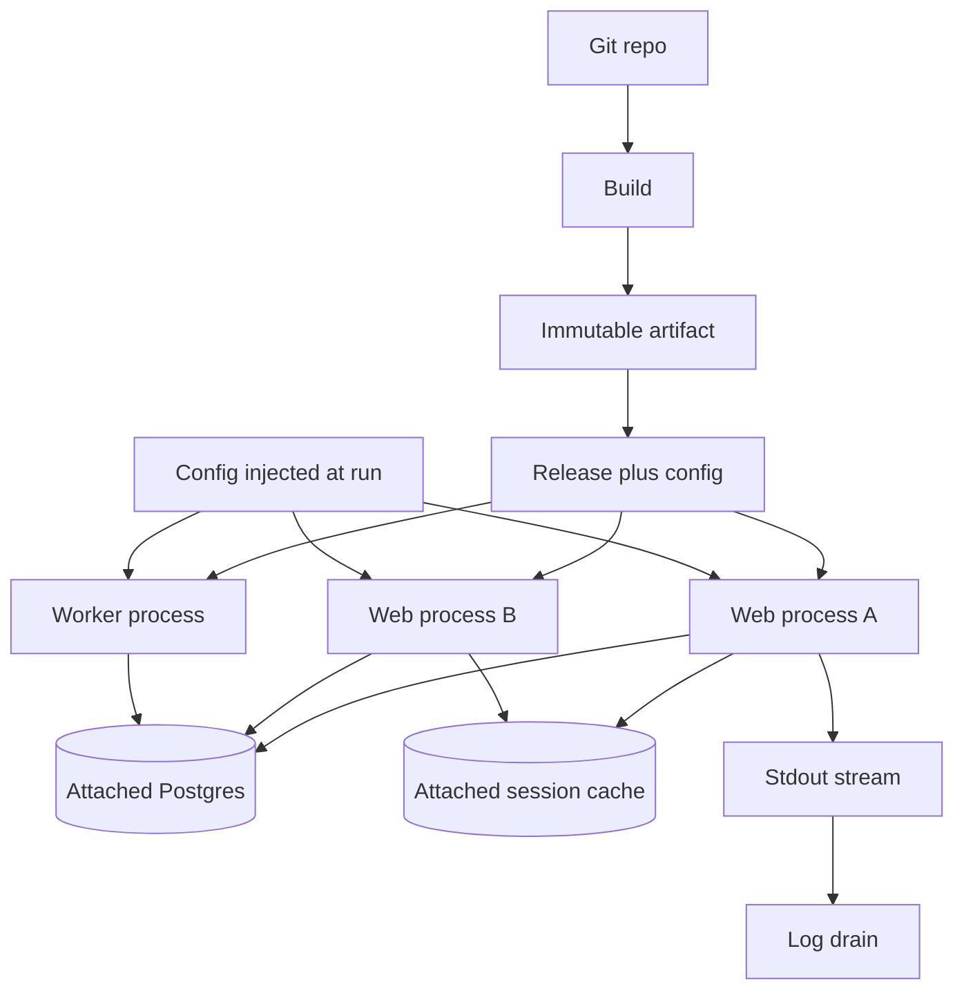

The Twelve-Factor App is a set of rules Heroku published for building software-as-a-service that can be deployed, scaled, and discarded without ceremony. It is not a religion and it is not a complete architecture. It is a checklist for how a process relates to config, to attached stores, to logs, and to the platform that will kill it. Teams that "do twelve-factor" by putting a badge in a README and then baking secrets into the image have not done the work.

The factors that break first in real deploys are almost always the same. Config leaks into the artifact. Backing services are called by hardcoded hosts. Processes hold session state, so the load balancer grows sticky cookies. Logs go to a file on a disk that will vanish. Shutdown takes thirty seconds of unfinished work because nobody handled SIGTERM. Those are the factors to inspect before you argue about buildpacks versus Docker.

The original list covers codebase, dependencies, config, backing services, build-release-run, processes, port binding, concurrency, disposability, parity across deploys, logs, and admin tasks. You should know the list. You should not paste it into a design doc as if naming a factor were compliance. Below is what those rules mean when you operate the system, and which ones fail when Kubernetes, a laptop, and a vendor SaaS disagree.

## Concept

### Config in the environment

Config is everything that varies between deploys: database URLs, feature flags, third-party keys, canonical hostnames. The artifact must not contain them. The same image should boot in a test cluster and in production with different environment variables, or an equivalent injected config, and without a rebuild.

Files of secrets in git, `production.yml` baked into the JAR, and `if env == "prod"` branches inside business code are the violations. Environment variables are the original mechanism because Heroku made them the injection path. Kubernetes ConfigMaps and Secrets, cloud secret stores, and sealed secrets are the same factor if they are injected at runtime and the image is unchanged. They fail the factor if the pipeline builds a different image per environment from different config files compiled in.

The first break: a secret in the image or in a layer of the Docker history. Rotating the secret then requires a rebuild, and anyone with the image has the secret. The second break: config that is an environment variable on Heroku and a mounted file in Kubernetes and a `local.settings.json` on a laptop, with three different keys for the same database. Pick one injection story and generate local files from it if you must, rather than three sources of truth.

### Backing services as attached resources

A database, a queue, a mail API, a cache — treat them as attached resources, addressable by config, swappable without code changes. The app should not care whether Postgres is on localhost, in RDS, or in a sidecar. The URL and credentials come from the environment. You do not rebuild to point at a different replica.

This breaks when hosts are in source, when the app includes a vendor SDK that is configured only by a compile-time region constant, or when "local" uses an in-process H2 and production uses Postgres with no adapter test in between. Attachment also means you can detach: a review app gets its own database instance, created by the platform, destroyed with the app. If standing up a second environment requires a ticket to a DBA to edit application code, the resource is not attached. It is a snowflake.

Local disk is not an attached resource you get to keep. The process will be rescheduled. Files you must keep belong in object storage or a database, which are attached. `/tmp` is scratch.

### Stateless processes and concurrency

The process is disposable and holds no user session in memory that another process would need. Scale by starting more processes. Store session in a cache or a database. Sticky sessions on the load balancer are a confession that the process is stateful.

Concurrency in the original model is process types: a `web` process and a `worker` process, scaled independently. That still holds. Horizontal pod autoscalers and separate deployments for web and worker are the Kubernetes spelling. Threads inside a process are allowed; they are not a substitute for a second process type when the work is a queue.

This factor breaks first after the first login form. Someone stores the user in memory, enables sticky cookies, and now deploys drain connections for minutes because those processes "have sessions." Move the session out. If you cannot, you do not have a twelve-factor web process. You have a sticky workstation.

### Disposability, logs, and the rest that fail in ops

Disposability: start fast, stop on SIGTERM, finish or hand off in-flight work, survive a sudden kill. Kubernetes will send SIGTERM and then SIGKILL after `terminationGracePeriodSeconds`. If your handler ignores SIGTERM, you will drop requests and hold a lock until kill. If shutdown tries to drain a huge queue inside the process, you will exceed the grace period. Design for crash. Retry from the queue. Keep the grace period short and honest.

Logs: the process writes events to stdout (and stderr) as a stream. The platform routes that stream to a drain. Do not write a log file, rotate it, and ship it with a sidecar you forgot. In containers the filesystem is ephemeral and the node is not your syslog. This factor breaks the first time someone adds `log4j` file appenders "like we had on VMs."

Build-release-run: build an artifact, combine it with config to make a release, run that release. Do not compile on the server. Do not edit files on a pod to hot-fix. That break shows up as "it works in the cluster because we kubectl exec'd."

Dev/prod parity: keep backing services, time-to-deploy, and people as close as you can. The break is a laptop on SQLite, CI on H2, production on Postgres, plus a two-week release train. Differences should be config, not physics.

Dependencies: declare them, isolate them. No implicit "this AMI has libfoo." Containers made this easier and then people bind-mounted a host Docker socket. Port binding: the app is a client of the OS; it listens on a port the platform assigns. Admin processes: run one-off tasks as one-shot processes against a release, not as "I'll just run a migration from my laptop against production." Codebase: one app, one repo (or a defined module), many deploys.

### Which factors break first

In the deploys I review, the order is predictable.

1. Config and secrets in the image or in git.
2. Session in process memory, then sticky load balancing.
3. Logs to files, or no structured stream, so the platform drain is empty during an incident.
4. SIGTERM ignored; killed in-flight work; "it was fine until Kubernetes preempted a node."
5. Backing services hardcoded, so a new environment is a code change.
6. Dev/prod parity: local Docker Compose with different engines, discovered on the first migration.

Port binding, declared dependencies, and a single codebase usually hold because Docker and git made them the default. Do not spend the review there while sessions still live in a servlet memory store.

## Trade-offs

| Approach | When it wins | Cost / risk |
| -------- | ------------ | ----------- |
| Config via env or runtime inject, one image | Many deploys, secret rotation, review apps | Env var sprawl; secret size limits; undisciplined key names |
| Attached backing services by URL | Swap, fork, and destroy environments without code edits | Local/prod engine drift if the URL hides a different product |
| Stateless processes plus external session | Horizontal scale, rolling deploys, preemption | You must design a session store; latency to that store |
| Sticky or in-memory session | Fast prototype, single instance | Cannot scale or preempt without losing users |
| Stdout stream plus platform drain | Containers, ephemeral disks, centralized search | Loss if you buffer and die; need structure and sampling |

Twelve-factor is a poor fit for a desktop installer, a database engine, or a long-lived connection mesh that is the product. It is a strong fit for request/worker SaaS on a platform that will schedule you like cattle.

## Diagram

A commit becomes an artifact. Config attaches at run, not at build. Many processes of that release share attached stores and emit logs to a drain. None of them is the home of session state.

## Failure modes

### Secrets and hosts in the artifact

**Detection.** `docker history` or a git grep shows passwords, tokens, or production hosts. Different environments require different images. Rotation of a database password is a rebuild and a redeploy of a new SHA, not a restart with new env. A leaked registry image is an incident.

**Mitigation.** One image, config at run. Inject from a secret store. Scan images and git for credential patterns. Kill `if production` hostnames in code. Review apps must boot from the same artifact with a different URL.

### Sticky processes pretending to be twelve-factor

**Detection.** The load balancer has application-cookie affinity. A rolling deploy disconnects checkouts. Memory of the web process grows with logged-in users. Horizontal scale does not linearize. A new replica starts cold and users "lose" a cart that was never in the database.

**Mitigation.** Store session and carts in an attached cache or database. Disable affinity. Make the web process crash-safe. If a websocket needs stickiness, isolate that process type and do not let it define the rest of the app.

### SIGTERM and file logs

**Detection.** Preemption and deploys correlate with dropped requests and incomplete jobs. Access logs exist only on a node disk that was recycled. Log search has nothing for the minute of the incident. The app's file appender is locked on a full ephemeral volume.

**Mitigation.** Handle SIGTERM: stop taking work, finish or nack the current message, exit. Keep grace periods tight. Write logs as a stream to stdout in a parseable form. Let the platform drain. Do not implement log rotation inside the container as a substitute for a drain.

### Admin from a laptop

**Detection.** Schema migrations run from an engineer's machine against production. One-off scripts are not versioned with the release. "It worked when I ran it" cannot be reproduced. A migration is incompatible with the currently running artifact.

**Mitigation.** One-off processes of the same release: a Job, a `heroku run`, a CI task against the image. Migrate as part of the release contract (expand/contract). Forbid production credentials on laptops as the normal path.

## Real-world example

Heroku is the platform the factors were written to match, and a Rails or Node app on Heroku is still the clearest production shape.

You push a git repo. A buildpack produces a slug (the artifact). Config vars are set on the app, not compiled in. Postgres and Redis are add-ons: attached URLs in the environment, detachable, copyable into a review app. `web` and `worker` process types in a Procfile scale independently. The router expects the process to listen on `$PORT`. Logs from stdout show up in `heroku logs` and can drain to a third party. A `heroku run rake db:migrate` is an admin process of that release. Dynos die daily; if you stored sessions in memory, users bounce.

The same app moved to Kubernetes without the factors will look modern and fail the same way. A Deployment with a Secret is config-in-the-environment — unless the Dockerfile `COPY`s `.env.production`. A PersistentVolume for log files undoes the log factor. A sticky `sessionAffinity` undoes the process factor. A migration Job of the same image is the admin factor done right; a developer `kubectl exec` plus `psql` is the laptop path. Twelve-factor on Kubernetes is not "we have YAML." It is the same attachments, the same stateless processes, the same disposable shutdown.

Cloud Foundry taught the same contract in enterprises. Twelve-factor.net remains the named source; this essay does not replace that list. It tells you which items rot first when the platform changes and the README still says you comply.

## What to remember

- Config belongs in the runtime environment; the artifact must be the same across deploys, with no secrets in the image.
- Backing services are attached by URL and credentials; local disk and hardcoded hosts are not attached resources.
- Processes are stateless and disposable: session in an external store, logs to stdout, SIGTERM honored.
- In real deploys, config, sticky sessions, file logs, and ignored shutdown break first; do not hide those behind a twelve-factor badge.
