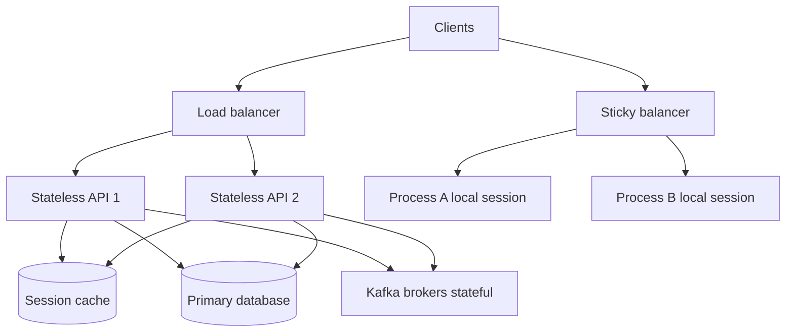

A stateless service can handle any request with the data in that request plus stores every replica can see. Add instances behind a load balancer, drain one for a deploy, preempt a node, and users still finish their work. A stateful service keeps something in this process that the next request, or the next replica, must find: a session, a replica of a log, an assigned shard, an open connection table. You cannot add instances and call it scale until you say where that something lives.

The distinction is about process memory and assignment, not about whether the system as a whole has a database. Almost every useful system is stateful somewhere. The architecture question is which processes are allowed to hold the state, and how they recover it. Web frontends should usually be stateless. Kafka brokers, etcd members, and database engines are stateful on purpose. Mixing the two — a web JVM that holds sessions and also "is just a replica" — is how rolling deploys become user-visible outages.

Sticky load balancing, replication, and an external store are the three ways to live with state. Stateless services pick the third for anything that must survive the process, and hold nothing. Stateful services pick replication and assignment, and accept that scaling is not "plus one replica" without a protocol.

## Concept

### What "stateless" actually means

Stateless does not mean no cache, no TCP, no thread-local. It means any replica can serve the next request because durable facts live in an attached store, and because caches are hints. If the process dies, a peer can answer. If you add ten peers, ten times the request capacity is available without a rebalance of ownership.

Session cookies that encode a signed ID, with the session body in Redis, keep the web tier stateless. Session objects in a servlet memory store do not. An LRU of product pages is allowed if a miss hits the database and a wrong cache cannot charge a card. A local cache of authorization decisions with a long TTL is state you did not admit; a revoke will not land until TTL or until you hit the instance that cached it.

Idempotency keys, request bodies, and tokens in the request are how a stateless handler stays honest. The handler may write to a store. It may not assume it wrote yesterday in this RAM.

### How stateless services scale

Put a load balancer in front. Use round-robin or least-request. Deploy with rolling replacement: new process starts, health check passes, old process drains in-flight HTTP, then dies. Autoscaling adds and removes processes on CPU or queue depth. None of that requires the balancer to remember a user.

The store becomes the bottleneck and the consistency story. Ten stateless API processes on one primary database will queue on connections and on write lock. Horizontal scale of the stateless tier is not horizontal scale of the system. Cache, read replicas, and queueing are how you keep the stateless claim while the data plane catches up.

Health checks must prove the process can reach the stores it needs, or you will take traffic on a replica whose database path is dead and still "statelessly" fail.

### What "stateful" actually means

A stateful service has an identity and a dataset. Kafka broker 2 owns partitions. Postgres primary owns the write log. A game room process owns a match. An etcd member is one of a quorum. You address them by that identity. You do not load-balance a write to a random Kafka broker and hope; the protocol routes to the leader of the partition.

Scaling a stateful service is adding members through a protocol: reassignment of partitions, replica factor, shard splits, a join/leave membership change. Removing a member is draining its assignments first. Restarting a member is replaying a log or attaching a volume that still has the data. Kubernetes StatefulSets exist because that identity and that volume must survive reschedule. A Deployment is the stateless spelling: pods are cattle, names are random, volumes are not the point.

Long-lived connections (websockets, streams) make the process stateful even if the business data is in Redis, unless you share the connection table. The socket lives here. A message for that user must find this process, or you need a pub/sub backplane that fans out to whoever holds the socket.

### Stickiness, replication, external store

When you discover state in a service that was supposed to be stateless, you have three moves.

Externalize: put the session, the cart, the lock in Redis, DynamoDB, or the primary database. The process becomes stateless again. You pay a round trip and you design TTL and failure of that store.

Replicate: every replica has the data, or a quorum does. Writes need a protocol (primary/secondary, Raft, gossip). Reads may be stale unless you ask. This is how databases and Kafka work. It is expensive to bolt onto a web app.

Stickiness: the load balancer pins a user to a process. Scaling, deploys, and node death become user-visible unless you also replicate. Stickiness is the cheapest to add and the worst to operate past a single instance. Use it as a bridge while you externalize, or for a connection-holding process that has a backplane, not as the architecture of checkout.

A fourth non-move is "we'll keep one replica." That is a stateful singleton. It will go down in a zone event. If the product needs a singleton (a scheduler leader), elect it explicitly and store the work in a log, rather than hoping the Deployment replica count stays 1.

### Mixing tiers on purpose

The common production shape is a stateless API plus stateful stores plus maybe a stateful stream processor. Do not run the API as stateful "for performance" by stuffing hot data only in one JVM. That JVM becomes a shard you cannot see. If you need affinity for cache locality, you are designing a stateful cache tier (and you should use one that already exists) or consistent hashing with replication, not a sticky cookie on the application balancer.

Workers can be stateless if the queue holds the job and the store holds the result. Workers are stateful if they hold a shard of a stream (Kafka consumer group members are slightly stateful in assignment, but the assignment is rebalanced; the log is on the brokers). Know which.

## Trade-offs

| Approach | When it wins | Cost / risk |
| -------- | ------------ | ----------- |
| Stateless processes plus external store | Web/API tiers, autoscaling, rolling deploys | Store latency and outage become user outages; connection storms |
| Stateful service with a membership protocol | Logs, databases, quorum config, shard owners | Scale and replace are protocol operations, not `replicas++` |
| Sticky sessions on a balancer | Short bridge, or connection pinning with a backplane | Deploys and node death drop users; hidden state |
| Singleton process | A leader you elect, with work in a log | A replica count of 1 without election is a weekend outage |
| Local memory as the source of truth | A prototype on one box | Unreplicable; every scale attempt becomes an incident |

If a Kubernetes Deployment has a PersistentVolumeClaim per random pod, you have a stateful service without the StatefulSet machinery. Fix the identity, or drop the volume.

## Diagram

A balancer can spray requests at stateless API replicas that share Redis and Postgres. A second balancer that pins users to a process with local sessions is the sticky path. Brokers and databases keep identity and disks on the side.

## Failure modes

### Session in process memory

**Detection.** Affinity cookies on the balancer. Memory grows with logins. A rolling deploy or a pod kill logs users out or empties carts. Adding replicas does not add capacity linearly. Heap dumps show session maps.

**Mitigation.** Move session and cart to an external store. Sign a session ID in the cookie. Disable affinity. Prove a deploy with replica bounce does not drop a test login. If you need websockets, add a pub/sub backplane so any process can find the socket owner, or isolate the connection tier.

### Scaling a stateful service like a stateless one

**Detection.** Someone sets `replicas: 5` on a database or on a broker Deployment. Two primaries accept writes, or none do. Partition assignment is empty. Volumes attach to the wrong node. Split-brain in the app tier that "just added Kafka pods."

**Mitigation.** Use the service's join protocol and the right controller (StatefulSet, operator, managed service). Scale by adding members, waiting for ISR or replica catch-up, then shifting assignments. Never load-balance writes to random members of a consensus group.

### Sticky as architecture

**Detection.** The runbook for deploy is "wait for sessions to drain," measured in tens of minutes. A zone loss takes a fraction of users with it. New instances sit idle because cookies still pin to old ones. Autoscaling cannot scale in.

**Mitigation.** Treat stickiness as debt. Externalize state. If you must pin connections, pin them to a dedicated tier with replication or a fan-out bus, and keep the API tier stateless. Short drain timeouts will otherwise cut people off; long drains will block every release.

### Caches that became truth

**Detection.** A revoke, a price change, or a sold-out flag is correct in the database and wrong on some instances for minutes. Incidents depend on which replica you hit. There is no invalidation, only TTL. "It was cached" is the postmortem line.

**Mitigation.** Decide if the cache is a hint. If yes, TTL and accept stale reads for that data class. If no, it is a stateful store: replicate, invalidate, or do not cache. Do not put authorization or money behind an uninvalidated local map.

## Real-world example

Kubernetes Deployments versus StatefulSets, plus Redis sessions and Kafka, is the production split most platform teams already run.

A typical web API is a Deployment: N pods, no stable names, no required local disk, a Service that load-balances. Session IDs live in a cookie; session bodies live in Redis (ElastiCache, Memorystore, or a self-run cluster). Postgres holds records. You roll the Deployment and Redis still has the session. That is a stateless service in the only sense that matters. Netflix's microservices story was this shape on the request path: lots of stateless JVM services, state in Cassandra and in backing stores, not in the request process.

Kafka is the other shape. Brokers have identities, logs on disk, leaders per partition. You scale with broker count and partition reassignment, not by hiding brokers behind a round-robin that ignores leadership. Kubernetes operators give them StatefulSets and persistent volumes. etcd, used by Kubernetes itself, is a Raft group: odd members, quorum, explicit replace. Treat those processes as stateful or you will lose the cluster on a casual `replicas` edit.

The failure I still see is an API Deployment that grew a local session or a websocket table, then a Helm chart that added `sessionAffinity: ClientIP`. Deploys slowed. A node drain became a product incident. The fix was not "more replicas." It was Redis for session and a fan-out (Redis pub/sub or a dedicated gateway) for sockets, returning the API to a Deployment that can die. Stateless is a claim you prove by killing a pod during a test login. Stateful is a claim you prove by failing a member through the protocol and watching assignments move. If you cannot say which proof you ran, you do not know which kind of service you shipped.

## What to remember

- Stateless processes scale by adding instances; any replica can serve the next request because durable state is in a store they all see.
- Stateful processes have identity and a dataset; scale and replace go through a protocol, a volume, and an assignment, not `replicas++`.
- When state shows up in an API, externalize it, replicate it, or admit stickiness as debt; do not call a sticky web tier "horizontally scaled."
- Prove the claim: bounce a pod through a login for stateless, fail a member through the join protocol for stateful.
