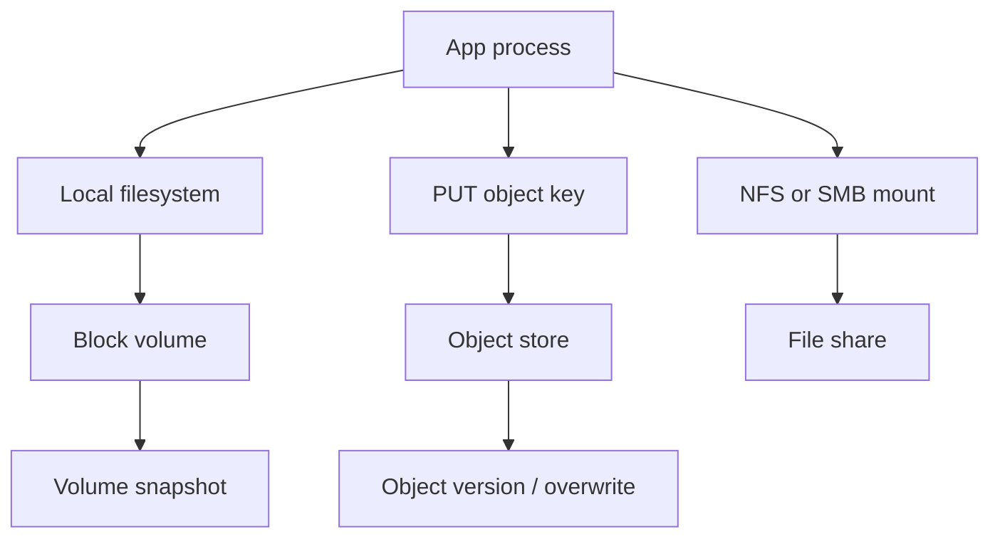

Three icons sit next to each other on every cloud storage page. They are not three sizes of the same product. A block volume is a disk: the kernel addresses bytes by offset, a filesystem lives on top, and a process opens a local path. A file share is a tree of names several machines mount at once over NFS or SMB. An object store is a key, an HTTP verb, and a whole-object write. There is no POSIX file handle on the object path, no byte-range overwrite that other readers treat as a live file, and no directory inode — only a prefix convention in the key.

An engineer who has only ever used a laptop disk will map all three onto `open()`, `read()`, and `write()`. That mapping is how databases land on NFS, how object stores get treated as append logs, and how a "shared disk" becomes a split-brain filesystem.

Choose by the access contract. Random I/O and a local filesystem want a block device. Several hosts editing the same tree want a file protocol. Durable blobs, fan-out reads, and HTTP clients want objects. Price per gigabyte is a secondary column. The first column is what the API actually does when two writers, a snapshot, or a partial failure show up.

## Concept

### Block storage is a disk

A block device presents fixed-size sectors. The operating system issues reads and writes at offsets. Access can be random: a database page, a WAL record, a VM's guest filesystem. Nothing in the block API knows about files. Files appear when you format the volume — ext4, XFS, NTFS — and mount it.

Cloud block volumes (Amazon EBS, Google Persistent Disk, Azure Disk) attach to one instance in the common case, or to a small set with a clustered filesystem when the vendor offers multi-attach. The volume has a size, an IOPS budget, and a throughput cap. Snapshots copy the disk. They are crash-consistent, not application-consistent, unless you freeze writes first.

You run a database, a broker, or a VM on block storage because those systems already speak disk. They depend on `fsync`, on ordered writes, on overwriting a page in the middle of a file. Object storage does not give them that contract. Moving MySQL's datadir to a bucket is not a storage migration. It is a rewrite of the storage engine.

Latency and IOPS are the scarce resources. A gp-class volume that looks large in gigabytes can still stall InnoDB if you undersize IOPS. Throughput (MiB/s) matters for sequential scans and for restore. Size, IOPS, and throughput are three knobs, not one.

### File storage is a shared namespace

NFS and SMB export a directory tree. Many clients mount it. Names, permissions, locks, and cache coherence are the product. The unit of identity is a path, not a volume serial and not an HTTP key.

This is the right shape for home directories, lift-and-shift apps that open files by path, CI caches several workers must see, and content roots a fleet of app servers already know how to serve. It is the wrong shape for a high-write database. NFS close-to-open consistency is not a local ext4 write. File locks across a network partition are how you get two writers and a corrupt inode.

Cloud file services (Amazon EFS, Azure Files, Google Filestore) are NFS or SMB as a managed appliance. You still have a mount, a POSIX-ish API, and a shared tree. Throughput and metadata IOPS are the scarce resources. A million tiny files punish the metadata server even when byte throughput looks fine. `ls` of a huge directory is an operation, not a free listing.

Mount options matter as much as the product name. `nconnect`, rsize/wsize, locking, and whether the client caches attributes change both performance and the consistency you think you bought. A "shared filesystem" without a written consistency story is a guess.

### Object storage is a key plus HTTP

An object store holds blobs addressed by a string key, usually grouped into a bucket. The API is HTTP: PUT the whole object, GET it, DELETE it, sometimes COPY or a multipart upload. Overwrite is a new version or a replace of the key. There is no `pwrite()` of eight kilobytes in the middle of a 4 GB object that other readers see as a POSIX mutation.

List is a prefix scan, not a directory inode walk. "Folders" are a UI convention. Concurrent writers last-write-wins unless you use a conditional put (If-Match / ETag) or a versioning scheme you own.

Objects fit backups, media, data lakes, static sites, and any payload written as a whole and read as a whole. They do not fit a MySQL datadir. They do not fit a process that needs `mmap`. They do not fit a lock file.

Multipart upload exists so a large object can be sent in parts, then completed. Until complete, those parts are not the object. That is not an append log other consumers can tail. Byte-range GET is a read optimization. It is not a substitute for a filesystem.

Durability numbers on object stores come from erasure coding and geo redundancy inside the service, not from RAID you configured. You still choose a class (standard, infrequent, archive), a region, and whether versioning and object lock are on. Those are product controls. They are not a POSIX volume.

### What sits on top of each

A VM disk, a Kubernetes `ReadWriteOnce` PersistentVolume, and a database data directory sit on block. A `ReadWriteMany` volume that several pods mount as a tree sits on file, if the driver is actually NFS or SMB rather than a pretend. Build artifacts, user uploads, lake tables, and AMI/container layers sit on object.

The same bytes can move between these APIs. A snapshot of a block volume can land as objects. An object can be copied onto a disk and mounted. That copy is a new artifact with a new consistency story. Do not treat the copy as "the same volume, cheaper."

## Trade-offs

| Approach | When it wins | Cost / risk |
| -------- | ------------ | ----------- |
| Block volume plus local filesystem | Databases, brokers, VMs, anything that needs random I/O, `fsync`, and in-place page writes | Attached to one instance (or a clustered FS); IOPS and throughput are billed and capped; snapshots are not app-consistent by default |
| NFS or SMB file share | Several hosts sharing a tree of names, lift-and-shift path-based apps, home directories, CI caches | Metadata-heavy workloads stall; locking and cache coherence fail across partitions; a poor home for a write-heavy database |
| Object store over HTTP | Whole-object blobs, media, backups, lakes, static sites, fan-out reads | No POSIX partial write; list is prefix scan; overwrite is replace; treating it as a disk corrupts the design |
| Block for compute, object for durable blobs | The common production split: local disk for the working set, bucket for what outlives the instance | Two APIs to operate; you must copy on purpose, not "mount the bucket" |
| Multi-attach block or clustered filesystem | A small set of nodes that truly need a shared disk and run software that knows how | Split brain if fencing is wrong; still not an object store; still not a substitute for a database |

A cheap object class does not make object storage a disk. A large NFS volume does not make NFS a database. Put the engine on the API it was written for, and put the archive next to it on objects.

## Diagram

A web app writes database pages to a filesystem on a block volume. The same app stores user uploads as objects. A second fleet mounts a file share for a shared config tree. Three APIs, three failure domains.

## Failure modes

### Database on a file share

**Detection.** Commit latency jumps under concurrent writers. InnoDB or Postgres reports torn pages, lock waits, or "stale NFS file handle." Two nodes mounted the same datadir after a failover that did not fence the first. Checksums fail on restart.

**Mitigation.** Put the datadir on a block volume attached to one writer. If you need a standby, replicate the database protocol, not the filesystem. NFS for a database is an incident report with a mount option. Clustered filesystems exist; they are still a specialist choice with fencing, not a default.

### Object store treated as a POSIX file

**Detection.** A writer "appends" by GET-modify-PUT and loses updates. Readers see truncated objects because a multipart upload never completed. A lock file in a bucket does not exclude anyone. Listing "a directory" times out on a prefix with tens of millions of keys.

**Mitigation.** Write whole objects under new keys (or versioned keys). Complete multipart uploads or abort them. Use conditional puts when two writers might share a key. Partition prefixes so list stays bounded. If you need append and concurrent readers, use a log or a filesystem, not a bucket pretending to be one.

### Multi-attach without fencing

**Detection.** Two instances write the same block volume after a network partition or a missed detach. Filesystem journals disagree. The volume's `attached-to` metadata in the cloud API does not match the process that is still issuing I/O.

**Mitigation.** One writer per volume unless the filesystem and the application both know about shared disks. On failover, wait for the cloud API to show detach, then attach. SCSI persistent reservations or the vendor's fencing path belong in the runbook. A Kubernetes `ReadWriteOnce` volume that still has a stuck attachment is this failure with a scheduler in the middle.

### Snapshot that is not a backup

**Detection.** Restore from a snapshot yields a database that must crash-recover, or a filesystem that is missing the last few minutes of writes that the application thought were durable. A snapshot taken while a multi-volume app was writing two disks independently cannot be opened as a consistent pair.

**Mitigation.** Freeze or use the engine's backup API, then snapshot. For multi-volume sets, snapshot as a group or use application-level backup. Test restore, not only snapshot creation. Treat object-store copies of snapshots as a second media, with their own retention and encryption keys.

## Real-world example

Amazon's three storage families are the textbook split, and they stay split on purpose. Elastic Block Store attaches as a disk to an EC2 instance. You format it, mount it, and run the guest filesystem and whatever needs random I/O — including the volumes under Relational Database Service and under most self-hosted databases on EC2. Elastic File System is NFSv4: many instances mount the same tree, which is why lift-and-shift content roots and shared scratch space land there. Simple Storage Service is object storage: HTTP PUT and GET of whole objects, prefix listing, optional versioning, no POSIX write in the middle of a key.

Teams that put a MySQL datadir on EFS, or that "mount S3" as if it were ext4, spend the next outage relearning this split. The production shape that holds is narrower: instance or EBS for the engine's disk, S3 for backups, media, and anything that should outlive the instance, EFS only when several hosts must share a real namespace and the workload can live with NFS semantics. Google Cloud Persistent Disk, Filestore, and Cloud Storage, and Azure Disk, Files, and Blob Storage, draw the same three lines. The brand names change. The APIs do not.

## What to remember

- Block storage is a disk: random I/O, a filesystem on top, `fsync` and in-place writes. Databases and VMs live here.
- File storage is a shared namespace over NFS or SMB. Several hosts see one tree. It is not a substitute for a database disk.
- Object storage is a flat key plus HTTP. Overwrite replaces the object. There is no partial POSIX write and no directory inode.
- Copy between these APIs on purpose. A snapshot, a sync, or a backup is a new artifact with a new consistency story, not a cheaper mount of the same disk.
