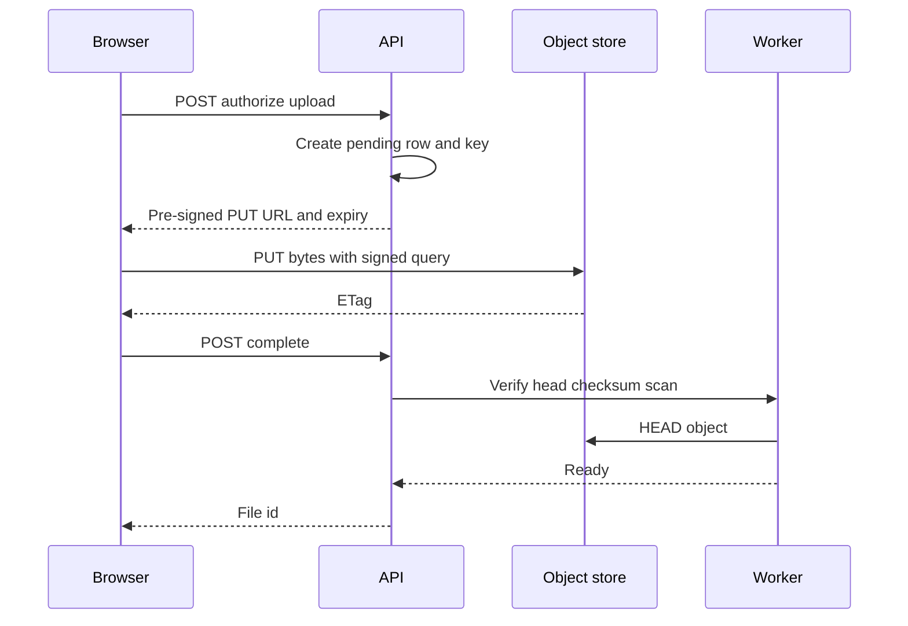

User uploads and downloads should not pass through your application servers as bytes. The application decides whether the action is allowed. The object store moves the payload. A pre-signed URL is how you separate those jobs: a short-lived capability to perform one HTTP method on one key, without handing the caller your long-lived cloud credentials.

The mistake is to treat the bucket as a private disk the API must proxy. Every megabyte then burns app CPU, saturates the load balancer, and puts your origin on the path of a 2 GB video. The other mistake is to mint a signature that is too broad — any method, any key, any day — and call it "secure because it is signed."

A pre-signed URL is a capability document encoded in a query string. It names the bucket, the key, the method, and an expiry. Anyone who holds it can use it until the clock runs out. Design the capability, then put the bytes on a direct path between the client and the store.

## Concept

### The blob is an object, not a column

A blob store (Amazon S3, Google Cloud Storage, Azure Blob Storage, MinIO) holds opaque bytes under a key. Metadata lives beside the object: content type, size, checksum, user-defined headers, encryption settings. The relational row keeps the key, the owner, the content type you accepted, and the state machine (pending, ready, scanned, deleted). The bytes do not live in Postgres.

That split is the whole design. The database answers "may this user read photo 18?" The store answers GET of `photos/18/orig.jpg`. If you put the file in a `bytea` column, you have coupled backup size, replication, and request latency to the payload. If you put an unsigned public URL in the row, you have skipped authorization.

### A pre-signed URL is a capability

Signing uses the store's credential (an IAM user, a role, a service account, a delegated key) to produce a URL that the store will accept without a further session. The signature covers selected elements of the request: typically the method, the bucket, the key, headers you required (content type, checksum), and a deadline.

Four properties are the contract:

- **Method.** A URL signed for GET cannot PUT. A URL signed for PUT cannot GET unless you signed that too. Sign the verb you mean.
- **Key.** One object, not a prefix, unless you have a very explicit reason to sign a prefix and a way to confine it.
- **Expiry.** Minutes for a user upload or a one-time download. Hours only when a batch job cannot refresh. Days is how a leaked chat log keeps working.
- **Constraints.** Content-Type, Content-Length range, checksum headers, and encryption headers belong in the signed set when the client would otherwise send `application/octet-stream` over a key you thought was an image.

The store verifies the signature with the same secret the issuer used. The application is not in the data path. That is the point.

### Why the app must not proxy the bytes

Proxying looks simple: the browser POSTs to `/api/files`, the API writes to the bucket, the API returns 201. Under load it is a second copy of the object through your fleet, a timeout tuned for JSON, and a memory buffer that someone will eventually hold entirely in RAM. Range requests, retries, and multipart all become your problem.

Direct-to-store upload inverts the flow. The API authorizes, chooses a key, signs a PUT (or a multipart initiate), and returns the URL. The client talks to the store. A completion callback or a polling endpoint lets the API confirm the object exists, matches the checksum, and passes virus scan before the product row becomes visible.

Direct download is the same shape with GET. The API checks the ACL, signs, redirects or returns the URL. The CDN in front of the bucket, if you use one, still needs a story for private objects: signed cookies, a signing Lambda at the edge, or a short-lived public cache of derivatives you meant to be public.

### Keys, layout, and the pending state

Do not let the client pick the raw key. The API assigns `uploads/{userId}/{uuid}` or a content-addressed name after it knows the hash. Guessable sequential keys plus a leaked signature are an enumeration. User-supplied filenames belong in metadata, not in the path, unless you have sanitized them and accepted the listing consequences.

A pending object is not a published object. Write to a staging prefix or a staging bucket. After the store confirms size and etag, a worker copies or heads the object, scans it, then updates the row. Orphans in staging need a lifecycle rule. Abandoned multipart uploads need an abort policy. Otherwise you pay for bytes nobody can see in the product.

## Trade-offs

| Approach | When it wins | Cost / risk |
| -------- | ------------ | ----------- |
| Pre-signed GET or PUT, client talks to the store | Uploads and downloads larger than a JSON body; offloads bandwidth from the app | URL is a bearer capability until expiry; clock skew; CORS and content-type must be signed correctly |
| App proxies every byte | Tiny payloads, strict inspection that cannot wait, or a store the client cannot reach | App and LB become the throughput limit; timeouts; you re-implement range and retry |
| Permanent public object URL | Truly public assets: marketing images, public docs | No per-user auth; cache and search will keep the bytes after you "delete" the row |
| Short-lived cookie or edge signature in front of the bucket | Many GETs per session (a photo gallery) without minting one URL per object | Cookie scope must not cover the whole bucket; edge config is now an authz path |
| Multipart upload with signed parts | Multi-gigabyte files, resume, parallel PUT | Incomplete uploads leak cost; completion must be authorized, not only the parts |

A signature is not an access-control list. It is a ticket. When the ticket leaks, expiry is the containment. When the ticket is too powerful, expiry is not enough.

## Diagram

The browser asks the API for permission. The API writes a pending row, signs a PUT for one key, and returns the URL. Bytes go to the store. A worker verifies the object and publishes the row. The API never sees the payload.

## Failure modes

### Capability that outlives the decision

**Detection.** A download link from last week still works after the user lost access, after the object was "deleted" in the product, or after it appeared in a support ticket screenshot. Access logs on the bucket show GET from IPs that never hit the API.

**Mitigation.** Keep expiry in minutes for user-facing links. On revocation, delete or rename the object, or block it with a bucket policy condition the signature cannot override. Do not put a long-lived GET URL in email. For galleries, prefer a session-scoped cookie at the edge over a URL that lives in chat history.

### Signed method and header mismatch

**Detection.** Browser PUT fails with 403 SignatureDoesNotMatch. Or it succeeds with `Content-Type: application/octet-stream` because that header was not in the signed set, and your image pipeline later trusts the product row's content type. CORS preflight fails because the bucket allows the origin but the signed headers do not match what the browser sends.

**Mitigation.** Sign method, key, content type, and any checksum header you will verify. Configure CORS on the bucket for the actual origins and headers. Test with the real browser, not only `curl` without Origin. On complete, HEAD the object and compare size, etag, and content type to the pending row. Reject if they disagree.

### App still in the data path

**Detection.** Upload p99 tracks app CPU and egress. Load balancer 504s on large files. Memory grows with request body size. A new feature "just streams through the API" because the mobile client could not do CORS.

**Mitigation.** Keep the API on authorize and complete. If a client cannot talk to the store, fix the client or put a thin streaming proxy that is not your core API fleet, with its own timeout and body limit. Never buffer a whole blob in the application heap. Set maximum object size at the signature or the bucket policy.

### Orphan bytes and incomplete multipart

**Detection.** Storage bill grows faster than object count in the product table. The bucket shows multipart uploads days old. Staging prefixes fill with keys whose rows were rolled back.

**Mitigation.** Lifecycle rules on staging prefixes. Abort incomplete multipart after a day. A reconciler that lists staging and deletes keys with no pending row older than the upload SLA. Charge the object to a customer only after complete, but delete the bytes either way.

## Real-world example

Amazon S3's pre-signed URL is the production shape most platforms copy. The application, running as an IAM role, calls the SDK to sign a GET or PUT for one bucket and key with an expiry. The client uses that URL against `s3.amazonaws.com` (or a path-style/virtual-hosted equivalent) and never receives the role's long-lived keys. AWS documents this for browser uploads so the API is not a byte proxy. Content-Type, checksum, and encryption headers can be included in the signed canonical request so the browser cannot swap them.

The same pattern shows up in GitHub Large File Storage: the git client asks the LFS endpoint for a batch of objects, the server returns authenticated hrefs to the storage backend, and the bytes move storage-to-client. Slack and many chat products put file bodies in object storage and keep only metadata and ACLs in the app database; the client fetches a short-lived URL after the API checks channel membership. The shared rule is stable: authorize in the app, transfer at the store, expire the ticket, never put cloud root keys in the mobile binary.

Google Cloud Storage signed URLs and Azure Blob user-delegation SAS tokens are the same capability with different cryptography. A SAS that grants `rwdl` on a container for a week is not a pre-signed GET. It is a second admin key. Scope the token the way you would scope an IAM action: one object, one method, one short clock.

## What to remember

- The database stores the key and the ACL. The blob store stores the bytes. Do not put large payloads in a row, and do not put an unsigned public URL where you needed an ACL.
- A pre-signed URL is a capability: one method, one key, a short expiry, and the headers you actually required.
- The application must not proxy the bytes. Authorize, sign, complete, verify. Let the client talk to the store.
- Treat the URL as a bearer ticket. Leakage is contained by expiry, object delete or rename, and never signing a prefix or a week when a minute would do.
