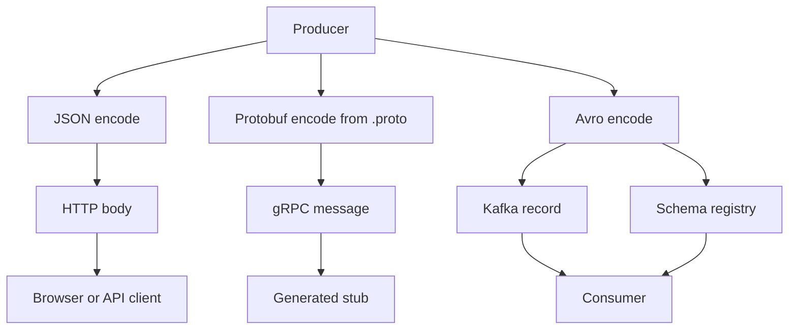

Two services cannot share a struct in memory. They share bytes. Serialization is the contract that turns a value into those bytes and back. JSON, Protocol Buffers, and Avro are the three you will actually choose among for APIs and pipelines. They disagree on who owns the schema, whether the wire is human-readable, and how a field added on Tuesday is read by a binary built last year.

JSON is text, self-describing, and schema-loose: a missing field, an extra field, or a number that used to be a string will often parse. Protobuf is a contract compiled into both sides: field numbers, types, and a compact binary. Avro carries the writer's schema with the data (or a pointer to it) and is built for readers that evolve on a different clock — the Kafka pattern.

Pick JSON when humans and browsers must read the payload and the schema can drift in compatible ways. Pick Protobuf when you want a small RPC contract with generated stubs. Pick Avro when a log or a bus must keep years of versions and the reader should still decode yesterday's events.

## Concept

### JSON is human and schema-loose

JSON encodes objects, arrays, strings, numbers, booleans, and null as Unicode text. Keys are strings. There is no single official schema in the payload. JSON Schema exists as a separate document; most HTTP APIs do not ship it with every body.

That looseness is the feature and the cost. A client can ignore unknown fields. A server can add a field without a flag day. A client can also send `"amount": "10.00"` when you expected a number, omit a field you now require, or duplicate a key and depend on parser-defined last-wins behavior. Numbers are a standing hazard: IEEE doubles cannot hold every integer that JavaScript will happily print, and some parsers treat large IDs as floats.

Use JSON for public HTTP, config that operators edit, and debug logs you want to grep. Version with additive fields, optional fields, and a documented policy for removals. Do not use JSON as a high-volume inner RPC without measuring size and parse CPU. Do not use it as the record format of a multi-year event log unless you also freeze a schema registry of your own — at which point you have reinvented Avro badly.

Pretty-printed JSON is for humans. On the wire, send compact JSON, and do not assume key order is significant. Canonicalization (sorted keys, no insignificant whitespace) only matters if you sign the body.

### Protobuf is a contract and smaller

You write a `.proto` file: messages, field names, field numbers, types. `protoc` generates code. The binary encoding is tag-length-value by field number, not by name. Names exist for humans and for JSON mapping. Compatibility is a function of numbers and rules: you can add a field; you must not reuse a number; required fields in proto2 are a trap; proto3 fields are optional in practice and default to zero values.

The payload is small. Integers use varints. Repeated fields pack. There is no self-describing key string on the wire unless you use the JSON mapping. Both sides need the same (or compatible) `.proto`. That is the contract. Change the contract in a repo both sides consume, or you will ship a server that writes field 7 as a string and a client that still reads field 7 as an int.

gRPC uses Protobuf as its default payload. Many internal services use Protobuf over HTTP or over a bus. The generated stubs are the API. Backward compatibility is a discipline on field numbers, not a hope that the parser will skip unknown keys — though Protobuf does skip unknown fields, which is why additive evolution works if you never reuse tags.

Do not treat the `.proto` as optional documentation. If producers and consumers do not compile the same schema family, you do not have Protobuf. You have a binary pile.

### Avro carries schema with the data

Avro was built at LinkedIn for long-lived data. A writer's schema describes the record. The reader has its own schema. Resolution maps writer's fields onto reader's fields: extra writer fields are ignored, missing fields take reader defaults, names and aliases reconcile renames. The binary encoding is dense and not self-describing without the schema. You do not send field names on the wire in binary Avro.

In files (Avro Object Container File), the writer schema sits in the header. In Kafka, the common production shape is a magic byte, a schema id, and the binary payload. A Schema Registry stores the Avro schema and hands out the id. Consumers fetch the writer schema by id and resolve it against the reader schema they were built with. That is how a topic can hold five years of events without a flag-day rewrite.

Avro fits Kafka evolution because compatibility can be checked at publish time: backward, forward, full, or none, per subject. A producer that adds a field with a default keeps old consumers working (backward). A producer that removes a field the reader still requires does not. The registry is the gate, not a wiki page.

JSON and Protobuf can live on Kafka too. JSON without a registry gives you years of slightly different shapes and a consumer that uses `if "foo" in doc`. Protobuf on Kafka works if you manage the `.proto` like Avro schemas; Confluent and others store Protobuf and JSON Schema in the same registry. Avro remains the format whose story is "schema travels with the record."

### Evolution rules in one place

Additive optional fields are the safe default in all three. Renames are cheap in JSON (new key, keep old), mechanical in Avro (aliases), and expensive in Protobuf (the number is the identity; the name is not on the wire). Type changes are never cheap. Enums need a default the old binary understands. Deleting a field requires a window where both writers and readers tolerate absence.

Put the schema where the runtime can see it: a `.proto` in the repo, a JSON Schema in CI, an Avro subject in the registry. A comment in a ticket is not a schema.

## Trade-offs

| Approach | When it wins | Cost / risk |
| -------- | ------------ | ----------- |
| JSON | Public HTTP, browsers, operator-edited config, payloads humans must read | Large; schema-loose; number and duplicate-key hazards; easy to "just add a field" that breaks a picky client |
| Protobuf | Internal RPC, gRPC, compact contracts, generated stubs in several languages | Both sides need compatible `.proto`; field-number discipline; debug is harder than reading JSON |
| Avro plus schema registry | Kafka and long-lived event logs; writer schema per record; compatibility checks at produce | Registry is production infrastructure; binary is opaque without schema; not the default in browsers |
| JSON on the bus with a registry | Teams already fluent in JSON who still want a compatibility gate | Still larger; still number issues; you must actually reject incompatible subjects |
| Protobuf as Kafka value | Services that already share `.proto` and want one type system | You must version and register like Avro or you will decode with the wrong descriptor |

Human-readable and compact are usually opposed. Schema-loose and safe evolution are usually opposed. Choose which opposition you can operate.

## Diagram

A producer encodes with a contract. JSON goes out as text. Protobuf goes out as tagged binary from a compiled `.proto`. Avro goes out as a schema id plus binary, with the registry holding the writer schema for the consumer to resolve.

## Failure modes

### Silent JSON drift

**Detection.** No parse error. A dashboard moves after a release. An amount that used to be a number is a string. A missing currency is treated as USD. Duplicate keys parse differently in two languages. A mobile client ignores a new required field and posts a partial resource that the server accepts.

**Mitigation.** Validate at the edge with JSON Schema or generated types. Reject unknown fields on write APIs where the product is strict; allow them on read for forward compatibility. Never use JSON numbers for identifiers that do not fit in 2^53. Add contract tests that replay old bodies and new bodies against both sides. Log schema-validation failures as a product metric, not as a debug line.

### Protobuf field number reuse

**Detection.** After a "cleanup" of unused fields, a new field reuses tag 4. Old binaries read new payloads as the old type. New binaries read old payloads as garbage. The failure looks like corruption, not like a 400.

**Mitigation.** Field numbers are forever. Reserve deleted numbers in the `.proto`. Review proto diffs the way you review API diffs. Ship additive fields first. Do not flip a type in place. Use a new number and a migration window. Keep proto2 `required` out of new code.

### Avro compatibility skipped

**Detection.** A producer publishes a schema the registry would have rejected if the client had been configured to check. Old consumers throw on deserialize. The dead-letter topic grows. A rollback of the producer still leaves new records in the log that old code cannot read.

**Mitigation.** Enforce backward (or full) compatibility on the subject in the registry. Block produce on incompatible schemas. Default values on new fields. Never rename without an alias. Test a consumer built from last quarter's schema against today's producer. Retention of schemas in the registry must exceed retention of the topic.

### Mixed encodings on one topic

**Detection.** Some records parse as JSON, some as Avro magic-byte prefixes, some as Protobuf. A consumer "that usually works" fails on a partition. A replay job uses the wrong deserializer for a date range.

**Mitigation.** One subject, one encoding per topic (or per header that selects a deserializer you actually support). Magic bytes and content-type headers are part of the contract. Do not "just write JSON for debug" onto a binary topic.

## Real-world example

LinkedIn created Avro for Hadoop and for the pipelines that became Kafka's natural partner. The production shape that spread from that work is Kafka plus a Schema Registry plus Avro records: each message starts with a small header and a schema id; the value is binary Avro; consumers fetch the writer schema and resolve it. Confluent's registry, and compatible registries on AWS Glue and others, exist so that compatibility is checked when a producer registers a version, not when a consumer page-files at 2 a.m.

Google's Protocol Buffers are the contract language for gRPC and for a large fraction of internal Google RPCs. The `.proto` is the API. Field numbers carry compatibility. Stubs generate in Java, C++, Go, Python, and the rest. Public HTTP APIs still tend to speak JSON: browsers, curl, and OpenAPI live there, and the cost of extra bytes is smaller than the cost of shipping a protobuf compiler to every partner.

A sane company split looks like that pair. Public edge: JSON, additive evolution, explicit validation. Inner RPC: Protobuf or gRPC. Event log: Avro (or Protobuf) with a registry and a compatibility mode you have tested on rollback. The failure is using JSON "because it is simple" as the ten-year event format with no schema at all.

## What to remember

- JSON is human and schema-loose. Validate on purpose. Do not use JSON numbers for large identifiers.
- Protobuf is a compiled contract. Field numbers are the identity. Smaller on the wire. Both sides need compatible `.proto` files.
- Avro carries the writer's schema with the data (or a registry id). That is why it fits Kafka evolution and multi-year logs.
- Additive optional fields are the safe default in all three. Type changes, number reuse, and unregistered schemas are incidents, not refactors.
