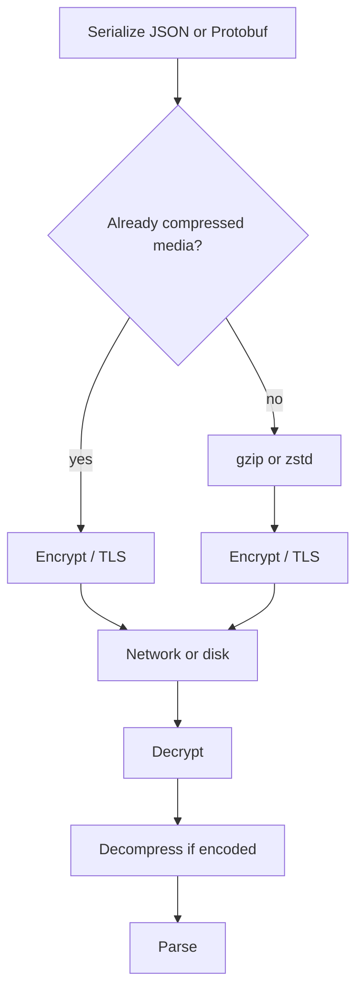

Compression trades CPU and latency for fewer bytes on the wire or on disk. gzip and zstd are the two names you will configure most often. They find repeated patterns in the input and emit a shorter stream. Already-compressed media — JPEG, PNG, MP4, most "zip" archives — has few patterns left. Running gzip over a video wastes CPU and can make the object slightly larger.

Order matters as much as algorithm. Compress, then encrypt. Encrypted bytes look random; a compressor that sees random input cannot shrink it and will still spend cycles. TLS may compress in theory; in practice modern TLS stacks leave compression off because of CRIME and BREACH. Application-level compression of HTTP bodies, Kafka batches, and file archives is the control you actually own.

Use compression where the payload is text, JSON, logs, columnar data, or uncompressed binary, and where CPU is cheaper than egress or storage. Skip it where the payload is already a compressed container, or where a tiny message would spend more time in the compressor than on the network.

## Concept

### What a compressor actually does

A lossless compressor (gzip, zlib, deflate, zstd, lz4, snappy, brotli) emits a stream that a matching decompressor can turn back into the exact original bytes. It wins on redundancy: repeated keys in JSON, repeated timestamps in logs, zeros in a binary struct, English text. It loses on high-entropy input: encrypted data, compressed media, good random numbers, already-gzipped files.

gzip is deflate plus a header and CRC, the HTTP and tar staple. It is everywhere, moderate ratio, moderate CPU. zstd (Facebook, now a common OS and Kafka option) usually beats gzip on ratio at similar or lower CPU, with a wide level knob. lz4 and snappy favor speed over ratio; they fit RPC inner loops and hot caches. brotli fits HTTP static assets where you compress once and serve many times.

Lossy compression (JPEG quality, H.264 bitrate) is a different job. It throws away information. Do not point a "gzip this directory" job at a photo pipeline and expect lossless behavior. Do not point a JPEG encoder at a JSON API.

### CPU versus bytes

Every algorithm has a level: more effort, more ratio, more latency on the compress path. Decompress is usually cheaper than compress. That asymmetry is why CDNs and object stores compress static assets at rest or at ingest, then decompress on the client a million times.

Measure three numbers: compress CPU per megabyte, decompress CPU per megabyte, and ratio on *your* payload. A ratio measured on Wikipedia XML does not apply to your protobufs, and it does not apply to your already-gzipped Nginx logs. A Kafka broker compressing JSON logs with zstd can cut disk and replication traffic in half. The same broker compressing JPEG thumbnails will pay CPU for a ratio near 1.0.

At the edge, gzip or brotli for `text/html`, `application/json`, and `application/javascript` is default good sense. `Accept-Encoding` advertises what the client can decode. Send `Content-Encoding: gzip` only when you actually compressed. Double-gzip is a classic bug: the origin gzips, the proxy gzips again, the client decodes once and sees garbage or a gzip member.

### Already-compressed media does not shrink

JPEG, WebP, PNG (mostly), MP4, WebM, Opus, most PDF with embedded images, and container formats that already apply deflate internally will not give you a meaningful gzip ratio. Object storage lifecycle policies that "gzip everything in the bucket" will burn batch CPU and produce `.jpg.gz` files that are larger than the `.jpg`.

Store media in the container that already compresses it. If you need a smaller video, re-encode with a video codec, which is lossy and specialized. If you need a smaller PNG of UI icons, use a tool that understands PNG, or switch to SVG/WebP. Then transport those bytes without a second general-purpose compressor.

A useful check: if `file` says the object is already compressed, do not gzip it again. If a content-type is `image/*` or `video/*` or `application/zip`, skip. If a Kafka topic carries Avro that is already dense binary, measure before you enable codec=gzip; zstd may still help a little, gzip may not.

### Compress before encrypt

Encryption (AES-GCM, TLS records, disk encryption) aims to make ciphertext indistinguishable from random. A compressor needs structure. The order is:

1. Serialize (JSON, Protobuf, Avro).
2. Compress (zstd, gzip, …) while the bytes still have structure.
3. Encrypt (TLS on the wire, envelope encryption at rest).

Reverse that order and you encrypt plaintext JSON, then try to gzip the ciphertext, and you have paid for encryption of bulky text and for a useless compress step. Some systems compress inside the TLS stack; do not turn that on to save a few bytes on HTTPS. Compress the HTTP body yourself, then let TLS encrypt the compressed body.

The same rule applies to backups: dump, compress, then encrypt to S3. Encrypting a raw dump first produces a blob that will not compress. Disk encryption of an already-compressed file is fine; you are encrypting at rest, not asking the compressor to look at ciphertext.

### Where to put the compressor

HTTP: compress at the origin or the CDN for eligible content types, honor `Accept-Encoding`, vary the cache on encoding. Kafka: set `compression.type` on the producer (or broker) so a batch of records is one compressed frame; consumers decompress. Databases: some engines compress pages (InnoDB, column stores). Logs: compress rotated files with gzip or zstd before upload. RPC: compress large responses; skip tiny ones.

Never compress twice on the same path without a measured reason. Never compress inside a lock or on the request thread of a latency-critical RPC without a budget. Offload batch compression to a worker.

## Trade-offs

| Approach | When it wins | Cost / risk |
| -------- | ------------ | ----------- |
| gzip on HTTP text and JSON | Universal clients, logs, HTML, APIs with redundant keys | CPU on origin; poor on media; CRIME-style bugs if you invent TLS compression |
| zstd for logs, Kafka, backups | Better ratio and speed than gzip on typical text and telemetry | Client and broker must support it; pick a level or you trade tail latency for disk |
| lz4 or snappy on inner RPC | Hot paths where ratio is secondary to microseconds | Weaker ratio; still useless on encrypted or JPEG payloads |
| Skip compression | Already-compressed media, tiny messages, CPU-bound services | Egress and disk stay large; that is often the correct bill |
| Compress then encrypt | Backups, envelope-encrypted objects, HTTPS bodies you gzip yourself | Must not reverse the order; must not double-compress |

A codec default copied from a blog (`gzip` on every Kafka topic, `gzip` on every S3 PUT) is how you buy a CPU incident and no disk win. Measure on the real payload.

## Diagram

A producer serializes, compresses while the bytes still have structure, then encrypts for the wire. The consumer reverses the stack. Media that is already a compressed container skips the middle step.

## Failure modes

### Gzip on JPEGs and videos

**Detection.** CPU sits high on the upload worker or the Kafka broker. Object sizes after gzip are equal or larger. `Content-Encoding: gzip` on `image/jpeg` responses; clients decode to a still-valid JPEG or to garbage depending on whether the bytes were actually compressed.

**Mitigation.** Allow-list content types for HTTP compression: HTML, CSS, JS, JSON, XML, protobuf with a known uncompressed type. Deny-list images, video, audio, zip, gzip, zstd, br. For Kafka, enable compression on text and Avro logs after a ratio sample; leave media topics uncompressed.

### Compress after encrypt

**Detection.** Backup jobs show ratio ≈ 1.0 on "compressed" artifacts. CPU is spent in gzip. The object in the bucket is `dump.sql.enc.gz` produced in the wrong order. Kafka payloads are TLS-terminated then compressed at the wrong layer, or application encrypts fields and then gzips the whole JSON with little gain.

**Mitigation.** Pipeline as serialize → compress → encrypt. For field-level encryption inside JSON, compress the document first only if the encrypted fields are a small fraction, or compress before those fields are sealed. Document the order in the backup runbook and test restore, not only the PUT.

### Double compression and encoding lies

**Detection.** Clients report malformed JSON. A proxy added `Content-Encoding: gzip` to a body that was already gzip. A cache stored one encoding and served it to a client that asked for another without `Vary: Accept-Encoding`. Kafka consumer throws because the batch header says zstd and a producer sent raw.

**Mitigation.** One encoder on the path. `Vary: Accept-Encoding` on cached HTTP. Trust the Kafka batch attribute, not a side convention. Never set Content-Encoding unless this hop compressed. Add a canary GET with and without `Accept-Encoding: gzip`.

### CPU on the hot path

**Detection.** p99 latency tracks compression level. A raise from zstd-3 to zstd-19 for "better ratio" stalls producers. A synchronous gzip of a 20 MB JSON response on the request thread blows the gateway timeout.

**Mitigation.** Compress large, cold, or batched data off the request thread when you can. Use fast levels (lz4, zstd-1..3, gzip-1) on interactive paths. Pre-compress static assets. Cap response size. Measure compress time as a metric next to ratio.

## Real-world example

HTTP compression is the most widely deployed form of this trade. Browsers send `Accept-Encoding: gzip, deflate, br`. Nginx, Caddy, and CDNs such as Cloudflare compress HTML, CSS, and JavaScript at the edge and set `Content-Encoding`. They skip JPEG, PNG, and MP4 because those formats already compress. Brotli is common for static assets compressed once; gzip remains the compatibility default.

Facebook published Zstandard and it moved into the Linux kernel, into Facebook's internal data paths, and into Kafka as `compression.type=zstd`. Kafka's design compresses a batch of records together, which is why a topic of small JSON events still wins: the batch, not the single message, is the unit. Confluent and Apache documentation list gzip, snappy, lz4, and zstd; the right choice is the one you measure on that topic.

The backup path at almost every company is the same three steps when someone has been burned once: database dump, zstd or gzip, then SSE or a client-side encrypt to object storage. Teams that encrypt the dump first keep paying full storage for SQL text. Teams that gzip thumbnails keep paying CPU. The rule does not change with the brand of the bucket.

## What to remember

- gzip and zstd trade CPU for bytes. Measure ratio and compress time on your payload, not on a generic corpus.
- Already-compressed media does not shrink. Skip images, video, and archives.
- Compress before encrypt. Ciphertext does not compress, and TLS compression is not a knob you should turn on.
- One encoder per path. Do not double-gzip, and do not set Content-Encoding unless this hop actually compressed.
