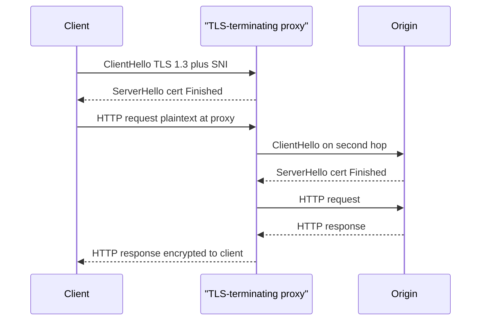

TLS sits under HTTPS, database drivers, gRPC, and most "encrypted in transit" checkboxes. The handshake is the part that happens before application bytes. It authenticates the server (and optionally the client) and agrees keys for the rest of the connection. After the handshake, records are encrypted. Before it finishes, you do not have that protection.

TLS 1.3 cut the handshake to one round trip in the common case. TLS 1.2 needed two. That difference is latency on every new connection, which is why connection reuse, TLS session tickets, and HTTP/2 or HTTP/3 matter as much as cipher slogans. Certificates bind a public key to a name. SNI tells a server or a reverse proxy which certificate to present when many names share an IP.

A proxy that terminates TLS sees plaintext. Encryption to the proxy is not encryption to the origin. If the next hop is HTTP, or a second TLS session the proxy originates, you have two separate trust decisions. Draw both, or you are lying on the data-flow diagram.

## Concept

### What the handshake is for

TCP (or QUIC, which folds TLS 1.3 into its own handshake) gives you a pipe. Anyone on the path can read and alter bytes. TLS wraps that pipe. The handshake has two jobs:

1. Authenticate. The client checks that the server presents a certificate chain it trusts for the name it intended to reach. The name check is hostname verification against the certificate's SAN, not "a cert exists."
2. Agree keys. Both sides contribute randomness, run a key exchange (ECDHE in modern suites), and derive record keys. Later bytes are encrypted and integrity-protected with those keys.

Client authentication with a certificate is optional and rare on the public web. It is common in mTLS between services. The mechanism is the same handshake with a second certificate, this time from the client.

### Certificates and the chain

A certificate is a signed binding of a public key to names and constraints. A site presents a leaf certificate plus intermediates. The client walks to a trust anchor in its store (a public CA, or a private CA you installed). Let's Encrypt, commercial CAs, and internal PKI all issue the same X.509 shape. They differ in who your clients already trust.

Expiry, revocation (CRL, OCSP, or short-lived certs that skip revocation), key type (RSA vs ECDSA), and whether the name matches (`api.example.com` vs a wildcard) are operational facts. A handshake that "succeeds" with verification disabled is not TLS as a security control. It is an encrypted pipe to whoever answered.

Clock skew fails handshakes: a client whose clock is months off will reject a valid Let's Encrypt leaf. Missing intermediates fail handshakes: the server must send the chain, not only the leaf. Name mismatch fails handshakes: connecting to an IP or to the wrong SNI with a cert for another hostname.

### SNI

Server Name Indication is a TLS extension in the ClientHello. It carries the hostname the client wants. A proxy or a server with many certificates uses SNI to pick the leaf. Without SNI, name-based virtual hosting on one IP cannot present the right cert.

SNI is visible on the wire in TLS 1.2 and, in ordinary deployments, in TLS 1.3 as well (Encrypted Client Hello exists but is not universal). A passive observer who cannot decrypt the records can still see which name you asked for. Do not treat SNI as a secret. Do treat a missing or wrong SNI as a reason the handshake presents the default certificate, which then fails name checks.

### TLS 1.3 is one round trip

In TLS 1.3 the ClientHello already carries key_share and the supported groups. The server answers with its share, the certificate, and Finished. Application data can follow after that one RTT. 0-RTT is an extra mode that sends early data on a resumed connection; it is replay-sensitive and off unless you know why you turned it on.

TLS 1.2's default full handshake takes two round trips before application data (ClientHello, ServerHello/Certificate/ServerHelloDone, ClientKeyExchange/ChangeCipherSpec/Finished, then the server Finished). Session resumption reduces that, at the cost of ticket state.

Cipher suite lists in 1.3 are short: AEAD only (AES-GCM, ChaCha20-Poly1305). The handshake hashes and signs with modern algorithms. If you still operate 1.0 or 1.1, you are off the web's current floor. If you still prefer 1.2, you are compatible; you are also paying an extra RTT on full handshakes and carrying older knobs (CBC, compression) you must keep disabled.

### What a terminating proxy can see

A load balancer, API gateway, or CDN that terminates TLS decrypts to plaintext HTTP (or gRPC) in its process. It can read URLs, headers, bodies, cookies. It can inject headers. It then may open a new TLS session to the origin (re-encrypt) or speak cleartext on a private network.

That hop is a trust boundary. Operators of the proxy, anyone with admin on that box, and anyone who can dump memory or logs at that layer see what the user thought was "HTTPS end to end." Origin certificates still matter for the second hop. Mutual TLS from proxy to origin is how you stop a rogue process on the VPC from pretending to be the gateway.

Passthrough (L4) TLS does not decrypt. The backend handshake is the one the client sees. You lose L7 routing on paths and headers unless you route on SNI. Choose terminate-and-inspect versus passthrough on purpose.

## Trade-offs

| Approach | When it wins | Cost / risk |
| -------- | ------------ | ----------- |
| TLS 1.3 to origin, hostname verification on | Default for public HTTPS and internal RPC | Clients and middleboxes must support 1.3 or fall back; cert automation required |
| TLS 1.2 only | Old clients you cannot abandon yet | Extra RTT on full handshake; larger misconfiguration surface (CBC, compression, weak suites) |
| Terminate TLS at the proxy, HTTP to origin | Simple ops, L7 routing, cheap backends | Proxy sees plaintext; the private hop is cleartext unless you add a second TLS |
| Terminate at proxy, TLS again to origin | L7 routing plus encryption on the second hop | Two certificate stories; the proxy still sees plaintext |
| Passthrough TLS | End-to-end crypto to the app, or when you must not inspect | No L7 routing except SNI; backend handles certs and HTTP |

Encryption in transit is a property of a hop. A diagram with one lock icon on the user-facing URL does not describe the path behind the load balancer.

## Diagram

A client performs a TLS 1.3 handshake with a terminating proxy, then the proxy opens a second TLS session to the origin. The proxy sees plaintext. SNI on the first hop selects the certificate.

## Failure modes

### Hostname verification off

**Detection.** A test flag, a custom HTTP client, or `verify=False` in a library reaches production. Handshakes succeed against a MITM proxy with a random cert. Certificate expiry monitors stay green because nobody is checking the real name.

**Mitigation.** Leave verification on. Pin the CA or the SPKI only when you have a rotation story. Fail closed on name mismatch. Probe with a wrong-name cert in staging and expect failure. Ban SDK flags that disable verify in the service codebase.

### Terminating proxy as an unnoticed plaintext zone

**Detection.** Access logs at the load balancer contain full URLs and bodies. A packet capture on the proxy-to-origin subnet shows HTTP. A ticket claims "we have TLS" because the browser padlock is closed.

**Mitigation.** Draw hops. Encrypt the origin hop or isolate it as a trust zone with mTLS. Treat proxy logs as sensitive. Restrict who can dump traffic at the terminator. Do not send cookies or tokens in query strings; the terminator and its logs will keep them even when the browser hid them.

### SNI and certificate mix-ups

**Detection.** Clients get a default certificate for the wrong name. A new hostname on a shared IP fails until SNI is configured. Older clients without SNI cannot connect to a name-based virtual host. A filter that blocks unknown SNI breaks health checks that connect by IP.

**Mitigation.** One cert per name or a SAN/wildcard you actually intended. Health checks use SNI or a dedicated cert. Monitor handshake errors by name. Do not share a default leaf that belongs to another tenant.

### Expired or incomplete chain

**Detection.** Mobile clients fail while desktop browsers work (different trust stores, missing intermediates). Overnight expiry of a leaf. OCSP stapling failures. Let's Encrypt renewals that wrote a file nobody reloaded in Nginx.

**Mitigation.** Automate issuance and reload (ACM, cert-manager, Certbot with a reload hook). Serve the full chain. Alert on notAfter, not on "the process is up." Test with a client that does not have extra intermediates cached.

## Real-world example

Let's Encrypt turned certificate issuance into a 90-day automated loop and made TLS the default for public websites. ACME issues a leaf; Nginx, Caddy, or a cloud load balancer presents it; browsers verify against the ISRG root. TLS 1.3 is the default in current Chrome, Firefox, and Safari; a full handshake is one RTT before HTTP.

Cloudflare, Amazon CloudFront, Google Cloud Load Balancing, and similar CDNs terminate TLS at the edge. The browser's padlock reflects the handshake to the edge, not to your origin. Cloudflare's "Full" versus "Full (strict)" SSL modes exist because the second hop was often HTTP or TLS with a self-signed cert. Strict mode verifies the origin certificate. That product distinction is the terminating-proxy lesson in a dropdown: the edge can always see HTTP inside the first hop; whether the origin hop is authenticated is a separate control.

Inside a VPC, the same split appears as an Application Load Balancer with an ACM certificate and optional HTTPS to target groups. The ALB sees headers and can do path routing because it terminated TLS. A Network Load Balancer in TLS passthrough mode does not. Choose the layer that matches whether you need to read the request.

## What to remember

- The handshake authenticates the server (name plus a trusted chain) and agrees keys. Application bytes come after.
- TLS 1.3 is one round trip for a full handshake. 0-RTT is optional and replay-sensitive. Keep 1.0/1.1 off.
- SNI selects the certificate on a shared IP. SNI is not a secret.
- A proxy that terminates TLS can see plaintext. Encryption on the browser hop does not encrypt the origin hop.
