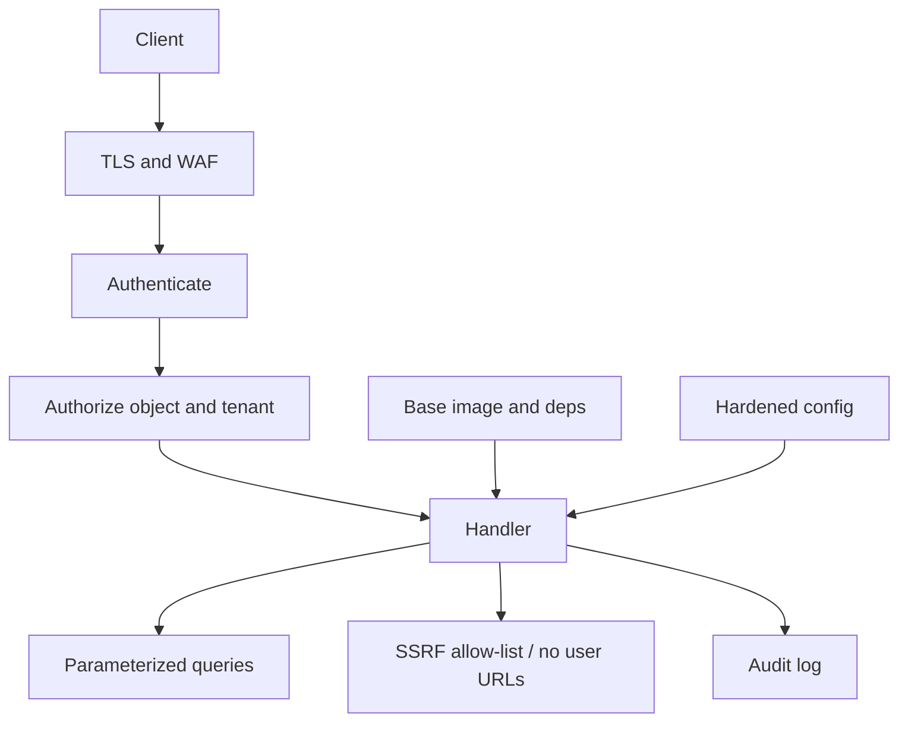

The OWASP Top 10 is a well-known list of web risk categories, not a ranking of your system and not a scanner report you file away after a green build. For an architect the useful move is to treat each current category as a design control: a place in the request path, the data model, or the supply chain where a decision either makes the class of bug hard or leaves it as a local coding accident.

The well-known categories in the current list are broken access control, cryptographic failures, injection, insecure design, security misconfiguration, vulnerable and outdated components, identification and authentication failures, software and data integrity failures, security logging and monitoring failures, and server-side request forgery (SSRF). They overlap. That is fine. You do not need a private ordering. You need a control for each class that survives a new endpoint, a new dependency, and a new environment.

A SAST scan that "covers OWASP" without object-level authorization, without a secret story, and without an egress policy has not done the architectural work. The list is a prompt for those controls. It is not a substitute for them.

## Concept

### Access control is an object rule, not a login

Broken access control is the class where a user who is authenticated (or not) reaches a record or an action they should not. IDOR is the textbook: `/invoices/4412` returns someone else's invoice because the handler checked "is logged in" and not "owns 4412." Horizontal privilege (same role, other tenant) and vertical privilege (user calls admin) are the same missing check.

The design control is authorization on every object reference, in the service that owns the object, using the caller's identity and tenant — not a UI hide, not a gateway path allow-list alone. Gateways can reject anonymous access to `/admin`. They cannot know whether invoice 4412 belongs to this tenant unless they become the product. Prefer deny-by-default APIs, server-side session or token claims you verify, and tests that fetch another tenant's id and expect 404 or 403.

### Cryptography and injection are defaults, not libraries you remember later

Cryptographic failures are secrets in git, passwords hashed with a fast hash, TLS off on an internal hop you thought was "private," and data at rest with a key sitting next to the ciphertext. The control is: TLS on every hop that leaves a trust zone, authenticated encryption, a KMS you do not bypass, and no home-rolled cipher. Hash passwords with a memory-hard algorithm. Do not invent a token format when a well-reviewed library exists.

Injection is untrusted input reaching an interpreter: SQL, OS shell, LDAP, template engines. Parameterized queries and stored APIs that never concatenate SQL are the control. So is "never spawn a shell with user text." An ORM is not a guarantee if you pass raw fragments. A GraphQL resolver that interpolates filters is SQL injection with extra steps.

### Insecure design and misconfiguration

Insecure design is the category for missing threat modeling: a workflow with no abuse case, a password reset that does not expire, a feature that emails a magic link forever, a multi-tenant database with no tenant column. You cannot scan this into existence. You write down who the attacker is and what a successful abuse looks like, then you put limits, step-up auth, and separation where that abuse would run.

Security misconfiguration is default passwords, directory listing, debug endpoints in production, cloud buckets public, overly broad CORS, missing security headers, verbose errors. The control is a hardened baseline: immutable images, no debug, least-privilege IAM, private buckets, reviewed CORS origins, and config that is code-reviewed. A single "we'll lock it down later" environment becomes the production clone.

### Components, authn, and integrity

Vulnerable and outdated components is Equifax-class risk: a framework with a known RCE, a log library with a JNDI gadget, a container base image a year behind. The control is an inventory (SBOM), patch SLAs on critical CVEs, and a way to ship a bump without a six-month release train. You cannot "architect around" an unpatched Struts.

Identification and authentication failures are credential stuffing, session fixation, weak recovery, missing MFA on the admin plane, tokens in query strings, long-lived JWTs you cannot revoke. The control is a real identity provider, MFA for privileged users, short-lived access tokens plus a revocation story, and recovery flows that do not reset to email-only for high-value accounts.

Software and data integrity failures are unsigned updates, CI that injects unsigned artifacts, auto-update without verification, deserialization of untrusted blobs, a CDN that serves a tampered JavaScript. The control is signed artifacts, a locked dependency file, provenance on the deploy path, and integrity checks on what the browser loads.

### Logging failures and SSRF

Security logging and monitoring failures are the incidents you cannot reconstruct: no audit of admin actions, logs without identity, alerts that do not fire, retention shorter than your detection goal. The control is structured audit events for authn, authz denials, and admin mutations, shipped to a store attackers cannot truncate from the app role, with alerts on the patterns you actually fear.

SSRF is the application fetching a URL the user supplied and hitting the cloud metadata service, an internal admin port, or a second-hop system that trusts the app's IP. The control is: do not fetch user URLs if you can avoid it; if you must, allow-list schemes and hosts, block link-local and private ranges, use a dedicated egress proxy, and strip or ignore metadata IMDS credentials on that path (IMDSv2 helps; it is not a complete application fix).

These ten are design reviews. Map each to a control in your system. Skip the ones that do not apply (no user URLs, no SQL) only after you have said so in writing.

## Trade-offs

| Approach | When it wins | Cost / risk |
| -------- | ------------ | ----------- |
| Category-to-control map in design review | New services, threat models, platform standards | Takes time; easy to rubber-stamp if nobody names the object and the hop |
| Scanner checklist as the security program | Catching known library CVEs and simple misconfig | Misses IDOR, SSRF to metadata, insecure workflows; green build becomes a false floor |
| Gateway-only enforcement | Coarse authn, TLS, WAF signatures, rate limits | Cannot encode object ACLs; teams skip service-side checks |
| Identity in every service plus deny-by-default APIs | Multi-tenant products, admin surfaces | Requires a consistent principal and tests that use another tenant's ids |
| Inventory, patch SLA, signed deploys | Any stack with dependencies, which is all of them | Needs ownership; "we'll bump next quarter" is how Equifax-class bugs linger |

Do not invent a private Top 10. Use the well-known categories as the agenda. Add company-specific threats (your payment rail, your IMDS layout) as extra rows, not as replacements.

## Diagram

A request hits controls in order: identity, object authorization, input handling, egress policy. Logs record the decision. Dependencies and config sit under the service, not after it.

## Failure modes

### Login mistaken for authorization

**Detection.** Support can open another customer's resource by changing an id. A mobile client ships an "admin" flag the server trusts. Integration tests never call `GET /resource/{otherTenantId}`. Access-control findings from a pentest are all IDOR.

**Mitigation.** Authorize in the owning service with tenant and principal. Return 404 for cross-tenant ids if you do not want to confirm existence. Fixture tests for another tenant's objects on every resource type. Do not trust client-side role flags.

### Scanner-green, design-empty

**Detection.** Pipeline reports "0 OWASP issues" while the app fetches user-supplied URLs, stores JWTs forever, and logs password reset tokens. A public bucket is out of band of the SAST tool. A new microservice copies a template that disabled authz middleware.

**Mitigation.** Pair the scan with a design checklist: object ACL, crypto hops, injection sinks, SSRF egress, dependency inventory, audit events. Block templates that skip authz. Include infra (buckets, IAM, IMDS) in the same review as the handler.

### SSRF through a "URL preview" feature

**Detection.** Cloud trail or metadata service logs show the app role fetching `169.254.169.254`. An internal host sees HTTP from the app when a user submitted that URL. WAF bypasses that still leave the app making outbound requests.

**Mitigation.** Default deny outbound from the app network except known APIs. If previews exist, fetch through a locked-down proxy that cannot reach IMDS or RFC1918. Require IMDSv2 and hop limit 1 on compute. Do not pass user strings to HTTP clients.

### Unpatched component on a long release train

**Detection.** A CVE in a web framework is weeks old. Production still runs the vulnerable version. SBOM is missing or unread. The team is waiting for a quarterly release. Exploit traffic matches public POCs.

**Mitigation.** Inventory dependencies. Define a patch SLA for critical remote-code issues measured in days. Keep a path to ship a one-line bump. Subscribe to advisories for the frameworks you actually run. Replace unmaintained libraries before they get a CVE.

## Real-world example

The 2017 Equifax breach is the component category made concrete: a known Apache Struts vulnerability, a patch that was available, and an unpatched public application. The architectural failure was not "they lacked a Top 10 poster." It was the absence of an inventory and a patch path that could move in days, plus a public attack surface running a framework with a remote exploit.

The 2019 Capital One incident is the SSRF category: a misconfigured WAF allowed a request that reached the AWS EC2 instance metadata service, credentials were taken, and data in S3 was listed and read. The control that was missing is the one architects own: applications must not fetch arbitrary URLs, metadata credentials must be hard to steal (IMDSv2, hop count), and IAM roles must not be able to list the company's entire data estate.

Log4Shell (CVE-2021-44228) again hit vulnerable components: a ubiquitous logger that would speak JNDI from attacker-controlled text. Defense in depth was patch plus disable JNDI plus egress restrictions so a successful lookup could not call home. None of those is a scanner checkbox you tick once.

Use those facts as the shape of a design review, not as a scoreboard. Your system will fail in the category you left without a control, not in the category a slide ranked first.

## What to remember

- Treat the current well-known OWASP categories as design controls on identity, objects, crypto, input, config, dependencies, integrity, logs, and egress. Do not invent a private ranking.
- Broken access control is an object-level check in the owning service. A login and a gateway path are not enough.
- Scanners find some CVEs and some misconfig. They do not find missing threat models, IDOR, or an SSRF to IMDS.
- Vulnerable components and SSRF have named public incidents. Inventory, patch SLAs, and deny-by-default egress are the architectural answers.
