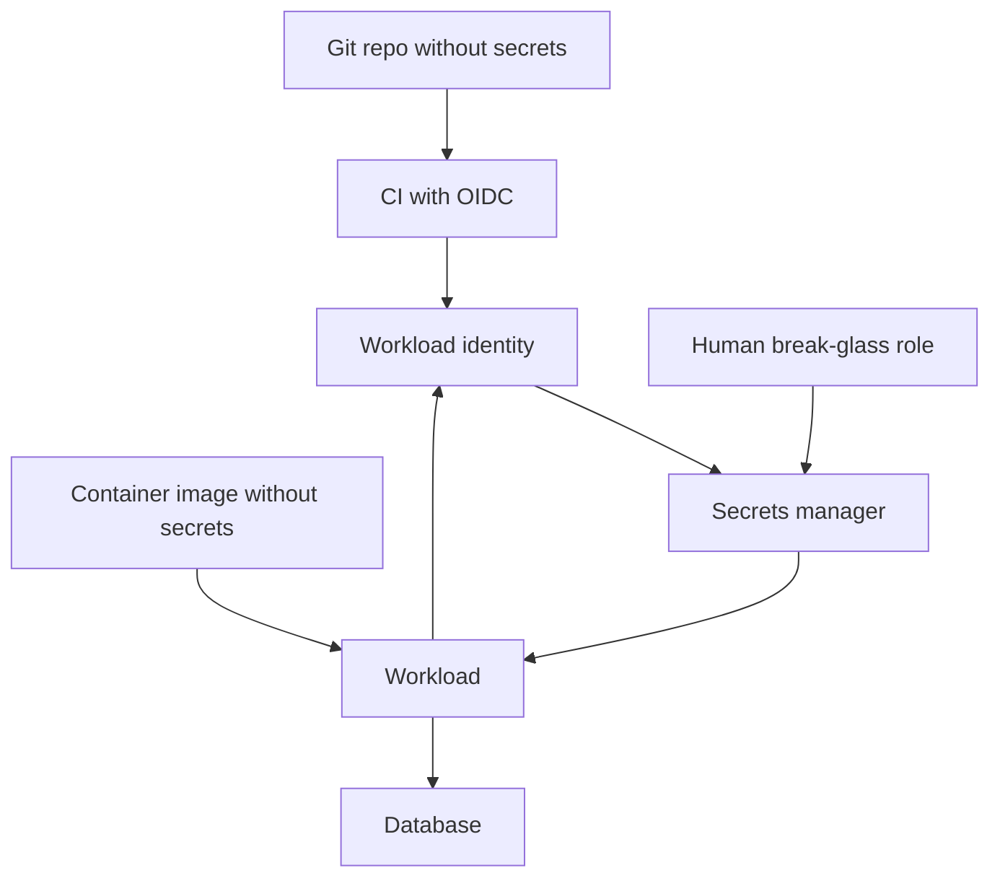

A secret is a value that grants access: a database password, an API token, a TLS private key, a signing HMAC, a cloud access key. If it lands in git, in a container image, in a chat log, or in a world-readable env file on a laptop, you no longer control who can read it. Rotation then becomes an incident, not a routine.

The design is small. Secrets do not live in source. They do not live in images. They are short-lived when the platform can issue them. They rotate on a clock and on suspicion. Every read is attributable: which identity, which environment, which time. The application receives the value at runtime from a manager or from the platform, not from a constant in a config module.

You will still have a bootstrap problem (how the first process authenticates to the manager). Solve that with workload identity — an instance role, a Kubernetes service account, a CI OIDC token — not with a long-lived master key checked into the same repo the manager was meant to protect.

## Concept

### What counts as a secret

Passwords, tokens, private keys, and certificate material are secrets. So are connection strings that embed passwords, webhook signing secrets, and the cookie encryption key. Public certificates, non-sensitive feature flags, and the name of a bucket are not. Putting everything in a secret store does not make a public URL confidential. Leaving a private key in "config because it is not a password" does.

Treat anything that would force a rotation if it appeared on a gist as a secret. If you are unsure, it is a secret until you write down why it is not.

### Not in git, not in images

Git history keeps deleted files. A key committed "for a minute" is in every clone and every backup of the remote. Pre-commit scanners (git-secrets, detect-secrets, GitHub secret scanning) catch some patterns. They do not catch a custom token that looks like a UUID. The control is cultural and mechanical: no secret in the tree, `.env` files untracked, CI credentials from the platform's OIDC or from a vault, not from a repo variable that is also printed in logs.

Container images are tar files. A `COPY .env` or an `ENV DATABASE_PASSWORD=` in a Dockerfile is a secret in every registry replica, every laptop that pulled the tag, and every SBOM-unaware backup. Build-time `--build-arg` values can leak into image history. Inject at runtime: volume, env from a manager, or a sidecar that writes a tmpfs file.

Kubernetes Secrets are base64-encoded objects in etcd. That is not encryption at rest unless you turned on encryption of Secret resources and locked down RBAC. Anyone who can `get secrets` in the namespace can read them. Treat native Secrets as a delivery format, and prefer an external manager or CSI driver when you need audit and rotation. Do not check YAML Secret manifests with live values into git.

### Short-lived beats long-lived

A static database password that lives for a year will leak. A cloud access key that lives in an IAM user for a year will leak. Prefer credentials the platform mints for the workload: AWS IAM roles for EC2/ECS/EKS, GCP service accounts with Workload Identity, Azure Managed Identity, CI job OIDC to assume a role. Those tokens expire in hours or minutes.

For databases, some platforms issue dynamic credentials (Vault database engine, IAM auth to RDS, Cloud SQL IAM). The app never sees a password that a human also uses. For machine-to-machine APIs, use short-lived JWTs from your IdP rather than a forever bearer token in an env var.

When you cannot go dynamic, store a long-lived secret in the manager and rotate it on a schedule with two-active-values during the cutover. Dual-running old and new passwords for a few hours is how you rotate without a flag-day outage.

### Rotation and who can read

Rotation is a designed operation: generate, dual-write or dual-accept, cut traffic, revoke old, prove revoke. A wiki instruction "change the password if it leaks" is not rotation. Include certificates (leaf lifetime is already a rotation clock) and HMAC keys (two keys, `kid` on the token).

Who can read is IAM on the manager: a production app role can read production secrets; a developer role cannot. Staging and prod are different namespaces. Break-glass is a separate role with audit. Humans should not `cat` production secrets as a daily habit. If they can, they will paste them into a ticket.

Audit logs on the manager are part of the product. A secret that can be read with no trail is a shared password with extra steps.

### Delivery into the process

Three common delivery modes:

- Environment variables from the orchestrator, populated from the manager at start. Simple. Visible in `/proc` and in crash dumps. Fine for many apps if the node is locked down.
- A file on a tmpfs or a CSI mount, refreshed when the value rotates. The app must re-read. Avoid world-readable files.
- An API call to Vault or a cloud secrets API at start (and on a timer). Needs network, retry, and a bootstrap identity.

Never log the value. Never put it on a URL. Never return it from a debug endpoint. Redact it in the config printer everyone adds "just for local."

## Trade-offs

| Approach | When it wins | Cost / risk |
| -------- | ------------ | ----------- |
| Workload identity, no static cloud keys | AWS/GCP/Azure compute with a native role | Does not cover third-party API tokens; still need a manager for those |
| External manager (Vault, AWS Secrets Manager, GCP Secret Manager) | Audit, rotation APIs, dynamic DB creds, many consumers | Operational dependency; bootstrap identity; mis-ACL still leaks |
| Kubernetes Secret from an external source | Delivery into pods without baking values into git | etcd and RBAC become part of the threat model; YAML with live values in git is a fail |
| Env var at process start | Simple apps, twelve-factor config | Visible on the node; no refresh without restart unless you add it |
| Long-lived secret in git or image | It never wins | History, clones, registries, and departed laptops keep a copy |

The cheapest secret is one you never created: a public-key client, a role assumption, a database that trusts the platform identity. When you must store a value, store it in one manager and deliver it late.

## Diagram

A workload authenticates with a platform identity, fetches a short-lived or rotated secret from a manager, and talks to the database. Humans and CI use different roles. Git and the image contain no secret values.

## Failure modes

### Secret in git or in an image

**Detection.** GitHub secret scanning, `trufflehog` on the repo, or a leaked-key alert from AWS. A clone from last year still has the `.env`. `docker history` or a pulled tag shows `ENV AWS_SECRET_ACCESS_KEY`. A public gist of a "sample" config contains a live token.

**Mitigation.** Rotate the leaked value first, then remove it from the tree (history rewrite only if you understand every clone). Block the pattern in CI. Teach the alternative: runtime inject. Scan images in the registry. Assume any committed secret is public.

### Static password, no rotation path

**Detection.** The database password is three years old. The people who set it have left. A leak requires a maintenance window nobody has rehearsed. Dual-running is impossible because one password field exists and every client is hard-coded.

**Mitigation.** Put the value in the manager. Implement dual-accept on the database or dual-read in the app. Rehearse rotation in staging. Move to IAM or dynamic creds where the platform supports it. Calendar the rotation before the leak.

### Over-broad read ACL

**Detection.** A developer role can read production database passwords. A single IAM policy grants `secretsmanager:GetSecretValue` on `*`. A Kubernetes RoleBinding lets the whole namespace `get secrets`. Audit logs show fetches from identities that should never touch prod.

**Mitigation.** Least privilege per secret or per path prefix. Separate prod and non-prod. Alert on reads from human roles. Remove `*` resource policies. Review new consumers as you would review a new production SSH key.

### Logged, printed, or proxied secrets

**Detection.** A debug `print(config)` in a crash report. A connection string in an application log. A CI log echoing `env`. A support bundle that includes `.env`. An error page that reprints the Authorization header.

**Mitigation.** Structured logs with an allow-list of fields. Redaction libraries that still miss connection strings — so do not put secrets in URLs or in exception messages. Disable debug config dumps in production. Treat CI logs as public to everyone with repo access.

## Real-world example

HashiCorp Vault, AWS Secrets Manager, Google Secret Manager, and Azure Key Vault are the production managers most teams mean when they say "we don't put secrets in git." Vault's original shape is a central broker: workloads authenticate (Kubernetes auth, IAM auth, AppRole), receive a token, and read a path. Database engines can mint short-lived DB users. AWS Secrets Manager stores a value, encrypts it with KMS, audits `GetSecretValue` in CloudTrail, and can rotate some RDS passwords with a Lambda. The cloud analogue of "no static AWS keys" is an instance or task role: the SDK fetches temporary credentials from IMDS or the container credential endpoint, and those credentials expire.

GitHub's secret scanning and push protection exist because the failure mode is so common: a key in a commit, a bot that uses it from the other side of the world. AWS, Slack, Stripe, and others participate so a leaked live key can be revoked. That is containment after a process failure. The process is still: never commit the value, inject at runtime, prefer workload identity, rotate, and restrict who can read.

Kubernetes documents that Secret objects are not encryption. Production clusters that care turn on encryption at rest for Secrets and still keep RBAC tight, or they mount values from an external manager so etcd never holds the live password. Either way the YAML in git holds a reference, not the password.

## What to remember

- Secrets do not live in git or in images. History and registries keep copies after you "delete" them.
- Prefer short-lived credentials from workload identity. When you must store a value, store it in a manager and rotate it.
- Who can read is the control: separate prod, audit fetches, no `*` policies, no daily human `cat` of production passwords.
- Deliver at runtime into env, a tmpfs file, or an API call. Never log the value.
