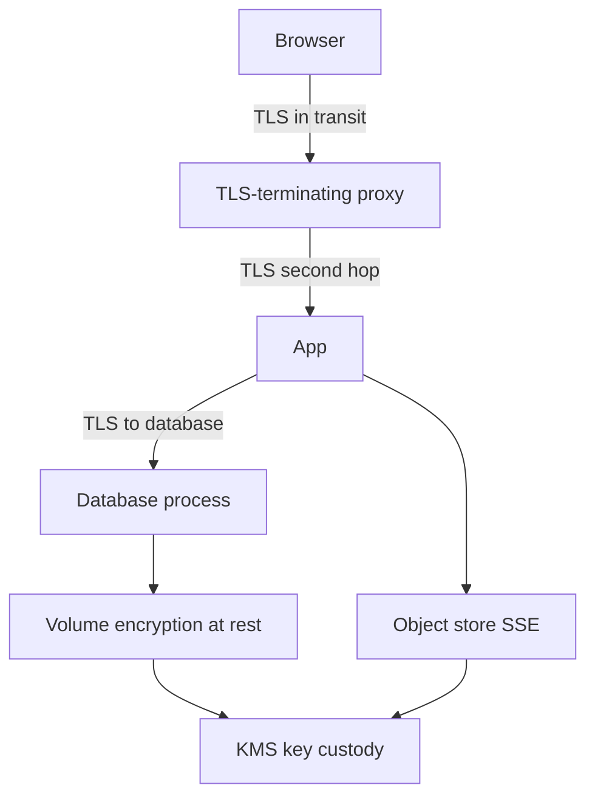

TLS encrypts a hop on the network. It does not encrypt the disk. Volume encryption or object-store SSE encrypts bytes on media. It does not protect a packet on the wire. Compliance checklists that tick "encrypted" without saying which of those they mean, and who holds the key, produce systems that are TLS to a load balancer and plaintext on the SAN, or LUKS on a laptop and HTTP inside the VPC.

The actual control is key custody. Ciphertext next to the key on the same disk is encryption against a thief who steals the powered-off drive and does not steal the key. It is not encryption against the operating system, the database process, or an attacker who already has the app role. At rest and in transit answer different thefts. You usually need both, and you need a written story for the keys of each.

Draw the path: client, TLS terminator, app, database connection, disk, backup object. Mark which hops are TLS, which media are encrypted, and where each key lives. Gaps in that drawing are the design.

## Concept

### In transit is TLS (and cousins)

Encryption in transit means an attacker on the network path cannot read or silently alter application bytes. TLS is the common mechanism: handshake authenticates the peer and agrees record keys; then HTTP, gRPC, or the database protocol rides inside. Wire-level VPN (IPsec, WireGuard) encrypts a tunnel; it does not replace TLS if you still need to authenticate the application peer.

TLS is hop-by-hop unless you terminate only at the destination. A load balancer that terminates TLS sees plaintext. The next hop is a new decision: HTTP, TLS with a private CA, or mTLS. Database drivers that "use SSL" must verify the server certificate. `sslmode=require` without verify-full encrypts to whoever answered.

In transit does not help after the bytes land in memory, in logs, or on a disk. A packet capture on a TLS 1.3 session without keys is useless. A packet capture on the app host after decryption is the full request.

### At rest is media encryption

Encryption at rest means the bytes on durable media are ciphertext without the key. Forms:

- Full-disk or volume encryption: BitLocker, FileVault, LUKS, cloud volume encryption (EBS encryption, Azure Disk Encryption). The OS or the hypervisor unwraps a volume key at boot or attach, then reads and writes plaintext through the filesystem.
- Object-store SSE: S3 SSE-S3, SSE-KMS, GCS default encryption, Azure Storage encryption. The service encrypts objects on disk with a key the provider manages or a key you send (SSE-C) or a key in KMS.
- Database TDE: the engine encrypts data files and WAL. The engine still sees plaintext rows for queries.
- Application-level or envelope encryption: the app encrypts a field or a blob with a data key, wraps that key with a KMS master key, stores both. The database then holds ciphertext even from a DBA who can SELECT.

A stolen laptop with FileVault on, powered off, is the threat volume encryption solves. A stolen NVMe from a rack, a decommissioned disk, a snapshot copied to the wrong account — same class. An attacker with a shell on the running host is not in that class. The volume key is already in memory.

### Key custody is the control

Who can unwrap the key is who can read the data.

- Provider-managed keys (SSE-S3, default GCP encryption) mean you trust the cloud's IAM and operational boundary. You still need IAM so that `s3:GetObject` is not granted to the world.
- Customer-managed keys in a KMS (AWS KMS CMK, Cloud KMS, Azure Key Vault) add a second lock: the caller needs both data-plane permission and `kms:Decrypt`. You can disable the key and make ciphertext inert. You can log every decrypt.
- Client-side keys you hold outside the cloud mean the provider cannot decrypt. You now run a key service. Loss of the key is loss of the data.

A key on the same volume as the data, in a file named `key.pem`, is not custody. A key in git is not custody. A KMS key with `Principal: "*"` is not custody. Envelope encryption with a data key per object and a wrapped copy next to the object is the usual production shape: KMS never sees the bulk bytes; the app or the storage service asks KMS to unwrap the small data key.

Rotation means new data keys for new writes, and a plan for old ciphertext (re-encrypt, or leave until the object dies). Disabling a CMK is a break-glass freeze. Deleting a CMK after the waiting period is destruction.

### What each does not cover

TLS does not encrypt backups in S3, EBS snapshots, replica disks, or the laptop that downloaded a CSV. Disk encryption does not encrypt the query the app sends across an unencrypted database port. Field encryption does not encrypt the metadata you left in clear (email as a primary key next to an encrypted SSN). A CDN that terminates TLS encrypts the browser hop and exposes the origin hop.

Mixing them is the job. Public HTTP APIs: TLS 1.3 to the edge and to the origin. Disks and buckets: encryption on with KMS. Sensitive columns: application-level encryption if a DBA or a warehouse replica should not see them. Backups: encrypted objects, keys not stored in the same bucket as the dump.

## Trade-offs

| Approach | When it wins | Cost / risk |
| -------- | ------------ | ----------- |
| TLS on every network hop, with name verify | Stops path attackers and naive "internal HTTP" | Terminating proxies still see plaintext; cert ops |
| Volume or SSE encryption, provider or CMK | Stolen media, snapshots in the wrong account, disk disposal | Running OS and app see plaintext; IAM is still required |
| CMK in KMS plus envelope encryption | Audit of decrypt, ability to disable keys, split IAM | Key deletion is data loss; mis-ACL on KMS is a second hole |
| Application-level field encryption | DBAs, replicas, and warehouses should not see the field | Search and uniqueness get hard; key loss; metadata still leaks |
| TLS only, disks clear | It does not win for durable data | Snapshots, backups, and discarded disks are plaintext |

Tick both boxes, then ask who holds the keys. Two checkboxes with one shared password in a repo are one checkbox.

## Diagram

A browser speaks TLS to a proxy. The proxy speaks TLS to the app. The app speaks TLS to the database. Disks and objects are encrypted with a KMS-wrapped key. The KMS is a separate trust decision from TLS.

## Failure modes

### TLS to the edge, HTTP behind it

**Detection.** Packet capture on the app subnet shows HTTP with cookies. The architecture slide has a padlock only on the public URL. Database `sslmode` is disable. A "private network" is the justification.

**Mitigation.** Encrypt origin and database hops, or treat the cleartext zone as a high-trust enclave with tight IAM and no disk dumping. Prefer mTLS to origin. Turn on verify-full for database TLS. Do not call the diagram "end-to-end encrypted" unless it is.

### Encrypted disk, key beside the data

**Detection.** `key.pem` on the same volume. KMS policy allows the entire account to decrypt. Snapshots include the plaintext mount because encryption was "optional" and a clone skipped it. A backup tarball in S3 is unencrypted next to an encrypted volume.

**Mitigation.** Keys in KMS or a vault, not on the data volume. Default encryption on all volumes and buckets. Backup jobs encrypt with a CMK. Test that a snapshot shared to another account is still ciphertext without the key.

### At rest used as a substitute for access control

**Detection.** A public bucket "because SSE is on." An IAM role that can `GetObject` on all keys, with the argument that data is encrypted at rest. A DBA account used by every engineer because TDE is enabled.

**Mitigation.** Encryption at rest does not replace IAM, object ACLs, or database grants. SSE-KMS helps only if `kms:Decrypt` is not granted to everyone who might call S3. TDE does not hide rows from SELECT. Put ACLs on the data plane; use field encryption when the data plane itself is the threat.

### Key deletion and lost custody

**Detection.** A CMK scheduled for deletion. An engineer with kms:ScheduleKeyDeletion. A client-side key on a laptop that was wiped. Restore tests fail with decrypt errors nobody rehearsed.

**Mitigation.** Separate roles for encrypt/decrypt and for key deletion. Waiting periods on delete. Replicated key material or a documented destruction policy. Restore drills that actually decrypt. Never store the only copy of a client-side key in the same system that holds the ciphertext.

## Real-world example

Amazon S3 encrypts objects at rest by default with SSE-S3. You can switch to SSE-KMS so every decrypt is an IAM and CloudTrail event on a customer-managed key. HTTPS is required for the API; that is encryption in transit to the S3 endpoint. The two are independent: a `GetObject` over TLS still returns plaintext to a principal that is allowed to read, and a stolen disk in an AWS data center is not useful without the service keys. EBS volume encryption and RDS encryption work the same way: a KMS key wraps a volume key; the running instance sees a block device.

Apple FileVault and Microsoft BitLocker are the laptop version of at rest: a powered-off stolen machine does not yield the disk. They do not encrypt traffic when the user opens a browser. Let's Encrypt and browser TLS are the in-transit counterpart for the web. A company that mandates FileVault and also "HTTPS everywhere" is applying both controls to two different thefts.

PCI and similar programs ask for both, then ask about key management: who can change the KMS policy, whether keys are split from data, whether TLS ciphers are modern. The questionnaire is clumsy. The underlying split is not. Wire versus media versus custody.

## What to remember

- TLS does not encrypt the disk. Disk encryption does not protect the wire. You usually need both.
- A terminating proxy and a database driver with verify off are gaps in transit, not details.
- Key custody is the actual at-rest control: KMS plus IAM, not a key file next to the data.
- Encryption does not replace access control. Ciphertext still returns to anyone allowed to decrypt and read.
