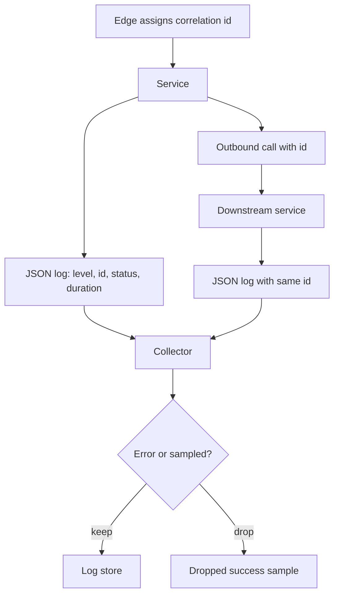

A log line is a record of one event: a request finished, a payment failed, a lock timed out. If you cannot find that event later, the line was decoration. Structured logs, a correlation id, and a strict policy on secrets turn logs into a queryable system. Unstructured `println` soup, a password in a query string, and a debug firehose in production turn them into a second outage — cost, noise, and a leak.

Levels exist so you can keep INFO on the request path and DEBUG in a box you turn for five minutes. Sampling exists so a million identical "cache hit" lines do not buy you a second cluster. Neither is an excuse to drop the one line that explains a 500.

Write logs for the person who will be awake at 3 a.m.: a timestamp, a service name, a correlation id, the outcome, and the identifiers that are not secrets. Everything else is optional and expensive.

## Concept

### Structured, not prose

A structured log is a set of fields: `ts`, `level`, `service`, `msg`, `request_id`, `user_id`, `http_status`, `duration_ms`, `error_code`. JSON is the usual encoding. The collector parses fields once. You query `http_status=500` instead of grepping English.

Free-text messages still belong in `msg` for humans. Do not bury the status code only inside the sentence. Do not concatenate user input into a format string that another tool will parse as extra fields (log injection). Put user-supplied strings in a dedicated field and bound their length.

One event, one line (or one JSON object). Multi-line stack traces need a logger that keeps them as a single event, or you will split a panic across unrelated requests in the viewer.

### Correlation id

A correlation id (request id, trace id) is a string that follows one user action across processes. The edge generates it if the client did not send one you trust. Every service copies it into logs and into outbound headers (`X-Request-Id`, `traceparent`). Support quotes it. The user-facing error page can show a short form of it.

Without that id, you have timestamps and hope. With it, you pull every line for `req_abc123` and see the gateway, the app, and the worker. Prefer the trace id from your tracing system when you have one, so logs and traces join. If you do not yet have traces, a ULID or UUID at the edge is enough to start.

Propagate on async boundaries: the queue message carries the id, the consumer logs it. A job that logs without the id is a dead end.

### No secrets

Logs are widely readable: on-call, vendors, analytics exports, laptops that pulled a support bundle. They are not a secret store. Do not log passwords, session tokens, `Authorization` headers, cookies, credit-card PAN, government ids, or raw request bodies that contain them.

Connection strings with passwords, pre-signed URLs (they are capabilities), and magic-link tokens are secrets too. Redact by allow-listing fields, not by hoping a regex catches `password=`. A debug dump of "the whole config" will undo the regex.

Health data, location, and similar regulated fields may be legal to process and still wrong to put in a log retained for a year. If you need them for a bug, use a short-lived, access-controlled debug mode, not INFO.

### Levels

DEBUG: internals you would not keep at full volume in production. INFO: normal completions you are willing to pay for (or sample). WARN: recovered problems, retries, degraded paths. ERROR: a request or job failed and a human might act. FATAL/PANIC: process death.

Do not log every cache hit at INFO. Do not log expected 401s from a scanner at ERROR. Do not use ERROR for "user typed a bad email." Metrics cover rates; logs cover instances. An ERROR line should be rare enough that an alert on count is meaningful.

Library loggers that default to DEBUG will drown you. Set library levels separately from your request logger.

### Sampling when volume hurts

Access logs on a busy edge can be millions of lines a minute. Keep 100% of errors and of a slow-request class. Sample successes: 1% of 200s, or a hash of the request id so that all lines for a sampled request survive. Tail-based sampling in a collector can keep a request if any span failed.

Debug in production is a time-boxed override keyed by request id or user id, not a global level flip that lasts a week. Cardinality still applies: a field with a unique value per line (`msg` that includes a UUID you also have as a field) inflates indexes. Bound high-cardinality fields.

Retention is a policy: hot search for days, cheap object storage for weeks or months, then delete. Legal hold is an exception list, not infinite INFO.

### What to put on the request log

A useful request log: method, route template (not the raw URL with ids if that is PII), status, duration, correlation id, caller identity if you have it, a coarse error code. Size of the body, not the body. Upstream status if you called one. Do not log every header.

Startup logs: config that is not secret, build SHA, feature flags. Shutdown logs: why. Cron: start, end, count processed, correlation id for the run. The same fields every time, or dashboards cannot parse them.

## Trade-offs

| Approach | When it wins | Cost / risk |
| -------- | ------------ | ----------- |
| Structured JSON with a correlation id | Any service you will debug across hops | Schema discipline; a collector that actually parses |
| 100% request logs | Low volume, audit-heavy paths (payments, admin) | Cost and noise at high QPS; must still drop secrets |
| Sample successes, keep all errors | High-QPS edges and chatty INFO | A sampled 200 that later looks wrong is missing; hash by request id |
| Unstructured stdout prose | A one-process tool on a laptop | Unqueryable in production; injection; no id |
| Debug left on in production | It never wins as a default | Cost, leaks, and a haystack that hides the ERROR |

Logs are not metrics and not traces. If you need a rate, export a counter. If you need a path across services, emit a trace. Keep the log for the event.

## Diagram

The edge assigns a correlation id. Each service writes one structured event per request and forwards the id. A collector ships JSON to a store. Errors are kept; successful chatter may be sampled.

## Failure modes

### Secrets in the log

**Detection.** A token in Kibana. A pre-signed URL in a support ticket export. PCI or privacy review finds PAN in access logs. A `console.log(req)` in a Node handler. Cloud provider alerts on keys in log groups.

**Mitigation.** Allow-list fields at the logger. Strip `Authorization`, `Cookie`, and known query keys at the edge. Never log raw bodies on authenticated routes. Rotate anything that appeared. Treat the log store as a sensitive system: access control, retention, no public buckets.

### No correlation id

**Detection.** An incident with three services and no way to join lines except a two-second timestamp window. Users send screenshots of an error without a code. Async workers log failures that cannot be tied to the API call that enqueued them.

**Mitigation.** Generate at the edge, propagate on HTTP, RPC, and queue messages, require the field in the log schema. Show a request id on 5xx pages. Reject a service template that does not log it.

### Volume without sampling or levels

**Detection.** Ingest bill jumps. Search latency dies. DEBUG from a dependency is 90% of lines. On-call cannot find ERROR. A "temporary" verbose flag from last quarter is still on.

**Mitigation.** Default INFO. Sample 200s. Keep errors. Separate library loggers. Alert on ingest GB, not only on application errors. Time-box debug overrides. Drop or downsample known chatty messages by code.

### Unparseable or lying lines

**Detection.** A dashboard that greps "error" matches "no error". Multi-line traces interleave. Clocks skew across hosts so order is wrong. A status field is a string in one service and an int in another.

**Mitigation.** Shared field names and types. UTC timestamps in a single format. One JSON object per event. A contract test that emits a log and parses it. NTP on hosts. Do not change field meaning without a new name.

## Real-world example

Nginx and most cloud load balancers emit an access log with method, status, duration, and a request id if you configure one. AWS Application Load Balancers can generate a `X-Amzn-Trace-Id`; many teams copy that value into application logs so a single id spans the ALB and the app. Stripe's API returns a request identifier in responses and documents that support uses it; that is the correlation id shown to a human.

The ELK/OpenSearch stack, Grafana Loki, CloudWatch Logs, and Datadog Logs all work better when the line is JSON with stable fields. They all get expensive when every pod prints DEBUG and when bodies contain tokens. Google's production practice, described in SRE material, treats logs as one telemetry stream next to metrics and traces, with volume as a first-class cost. OpenTelemetry's log data model carries a trace id on the log record so the three streams join.

A payment API that logs 100% of attempts with status, amount identifier, customer id, and request id, and never logs the PAN or the raw auth header, is the shape to copy. A social feed that logs every impression at INFO without sampling is the shape to avoid.

## What to remember

- Structured fields plus a correlation id you propagate on HTTP, RPC, and queues. One event, one object.
- Do not log secrets, tokens, PAN, or raw bodies. Allow-list fields. Rotate anything that leaked into the store.
- Use levels honestly. Sample high-volume successes. Keep errors and slow requests.
- Logs explain a single event. Rates belong in metrics. Cross-process paths belong in traces.
