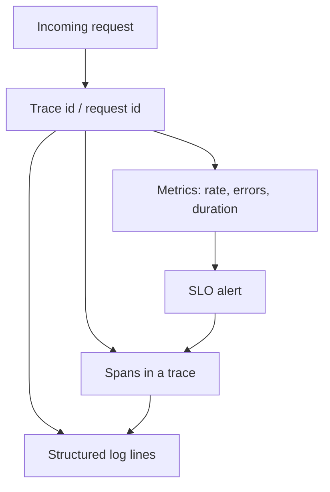

When a request is slow, three questions appear. Is this a class of requests, or one request? Where in the hop chain did time go? What exactly happened inside that process? Metrics answer the first. Traces answer the second. Logs answer the third. Calling all three "observability" without assigning those jobs produces a dashboard that cannot page you, a log pile you cannot join, and a trace you never look at because nothing links it to the alert.

Metrics are numbers over time: counters, gauges, histograms. They are cheap to store at aggregate cardinality, and they are what you alert on. Logs are records of a single event. Traces are a tree of spans for one request as it crosses processes. You need a join key (trace id, request id) so an alert can become a trace can become a log line.

Do not collect all three at maximum volume and hope. Instrument on purpose: RED or USE metrics on every service, traces sampled with errors kept, logs structured and quiet.

## Concept

### Metrics for aggregates and alerts

A metric is a named measurement with labels: `http_requests_total{route="/pay",status="500"}`. Prometheus scrapes counters and histograms. CloudWatch, Datadog, and others take the same idea with different wires. You chart a rate, a p95 latency, a saturation gauge. You alert when the rate of 500s on `/pay` exceeds a budget, or when p99 latency leaves the SLO.

Metrics do not tell you why request `abc123` failed. They tell you that 4% of `/pay` is failing and that it started at 14:02. Cardinality is the tax: a label with user id or request id turns a metric into a unique series per event, which will not scrape or will not pay. Keep labels to bounded sets: route template, status class, region, version.

Histograms and summaries are how you get percentiles. Averages hide the tail. Export latency buckets you actually care about (100ms, 250ms, 1s, 2.5s). Queue depth, pool usage, and CPU are USE-style gauges for the resources the service sits on. RED (rate, errors, duration) is the request-facing trio.

Alert off metrics, not off log grep. A metric has a known cardinality and a known eval interval. A log alert is a search that will miss when ingest lags.

### Logs for a single event

A log line (structured JSON) is what you open when you know which event to inspect: this request id, this order id, this deploy. It holds fields that would explode a metric: a message, a stack, an upstream error string, an id. Volume is the tax. You cannot log every cache hit at a million QPS and also keep the ERROR that matters.

Join logs to traces with the trace id on the log record. Join logs to metrics with time plus route plus status — a weak join, which is why the id exists. Retention is shorter or colder than metrics in many shops: you need 5xx lines for weeks, not every 200 for a year.

If the question is "did error rate jump?" do not start in the log UI. Start on the graph. Then pivot.

### Traces for a request across processes

A trace is a directed tree of spans. Each span has a name (`db.query`, `http POST /pay`), timestamps, attributes, and a parent span id. The trace id is shared. OpenTelemetry, Jaeger, Zipkin, and cloud X-Ray products all implement this model. Google's Dapper paper is the ancestor: sample in production, record the tree, find the slow hop.

A trace answers: the gateway took 2ms, the app 40ms, the database span 800ms, the cache was a miss. It does not answer "how often does this happen" unless you aggregate span metrics (which OpenTelemetry and many backends now do). It does not give you the SQL error text unless you copied that into a span event or a log.

Sampling is required at high QPS. Head sampling decides at the start (cheap, may miss rare faults). Tail sampling decides after the trace completes (keep errors and slow traces). Always keep a trace id on the request even when the trace is not stored, so logs still join.

Context propagation (`traceparent`, gRPC metadata) is the implementation. If a worker consumes a queue without the parent context, the trace breaks and you have two trees.

### How they work together

An SLO burn alert fires on a metric. The dashboard links to traces for that route in the alert window, filtered to errors. You open one trace, see the slow span, click through to logs with that trace id, read the exception. That path is the design. If any hop lacks the id, the path dies and someone greps.

Instrument libraries once (HTTP, SQL, gRPC) rather than every handler. Add custom spans for the business steps metrics cannot name (`authorize_payment`, `render_pdf`). Do not trace every in-process function. Do not metric-label every function. Do not log every function.

Exporters have budgets. A blocked tracing exporter should not stall the request thread. A log that writes synchronously to a full disk should not take down the API — or you have coupled availability to telemetry. Fail open on telemetry, fail closed on the product path, and watch telemetry pipeline health as its own SLO.

## Trade-offs

| Approach | When it wins | Cost / risk |
| -------- | ------------ | ----------- |
| Metrics (RED/USE) plus SLO alerts | Knowing that a class of traffic is sick; paging | Wrong labels explode cardinality; averages hide tails |
| Traces with error and latency sampling | Finding which hop ate the time for one request | Broken context on queues; 100% trace ingest is a bill; missing custom spans |
| Structured logs with trace id | Explaining one event, including stacks and ids | Volume, secrets, no aggregate without a metric |
| Logs as the only telemetry | Tiny systems, a single process | Cannot alert cleanly; cannot see cross-service time |
| Three pillars with a join key and budgets | Production services with hops and SLOs | Upfront instrumentation; a collector you must operate |

A fourth "pillar" of profiles or dumps can wait until CPU is the question. The first three already fail if they do not share ids.

## Diagram

A request carries a trace id. Each service records spans, increments metrics, and writes a log line with the same id. An alert reads metrics. A human follows the id into a trace and into logs.

## Failure modes

### High-cardinality metrics

**Detection.** Prometheus scrape time explodes. Memory on the TSDB grows. A label `user_id` or `email` or raw URL with ids. Dashboards time out. The metric you wanted (`status`) is unusable next to millions of series.

**Mitigation.** Bound labels. Use route templates, not raw paths. Never put request id on a metric — that is a log or a trace attribute. Relabel and drop at the collector. Set a cardinality alert on new series.

### Traces that stop at the queue

**Detection.** API traces look healthy. The worker is slow. There is no parent link. A new "consumer" trace starts with a different id. On-call debugs two systems as if they were unrelated.

**Mitigation.** Inject trace context into the message (W3C `traceparent` or the broker's tracing header). Extract on consume. If you cannot propagate, log both the API request id and the job id and write the mapping. Test a full path in staging, not only HTTP.

### Alerting on logs, ignoring metrics

**Detection.** Pages arrive late because ingest lagged. A regex alert matches a new "error" string in a debug message. Silence when the logger changes format. No SLO, only "ERROR appeared."

**Mitigation.** Alert on metrics derived from the request path (or from span metrics). Use logs to diagnose. If you must alert from logs (audit gaps, security), treat that pipeline as critical and test it. Keep a metric for "log ingest lag."

### Telemetry that takes down the product

**Detection.** Request latency tracks a tracing backend outage. A full disk from DEBUG logs blocks writes. A metric export holds a lock. Timeouts cascade because the exporter's timeout is the request's timeout.

**Mitigation.** Async export, bounded queues, drop on overflow. Separate disks or sidecars for logs. Timeouts on telemetry smaller than the user timeout. Fail open. Monitor the collector as a dependency with its own dashboard, not as an afterthought.

## Real-world example

Google's Dapper paper (2010) described production tracing at Google: low-overhead span trees, sampling, and the ability to follow a request across many services. Jaeger started at Uber for the same job and is now an OpenTelemetry backend many companies run. Prometheus became the default metrics system in Kubernetes environments: scrape, labels, histograms, Alertmanager. Elastic, Loki, and CloudWatch remain the common log stores.

OpenTelemetry exists to emit all three with one SDK: metrics, traces, and logs sharing a resource and a trace id. AWS X-Ray, Google Cloud Trace, and Azure Monitor implement the trace pillar in those clouds; CloudWatch, Monitoring, and Azure Metrics implement the metric pillar. The production shape that works is boring: RED metrics and SLO alerts on every service, OpenTelemetry traces with tail sampling that keeps errors, JSON logs that include `trace_id`, and a runbook that says "alert → trace → log," not "grep production."

Netflix, Google, and Uber published this split because a single pile of print statements does not scale to many services. You do not need their size to need the split. Two services and a queue already do.

## What to remember

- Metrics are aggregates for graphs and alerts. Keep label cardinality bounded. Do not put a request id on a metric.
- Logs are one event. Structure them, add the trace id, drop secrets, sample chatter.
- Traces follow one request across processes. Propagate context through queues. Sample, but keep errors.
- Join the three with a shared id, and fail open on telemetry so a collector outage is not a user outage.
