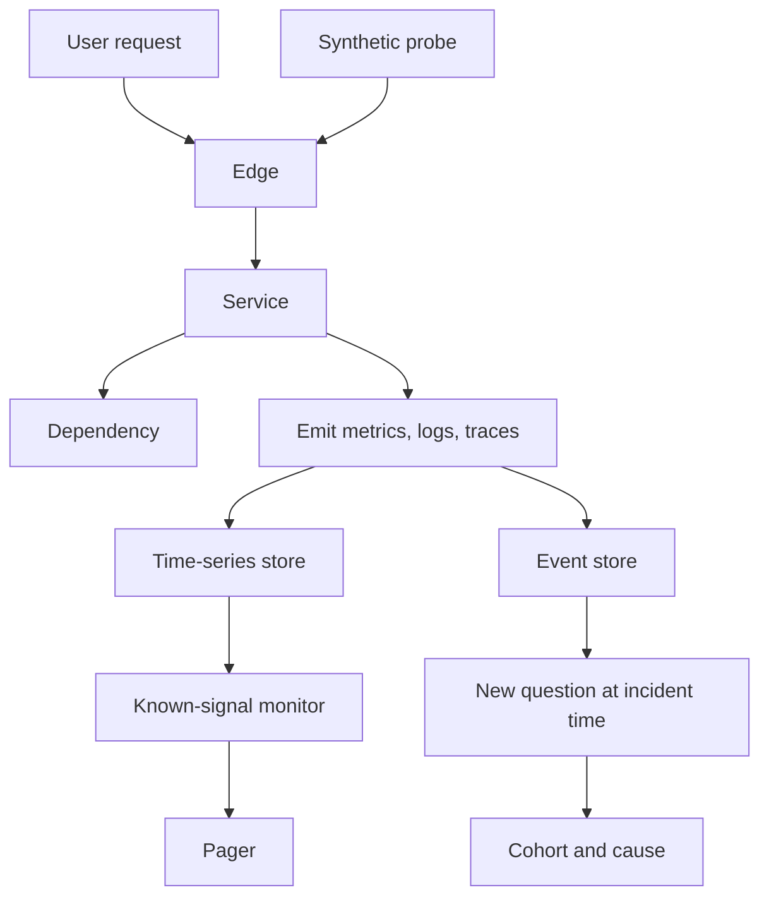

A dashboard that is all green while checkout is dead is not a mystery. It is monitoring doing the job you asked of it. You asked it to watch CPU, error rate, and p99 latency on the endpoints you listed last quarter. The failure tonight is a new combination: a dependency returning 200 with an empty body, a retry storm, a cache stampede. None of those were on the list.

Monitoring checks known signals. You decide in advance what "bad" looks like, you instrument for it, and you page when the signal crosses a line. That is the right tool for the failures you have already paid for. It is the wrong tool for the next failure, which will not look like the last one.

Observability is the property of the system that lets you ask a question you did not write a dashboard for, using telemetry you already emit. If you cannot form that question — if the only way to debug is to add a log line and wait for the next incident — you have monitoring, not observability. The distinction is not a vendor category. It is whether your production data can answer a new question before the user gives up.

You will need both. Monitoring is how you sleep. Observability is how you finish the incident.

## Concept

### Known signals versus new questions

A monitor is a predicate: if error rate exceeds 1% for five minutes, page. The predicate is a bet that this signal, at this threshold, on this window, is a user-visible problem. You win that bet on the failures you have seen. You lose it on everything else: a single tenant, a single SKU, a single region, a single build SHA, a payload shape you never stored as a dimension.

Observability starts from events with enough context that you can slice after the fact. The event is not "HTTP 500." The event is this request, this customer, this deploy, this feature flag, this downstream status, this latency bucket, this shard. When you can group and filter those events without shipping a new build, you can ask "is this only the users who got the new tax calculator?" at 3 a.m. and get an answer.

High cardinality is the mechanism. A dimension with a million values — user id, request id, object id — is expensive to pre-aggregate into time series. It is cheap to keep on a stored or sampled event and query later. Monitoring systems historically pre-aggregated because disks and indexes were expensive. That choice baked "we already know the questions" into the architecture. Observability systems invert it: keep the raw-enough event, pay for query at incident time, accept that you cannot graph every combination in advance.

### What you must emit

Three kinds of telemetry show up in every serious shop: metrics, logs, and traces. Metrics are cheap, low-cardinality, good at "is anything on fire." Logs are the narrative of a process. Traces stitch a request across services. Observability is not "buy all three." Observability is whether those three, together, let you reconstruct a single user journey and then aggregate across journeys by any field you kept.

If your metrics have no tenant id, your logs have no trace id, and your traces drop on the error path, you cannot ask the new question. Instrumentation is a product decision. You decide, per request, which fields are worth the cost. Correlation identifiers are not optional. A request id that does not leave the process is decoration.

Cardinality has a budget. You cannot attach unbounded user ids to a global counter and expect the time-series store to survive. Put high-cardinality fields on events and traces. Put low-cardinality fields on the metrics you alert on: status class, endpoint template, region, version. Mixing those two is how a metrics backend falls over during the incident it was supposed to explain.

### Black-box and white-box

Black-box monitoring treats the system as a user would: probe the URL, assert the status and the payload. It catches "the site is down" even when your internal metrics lie. White-box monitoring reads internals: queue depth, GC pause, replica lag. You want both. Black-box tells you the user is hurting. White-box tells you where to look. Neither is observability by itself. Observability is the ability to move from "hurting" to "this cohort, this cause" without a new deploy.

Synthetic probes are a known signal. They miss the path only real users take: the one with a specific cookie, a specific locale, a specific cart. Real-user telemetry — actual requests, actual browsers — is how you see those paths. Sample it if you must. Do not sample away the error class. Errors are already rare; uniform sampling that keeps 1% of everything will hide the 0.1% failure mode that is the whole incident.

### The feedback loop after an incident

You still write monitors. After each incident, add a signal for that failure class if it will recur. That is how monitoring grows. Also ask whether the same incident would have been diagnosable from existing telemetry. If the answer is no, add fields, not only alerts. Alerts without fields produce a pager that cannot be acted on.

A useful rule: every page names the next query. "Error rate high on checkout" is incomplete. "Error rate high on checkout; group by downstream status and flag" is a monitor that assumes you stored those fields. If you did not store them, the page is a starting gun for guesswork. Guesswork is how incidents last hours. Platform owns trace context; product owns business dimensions. You need both.

## Trade-offs

| Approach | When it wins | Cost / risk |
| -------- | ------------ | ----------- |
| Threshold monitors on low-cardinality metrics | Known failure classes, paging, capacity | Silent on novel failures and single-tenant bugs |
| Black-box synthetics | "Is the site up" from outside the fleet | Misses authenticated and long-tail user paths |
| High-cardinality events plus ad-hoc query | Unknown-unknowns, cohort questions, incident debug | Storage, query cost, and a team that must know how to ask |
| Full traces on every request | Deep service graphs, rare error reconstruction | Tail latency and bill; teams sample and then lose the error |
| Logs as the only signal | Small binary, one host, early product | Unqueryable at scale; no aggregation; no cross-service stitch |

Monitoring without observability is how you get a calm pager and a loud Twitter. Observability without monitoring is how you get a warehouse of events and nobody paged until a customer called. The cost of high-cardinality storage is real: you will sample, expire, and fight a finance conversation. Pay that cost on the request path that makes money. Do not pay it on internal health checks.

Synthetics are cheap and they lie in a specific way. They prove that a scripted path works from a vantage you chose. They do not prove that the user in a particular region, on a particular app version, with a particular cart, can check out. Keep them. Do not let them be the only "user" you measure.

Traces are the right tool for "where did the time go" and a poor tool for "how many users." Metrics are the opposite. If you try to make one telemetry type do all jobs, you will either blow the cardinality budget or lose the rare event.

## Diagram

## Failure modes

### Green dashboards, red users

The known signals are healthy. CPU is fine. The global error rate is under the threshold because the broken path is 2% of traffic, or one tenant, or one feature flag. Users on that path are down.

**Detection.** Customer tickets that do not match a page. A synthetic that hits only the healthy path. A global error rate that stays under threshold while a sliced error rate (by route, tenant, version, flag) would not. Compare ticket timestamps to the dashboard. If the dashboard did not move, the signal is wrong, not the user.

**Mitigation.** Page from a user-journey SLI, not from host CPU. Keep high-cardinality fields so you can slice when the global graph is quiet. Add a black-box probe that exercises the money path with a real-shaped payload, not a `/health` that returns 200 from a process that cannot reach the database.

### Cardinality explosion in the metrics store

Someone adds `user_id` as a Prometheus label, or a unique URL path as a metric dimension. The time-series database ingests millions of new series. Query latency goes to minutes. During the next incident the metrics UI times out, which is the worst moment for the store to die.

**Detection.** Series count growth, ingest lag, query timeouts, memory on the metrics brokers. A deploy that added a label is the usual cause. Watch series count as a first-class signal on the telemetry pipeline itself.

**Mitigation.** Forbid unbounded labels in the metrics path. Put user id and object id on events and traces. Use route templates (`/orders/{id}`) not raw paths. Cap metric cardinality in the client library so a bad commit fails in CI, not in production ingest.

### Sampling that deletes the incident

You trace 1% of requests to save money. The bug affects 0.05% of requests, or only requests that already failed. The trace you need was dropped. You have a distributed system and a story with missing chapters.

**Detection.** Incidents where "we have no trace for the failing requests" appears in the write-up. Error-biased sampling rates that are still too low. A trace store whose error span count does not rise when the error metric does.

**Mitigation.** Tail-based or error-biased sampling: keep traces that are slow or failed, sample the rest. Propagate a "keep this trace" bit from the first error hop. If you cannot afford that, keep structured logs with the same request id as the trace, so the log is the fallback reconstruction.

### Observability theater

The company bought a platform. Every service has an agent. Nobody can name the fields required to debug a payment failure. Dashboards are copied from a vendor gallery. The on-call still SSHs and adds print statements.

**Detection.** Time-to-diagnosis that does not fall after the tool lands. Incidents whose action items are "add more logging" after a year of the platform. A survey of on-call engineers who cannot write the query that would have found the last outage.

**Mitigation.** Treat instrumentation as an API with a contract: request id, trace id, tenant, version, route, dependency status. Review that contract in the same way you review the HTTP API. Practice the new question in game days. If the tool cannot answer last quarter's incident without a new field, the field is the work, not another dashboard.

## Real-world example

Google's Dapper paper (2010) described production distributed tracing at Google: a small annotation on each RPC, a trace id that follows the request, sampling so the cost stayed acceptable, and a store that engineers queried when a latency or error question was not on any dashboard. Dapper was not a replacement for monitoring. Google still used black-box probes and white-box metrics to page. Tracing was how a new question — which backend, which user cohort, which tree of RPCs — got an answer from data that already existed.

The Google SRE book's monitoring chapter draws the same line in operational language. Monitor symptoms the user sees, not (only) causes you guess. Use white-box data to locate the cause. That split is monitoring done well. What Dapper added is the ability to ask a question whose dimensions were not pre-aggregated into those monitors. The production lesson that transferred to everyone else is mundane: if the request does not carry a trace context, and the spans do not record the fields you will need, no later platform will invent them.

When I copy this outside Google, I do not start with a vendor bake-off. I start with one user journey, a required event shape, a known-signal page on that journey's SLI, and one query an on-call can run that groups failures by version and dependency status. If that query is impossible, we are not observable yet, no matter how many graphs we have.

## What to remember

- Monitoring checks known signals you chose in advance; observability is the ability to ask a new question from telemetry you already have.
- Put unbounded dimensions on events and traces, not on the metrics you alert on.
- Every page should name the next query, which means the fields for that query must already be in the event.
- A platform with no field contract and no journey SLI is a bill, not a debug capability.
