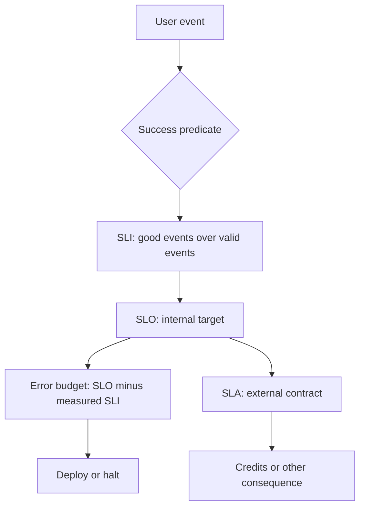

Most teams can quote a number that sounds like reliability: "three nines," "four nines," "we're pretty much always up." Ask what was measured, over what window, for which users, and what happens if the number is missed, and the room splits. That split is the whole subject. SLI, SLO, and SLA are not three names for the same percentage. They are a measurement, a target, and a contract, and mixing them is how you get a dashboard that cannot drive a decision.

An SLI is the measurement: a ratio or distribution taken from real events. An SLO is the target you set on that measurement, internally, as the reliability you intend to deliver. An SLA is the contract you offer someone else, with a consequence when you miss — credits, termination rights, a penalty. The error budget is what is left when you subtract reality from the SLO: the unreliability you already accepted and can spend on change.

If you only remember one ordering, remember this: pick the user event, measure it (SLI), set a target you can operate (SLO), then, if you must sign a contract, write an SLA that is looser than the SLO. An SLA tighter than the SLO is a promise the paging policy does not believe.

You do not need an SLA to run a serious service. You do need an SLI and an SLO, or you are arguing from anecdotes every time product wants to ship and on-call wants to freeze.

## Concept

### SLI: name the event, then measure it

An SLI is not "availability." Availability is a slogan until you define the event. Good SLIs are ratios: successful events divided by valid events, over a window. The numerator and denominator do the work. "Valid" excludes probes you do not want in the number, and includes the user actions you do. "Successful" is a predicate on latency, status, and correctness — not status alone. A 200 that arrives in 30 seconds is a failure for checkout even if the HTTP stack is proud of it.

Pick events a user would recognize: login succeeded in time, checkout completed in time, video started in time, job result available in time. Host CPU is not an SLI for the product. It is a diagnostic. If you page on CPU and report CPU as the reliability number, you will have a healthy fleet and angry users.

Latency SLIs need a threshold and a percentile or a count of events inside a budget. "p99 is 200ms" is an SLO-shaped sentence. The SLI is the fraction of events faster than 200ms, or the observed p99 itself. I prefer the fraction: it composes into an error budget as failed events. A sliding p99 is harder to turn into a budget and easier to game with a flood of cheap events.

Correctness is the SLI teams skip because it is hard. The order was placed and the inventory was wrong. The search returned 200 with empty results that should not be empty. Measure correctness with a smaller, explicit population: sampled audits, canary orders, checksum comparisons. A latency-only SLI will green-light a fast wrong answer.

### SLO: the target you operate to

The SLO is the line you draw on the SLI: 99.9% of checkout events succeed in 800ms over 28 days. That line is a product choice dressed as math. 99% is 7.2 hours of full unavailability per 30-day month. 99.9% is 43 minutes. 99.99% is 4 minutes. Those conversions are why you do not pick nines from a slide. You pick them from the user and from the cost of the next nine, which is usually an order of magnitude more engineering, not 10% more.

Set the SLO below what you currently measure if you are still noisy, or you will spend every week explaining why the target is a lie. Set it above a vanity 95% if users already churn at that level. The SLO should be a number you are willing to halt a launch for. If you will not halt, it is not an SLO. It is a wish. Prefer a 28-day rolling window over a calendar month, which has a cliff on the first that teams use as a release valve.

### SLA: the contract with a consequence

An SLA is what you promise a customer or partner, in writing, with a remedy. The remedy is the point. Without a credit, a refund, or a termination clause, you have marketing. The SLA number should be worse than the SLO — more room, a coarser window, exclusions you can defend — because the SLA is what legal and finance will pay for, and the SLO is what you page on. If they are identical, every SLO miss is a contract event, and you will stop writing honest SLOs.

Exclusions in an SLA are where trust goes to die if you hide them. Maintenance windows, customer-caused errors, internet weather outside your edge, a region the customer did not buy. List them. Measure them the same way the customer would. If your SLI excludes a class of failure the customer still feels, the SLA meeting will be a fight about the denominator.

You can (and often should) have no public SLA. Internal platform teams still need SLOs for the products that consume them. The "consequence" internally is a halt, a priority bump, a named escalation — an error-budget policy — not a credit on a credit card.

### Error budget: SLO minus reality

If the SLO is 99.9% over the window, the budget is 0.1% of valid events. Burn it with deploys, incidents, and experiments. When it is gone, stop burning. The budget is not a trophy to hoard at 99.99% against a 99.9% SLO. That hoard is unused risk the product already paid for. Spend it on purpose. Do not donate it to a retry loop.

Measure the budget from the same SLI the alerts use. A prettier number in a slide is how Goodhart shows up: exclusions multiply, health checks flood the denominator, failed events are recoded as "non-user." The budget then refills on paper while users still wait.

## Trade-offs

| Approach | When it wins | Cost / risk |
| -------- | ------------ | ----------- |
| SLI only, no SLO | Early product, measurement still moving | No target, so no halt and no shared language |
| SLO without an SLA | Internal services, most product teams | Sales may invent a promise you did not sign |
| SLO plus a looser SLA | External customers who need a contract | Legal process; credits; pressure to make the SLO timid |
| Time-based uptime ("minutes the site was up") | Simple brochure metric | Hides partial failure; a 10% broken path still looks "up" |
| Event-based SLI on a user journey | Matches how users fail | Needs real event logging and a clean valid/success predicate |

Time-based uptime is the metric executives already know and the one I will not operate to. A service can be "up" for 100% of minutes and still fail 5% of checkouts. Event-based SLIs catch that. They also require you to define the event, which is the work.

A public SLA without a tighter internal SLO means the first people to notice a miss are customers and lawyers. Invert it. Page and halt on the SLO. Let the SLA be the shock absorber. If sales needs a number before you have an SLI, the number is fiction. Ship the measurement first, even if the first SLO is conservative.

Multiple SLOs on one service are normal: availability, latency, correctness. They fight for attention. Cap the count. One journey availability SLI plus one latency SLI will carry most products. Add correctness when a fast wrong answer is the failure mode that matters.

## Diagram

## Failure modes

### Measuring the host instead of the user

The reported "availability" is the fraction of healthy instances, or a load-balancer health check, or CPU under 80%. Users fail on a specific endpoint, in a specific region, with a specific payload. The number stays green.

**Detection.** Incidents with user impact and no SLO burn. A graph of instance health that does not move while ticket volume does. Health-check success that is much higher than success of the money path. If `/health` is the denominator, you are measuring the probe.

**Mitigation.** Define the SLI on the user event at the edge you actually serve from: completed checkouts, successful API calls with a latency cap, started streams. Exclude health checks from the denominator. Keep host metrics as diagnostics that explain burn, not as the burn itself.

### An SLA tighter than the SLO, or an SLA with no SLO

Legal signed 99.99%. Engineering pages at 99.9% or not at all. The first miss is a credit event before it is an engineering event. Or there is an SLA on the website and no internal target, so nobody owns the number until a customer files.

**Detection.** Compare the public contract to the alerting threshold and the error-budget policy. If the contract is tighter, or the policy does not exist, you will find it in the first credit quarter. Sales decks that quote nines absent from the SLO doc are the leading indicator.

**Mitigation.** Write the SLO first. Set the SLA strictly looser, with a coarser window and listed exclusions. Put the SLO owners on the contract review. If you cannot operate 99.99%, do not sign it. "We will try" is not a remedy structure.

### Gaming the denominator

Cheap events flood the SLI. Internal retries are counted as extra successes. Failed requests are excluded as "client error" when the client sent a valid request and the server timed out. The ratio improves as users suffer.

**Detection.** Sudden jumps in event count without a matching user-traffic increase. A rising 4xx share that coincides with a "better" SLI. Change logs on the success predicate. A customer incident that did not consume budget.

**Mitigation.** Freeze the SLI definition as a policy change, not a dashboard variable. Count a user action once, not once per retry. Classify timeouts and 5xx as failed even when a client library retried and later succeeded — or count the user-visible attempt, consistently, and document it. Exclude only the classes listed in advance.

### A target nobody will halt a launch for

The SLO exists. The launch date also exists. The date wins. The number becomes a retrospective slide.

**Detection.** Deploys during empty or near-empty error budget. A review meeting that always "accepts the risk." An SLO that has never caused a slip. If the graph has never changed a roadmap, it is decoration.

**Mitigation.** Attach the budget to the pipeline and to a named halt. Record overrides. If the SLO is too tight for the business, change the SLO in the same document, with the same people. Do not silently ignore it. A halt that is always overridden is an SLA-shaped embarrassment waiting for a customer to notice.

## Real-world example

Amazon S3 publishes a service level agreement built on monthly uptime, with service credits as the consequence when a month misses the promised percentage. That document is an SLA: a contract, a measurement definition, a remedy. It is not Amazon's internal SLO. Internally, S3's operators run tighter objectives and far more detailed SLIs than a monthly uptime percentage — request success, latency, and error classes that a credit formula would be too coarse to capture. The public number is what a customer can claim against. The internal numbers are what pages a human.

Google's SRE material made the three-letter split standard language in the industry: SLI as the indicator, SLO as the objective, SLA as the agreement. The operational move that matters is the error budget, which only exists once you have an SLI and an SLO. Google could afford to talk about this in public because the internal measurement already existed. Copying the acronyms without the event definition copies the vocabulary and none of the control.

When I set these up for a product team, I start with one journey, one success predicate, a 28-day rolling SLO slightly below current measured performance, and no public SLA until sales truly needs one. The first month is for trusting the SLI. The second is for writing the halt. The SLA, if it appears, comes last, and it is looser on purpose.

## What to remember

- SLI is the measurement, SLO is the internal target, SLA is the contract with a consequence; do not use the words interchangeably.
- The error budget is the SLO minus measured reality; spend it on change, and halt when it is gone.
- Measure user events with a success predicate that includes latency and correctness, not host health.
- Sign an SLA only after the SLO exists, and keep the SLA looser than the SLO.
