A merge that is not built and tested is a rumor about the state of the main branch. A build that cannot be installed is a trophy. Continuous integration is the first loop: every change is compiled, tested, and proven mergeable against the current trunk. Continuous delivery is the second: that proven artifact can be put in front of users, on purpose, through a path you can reverse.

The split is not "Jenkins versus Kubernetes." CI answers "does this change integrate?" CD answers "can we ship this artifact, and can we take it back?" Teams that stop at green tests still ship by hand on Friday with a wiki page. Teams that automate deploy without a rollback still have a pipeline; they have an incomplete one. Incomplete pipelines turn a bad commit into an incident with no rehearsed exit.

You can code a feature and still not operate this loop. The loop is a product with an owner, an artifact contract, and a failure policy. Treat it that way or it will treat you as an untested path.

The artifact is the unit of CD. Git is the unit of CI. If you rebuild from a different commit at deploy time, you are not delivering the thing you tested. You are testing one binary and shipping another.

## Concept

### CI: build and test on every change

Continuous integration means developers integrate into a shared trunk frequently, and a machine proves each integration. The proof is a pipeline triggered by the change: fetch, compile, unit tests, at least one integration test that is not a lie, and a stored artifact with an immutable identifier. "Frequently" is hours, not days. A branch that lives a week is a denial of integration. You will pay for it at merge time with a conflict that no test has seen.

Trunk-based development is the shape that makes CI honest. Short-lived branches, small diffs, merge gates that run the same tests main will run. Long-lived feature branches with a "we'll integrate later" story are a different process with the same logo. Feature flags, not branches, are how you hide incomplete work on trunk.

The CI system must be the only path to the artifact you ship. Local "it works on my machine" is a development convenience. If the pipeline cannot reproduce the build — pinned toolchain, locked dependencies, a containerized builder — you do not have CI. You have a shared hope. Cache aggressively; pin strictly. A cache that can inject a different dependency version is a supply-chain bug.

Test selection is an engineering problem, not a moral one. A two-hour suite that everyone skips is worse than a eight-minute suite people trust. Put fast tests on every change. Put slow tests on main, on a schedule, or on a label. A test that flakes more than it catches will be ignored; ignore is how a real failure ships. Quarantine flakes in the open, with an owner and a deadline, or they become the culture.

### CD: deliver the same artifact, and reverse it

Continuous delivery means the artifact that passed CI is always in a shippable state. Continuous deployment means you actually ship it to production on every green main — or on every green after a canary — without a human pressing a button. You can have delivery without deployment. You cannot have either if the pipeline cannot roll back.

Rollback is a first-class stage, not a runbook sentence. The previous artifact remains installable. The data migration is backward-compatible, or the rollback plan includes a forward fix you have already written. If schema changes only go forward, say so, and make "roll forward" a pipeline action with the same automation as deploy, not a hero on a laptop.

Environments are promotions of the same artifact: build once, deploy the identical bytes to test, staging, production. Configuration differs; the binary does not. Rebuilding for production with different compiler flags is how you discover a bug that staging never had. Configuration that is not in the pipeline — a checkbox in a cloud console — is an untracked change. Treat it as a deploy.

### What the pipeline actually contains

A pipeline I will sign has, in order: lint and unit tests; build of a versioned artifact; automated tests against that artifact; a security and license scan that can fail the build; deploy to a pre-production environment; a smoke test; deploy to production in a controlled slice; health confirmation; a one-command rollback to the previous artifact. Anything missing is a manual ritual. Manual rituals fail at 2 a.m.

Approvals belong on the production slice, not on the compile. A human approval that is a rubber stamp should be a recorded automated policy instead: tests green, scan green, change freeze calendar, error budget remaining. If a human must look, they look at the diff, the test report, and the canary, not at a blank "Approve" button.

Secrets in CI are the same class of secrets as production, with a worse audience: every engineer with pipeline access, every forked pull request if you are careless, every log line that prints the environment. Inject from a secret manager at runtime. Never commit them. Never echo them. Pull requests from forks do not get production secrets; they get a cheap sandbox or they do not get a deploy stage.

### Feedback time is the product

The pipeline's job is to shrink the time from commit to "known good" or "known bad." A 40-minute wait trains people to batch commits and skip the loop. Parallelize. Split slow jobs. Fail fast on compile. Put the owner of a red main in the same chat as the break, with a clock. A red main that sits for two hours is not a quality process. It is an unowned outage of the delivery system.

## Trade-offs

| Approach | When it wins | Cost / risk |
| -------- | ------------ | ----------- |
| CI only, manual production deploys | Early team, rare releases, simple artifact | Friday deploys, snowflake steps, no practiced rollback |
| CI plus CD to staging, gated prod | Most product teams, compliance that needs a recorded gate | Staging drift if it is not the same artifact and data shape |
| Continuous deployment on every green main | High-discipline trunk, fast tests, instant rollback | A broken test culture ships broken product at high frequency |
| Rebuild per environment | Emergency hotfix culture, mismatched toolchains | You did not ship what you tested |
| Pipeline without rollback | Teams that "always roll forward" | A bad artifact has no rehearsed exit; roll-forward is a wish during an incident |

Manual production deploys feel safer because a human is in the loop. They are safer only if that human has a checklist the machine lacks. Usually the human has a worse checklist and a worse audit trail. Automate the steps; keep a recorded approval if a regulator requires a name.

Continuous deployment is not a maturity badge. It is a bet that your tests, your canary, and your rollback are better than a human's memory. If any of those three is weak, a button is not cowardice. It is the remaining control. Strengthen the three, then remove the button.

Rebuilding per environment is the bug that looks like hygiene. "Production uses the production Dockerfile." If that file is not what CI ran, you are testing a cousin. Pin a digest. Promote the digest. Talk about git SHAs in chat if you want; the deploy tool should talk about artifact ids.

## Diagram

```mermaid
flowchart TB
  Commit[Commit to trunk] --> CI["CI: build and test"]
  CI --> Artifact["Immutable artifact"]
  Artifact --> Staging[Deploy staging]
  Staging --> Smoke[Smoke tests]
  Smoke --> ProdSlice[Deploy production slice]
  ProdSlice --> Health{Health check}
  Health -->|pass| Promote[Promote remaining slice]
  Health -->|fail| Rollback[Rollback previous artifact]
  Promote --> Done[Done]
  Rollback --> Done
```

## Failure modes

### The pipeline cannot roll back

Deploy succeeded. Metrics scream. The runbook says "redeploy the previous version." Nobody has done that in six months. The previous image was garbage-collected. The migration already dropped a column. Rollback is a meeting.

**Detection.** A game-day attempt to reinstall the last artifact fails, or the artifact is gone, or the schema forbids it. Production incidents whose exit was a forward fix invented on the call. A registry retention policy shorter than your rollback window. If you cannot name last week's production digest and install it in a non-prod cluster tonight, you do not have rollback.

**Mitigation.** Keep N previous production artifacts and their config. Test rollback in staging on a schedule. Make schema changes expand-then-contract so old binaries still run. Put `rollback` next to `deploy` in the same tool, same permissions, same health checks. If you can only roll forward, write the forward artifact before you need it, as a pipeline stage, not as a hero branch.

### CI is optional or slow, so people bypass it

The suite is 90 minutes and red half the time. Engineers merge with `--no-verify` or an admin override. Main is an untested soup. The pipeline still exists in a screenshot.

**Detection.** Override counts, merges without a green check, mean time from commit to green, flake rate. A chat culture of "just merge it, I'll fix CI later." Compare the SHA in production to the last green SHA; if they diverge, the gate is theater.

**Mitigation.** Fail closed. Make main protected. Shorten the suite until it is trusted. Quarantine flakes with owners. Put the cost of a red main on the breaker, publicly. An override that is not ticketed is a stolen deploy. Track overrides like you track production incidents; they are the same class of risk.

### You ship a different binary than you tested

CI builds on Ubuntu with JDK 17. Production runs a hand-built AMI with a different patch level. Or CD rebuilds from main at noon, and main moved. Staging is green on yesterday's code.

**Detection.** Artifact checksums that do not match across environments. Deploy logs that show `docker build` at release time. A bug that exists only in production despite "the same commit." Toolchain files that are not pinned.

**Mitigation.** Build once. Promote a digest. Pin the builder image by digest too. Record the artifact id in the deploy event and in the runtime `/version` endpoint. Forbid production builds from source. If you must re-sign or re-wrap, wrap the same bytes.

### Secrets and untrusted pipelines

A pull request from a fork runs the pipeline with cloud credentials. A test prints an environment variable. A compromised dependency runs in the build and exfiltrates the deploy key.

**Detection.** Pipeline logs that contain tokens. Fork workflows with write credentials. Long-lived AWS keys in CI variables. A build that reached the production account during a pull-request job. Audit the identity the pipeline assumed; if it is a human's key, that is the finding.

**Mitigation.** Short-lived OIDC-style credentials, least privilege per stage, no production secrets on pull-request jobs, secret scanning in logs, an allowlist of build dependencies. Separate the CI role from the CD role. The test job cannot deploy. The deploy job cannot compile arbitrary pull-request code.

## Real-world example

Netflix open-sourced Spinnaker as the CD control plane they used to ship to a large, heterogeneous fleet: bake an immutable image, deploy it through a pipeline with explicit stages, verify, and roll back. The public materials are consistent on the point that delivery is a sequenced, observable machine, not a script on an engineer's laptop. Spinnaker's cluster deploy strategies (including their red/black style) exist because a pipeline that can only move forward is a liability at their rate of change.

The other half of the lesson is older and smaller. ThoughtWorks and Fowler's continuous integration writing set the CI contract: integrate to trunk, build on a machine, make the result visible, keep it fast. Jenkins, then GitHub Actions and a dozen others, implemented that contract. The companies that copied the tools without the contract — slow tests, optional gates, rebuild-on-deploy — got the dashboard and not the property.

When I install this for a team that currently ships with a checklist, I do not start with continuous deployment. I start with a single artifact id, a required CI gate on main, a staging deploy of that digest, a production deploy of the same digest, and a rollback command that someone ran last week. Frequency comes after the artifact is honest.

## What to remember

- CI builds and tests every change against trunk; CD delivers the same artifact and must be able to take it back.
- A pipeline that cannot roll back is incomplete, even if deploy is automated.
- Build once, promote a digest; configuration may change, the bytes may not.
- Slow or optional CI trains people to bypass it, which is indistinguishable from not having CI.
