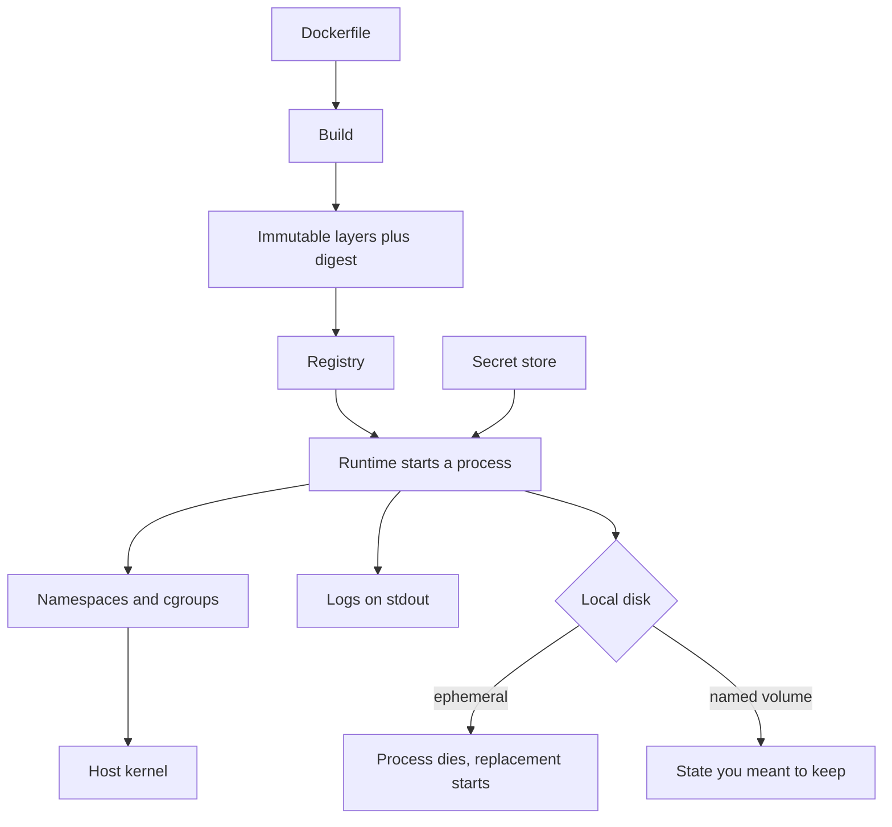

A container is not a small virtual machine. It is a process with a private view of the machine: its own filesystem tree, its own process ids, its own network interface, its own resource caps. The kernel is the host kernel. If you design as if you shipped a guest OS, you will make security and resource bets the isolation model does not support. If you design as if you shipped a tarball of an app, you will miss the isolation you did pay for.

Docker made that process packaging popular: a Dockerfile, an image, a registry, a runtime. The image is the unit architects should care about. It is a layered, content-addressed filesystem plus metadata that says what to run. Layers are immutable. You do not patch a running container's OS the way you patched a VM. You build a new image and replace the process.

Secrets do not belong in the image. Anything baked into a layer is in the registry, in every laptop that pulled it, and in the history of the image even after you "delete" a file in a later layer. Configuration that varies by environment does not belong in the image either, except for sane defaults. The image is the app plus its runtime files. Credentials arrive at process start, from a volume, an env injector, or a secret store.

You can write a web service and still not operate this packaging. The packaging is how you make the thing you tested the thing you run, on more than one machine, without a unique snowflake host.

## Concept

### Process isolation, not a hypervisor

Linux containers rest on namespaces and cgroups. Namespaces hide: mount, PID, network, UTS, IPC, user. Cgroups limit: CPU, memory, I/O. A process in a container that hits a kernel bug, or that can `ptrace` in the wrong configuration, or that is run as root with extra capabilities, is a process on the host. The VM boundary is a different boundary. Use VMs when you need a different kernel, a different patch cycle, or a tenant you do not trust with your kernel. Use containers when you need density, start time, and a reproducible filesystem for a process you do trust at the kernel layer — your own app, in your own account.

User namespaces and dropped capabilities are how you make that trust smaller. Run as a non-root user inside the image. Drop `NET_RAW`, `SYS_ADMIN`, and the rest unless you can name why. Read-only root filesystem plus a tmp volume is a default I will sign. Privileged containers are VMs without the isolation; I treat them as a defect unless the workload is a nested runtime that has no other shape.

### Image and layers

An image is a stack of immutable filesystem layers, each a diff, addressed by digest. The Dockerfile is a recipe; the digest is the identity. Tags (`v1.2.3`, `latest`) are pointers. Pointers move. Digests do not. Production should run a digest. Tags are for humans.

Layering is a cache and a leak. A cheap rebuild is why you put dependency install before app copy: the dependency layer stays cached. A leak is why `COPY secret.pem` followed by `RUN rm secret.pem` does not remove the secret. The pem lives in the parent layer. Multi-stage builds exist to keep compilers and credentials out of the final image: build in one stage, copy the binary into a thin runtime stage. The final image should not contain a compiler, a package manager you do not need, or a shell if you can avoid it.

Base images are a supply chain. `FROM ubuntu:latest` is a moving floor. Pin a digest. Rebuild on a schedule for patches. Distroless or a minimal base reduces the CVE surface and the accidental `apt-get` in production. You still patch by rebuilding, not by SSHing in. SSH into a container to "fix" it is how you create a snowflake that no longer matches the image you think you run.

### Runtime contract

The process should treat its filesystem as ephemeral except for mounted volumes you named. Logs go to stdout and stderr. State goes to a database or an object store. The container dies. The scheduler starts another one from the same image. If you wrote to local disk and expected it to survive, you designed a VM and deployed a process.

Health is a process question. A container that is "running" but cannot serve is a waste of a restart policy. Liveness and readiness are not the same: liveness is "kill me," readiness is "do not send me traffic." Architects who collapse those two get restart storms or black-hole instances.

Resource requests and limits are part of the contract with the host. Without them, one process eats the node. With bad ones, you throttle or OOM-kill the wrong workload. Memory limits are enforcement. CPU limits are usually throttling. Know which one you set.

### What the image must never contain

Secrets, customer data, and environment-specific endpoints that are not defaults. Scan images for keys the same way you scan git. Inject runtime config: environment variables for non-secrets, files from a secret store for secrets, never a layer. If a developer needs a credential to run locally, it comes from their own secret tool, not from a `dev.Dockerfile` that copies `.env`.

## Trade-offs

| Approach | When it wins | Cost / risk |
| -------- | ------------ | ----------- |
| Process on a VM or metal, no container | Kernel-level isolation needed, one tenant per host, special hardware | Slow to pack, snowflake hosts, weak artifact identity |
| Container image, run as a process | App packaging, density, identical bytes from CI to prod | Shared kernel; misconfig is host compromise; layer leaks |
| Full VM per service | Untrusted tenants, different kernels, compliance that names VMs | Size, start time, patching a guest OS fleet |
| Fat image with a shell and a package manager | Fast debug, familiar Linux | CVE surface, people patch live, secrets and tools in layers |
| Minimal or distroless image by digest | Production, reproducible deploys | Debug story must be a sidecar or ephemeral debug container |

Containers win as an artifact format even when they lose as an isolation boundary. I will still put an untrusted tenant in a VM or a separate account. I will still put my own stateless API in a container because I want the digest, the layers, and the start time.

Fat images are a local optimum. They feel like a VM you already know. They accumulate compilers, curl, and that one debug package from 2019. Then the scanner goes red and nobody knows which layer is allowed to change. Thin images shift debug cost to tooling. Pay that cost once.

Pinning digests is ceremony until a tag moves and a production node pulls a different base overnight. Then it is the only identity that was ever real. Use tags in chat. Use digests in the deploy spec.

## Diagram

## Failure modes

### Secrets baked into layers

An API key in the Dockerfile, a `.env` copied in, a private key that was `rm`'d in a later RUN. The image is public, or it is private and every engineer pulled it, or a scanner finds the key in a parent layer two years later.

**Detection.** Image scans that look at every layer, not the final filesystem. Git history of Dockerfiles. Registry access logs for an image that should never have left CI. A rotated key that still works because a six-month-old tag is still runnable. `docker history` and layer extractors will show what `ls` in the running container hides.

**Mitigation.** Multi-stage builds, secret mounts at build time that never create a layer, runtime injection from a secret manager, scanners in CI that fail the build. Assume any layer ever pushed is public to everyone who could pull it. Rotate anything that might have been copied. Do not "fix" by adding a delete layer.

### Treating a container like a VM

Someone SSHs in, apt-gets a patch, edits a config, and leaves. The next reschedule restores the image and "undoes production." Or the process writes state to the container filesystem and the disk fills, or the state vanishes on a restart.

**Detection.** Exec sessions in production, unexpected packages in a running container versus the image, disk growth on the writable layer, incidents that "fixed themselves" after a reschedule. If your runbook includes "log in and edit," the design is wrong.

**Mitigation.** Immutable deploys: new image, replace process. Debug with copies in non-prod, or an ephemeral debug sidecar, not a mutated production container. Mount volumes only for state you can name. Send logs out. Cap the writable layer so a runaway write OOMs or fails instead of filling the host.

### Shared kernel surprise

A container escape, a kernel CVE, or a noisy neighbor that the cgroup did not actually constrain. All tenants on the node share fate with the kernel and with an incorrect isolation flag.

**Detection.** Capability sets you did not expect (`privileged: true` in a spec). Host processes visible from a container. CVE notices on the host kernel that your image scanner will not see. CPU throttling or memory steal that looks like app slowness. Node-level incidents that hit every container at once.

**Mitigation.** Unprivileged processes, dropped capabilities, read-only root, seccomp profiles, separate node pools for a different trust tier. Patch the host kernel on a schedule. Do not sell containers as a multi-tenant security boundary they are not. Put hostile workloads on VMs or dedicated nodes.

### Moving tags and unreproducible bases

`FROM node:18` moved. A rebuild picked a different patch. Production nodes pulling `app:latest` diverged. Two replicas run two different images and you debug the wrong one.

**Detection.** Digest mismatch across replicas. Deploy records that store a tag without a digest. A "ghost" bug that appears on one node. Base-image rebuilds that were not an intentional deploy. Registry events that retag `latest`.

**Mitigation.** Pin `FROM` by digest, pin deploys by digest, rebuild bases on a cadence you own. Ban `latest` in production specs. Show the running digest on the service's version endpoint and on the dashboard. Alert on replica digest skew.

## Real-world example

Google's Borg paper described a fleet that had already run isolation and packaging at enormous scale before Docker's 2013 public release: jobs as tasks, resource limits, a shared kernel, a package that had to start fast and die cleanly. Docker did not invent that model. Docker made a usable image format and developer loop — Dockerfile, local daemon, registry — that the rest of the industry could copy. Linux namespaces and cgroups were the kernel mechanism; Docker was the packaging UX.

The architectural residue is the image digest as the unit of deploy. Shops that took Docker as "lighter VMs" kept SSH, kept guest patching, and kept secrets in images, then wondered why scanners and reschedules fought them. Shops that took Docker as "a reproducible process filesystem" built CI around digests, injected secrets at runtime, and treated a running container as disposable. Kubernetes later standardized the second shop's assumptions. The first shop's assumptions still show up as privileged pods and `latest` tags.

When I specify containers for a service, the document names the digest, the non-root user, the secret injection path, the writable paths, and the host-kernel trust boundary. If those sentences are missing, we have a demo, not a production shape.

## What to remember

- A container is a namespaced, cgrouped process on a shared kernel, not a VM; the image is an immutable layered filesystem plus a digest.
- Secrets and environment credentials do not belong in the image; layers remember what a later `rm` pretends to forget.
- Run the digest you built in CI, as a disposable process, with logs on stdout and state on a volume or a database you named.
- Pin bases and deploys by digest; `latest` and live patching recreate the snowflake host you left.
