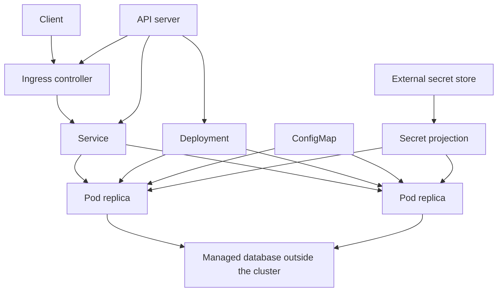

Kubernetes is a control plane that keeps a cluster of machines running the process shapes you declared. You do not "run Kubernetes" the way you run a JVM. You submit objects — Pod, Deployment, Service, Ingress, ConfigMap, Secret — and controllers try to make the world match. If you think of it as a clever Docker host, you will put data in the wrong place and expect the control plane to save you. It will not.

The atom is the Pod: one or more containers that share a network namespace and, optionally, volumes, scheduled together onto a node. You almost never create a Pod by hand in production. A Deployment owns ReplicaSets that own Pods, and it replaces them when you change the pod template. A Service is a stable DNS name and virtual IP in front of Pods that match a selector. Ingress (or a Gateway) is how HTTP from outside the cluster finds a Service. That is the request path. Everything else is policy around it.

ConfigMaps hold non-secret configuration. Secrets hold credentials, still as objects in the API, still readable by anyone who can get the object unless you add encryption, RBAC, and an external store. The control plane schedules, restarts, rolls out, and routes. It does not back up your database. It does not make a single-replica disk highly available. It does not encrypt application data at rest because you created a Secret object. Those are your jobs.

You can write the app and still not operate this. Operating it means knowing which object owns the process, which object owns the name, and which object does not own the data.

## Concept

### Pod, then Deployment

A Pod is mortal. Nodes die, the kubelet kills, you ship a new image. Anything in the Pod's writable layer dies with it. A Deployment says "I want N copies of this template." It creates a ReplicaSet, which creates Pods. A rollout updates the template; the Deployment raises a new ReplicaSet and drains the old one according to `maxUnavailable` and `maxSurge`. You get a rolling replace, mixed versions, for a while. If mixed versions are unsafe, you do not have a Deployment problem. You have a compatibility problem. Fix the protocol, or use a strategy that cuts over all at once.

Probes are part of the template. Liveness: restart this container, it is wedged. Readiness: keep it out of the Service until it can serve. Startup: give a slow process time before liveness starts biting. Collapse liveness and readiness and you will either flap or serve errors. Architects specify probes against a cheap, honest endpoint, not against a dependency that being down should not kill the Pod.

### Service and Ingress

Pods have IPs that change. A Service selects Pods by labels and holds a stable name. ClusterIP is internal. NodePort and LoadBalancer are ways to get traffic onto the cluster; in a cloud, LoadBalancer usually provisions an external balancer. Ingress sits in front of HTTP Services and routes by host and path. The Ingress object is not the balancer; a controller implements it. If that controller is down, your YAML is a wish.

DNS inside the cluster (`service.namespace.svc.cluster.local`) is how apps find each other. Do not hardcode Pod IPs. Do not use Ingress for east-west traffic that never leaves the cluster; that is what Services are for. Headless Services exist when you need DNS to return Pod IPs themselves, typical for some stateful sets. Most APIs want a ClusterIP and a Deployment.

NetworkPolicy, if you turn it on, is the firewall between Pods. The default in many clusters is "everything can talk." That is convenient and is not a security design. If you need isolation, you write policies, and you test them, because a missed label is an open path.

### Config versus Secret

ConfigMaps are files and env vars you are willing to see in the API and in git, sometimes. Secrets are the same shape with different conventions and, on many clusters, little extra protection until you enable encryption at rest and bind RBAC tightly. Both can be mounted as volumes or injected as environment variables. Environment variables are easy to leak in logs and child processes. Files with mode 0400 are a better default for credentials.

Do not store the only copy of a credential in a cluster Secret. The cluster is not your secret manager. Sync from a real store (cloud manager, Vault, or similar) and treat the Kubernetes Secret as a projection. Rotate by changing the source and rolling the Deployment, or by a sidecar that refreshes the file.

### What the control plane does not do for your data

etcd holds cluster state: objects, not your application tables. A healthy control plane with a dead disk on a single-replica database is a healthy control plane and a dead product. PersistentVolumeClaims request storage. A volume that is `ReadWriteOnce` in one zone is not multi-AZ HA. A StatefulSet gives you stable names and disks; it does not give you a replicated database. You still run backups, you still pick a database product that can lose a node, you still think about what happens when the zone that holds the volume is gone.

The scheduler does not understand your consistency model. It will place replicas according to resources and anti-affinity if you wrote anti-affinity. If you did not, two "HA" Pods can land on one node. If you asked for three replicas of a cache with no persistence, you asked for three copies of empty. Draw the data path on a whiteboard that does not include the word Kubernetes, then map it onto objects. That order prevents cargo-cult HA.

## Trade-offs

| Approach | When it wins | Cost / risk |
| -------- | ------------ | ----------- |
| Deployment plus Service plus managed database outside the cluster | Stateless APIs, most product teams | You must operate two platforms; the cluster cannot save the database |
| StatefulSet plus disks in one zone | Caches, single-zone labs, data that can be rebuilt | Zone loss is data loss; not a database product |
| Ingress for north-south HTTP | Many hostnames, one balancer | Controller is a shared fate; misroutes are production bugs |
| Apps talking to Pod IPs | Debugging a single replica | IPs die; you will page at the next rollout |
| Secrets only in etcd, wide RBAC | Demos | Anyone with get-secret can take the fleet; etcd backup is a secret dump |

The production shape I default to is boring: Deployment for the app, Service for the name, Ingress or a cloud HTTP balancer at the edge, ConfigMaps for flags, secrets projected from an external manager, and data in a managed store the cluster does not own. Kubernetes shines at replacing processes. It is average at being a database.

StatefulSets are correct for software that needs a stable identity per replica (a broker, a cache with sharding by name). They are not a shortcut around running Postgres well. If you need Postgres, buy Postgres or run an operator you are willing to staff. Do not hide a single PVC behind a Service and call it HA.

Ingress proliferates annotations that are really load-balancer configuration. Treat those annotations as production config: reviewed, tested, and owned. A stray rewrite rule is an outage with a YAML diff.

## Diagram

## Failure modes

### Data on the Pod, faith in the control plane

The app writes to local disk. A node dies or a rollout happens. The Pod is replaced. The data is gone. The Deployment is still "healthy." Or a single PersistentVolume lives in one availability zone and that zone fails. The control plane cannot schedule the Pod because the disk cannot follow.

**Detection.** Restarts that "reset" the app. PVC attach errors bound to a zone. A backup policy that does not exist. A diagram where the database is a container without replicas or snapshots. If deleting the Deployment would delete the only copy of customer data, the design is already failed.

**Mitigation.** Put durable state in a store with its own replication and backups. Use volumes only when you can name the failure domain and the snapshot plan. Anti-affinity and zonal topology constraints for anything that must survive a node. Test killing a node. The control plane's job is to start a replacement Pod, not to remember your rows.

### Readiness and liveness fighting the app

A liveness probe hits an endpoint that checks the database. The database hiccups. Kubernetes kills the Pods. The remaining Pods take more load. The database recovers into a thundering herd of cold processes. Or readiness never goes false, so a booting Pod takes traffic and 500s.

**Detection.** Restart counts correlated with dependency latency, not with app deadlocks. Traffic to Pods whose start time is seconds ago. Oscillating replica counts. Probe configuration that copies a vendor tutorial's `/health` which is a full dependency check.

**Mitigation.** Liveness checks the process only. Readiness checks "can this instance serve," which may include a cheap local dependency check, not a full graph. Start with generous startup probes for slow JVMs. Load-shed in the app so a dependency outage does not become a restart outage. Watch restart rate as a symptom of probe design, not only of app bugs.

### Secret sprawl in the API

Every namespace has Secrets copied from Slack. RBAC grants `get secrets` to the whole team. etcd backups sit in an unencrypted bucket. A CI bot has cluster-admin.

**Detection.** `kubectl get secrets --all-namespaces` succeeding for roles that should not. Backup buckets without encryption and access logs. Image pull secrets that are also production database passwords. Audit logs (if enabled) showing wide secret reads. If you cannot name who can read a credential, assume everyone with kubeconfig can.

**Mitigation.** Encrypt secrets at rest in the API, tight RBAC, short-lived projected credentials from an external manager, no cluster-admin for pipelines, audit. Rotate on a schedule that does not require a human to paste into YAML. Prefer file mounts over env vars for credentials.

### Mixed versions during a rolling update that are not compatible

The Deployment rolls. New Pods speak a new schema. Old Pods still serve. A request hits an old Pod after a new Pod wrote a field the old Pod cannot read. Or the Service includes both, and a client's two calls land on different versions.

**Detection.** Error spikes only during rollouts. Version skew in access logs. A schema change that shipped in the same release as the code that requires it. If you cannot run N and N+1 at once, a rolling Deployment is the wrong strategy until you fix compatibility.

**Mitigation.** Expand-then-contract for schemas and APIs. Feature flags for incompatible behavior. `maxUnavailable` and surge settings that you actually reasoned about. For a cut that cannot mix, use a blue-green style replacement of the Service selector, not a slow roll. Test N talking to N+1 in staging with real traffic shape.

## Real-world example

Kubernetes began at Google as an open-source descendant of Borg's ideas: declare the job, let a control plane place and restart it, treat machines as a pool. Google donated it to the Cloud Native Computing Foundation. The production lesson that stuck is the object model — Pod, replica controller, Service — not any one cloud's dashboard.

Niantic's Pokémon GO launch on Google Kubernetes Engine is the named, public reminder of what the control plane does and does not absorb. The game's traffic surged at launch and the cluster was scaled under that load; Google and Niantic discussed that story in public cloud engineering posts. The cluster could add nodes and reschedule Pods. It could not invent a data tier, a player-state store, or a capacity plan that did not exist. Teams that read that story as "Kubernetes scales automatically" missed the half that mattered: autoscaling Pods and nodes is real, and it still leaves your database, your session store, and your external APIs as the bottleneck the control plane will not see.

When I put an API on Kubernetes, the design doc names the Deployment, the Service, the edge path, the secret projection, and the data store that lives outside the cluster (or the StatefulSet plus backup plan if it cannot). If the doc says "Kubernetes will handle HA" with no further nouns, we are not ready to cluster.

## What to remember

- Pods are mortal processes; Deployments replace them; Services name them; Ingress brings HTTP to a Service.
- ConfigMaps are configuration; Secrets are projections of credentials and are not a secret manager by themselves.
- The control plane schedules, restarts, and routes; it does not replicate, back up, or encrypt your application data for you.
- Rolling updates mix versions; if N and N+1 cannot coexist, fix compatibility or change the cutover, do not hope.
