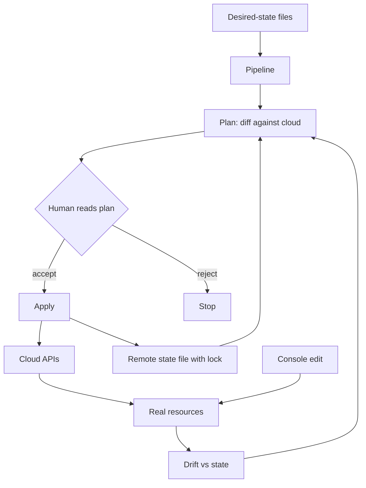

Clicking a cloud console is a deploy you cannot review, replay, or roll back as a unit. Infrastructure as code is the decision to describe the desired state of networks, machines, identities, and managed services in files, then let a tool converge the real world toward those files. The files are the design. The cloud is a cache of what was last applied.

The useful tools are declarative. You write what should exist: this VPC, this instance type, this IAM role, this database class. The tool computes a plan — create, update, delete — and, if you accept, applies it. Imperative scripts (`aws ec2 create-...` in a loop) can build a thing once. They do not converge. Run them twice and you get two things, or an error, or a snowflake. Declarative is how you make Monday's cluster match the repo on Friday.

Two objects make or break this: the plan you read before you apply, and the state file that records what the tool thinks it owns. Drift is the world changing outside the tool. The state file is a secret. It holds resource ids, and often enough it holds data that would let someone destroy or take over those resources. Treat it like production credentials, not like a build log.

You can write application code and still treat infrastructure as a one-time setup. That setup will rot. IaC is how the platform stays a product with a version.

## Concept

### Desired state, plan, apply

You describe resources in a language the tool understands: Terraform HCL, CloudFormation YAML, Pulumi in a general-purpose language, Bicep, and cousins. The engine walks the graph of references (this subnet belongs to this VPC; this instance needs this role) and asks the cloud APIs what exists. The plan is the diff. You read the plan. You apply. Apply is the only path that should create production infrastructure.

Reading the plan is a skill. A one-line change in a module can replace a database. Replacement is destroy-and-create unless the provider can update in place. Forced replacement of a stateful resource is a migration, not a tweak. If the plan says `force new resource` on a disk or a cluster, stop. The tool did what you asked. You asked for something dangerous.

Modules and stacks keep the graph human. One root module that owns the entire company is unreviewable. Split by blast radius: network, identity, data, app. Apply identity before app. Never let an app stack be allowed to destroy the network by accident; use separate state and separate credentials. The blast radius of an apply is the blast radius of the credentials plus the resources in that state.

### State is ownership

The state file maps your named resources to cloud ids. Without it, the tool cannot know which of twelve "similar" databases is the one in the file. Remote state (S3, Terraform Cloud, a backend the vendor names) plus locking is the minimum for a team. Two applies at once, without a lock, corrupt ownership. You will spend a day attaching the real world back to the file.

State contains secrets even when you did not put `password =` in the file. Providers store attributes. Some of those attributes are connection strings, generated keys, or private IPs you did not want in git. Encrypt the backend. Restrict who can read the state object. Do not commit it. Do not paste it into a ticket. Rotation of a leaked state is "assume every secret the provider wrote is burned."

Import and refactor exist because state is a living object. You can change a resource address in the file and lose the mapping, which the next apply will interpret as "delete the old, create the new." State moves are first-class operations. Treat a rename as a migration. Run the plan and look for unexpected destroys.

### Drift

Someone changed a security group in the console during an incident. The next apply reverts it, or the next plan is a surprise, or the tool and the console now disagree and both look "correct" to different people. Drift is any change not made through the desired-state file.

Detection is `plan` on a schedule with no pending git change: if the plan is not empty, the world moved. Policy is what you do next. For production, I want the console locked down so that only the pipeline's identity can write the resources the stack owns, with a break-glass role that is alarmed. If you allow day-to-day console edits, you do not have IaC. You have documentation that sometimes wins.

Not all drift is malice. Cloud autoscaling, managed backups, and provider-side defaults will change attributes. The file must express the attributes you care about and ignore the ones you do not, or every plan is noise. Noise trains people to apply without reading.

### Pipelines, not laptops

Apply from CI with short-lived credentials, a recorded plan, a required review on destroy-heavy plans, and a log. Apply from a laptop is how an engineer's local module cache and an extra environment variable take down a region. The pipeline is the same idea as application CD: the thing you reviewed is the thing that ran.

Workspaces or separate state files per environment (dev, staging, prod) keep a "tiny" experiment from targeting prod. Naming is not isolation. Credentials are isolation. The prod backend and the prod cloud account should be unreachable from a developer workstation's default role.

## Trade-offs

| Approach | When it wins | Cost / risk |
| -------- | ------------ | ----------- |
| Console only | Spike, throwaway account, first hour of a prototype | No review, no replay, drift is the process |
| Imperative scripts | One-shot bootstrap, glue the declarative tool cannot express | Not convergent; reruns duplicate or fail |
| Declarative IaC with remote state and lock | Any shared environment that must last | State is a secret; plans can destroy; learning cost |
| One giant state for the company | Tiny org, few resources | Any apply can touch everything; reviews are theater |
| Apply from laptops | Emergencies, very small teams | Unreproducible, unauditable, easy to target the wrong account |

Declarative IaC is heavier than a script until the second change. The second change is when scripts lie. Pay the cost when more than one person will touch the system, or when the system must exist in two environments, which is almost immediately.

Split state by blast radius even when the team is small. A database stack that cannot be applied by the frontend pipeline is a feature. Convenience of "one apply" is how a typo in a tag takes down a NAT gateway.

Ignoring drift is a choice to let the console be the real source of truth. That choice is valid for a lab. It is not valid for a regulated production account. If you need a console change in an incident, make it, then immediately capture it in the file, or you will revert it at the next pipeline run and cause a second incident.

## Diagram

## Failure modes

### State file treated as a build artifact

State sits in git, or in an open bucket, or on a laptop. It contains resource ids and leftover secrets. A leak is a map of the production estate. A git revert of the state file desynchronizes ownership: the next apply may try to create resources that exist or destroy resources that are still in the cloud.

**Detection.** State files in git history. Bucket ACLs that are public or too wide. Backends without encryption or without lock. Engineers with state on disk in a zip from last quarter. A plan that wants to create everything because state was lost. If you can `curl` the state, it is already a secret incident.

**Mitigation.** Remote backend, encryption, tight IAM, lock, no git. Backup the state with the same care as a database. Practice restore. Rotate credentials if state leaked. Add a policy that fails CI if a local state file is committed. Split state so a leak of the app stack is not a leak of org-wide identity.

### A plan that replaces stateful resources

A parameter change looks cosmetic. The provider cannot update in place. The plan destroys the database and creates a new empty one. Someone applies because the rest of the plan was tags.

**Detection.** Plan output that includes destroy or force-new on databases, disks, clusters, or queues with data. A module upgrade that changed a resource identifier. Tests that only apply empty workspaces. If your pipeline can apply a destroy of prod data without an extra approval, the detection is the outage.

**Mitigation.** Separate stacks for stateful resources. Require a second reviewer, or a dedicated "allow destroy" signal, when the plan contains deletes of those types. Read every plan. Run apply with `-target` only as a last resort; targeting hides graph effects. Prefer blue-green data stores over in-place replacement. Test module upgrades in a clone of prod topology, not in a toy VPC.

### Drift and console cowboy changes

An incident fix in the console opens a port. The pipeline later closes it. Or the pipeline never runs, the file is a lie, and the next engineer applies a month of pent-up diffs at once.

**Detection.** Scheduled plans that are not empty. Cloud audit logs showing writes from human users to resources a stack owns. Security group rules that exist only in the console. A culture of "just tweak it, we'll terraform later." Later is how later never happens.

**Mitigation.** Deny human write on production resources except a break-glass role with alarms. Pipeline applies on a cadence even when git did not change, so drift becomes a failing job. If you change the console in an incident, the incident is not closed until a matching git change has applied. That is the definition of closed.

### Credentials on the laptop, targeting the wrong account

A default AWS profile points at prod. An engineer runs apply from a branch that was meant for a sandbox. Or a personal access token can create IAM users.

**Detection.** Cloud trails that show applies from user identities instead of the pipeline role. Resources tagged with a sandbox module in a prod account. Missing account-id guards in the configuration. If the tool does not check "am I in the account I think I am," the human will eventually not be.

**Mitigation.** Pipeline-only credentials for prod, account-id assertions in the code, separate backends per environment, no long-lived keys on laptops. Workspaces are not enough. Different cloud accounts are enough. A `prevent_destroy` lifecycle on irreplaceable resources is a seatbelt, not a substitute for reading the plan.

## Real-world example

HashiCorp Terraform made the plan/apply/state loop the default language for a generation of cloud teams. HashiCorp's own documentation is explicit that remote state can contain sensitive values and must be access-controlled, and that locking exists because concurrent writes corrupt the map from file to cloud. Those two sentences are the product. Teams that used Terraform as "a nicer CLI" and committed `terraform.tfstate` to a public repo learned them as an incident.

AWS CloudFormation is the same idea with the state held inside the service as a stack: desired template, changeset (the plan), execute. Google Cloud Deployment Manager and Azure Resource Manager templates occupy the same niche. The vendor differs. The failure modes do not: a stack that owns a database, a change that forces replacement, a human who did not read the changeset.

When I introduce IaC to a team that lives in the console, I do not wrap the entire estate on day one. I pick one blast radius (the app's IAM and its compute), put remote state and a pipeline around it, lock the console on those resources, and practice a plan that people actually read. Then we import the next blast radius. A giant rewrite of every click into HCL, applied once from a laptop, is how you get a spectacular first outage and a story that "IaC is dangerous." IaC is dangerous when the apply is.

## What to remember

- Declarative desired state plus plan/apply is how infrastructure converges; imperative scripts do not.
- The state file is a secret and the lock is what keeps two applies from lying about ownership.
- Drift is any change outside the file; either the pipeline owns writes, or the file is documentation.
- A plan that replaces stateful resources is a migration; read it, split the stack, and do not apply on hope.
