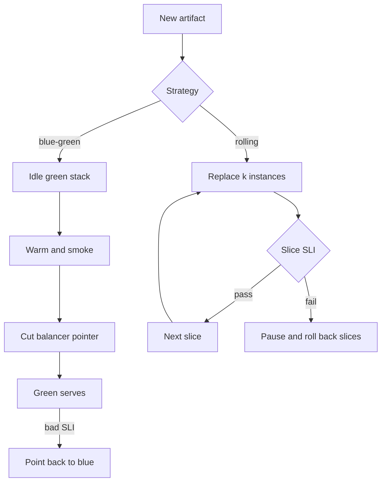

Shipping a new version is a traffic problem and a compatibility problem before it is a ceremony. Two families of solution dominate production: blue-green, where you run two full stacks and cut a pointer, and rolling, where you replace a slice of the fleet at a time until the old version is gone. Both exist because "stop the world, copy files, start" does not meet availability targets, and because humans are slow at noticing that the new version is wrong.

Blue-green costs a second environment. The cut is a router change: load balancer, DNS, a Kubernetes Service selector, a feature flag in front of two clusters. Rollback is the same change in reverse, if the old stack is still healthy and the data still fits it. Rolling costs mixed versions. For a while, N and N+1 both serve. If they cannot, you did not have a rolling deploy. You had a partial outage.

Neither strategy repairs a bad migration. If the new code requires a schema the old code cannot read, a green cut or a half-rolled fleet will still fail, just on different timelines. Version compatibility is the tax you pay for not taking the site down. Pay it in the data model, not in hope.

You can write the feature and still not operate the cut. Operating the cut means knowing where the pointer lives, how long mixed versions last, and what "roll back" actually restores.

## Concept

### Blue-green: two stacks, one pointer

Call the live stack blue and the idle stack green (Netflix often said red/black for the same idea). You deploy the new version to the idle stack, warm it, run smokes, then point traffic at it. The old stack stays up until you are sure. Rollback is pointing back. The idle stack must be a real stack: same capacity class, same data path, same config shape, not a starved staging box that will melt when it becomes live.

The pointer is the design. A load-balancer target group swap is fast and usually consistent. DNS is slow and cached; I will not use DNS as the only cut for a latency-sensitive service. A Kubernetes Service selector change is a pointer. An API gateway route is a pointer. Two pointers (DNS and a gateway) that you forget to move together are a split-brain.

Warming matters. A green stack with cold caches, empty connection pools, and JIT-cold processes will look healthy on `/health` and fail the first real burst. Send synthetic or mirrored traffic before the cut, or accept that the cut includes a cache-fill incident. Drain the old stack after the cut: existing connections finish, then you stop the processes. Cutting without drain drops in-flight work.

Capacity is the bill. Two full stacks means you pay for peak twice during the window, or you scale green up and blue down in a coordinated way, which starts to look like a rolling deploy with extra steps. For heavy stateful systems, a full second data store is rare; more often the two stacks share a database. Shared data is where blue-green stops being "instant rollback." If green migrated the schema, blue may not be able to come back.

### Rolling: replace a slice

You take k instances out, replace them with the new version, wait for health, repeat. Kubernetes Deployments do this with `maxUnavailable` and `maxSurge`. Load-balancer pools do it with instance refresh. The user always has somewhere to go, as long as remaining capacity holds. The user may hit old or new on consecutive requests. Session stickiness hides that until it does not.

Compatibility is mandatory. API fields, database schema, cache keys, message formats: N+1 must accept what N wrote, and N must tolerate what N+1 wrote, or you must sequence the change (expand, roll, contract). A rolling deploy of an incompatible protocol is how you get 5% error forever until the roll finishes — or 100% if the first slice poisons a shared store.

Health gates decide whether the roll continues. If you roll on "the process is up," you will complete a 100% bad deploy efficiently. Gate on the user SLI for that slice: error rate, latency, a canary metric. Pause automatically. Humans approve a resume only if the metric is a known false alarm. A roll that cannot pause is a timed bomb.

Surge capacity is the other bill. `maxSurge: 25%` needs 25% extra headroom. `maxUnavailable: 25%` needs to survive 25% less capacity. Pick one to be small if you are near the load limit. Rolling during peak without headroom is a self-inflicted brownout.

### Where canaries sit

A canary is a tiny rolling deploy with extra measurement, or a blue-green where green gets 1% of traffic. It is not a third family as much as a traffic fraction. Use it when the failure is rare or user-specific. Do not use it as the only test of a migration that poisons data at 1% as thoroughly as at 100%. Data poison is binary. Traffic fraction is not a defense.

## Trade-offs

| Approach | When it wins | Cost / risk |
| -------- | ------------ | ----------- |
| Recreate (stop all, start new) | Tiny services, no HA target, incompatible versions | Downtime; no gradual signal |
| Rolling replace | Stateless replicas, compatible N and N+1, limited extra capacity | Mixed versions; slow to reverse if you detect late |
| Blue-green cut of a pointer | Need fast rollback, can pay for two stacks, want no mixed serving | Double compute; shared data still binds you; two pointers drift |
| Canary fraction then roll | Rare bugs, user-cohort risk, good SLI on the slice | Weak against data-poisoning changes; measurement must be real |
| DNS as the only cut | Coarse, high-TTL-tolerant systems | Caches delay both cut and rollback |

Rolling is the default for a Deployment of stateless APIs because it is built in and cheap on capacity. Blue-green is the default when rollback must be a single switch and you can afford the idle stack — or when mixed versions are forbidden and you still cannot take downtime. Recreate is honest when you cannot be compatible; it is better than a rolling deploy that lies.

DNS cuts fail in a specific, repeated way: some clients keep the old answer. You think you rolled back. They did not. Use DNS to find a balancer; cut at the balancer.

Shared databases make every strategy more similar than slides suggest. If both colors write the same rows, rollback is a data question. Solve it with expand-contract migrations, or accept roll-forward only, and do not advertise "instant blue-green rollback" in the runbook.

## Diagram

## Failure modes

### Mixed versions that are not compatible

A rolling deploy ships a code path that writes a new JSON field a remaining old instance cannot parse, or a schema that drops a column the old binary still selects. Errors track the roll. Rollback of the code leaves the new rows in place.

**Detection.** Error rate that steps up every time a slice completes. Version headers in logs that show old instances failing after new instances wrote. A migration in the same pipeline as the binary that requires it. If staging only ever ran one version, you never saw this.

**Mitigation.** Expand-then-contract. Deploy code that reads both shapes, then migrate, then remove the old path. Forbid destructive schema in the same release as the code that needs it. Test N against N+1 traffic in staging. If you cannot, use blue-green only after the migration is backward compatible, or take a recreate window you admit in public.

### Blue-green with a stale or shared pointer

You cut the load balancer. CDN or DNS still points at blue. Or you have two gateways and someone updated one. Users split. Rollback updates the balancer you are looking at. The other one keeps shipping green.

**Detection.** Access logs on both stacks after a supposed 100% cut. Metrics that do not invert when you "roll back." TTL remaining on DNS. A runbook with two pointers and a checkbox nobody checks. Compare client-seen IPs to the stack you believe is live.

**Mitigation.** One authoritative pointer per product. Everything else CNAME or forwards to it. Drain and watch both stacks' QPS after a cut; the old stack should fall to near zero except health checks. Do not use DNS as the cut. Keep the old stack until QPS and SLI agree.

### Rolling through a bad version because the gate was "process up"

All replicas restart. All of them are ready. All of them 500 on the money path. The Deployment reports successful rollout. Rollback now means rolling the other direction through the same pain, unless you still have the previous ReplicaSet scaled up.

**Detection.** A completed rollout coincident with an SLI cliff. Readiness probes that do not hit the user path. `maxUnavailable: 100%` or a surge that replaced everything before a human blinked. If the previous ReplicaSet was garbage-collected, rollback is a new deploy of an old digest — slower, easy to get wrong.

**Mitigation.** Gate on the journey SLI and on a canary slice. Keep previous ReplicaSets. Set surge and unavailable so you cannot replace the whole fleet in one step. Auto-pause. Practice rollback until it is faster than the argument about whether to rollback.

### Cold green and cache stampedes

The cut looks clean. Green has empty caches. Database load spikes. Tail latency explodes. You cut back to blue, which is now also cold if you drained it, or you stay on green and ride out a self-inflicted incident.

**Detection.** Latency and datastore QPS spikes in the minute after the pointer moves, with healthy green process metrics. Cache hit rate near zero. Connection pool exhaustion. A smoke test that only hit `/health`.

**Mitigation.** Warm caches with replay or synthetic traffic. Pre-open pools. Cut in fractions even for blue-green (1%, 10%, 100%) if the store cannot take a full cold start. Do not drain blue until green's hit rate and SLI are boring. Capacity-test green at production QPS before the cut, not after.

## Real-world example

Netflix described red/black deployments as a pair of clusters and a traffic switch: push the new code to the idle color, verify, flip, keep the old color until the new one proves itself. That is blue-green with Netflix's color names. They invested in it because rollback had to be a switch, not a rebuild, at their deploy rate. Spinnaker encoded those strategies so the switch was a pipeline stage, not a tribal command.

Kubernetes made rolling the default the rest of the industry actually runs: a Deployment replacing Pods under a Service. The compatibility tax showed up immediately in every shop that shipped schema and code together. The SRE pattern that survives both companies is the same: pick a strategy that matches your compatibility story, measure the cut with a user SLI, and keep a rehearsed reverse move. The color names do not matter. The pointer and the mixed-version window do.

When I choose for a stateless API, I roll with a canary slice and a pause. When I choose for a change that cannot mix, I stand up a second stack, warm it, and cut a balancer, with the old stack left running until the SLI is dull. When the database cannot go backward, I say roll-forward in the runbook before the deploy, not during it.

## What to remember

- Blue-green runs two full stacks and cuts a pointer; rollback is reversing that pointer if data still allows it.
- Rolling replaces a slice at a time; mixed versions must be compatible or the roll is an outage in slow motion.
- Gate the cut on a user SLI, not on "the process is up," and keep the previous artifact installable.
- Shared data, DNS caches, and cold caches turn a clean diagram into the incident; design those three explicitly.
