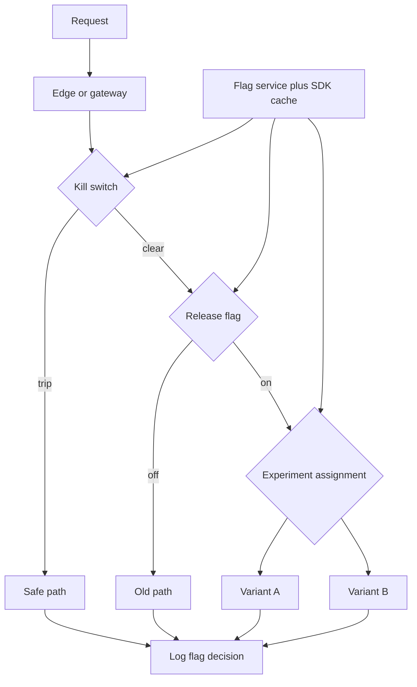

A feature flag is a runtime branch you can change without shipping a binary. That sentence is the whole appeal and the whole hazard. You decouple deploy from release: the code can sit dark in production, then light up for one user, one percent, or everyone. You also add a second product — the flag system — whose states multiply with every flag you do not delete.

Not all flags are the same. A release flag hides unfinished work on trunk so CI can stay honest. An experiment flag splits traffic for a measurement. A kill switch turns a dependency or a feature off when it is on fire. Using one mechanism for all three is fine. Using one lifecycle for all three is how a kill switch becomes a permanent A/B test becomes an undocumented fork of the business.

Flags that never die become a second product. Each flag is a dimension. Ten never-removed flags is a thousand theoretical worlds, of which a dozen are actually running, none of them documented. On-call debugs the world they cannot name. Product thinks the old checkout is gone. It is not. It is `checkout_v2=false` for a cohort nobody remembers.

You can ship code all day and still not operate flags. Operating them means a registry, an owner, an expiry, and a removal PR that is part of the feature, not a hope.

## Concept

### Release, experiment, kill switch

A release flag is a temporary door. The code merges to trunk in a safe state (usually off). You deploy whenever CI is green. You open the door when the feature is ready, in a slice, then for everyone. Then you delete the door. The deletion is the end of the release. If you leave the flag, you did not finish the release; you invented a configuration bit.

An experiment flag is a measurement instrument. It assigns users to variants with a sticky hash, emits events, and exists until the experiment has a result or a stop rule. It is not how you hide an incomplete feature (that is a release flag). Combining them — "we'll A/B the unfinished thing" — poisons both the experiment and the trunk.

A kill switch is an emergency brake: stop calling the recommender, skip the new tax path, disable uploads. It must default to safe if the flag service is down, be evaluable in milliseconds, and be operable by on-call without a deploy. A kill switch that requires a code push is not a kill switch. A kill switch that defaults to "on" when Redis is empty will turn an outage of the flag store into a product outage of a different kind — or into a stampede of the dangerous path.

Evaluation order matters. Kill switches first, then release, then experiment. A user who is kill-switched off should not still be in the experiment for that feature. Log the decision: flag name, variant, reason. Debugging without that log is guessing which world the user was in.

### Where the bit lives

Flags can be a config file, an env var, a database row, or a dedicated service. Files and env vars require a deploy or a restart; they are acceptable for rare kill switches at the edge, not for per-user experiments. A dedicated service (LaunchDarkly-style, or an in-house equivalent) evaluates per request with targeting rules: user, cohort, percentage, region. The app should SDK-cache those rules so the flag service dying does not mean the app dying. Stale cache with a TTL and a last-known-good is the usual contract.

Do not evaluate flags only in the client if the server must enforce them. A mobile app can hide a button. The API still needs to reject the path. Client flags are UX. Server flags are the control. Both, when the surface is both.

Targeting should be boring: user id hash for percentages, explicit allowlists for internal testers, environment as a dimension. Targeting on "is the user's email in this spreadsheet" does not belong in the hot path. Targeting on high-cardinality custom attributes that you change per request will make the flag service into a database you did not plan to run.

### Lifecycle, or the combinatorial tax

Every flag needs: owner, purpose (release, experiment, kill), default, expiry date, and a removal ticket opened when the flag is created. Release flags die in days or weeks. Experiments die when the result is in. Kill switches may live, but they should be few, named as such, and tested in game days. A quarterly sweep that does not remove flags is a museum.

Removal is a code change: delete the branches, delete the flag, deploy. If the "off" path has bit-rotted, removal will be an incident. Keep the off path compiling and, until removal, occasionally exercised, or delete faster. Feature-flagged code that is never run in one variant is untested code. Your CI should run both sides for flags that still exist, or you are testing a coin flip.

### Consistency in distributed systems

A user who hits two services may see two variants if each evaluates independently and the flag changed mid-request, or if hashes differ. For experiments, stickiness is part of validity. Pass the variant in the request context from the edge, or evaluate once at the gateway. For kill switches, eventual consistency of "off" is usually acceptable; a few extra calls to a dying dependency beat a split brain that never converges. Decide which flags need strongly consistent evaluation. Most release flags do not. Billing and permission flags might; those may not belong in the flag product at all.

## Trade-offs

| Approach | When it wins | Cost / risk |
| -------- | ------------ | ----------- |
| Deploy equals release (no flags) | Tiny surface, no trunk-based hiding | Incomplete work lives on branches; rollback is a revert |
| Config-file or env flags | Rare, coarse kill switches | Restart to change; no per-user targeting |
| Server-side flag service with cached SDK | Release slices, experiments, on-call kills | Second product; outage modes; flag sprawl |
| Client-only flags | Cosmetic UI | Users bypass; server still serves the path |
| Flags without expiry or owners | Fast local shipping | Combinatorial product; untestable matrix; zombie features |

Flags are how trunk-based development stays honest. Without them, people hide work on long branches and call it process. With them unmanaged, people hide work in production forever and call it flexibility. The cost of a flag service is justified when you actually slice releases and run experiments. It is not justified as a junk drawer for every boolean a product manager might want to flip later.

Client-only flags are a UI convenience. If the feature has a server effect, the server decides. Otherwise you will debug "ghost" usage from old app versions that never heard the flag died.

Default-on versus default-off when the store is unreachable is a design choice you write down per flag class. Kill switches default to the safe product behavior. Release flags default to off (the old path). Experiments default to the control. If every flag defaults to the last cached value, say how old that cache may be.

## Diagram

## Failure modes

### Flags that never die

A year of release flags remains. Some default on, some off, some percentage. Nobody knows the intended matrix. A "cleanup" PR that removes a flag takes down a cohort that still needed the off path. Or the off path is already dead and nobody noticed.

**Detection.** Flag count, age, last-touch date, owners that have left the company. Code references to flags that are 100% on for everyone. Experiment platforms whose tests ended months ago. If you cannot list flags older than 90 days with an owner, you are already in the second product.

**Mitigation.** Expiry as a required field. Automated nag, then automated fail of CI for expired release flags. Removal PRs estimated as part of the feature. Sweep with the same seriousness as dependency upgrades. Promote the rare true long-lived toggle into real configuration or a kill-switch registry, not a leftover experiment.

### Flag service outage flips the product

The SDK cannot reach the store. Defaults kick in. Every user gets the new checkout, or nobody gets login MFA, depending on a boolean you picked in a hurry. Traffic to a half-built path spikes. Or every kill switch "opens" because the default is fail-open.

**Detection.** Error rates correlated with flag-service latency or 5xx. Sudden 100% assignment to a variant. Cache expiry storms. On-call who cannot change a flag because the console is the same down system. Synthetic evaluation of a known flag from the app.

**Mitigation.** Local cache with last-known-good, long TTL for kill and release rules, explicit defaults per class, the app still serving if the flag process is dead. A break-glass file or env on the edge for the few true kill switches. Do not put the flag service on the same critical path cluster without a cache. Game-day the store being down.

### Inconsistent assignment and polluted experiments

The same user sees different variants across devices, retries, or microservices. Experiment results are noise. Support cannot reproduce. A percentage rollout is not sticky, so a user flips on every request and corrupts state that assumed one world.

**Detection.** Event streams where a user id has multiple variants in a short window. Services that hash different keys (session versus user versus IP). Client and server disagreeing. Stateful features (cart, billing) with percentage flags evaluated per call.

**Mitigation.** Sticky hashing on a stable id, evaluate once per request at the edge, propagate the decision. For stateful features, prefer allowlists and staged release flags over per-request dice rolls. Do not experiment on the payment write path unless you can name the consistency model. Log the variant on every event the experiment cares about.

### A flag that is the only copy of a security decision

Authorization, pricing, or "this customer is allowed" lives in a flag UI. Someone with flag-console access grants a permission that the identity system would not. Audit trails skip it. Offboarding a user does not flip the flag.

**Detection.** Privileged behavior that does not appear in IAM or billing systems. Flag rules with individual user ids that look like an ACL. Console access broader than production SSH. Incidents where "we turned them off in LaunchDarkly" was the access-control design.

**Mitigation.** Flags may gate unfinished features. They are not the source of truth for authz or money. Put those decisions in the identity and billing systems. Restrict who can change targeting. Audit flag changes as production changes. Review allowlists like you review IAM.

## Real-world example

Facebook's Gatekeeper was the widely described internal system that let engineers ship code dark and open it to employees, percentages, then the world — a release flag service at company scale. The public engineering conversation around Gatekeeper, and around similar systems at other large product companies, is consistent: flags made trunk-based development possible, and the inventory of flags became an operational problem of its own. Experimentation platforms (the lineage that includes the papers and systems behind large-scale A/B testing at internet companies) added assignment, stickiness, and analysis. Those are different jobs that often share a delivery pipe.

LaunchDarkly and its peers productized the evaluation service so teams that are not Facebook-sized could still split deploy from release. The architectural lesson does not depend on the vendor: evaluate on the server for anything that matters, cache so the vendor outage is not your outage, and delete the flag. Companies that imported the UI and not the lifecycle grew a shadow product of booleans.

When I add flags to a team that currently uses long-lived branches, I start with release flags that have a 14-day expiry, one kill switch for the riskiest dependency, and no experiments until assignment is sticky and logged. The first removed flag is the proof the process works. The first flag that turns a year old is the proof it does not.

## What to remember

- Release flags hide unfinished work, experiment flags measure, kill switches stop a fire; they share a mechanism, not a lifecycle.
- Flags that never die become a second product; give every flag an owner, a purpose, and an expiry, then delete it.
- Evaluate on the server for anything with a server effect, cache last-known-good, and log the decision on the request.
- Do not store authorization or billing truth in the flag console; that console is a ship switch, not an IAM system.
